# JavaScript数据结构和算法

## (一) 邂逅数据结构与算法

### 1. 编程尽头、数据结构

#### 1.1 为什么需要学习数据结构与算法？


#### 1.2 编程的真相 – 数据的处理

+ 在前面的课程中我不断的强调一个编程的真相：对数据的操作和处理
+ 编程的最终目的只有一个：对数据进行操作和处理
  + 评判编程能力、水平的高低，要看你`是否可以更好的操作和处理数据`
  + 在之前的很多课程中，我经常和同学们强调一个事实：所以的编程（无论是前端、后端、算法、人工智能、区块链，也不论是什么语言JavaScript、Java、C++等等）最终的目的都是为了处理数据
+ 当你拿到这些数据时，以什么样的方式存储和处理会更加方便、高效，也是评判一个开发人员能力的重要指标（甚至是唯一的指标）
  + 虽然目前很多的系统、框架已经给我们提供了足够多好用的API，对于大多数时候我们只需要调用这些API即可
  + 但是`如何更好的组织数据和代码`，以及`当数据变得复杂`时，`以什么方式处理这些数据`依然非常重要
  + 只有可以更好的处理数据，你才是一个`真正的开发工程师`，而不只是一个API调用程序员
+ 以前端、后端为例：
  + 前端从后端获取数据，对数据进行处理、展示
  + 和用户进行交互产生新的数据，传递给后端，后端进行处理、保存到数据库，以便后续读取、操作、展示等等

#### 1.3 数据结构与算法的本质

> 数据结构与算法的本质就是一门专门研究数据如何组织、存储和操作的科目

+ 甚至Pascal之父——尼古拉斯赵四说过：
  + `Nicklaus Wirth`凭借一个`公式获得图灵奖`
  + `算法 + 数据结构 = 程序（Algorithm+Data Structures=Programs）`
+ 所以数据结构与算法事实上是程序的核心，是我们编写的所有程序的灵魂


+ 勿在浮沙筑高台
  + 只有掌握了扎实的数据结构与算法，我们才能更好的理解编程，编写扎实、高效的程序
  + 包括对于程序的理解不再停留于表面，甚至在学习其他的系统或者编程语言时，也可以做到高屋建瓴、势如破竹

### 2.  数据结构与算法的应用

#### 2.1 学习数据结构与算法到底有什么实际应用？

+ 只要是已经接触或者即将接触编程的人，都会或多或少的听说过数据结构与算法，也有很多人可以直接说出几种耳熟能详的数据结构
  + 很多计算机专业的同学，在大学也是学习过《数据结构》这门课程的
  + 但是对于很多同学来说，平时学习或者工作来说，好像很少直接用到或者直接接触到数据结构与算法
  + 事实上数据结构与算法是无处不在的
+ 系统、语言、框架源码随处可见数据结构与算法：
  + 无论是操作系统（Windows、Mac OS）本身，还是我们所使用的编程语言（JavaScript、Java、C++、Python等等），还是我们在平时应用程序中用到的框架（Vue、React、Spring、Flask等等），它们的底层实现到处都是数据结构与算法，所以你要想学习一些底层的知识或者某一个框架的源码（比如Vue、React的源码）是必须要掌握数据结构与算法的
  + 以前端为例：框架中大量`使用到了栈结构、队列结构`等来解决问题（比如之前看框架源码时经常看到这些数据结构，Vue源码、React源码、Webpack源码中可以看到队列、栈结构、树结构等等，Webpack中还可以看到很多Graph图结构）
  + `实现语言或者引擎本身也需要大量的数据结构`：哈希表结构、队列结构（微任务队列、宏任务队列），前端无处不在的数据结构：DOM Tree（树结构）、AST（抽象语法树）

#### 2.2 Vue源码中的数据结构

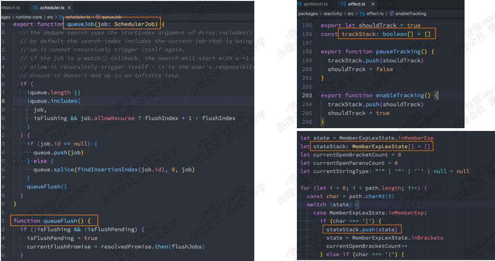

#### 2.3 React、Webpack源码中的数据结构

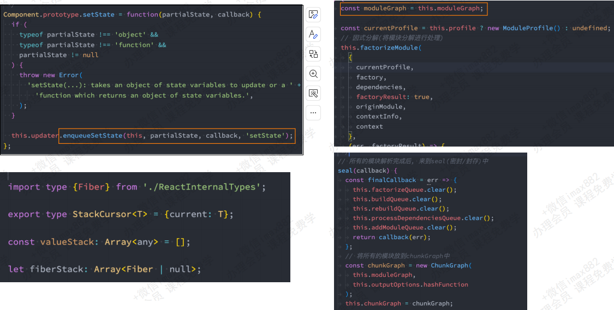

#### 2.4 Homebrew作者被Google拒绝

+ 互联网大厂、高级岗位面试都会要求`必须要掌握一定的数据结构与算法`
+ Mac上非常知名的工具homebrew的作者Max Howell曾经去Google面试，Google要求它写一个《反转二叉树》的算法（课堂会讲到），但是因为没有写出所以被拒绝了
  + 当然这件事本身可能会让我们唏嘘：一些人才因为对于数据结构与算法的掌握不够被埋没
  + 但是从侧面也能反应对于很多互联网大厂（无论是国内外的大厂）对于数据结构与算法的重视程度


#### 2.5 互联网大厂、高级岗位面试

+ 因为对于很多企业来说，想要短时间考察一个人的能力以及未来的潜力，数据结构与算法是非常重要指标，也会成为它们的硬性条件
  + 对于可以将数据结构与算法掌握很好的开发人员来说，通常对于业务的把握肯定是没有问题的
  + 并且对于系统的设计也会更加合理，可以写出更加高效的代码
+ 对于想要进入大厂的同学，经常会`刷leetcode`
  + 但是对于大多数同学来说，leetcode上的题目晦涩难懂，代码无从下手，不会解题
  + 只有系统的掌握了数据结构与算法，才能将这些题目融会贯通，面试遇到相关的题目就可以对答如流
+ 逻辑思维、代码能力提升离不开对于数据的处理
  + 我们已经强调了所有的编程最终的目的都是`为了处理数据`
  + 而数据结构与算法就是一门专为讲解数据应该`如何存储、组织、操作的课程`
  + 所以学习数据结构与算法可以更好的`锻炼我们的逻辑思维能力和代码编程能力`，帮助我们平时在处理一些复杂数据时，可以更好的编写代码，写出更高效的程序
+ 并且掌握数据结构与算法后，如果想要转向其他的领域（比如从前端转到后端、算法工程师等）也会更加容易
  + 因为所有的编程思想都是想通的，只是`换了一种语言来处理数据`而已
  + 对于未来更多的领域，比如`人工智能、区块链，数据结构与算法也是它们的基石`，是必须要掌握的一门课程

### 3. 如何学习数据结构算法？

+ 数据结构与算法通常被认为 晦涩难懂、复杂抽象，对于大多数人来说学习起来是比较困难的
+ 那么通常学习数据结构与算法有哪些方式呢？

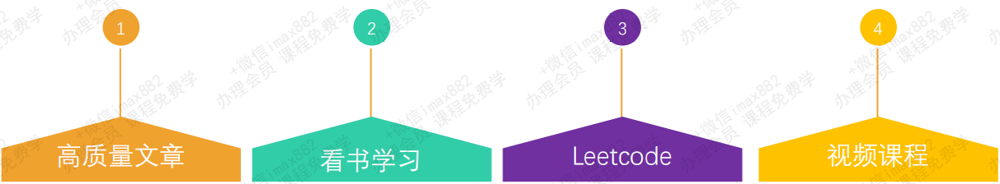

### 4. 到底什么是数据结构？

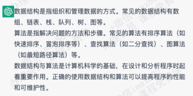

+ 非官方较为标准的定义

  + 数据结构是数据对象，以及存在于该对象的实例和 组成实例的数据元素之间的各种联系。这些联系可以通过定义相关的函数来给出。 --- 《数据结构、算法与应用》
  +  数据结构是ADT（抽象数据类型 Abstract Data Type）的物理实现。 --- 《数据结构与算法分析》
  + 数据结构（data structure）是计算机中存储、组织数据的方式。通常情况下，精心选择的数据结构可以 带来最优效率的算法。 ---  中文维基百科

+ 我们还是从 自己的角度 来认识数据结构吧

  + 数据结构就是 在计算机中，存储和组织数据的方式
  + 我们知道，计算机中数据量非常庞大，如何以高效的方式组织和存储呢？
  + 这就好比一个庞大的图书馆中存放了大量的书籍，我们不仅仅要把书放进入，还应该在合适的时候能够取出来

+ 我们从摆放图书说起：

  + 如果是自己的书相对较少，我们可以这样摆放

    

  + 如果你有一家书店，书的数量相对较多，我们可以这样摆放

    

  + 如果我们开了一个图书馆，书的数量相当庞大，我们可以这样摆放

    

  + 图书摆放规则

    1. 图书摆放要使得两个 相关操作 方便实现：
       + 操作1：新书怎么插入？
       + 操作2：怎么找到某本指定的书？
    2. 方法1：随便放
       + 插入操作：哪里有空放哪里，一步到位！
       + 查找操作：找某本书，累死。。。
    3. 方法2：按照书名的拼音字母顺序排放
       + 插入操作：新进一本《阿Q正传》《理想国》，按照字母顺序找到位置，插入
       + 查找操作：二分查找法
    4. 方法3：把书架划分成几块区域，按照类别存放，类别中按照字母顺序
       + 插入操作：先定类别，二分查找确定位置，移出空位
       + 查找操作：先定类别，再二分查找

    

#### 4.1 常见的数据结构

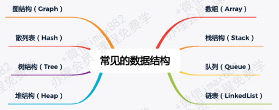

+ 那么在计算机中对于数据的组织和存储结构也会影响我们的效率
+ 常见的数据结构较多
  + 每一种都有其对应的应用场景，`不同的数据结构`的`不同操作`性能是不同的
  + 有的`查询性能很`快，有的`插入速度很快`，有的是`插入头和尾速度很快`
  + 有的`做范围查找很快`，有的`允许元素重复`，有的`不允许重复`等等
  + 在开发中如何选择，要根据具体的需求来选择
+ 注意：数据结构和语言无关，常见的编程语言都有`直接或者间接`的使用上述常见的数据结构
+ 为什么之前学习JavaScript没有接触过数据结构呢？ 好像只见过数组
  + 这是因为很多数据结构是需要再进行高阶开发（比如设计框架源码）时才会用到的
  + 设置某些数据结构在JavaScript中本身是没有的，我们需要从零去实现的
+ 你可能会想：老师，我觉得不多呀，赶紧给我们讲讲怎么用的就行了
  + 我们不是要讲这些数据结构如何用，用是API程序员的思考方式，我们要讲的是这些数据结构如何实现，再如何使用
  + 了解真相，你才能获得真正的自由

### 5. 到底什么是算法？

#### 5.1 什么是算法？

+ 算法(Algorithm)的认识
  + 在之前的学习中，我们可能学习过几种排序算法，并且知道不同的算法，执行效率是不一样的
  + 也就是说`解决问题`的过程中，不仅仅`数据的存储方式会影响效率，算法的优劣也会影响着效率`
  + 那么到底什么是算法呢？


+ 算法的定义：
  + 一个有限指令集，每条指令的描述不依赖于语言
  + 接受一些输入（有些情况下不需要输入）
  + 产生输出
  + 一定在有限步骤之后终止


+ 算法通俗理解：
  + `Algorithm`这个单词本意就是`解决问题的办法/步骤逻辑`
  + `数据结构的实现，离不开算法`

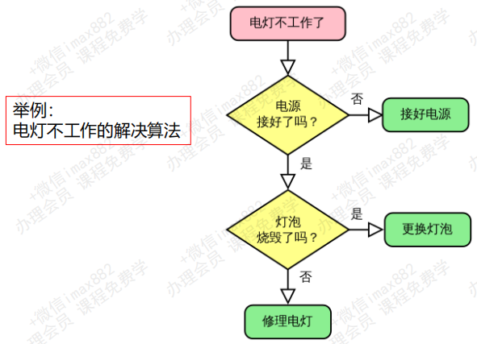

#### 5.2 生活中的数据结构与算法

+ 前面我们提了一下生活中的数据结构和算法：`图书的摆放`
  + 为了更加方便的插入和搜索书籍，需要合理的组织数据，并且通过更加高效的算法插入和查询数据
  + 除了这些，生活中还有很多案例
+ 快递员的快递
  + 大家平时都有收到过快递
  + 现在很多的快递通常情况不是送到家里的
  + 通常快递会放在某个固定的地方，让大家自己去拿
  + 当你跑到固定的地方拿快递，还有两种情况：一种自己去海量的快递中找，另一种快递员让你报出名字，它帮你找
  + 自己寻找相当于线性查找，一个个挨着看吧
    + 当然我们人类眼睛处理数据的能力非常快，眼观六路耳听八方，可能很快也能找到
  + 但是比较好的方式，应该是快递员帮我们找
    + 如果这个快递员动动脑筋的话，最好的方式是对快递进行分类，比如按照名字分类
  + 这个时候，只要你报出名字，它会根据姓氏立马锁定到某一个区域的快递中，再根据名字马上帮你找到
  + 这就体现了合理的组织数据，对于我们获取数据效率的重要性至关重要

### 6. 生活中数据结构与算法

+ 找出线缆出问题的地方：
  + 假如上海和杭州之间有一条高架线，高架线长度是1000000米，有一天高架线中有其中一米出现了故障
  + 请你想出一种算法，可以快速定位到处问题的地方


+ 线性查找：
  + 从上海的起点开始一米一米的排查，最终一定能找到出问题的线段
  + 但是如果线段在另一头，我们需要排查1000000次，这是最坏的情况。平均需要500000次


+ 二分查找：
  + 从中间位置开始排查，看一下问题出在上海到中间位置，还是中间到杭州的位置
  + 查找对应的问题后，再从中间位置分开，重新锁定一半的路程
  + 最坏的情况，需要多少次可以排查完呢？ 最坏的情况是20次就可以找到出问题的地方
  + 怎么计算出来的呢？log(1000000，2)，以2位底，1000000的对数 ≈ 20


+ 结论：
  + 你会发现，解决问题的办法有很多。但是好的算法对比于差的算法，效率天壤之别
+ 后续我们还会讲解大O表示法来评定算法的效率（这里暂时不讲）


## (二) 线性结构 – 数组

### 1. 线性结构（Linear List）

+ 线性结构（英語：Linear List）是由n（n≥0）个数据元素（结点）a[0]，a[1]，a[2]…，a[n-1]组成的有限序列
+ 其中：
  + 数据元素的个数n定义为表的长度 = “list”.length() （“list”.length() = 0（表里没有一个元素）时称为空表）
  + 将非空的线性表（n>=1）记作：（a[0]，a[1]，a[2]，…，a[n-1]）
  + 数据元素a[i]（0≤i≤n-1）只是个抽象符号，其具体含义在不同情况下可以不同
+ 上面是维基百科对于线性结构的定义，有一点点抽象，其实我们只需要记住几个常见的线性结构即可
  + 数组/链表 是一种线性结构
  + 栈/队列 是一种受限的线性结构


### 2. 数组（Array）结构

> 这里我们不再详细讲解TypeScript中数组的各种用法，和JavaScript是一致的
>
> https://developer.mozilla.org/zh-CN/docs/Web/JavaScript/Reference/Global_Objects/Array

+ 数组（Array）结构是一种重要的数据结构
  + 几乎是每种编程语言都会提供的一种`原生数据结构（语言自带的）`
  + 并且我们`可以借助于数组结构来实现其他的数据结构`，比如栈（Stack）、队列（Queue）、堆（Heap）
+ 通常数组的`内存是连续的`，所以数组在知道下标值的情况下，访问效率是非常高的；链表是在插入和删除数据的时候效率比较高

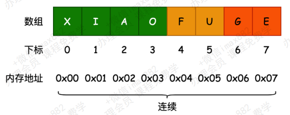

+ 后续我们在讨论数组和链表的关系区别时，还会通过大O表示法来分析数组操作元素的时间复杂度问题
+ 面试题：约瑟夫环问题  -->  使用数组(队列)、链表实现


## (三) 栈结构（Stack）

### 1. 认识栈结构和特性

>  栈也是一种非常常见的数据结构， 并且在程序中的应用非常广泛

+ 数组
  + 我们知道数组是一种`线性结构`， 并且可以在数组的`任意位置`插入和删除数据
  + 但是有时候， 我们为了实现某些功能， 必须对这种`任意性`加以`限制`
  + 而`栈和队列`就是比较常见的`受限的线性结构`， 我们先来学习栈结构
+ 栈结构示意图

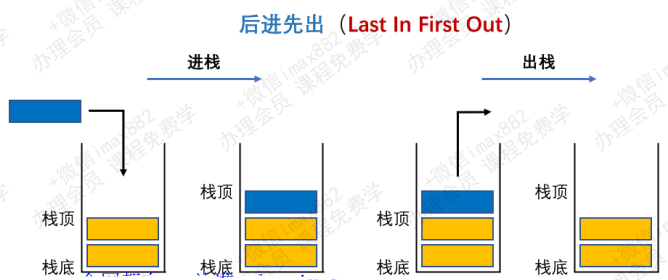

+ 栈（stack），它是一种受限的线性结构，`后进先出(LIFO)处理`
  + 其限制是仅允许在`表的一端`进行插入和删除运算。这一端被称为`栈顶`，相对地，把另一端称为`栈底`
  + LIFO(last in first out)表示就是后进入的元素， 第一个弹出栈空间。 类似于自动餐托盘， 最后放上的托盘， 往往先把拿出去使用
  + 向一个栈插入新元素又称作`进栈、入栈`或`压栈`，它是把新元素放到栈顶元素的上面，使之成为新的栈顶元素
  + 从一个栈删除元素又称作`出栈或退栈`，它是把栈顶元素删除掉，使其相邻的元素成为新的栈顶元素
+ 生活中类似于栈的
  + 自助餐的托盘， 最新放上去的， 最先被客人拿走使用
  + 收到很多的邮件(实体的)， 从上往下依次处理这些邮件。 (最新到的邮件， 最先处理)
  + 注意: 不允许改变邮件的次序， 比如从最小开始， 或者处于最紧急的邮件， 否则就不再是栈结构了。 而是队列或者优先级队列结构

### 2. 栈结构特性-面试题

**练习题：有六个元素6,5,4,3,2,1 的顺序进栈，问下列哪一个不是合法的出栈顺序？（ C ）**

A：5 4 3 6 1 2              B：4 5 3 2 1 6               C：3 4 6 5 2 1              D：2 3 4 1 5 6

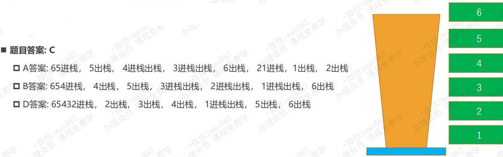

### 3. 实现栈结构的封装

#### 3.1 栈结构的实现

+ 实现栈结构有两种比较常见的方式
  + 基于`数组`实现（这种方法更好）
  + 基于`链表`实现
+ 什么是链表?
  + 也是一种数据结构，目前我们还没有学习，并且`JavaScript中并没有自带链表结构`
  + 后续，我们会自己来实现链表结构，并且对比数组和链表的区别

#### 3.2 创建栈的类

+ 我们先来创建一个栈的类，用于封装栈相关的操作

  ```typescript
  // 使用ts代码，使用ts-node插件编译代码：查看ts-node版本 (ts-node --version)
  class ArrayStack<T> {
    private data: T[] = [];
  }
  ```

+ 代码解析

  + 我们创建了一个ArrayStack，用户创建栈的类，可以定义一个泛型类
  + 在构造函数中，定义了一个变量，这个变量可以用于保存当前栈对象中所有的元素
  + 这个变量是一个数组类型
  + 我们之后无论是压栈操作还是出栈操作，都是从数组中添加和删除元素
  + 栈有一些相关的操作方法，通常无论是什么语言，操作都是比较类似的

### 4. 栈结构常见的方法 (完整封装)

+ 栈常见有哪些操作：

  + `push(element)`: 添加一个新元素到栈顶位置
  + `pop()`：移除栈顶的元素，同时返回被移除的元素
  + `peek()`：返回栈顶的元素，不对栈做任何修改（这个方法不会移除栈顶的元素，仅仅返回它）
  + `isEmpty()`：如果栈里没有任何元素就返回true，否则返回false
  + `size()`：返回栈里的元素个数。这个方法和数组的length属性很类似

+ 现在，我们可以在类中一一实现这些方法

+ 基于`数组`实现

  ```typescript
  // 02.实现栈结构(重构).ts
  interface IList<T> {
    peek(): T | undefined;
    isEmpty(): boolean;
    size(): number;
  }
  
  // 接口继承接口
  interface IStack<T> extends IList<T> {
    push(element: T): void;
    pop(): T | undefined;
  }
  
  class ArrayStack<T> implements IStack<T> {
    private data: T[] = [];
  
    // push方法：将一个元素压入栈中
    push(element: T): void {
      this.data.push(element);
    }
  
    // pop方法：移除栈顶的元素，同时返回被移除的元素
    pop(): T | undefined {
      return this.data.pop();
    }
  
    // peek方法：返回栈顶的元素，不对栈做任何修改
    peek(): T | undefined {
      return this.data[this.data.length - 1];
    }
  
    // isEmpty方法：判断栈是否为空
    isEmpty(): boolean {
      return this.data.length === 0;
    }
  
    // size方法：返回栈里的元素个数
    size(): number {
      return this.data.length;
    }
  }
  
  const stack1 = new ArrayStack<string>();
  stack1.push("aaa");
  stack1.push("bbb");
  stack1.push("ccc");
  ```

### 5. 栈面试题 – 十进制转二进制

+ 我们已经学会了如何使用Stack类，现在就用它解决一些计算机科学中的问题

+ 为什么需要十进制转二进制？

  + 现实生活中，我们主要使用`十进制`
  + 但在计算科学中，`二进制非常重要`，因为`计算机里的所有内容都是用二进制数字表示的（0和1）`
  + 没有十进制和二进制相互转化的能力，与计算机交流就很困难
  + `转换二进制是计算机科学和编程领域中经常使用的算法`

+ 如何实现十进制转二进制？

  + 要`把十进制转化成二进制`，我们可以将该`十进制数字和2整除`（二进制是满二进一），直到结果是0为止
  + 举个例子，把十进制的数字10转化成二进制的数字，过程大概是这样

  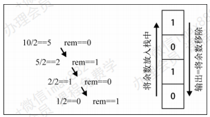

```typescript
import ArrayStack from "./02.实现栈结构(重构)";

function decimalToBinary(decimal: number): string {
  // 1.创建一个栈，用于存放余数
  const stack = new ArrayStack<number>();

  // 2.使用循环
  // while：不确定循环次数，只知道循环结束条件while循环
  // for：知道循环次数使用for循环
  while (decimal > 0) {
    const result = decimal % 2;
    stack.push(result);
    decimal = Math.floor(decimal / 2);
  }

  // 3.所有的余数都放在stack中，依次取出即可
  let binary = "";
  while (!stack.isEmpty()) {
    binary += stack.pop();
  }

  return binary;
}

console.log(decimalToBinary(35));  // 100011
console.log(decimalToBinary(100)); // 1100100
```

### 6. 栈面试题 – 有效的括号

> 面试题：给定一个只包括 '('，')'，'{'，'}'，'['，']' 的字符串 s ，判断字符串是否有效
>
> Leetcode 20：https://leetcode.cn/problems/valid-parentheses/description

+ 国内字节、华为、京东都考过的面试题

+ 有效字符串需满足：

  + 相同类型的括号一定要对应    "() [] {} ({[ ]})"    --->    true
  + 左括号必须用相同类型的右括号闭合
  + 左括号必须以正确的顺序闭合
  + 每个右括号都有一个对应的相同类型的左括号

  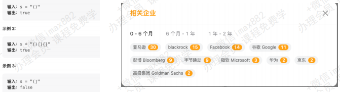

```typescript
import ArrayStack from "./02.实现栈结构(重构)";

function isValid(s: string): boolean {
  // 1.创建栈结构
  const stack = new ArrayStack<string>();

  // 2.遍历s中的所有的括号
  // 碰到左括号，将右括号放入栈里面；碰到右括号，与栈顶元素进行比对
  for (let i = 0; i < s.length; i++) {
    const c = s[i];
    switch (c) {
      case "(":
        stack.push(")");
        break;
      case "[":
        stack.push("]");
        break;
      case "{":
        stack.push("}");
        break;
      default:
        if (c !== stack.pop()) return false;
        break;
    }
  }

  // 3.栈最后必须为空
  return stack.isEmpty();
}

console.log(isValid("()"));                // true     
console.log(isValid("()[]{}"));            // true
console.log(isValid("(]"));                // false
console.log(isValid("()[]{}({[]})"));      // true
```

## (四) 队列结构（Queue）

### 1. 认识队列以及特性

#### 1.1 认识队列

+ 受限的线性结构：
  + 我们已经学习了一种`受限的线性结构`：栈结构
  + 并且已经知道这种受限的数据结构对于解决某些`特定问题`，会有`特别的效果`
  + 下面，我们再来学习另外一个受限的数据结构：`队列`
+ 队列(Queue)，它是一种受限的线性表，`先进先出`(FIFO First In First Out)
  + 受限之处在于它只允许在队列的`前端`（front）进行删除操作
  + 而在队列的`后端`（rear）进行插入操作

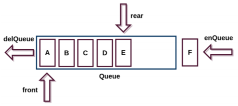

#### 1.2 生活中的队列

+ 生活中类似的队列结构
  + 生活中类似队列的场景就是非常多了
  + 比如在`电影院`，`商场`，甚至是`厕所`排队
  + 优先排队的人，优先处理（买票，结账，WC）


#### 1.3 开发中队列的应用

+ 打印队列
  + 有五份文档需要打印，这些文档会`按照次序放入`到`打印队列`中
  + 打印机会依次从队列中取出文档，`优先放入的文档`，`优先被取出`，并且对该文档进行打印
  + 以此类推，直到队列中不再有新的文档
+ 线程队列
  + 在开发中，为了让任务可以并行处理，通常会`开启多个线程`
  + 但是，我们不能让大量的线程同时运行处理任务（占用过多的资源）
  + 这个时候，如果有需要开启线程处理任务的情况，我们就会使用`线程队列`
  + 线程队列会`依照次序`来启动线程，并且处理对应的任务
+ 当然队列还有很多其他应用，我们后续的很多算法中也会用到队列（比如二叉树的层序遍历）
+ 队列如何实现呢?
  + 我们一起来研究一下队列的实现

### 2. 实现队列结构封装

+ 队列的实现和栈一样，有两种方案

  + 基于`数组`实现
  + 基于`链表`实现（这种方法更好）

+ 我们需要创建自己的类，来表示一个队列

  ```typescript
  // 使用ts代码，使用ts-node插件编译代码：查看ts-node版本 (ts-node --version)
  class ArrayQueue<T> {
    private data: T[] = [];
  }
  ```

+ 代码解析

  + 我们创建了一个ArrayQueue的类，用户创建队列的类，并且是一个`泛型类`
  + 在类中，定义了一个变量，这个变量可以用于`保存当前队列对象中所有的元素`。 (和创建栈非常相似)
  + 这个变量是一个数组类型
    + 我们之后在队列中添加元素或者删除元素，都是在这个数组中完成的
  + 队列和栈一样，有一些相关的操作方法，通常无论是什么语言，操作都是比较类似的

### 3. 队列结构常见方法 (完整封装)

+ 队列有哪些常见的操作呢?

  + `enqueue(element) `：向队列尾部添加一个（或多个）新的项
  + `dequeue()`：移除队列的第一（即排在队列最前面的）项，并返回被移除的元素
  + `front/peek()`：返回队列中第一个元素——最先被添加，也将是最先被移除的元素。队列不做任何变动（不移除元素，只返回元素信息——与Stack类的peek方法非常类似）
  + `isEmpty()`：如果队列中不包含任何元素，返回true，否则返回false
  + `size()`：返回队列包含的元素个数，与数组的length属性类似

+ 现在，我们来实现这些方法

+ 基于`数组`实现

  ```typescript
  // 01.实现队列结构.ts
  interface IList<T> {
    peek(): T | undefined;
    isEmpty(): boolean;
    size(): number;
  }
  
  // 接口继承接口
  interface IQueue<T> extends IList<T> {
    enqueue(element: T): void;
    dequeue(): T | undefined;
  }
  
  class ArrayQueue<T> implements IQueue<T> {
    private data: T[] = [];
  
    // enqueue方法：向队列尾部添加一个（或多个）新的项
    enqueue(element: T): void {
      this.data.push(element);
    }
  
    // dequeue方法：移除队列的第一（即排在队列最前面的）项，并返回被移除的元素
    dequeue(): T | undefined {
      return this.data.shift();
    }
  
    // peek方法：返回队列队列的第一的元素，不对队列做任何修改
    peek(): T | undefined {
      return this.data[0];
    }
  
    // isEmpty方法：判断队列是否为空
    isEmpty(): boolean {
      return this.data.length === 0;
    }
  
    // size方法：返回队列里的元素个数
    size(): number {
      return this.data.length;
    }
  }
  ```

### 4. 队列面试题 – 击鼓传花

+ `击鼓传花`是一个常见的面试算法题： 使用队列可以非常方便的实现最终的结果
+ `原游戏`规则：
  + 班级中玩一个游戏，所有学生围成一圈，从某位同学手里开始向旁边的同学传一束花
  + 这个时候某个人(比如班长)，在击鼓，鼓声停下的一颗，花落在谁手里，谁就出来表演节目
+ `修改游戏`规则：
  + 我们来修改一下这个游戏规则
  + 几个朋友一起玩一个游戏，`围成一圈`，`开始数数`，`数到某个数字`的人自动淘汰
  + 最后`剩下的这个人`会获得胜利，请问最后剩下的是`原来在哪一个位置上`的人?
+ 封装一个基于队列的函数
  + 参数：所有参与人的姓名，基于的数字
  +  结果：最终剩下的一人的姓名

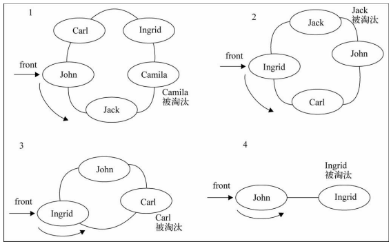

```typescript
import ArrayQueue from "./01.实现队列结构";

function hotPotato(names: string[], num: number): string {
  // 1.创建队列结构
  const queue = new ArrayQueue<string>();

  // 2.将所有names加入队列
  for (const name of names) {
    queue.enqueue(name);
  }

  // 3.淘汰规则
  while (queue.size() > 1) {
    for (let i = 1; i < num; i++) {
      const name = queue.dequeue();
      if (name) queue.enqueue(name);
    }
    // 淘汰
    queue.dequeue();
  }

  return queue.dequeue()!;  // !感叹号是类型非空断言
}

const names = ["John", "Jack", "Camila", "Ingrid", "Carl"];
console.log(hotPotato(names, 8));   // John
```

### 5. 队列面试题 - 约瑟夫环

> https://leetcode.cn/problems/yuan-quan-zhong-zui-hou-sheng-xia-de-shu-zi-lcof

#### 5.1 什么是约瑟夫环问题（历史）

+ 阿桥问题（有时也称为约瑟夫斯置换），是一个出现在计算机科学和数学中的问题。在计算机编程的算法中，类似问题又称为约瑟夫环
  + 人们站在一个等待被处决的圈子里
  +  计数从圆圈中的指定点开始，并沿指定方向围绕圆圈进行
  + 在跳过指定数量的人之后，处刑下一个人
  + 对剩下的人重复该过程，从下一个人开始，朝同一方向跳过相同数量的人，直到只剩下一个人，并被释放
  + 在给定数量的情况下，站在第几个位置可以避免被处决？
+ 这个问题是以`弗拉维奥·约瑟夫`命名的，他是1世纪的一名犹太历史学家
  + 他在自己的日记中写道，他和他的40个战友被罗马军队包围在洞中
  + 他们讨论是自杀还是被俘，最终决定自杀，并以抽签的方式决定谁杀掉谁

#### 5.2 约瑟夫环问题 – 字节、阿里、谷歌等面试题

+ 击鼓传花和约瑟夫环其实是同一类问题，这种问题还会有其他解法（后续讲解）同样的题目在Leetcode上也有
  + 0,1,···,n-1这n个数字排成一个圆圈，从数字0开始，每次从这个圆圈里删除第m个数字（删除后从下一个数字开始计数），求出这个圆圈里剩下的最后一个数字
  + 例如，0、1、2、3、4这5个数字组成一个圆圈，从数字0开始每次删除第3个数字，则删除的前4个数字依次是2、0、4、1，因此最后剩下的数字是3

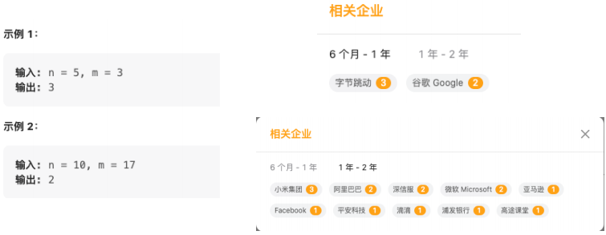

+ 基于`队列`实现

  ```typescript
  import ArrayQueue from "./01.实现队列结构";

  function lastRemaining(n: number, m: number): number {
    // 1.创建队列结构
    const queue = new ArrayQueue<number>();
    for (let i = 0; i < n; i++) {
      queue.enqueue(i);
    }

    // 2.开始淘汰
    while (queue.size() > 1) {
      for (let i = 1; i < m; i++) {
        queue.enqueue(queue.dequeue()!);
      }
      queue.dequeue();
    }

    return queue.dequeue()!;
  }

  console.log(lastRemaining(5, 3));    // 3
  console.log(lastRemaining(10, 17));  // 2
  ```

+ 基于`动态规划`实现

  ```typescript
  function lastRemaining(n: number, m: number): number {
    let position = 0;
  
    for (let i = 2; i <= n; i++) {
      position = (position + m) % i;
    }
  
    return position;
  }
  
  console.log(lastRemaining(5, 3));    // 3
  console.log(lastRemaining(10, 17));  // 2
  ```

## (五) 链表结构（LinkedList）

### 1. 认识链表以及特性

#### 1.1 链表以及数组的缺点

+ 链表和数组一样，可以用于`存储一系列的元素`，但是链表和数组的`实现机制完全不同`
+ 这一章中，我们就来学习一下另外一种非常常见的用于存储数据的线性结构：`链表`
+ 数组
  + 要存储多个元素，数组（或选择链表）可能是`最常用`的数据结构
  + 我们之前说过，几乎每一种编程语言都有默认实现`数组结构`
+ 但是数组也有很多缺点
  + 数组的创建通常需要申请一段`连续的内存空间`(一整块的内存)，并且大小是固定的(大多数编程语言数组都是固定的)，所以当当前数组`不能满足容量需求`时，需要`扩容` (一般情况下是申请一个更大的数组，比如2倍。 然后将原数组中的元素复制过去)
  + 而且在`数组开头或中间位置插入数据的成本很高`，需要`进行大量元素的位移`
  + 尽管JavaScript的Array底层可以帮我们做这些事，但背后的原理依然是这样

#### 1.2 链表的优势

+ 要存储多个元素，另外一个选择就是`链表`
+ 但不同于数组，链表中的元素在内存中`不必是连续的空间`
  + 链表的每个元素由一个存储`元素本身的节点`和一个`指向下一个元素的引用`(有些语言称为指针或者链接)组成
+ 相对于数组，链表有一些优点：
  + `内存空间不是必须连续的，`可以充分利用计算机的内存，实现灵活的`内存动态管理`
  + 链表不必在创建时就`确定大小`，并且大小可以`无限的延伸`下去
  + 链表在`插入和删除`数据时，`时间复杂度`可以达到O(1)，相对数组效率高很多
+ 相对于数组，链表有一些缺点：
  + 链表访问任何一个位置的元素时，都需要`从头开始访问 `（无法跳过第一个元素访问任何一个元素）
  + `无法通过下标直接访问元素`，需要从头一个个访问，直到找到对应的元素

#### 1.3 链表到底是什么?

+ 什么是`链表`呢?
  + 其实上面我们已经简单的提过了链表的结构，我们这里更加详细的分析一下
  + `链表类似于火车`：有一个火车头，火车头会连接一个节点，节点上有乘客(类似于数据)，并且这个节点会连接下一个节点，以此类推。
+ 链表的火车结构

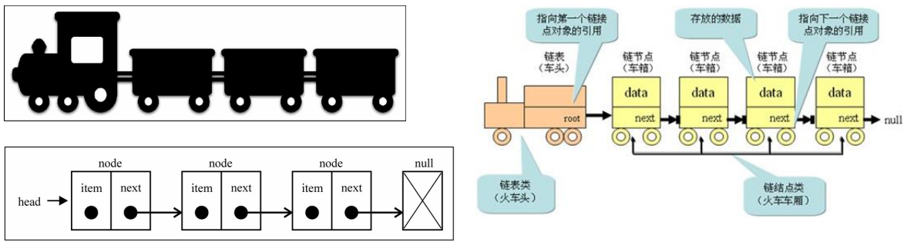

### 2. 封装链表的类结构

+ 我们先来创建一个链表类

  ```typescript
  // 1.创建Node类
  class Node<T> {
    value: T;
    next: Node<T> | null = null;
    constructor(value: T) {
      this.value = value;
    }
  }

  // 2.创建LinkedList类
  class LinkedList<T> {
    private head: Node<T> | null = null;
    private size: number = 0;

    get length() {
      return this.size;
    }
      
    // 封装私有方法
    // 根据position获取到当前的节点
    private getNode(position: number) {}

    // 在此处封装链表相关方法
    append(value) {}
    traverse() {}
    insert(position，value) {}
    get(position) {}
    indexOf(value) {}
    update(position，value) {}
    removeAt(position) {}
    remove(value) {}
    isEmpty() {}
    size() {}
  }

  const linkedList = new LinkedList<string>();
  console.log(linkedList.head);

  // 放入一个模块里面，不然在node环境里面，写class Node会有冲突的
  export {};
  ```

+ 代码解析
  + 封装一个`Node类`，用于封装每一个节点上的信息（包括值和指向下一个节点的引用），它是一个泛型类
  + 封装一个`LinkedList类`，用于表示我们的链表结构。 (和Java中的链表同名，不同Java中的这个类是一个双向链表，在第二阶段中我们也会实现双向链表结构)
  + 链表中我们保存两个属性，一个是`链表的长度`，一个是`链表中第一个节点`
  + 当然，还有很多链表的操作方法。 我们放在下一节中学习

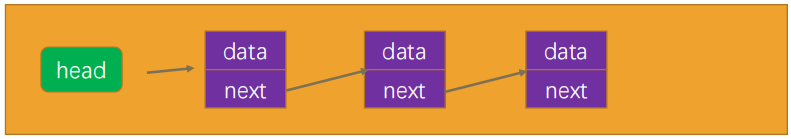

### 3. 封装链表相关方法

+ 我们先来认识一下，链表中应该有哪些`常见的操作`
  + `append(value)`：向链表尾部添加一个新的项
  + `insert(position，value)`：向链表的特定位置插入一个新的项
  + `get(position) `：获取对应位置的元素
  + `indexOf(value)`：返回元素在链表中的索引。如果链表中没有该元素则返回-1
  + `update(position，value)` ：修改某个位置的元素
  + `removeAt(position)`：从链表的特定位置移除一项
  + `remove(value)`：从链表中移除一项
  + `isEmpty()`：如果链表中不包含任何元素，返回true，如果链表长度大于0则返回false
  + `size()`：返回链表包含的元素个数。与数组的length属性类似
+ 整体你会发现操作方法和数组非常类似，因为链表本身就是一种可以代替数组的结构

#### 3.1 append方法

+ 向链表尾部追加数据可能有两种情况

  + `链表本身为空`，新添加的数据是唯一的节点
  + `链表不为空`，需要向其他节点后面追加节点

  ```typescript
  // 追加节点
  append(value: T) {
    // 1.根据value创建一个新节点
    const newNode = new Node(value);

    // 2.判断this.head是否为null
    if (!this.head) {
      this.head = newNode;
    } else {
      let current = this.head;
      while (current.next) {
        current = current.next;
      }
      // current肯定是指向最后一个节点的
      current.next = newNode;
    }

    this.size++;
  }
  ```

+ 链表的遍历方法（traverse）

  + 为了可以方便的看到链表上的每一个元素，我们实现一个遍历链表每一个元素的方法
    + 这个方法首先将当前结点设置为链表的头结点
    + 然后，在while循环中，我们遍历链表并打印当前结点的数据
    + 在每次迭代中，我们将当前结点设置为其下一个结点，直到遍历完整个链表

  ```typescript
  // 遍历链表
  traverse() {
    let values: T[] = [];
    let current = this.head;
    while (current) {
      values.push(current.value);
      current = current.next;
    }
    console.log(values.join(" -> "));
  }
  ```

#### 3.2 insert方法

+ 接下来实现另外一个添加数据的方法：在任意位置插入数据

+ 添加到第一个位置

  + 添加到第一个位置，表示新添加的节点是头，就需要将原来的头节点，作为新节点的next
  + 另外这个时候的head应该指向新节点

  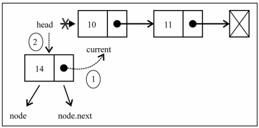

+ 添加到其他位置

  + 如果是添加到其他位置，就需要先找到这个节点位置了
  + 我们通过while循环，一点点向下找。 并且在这个过程中保存上一个节点和下一个节点
  + 找到正确的位置后，将新节点的next指向下一个节点，将上一个节点的next指向新的节点

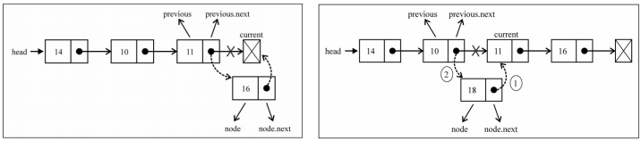

```typescript
// 根据位置插入节点：在索引 position 的前面拆入 value
insert(value: T, position: number): boolean {
  // 1.越界判断
  if (position < 0 || position > this.size) return false;

  // 2.根据value创建新节点
  const newNode = new Node(value);

  // 3.判断是否需要插入头部
  if (position === 0) {
    newNode.next = this.head;
    this.head = newNode;
  } else {
    let current = this.head; // current是后一个节点
    let previous: Node<T> | null = null; // 前一个节点
    let index = 0;
    while (index++ < position) {
      previous = current;
      current = current!.next;
    }
    // index === position
    newNode.next = current;
    previous!.next = newNode;
  }
  this.size++;
  return true;
}


// 遍历结点的操作重构----------------------------------------
insert(value: T, position: number): boolean {
  // 1.越界判断
  if (position < 0 || position > this.size) return false;

  // 2.根据value创建新节点
  const newNode = new Node(value);

  // 3.判断是否需要插入头部
  if (position === 0) {
    newNode.next = this.head;
    this.head = newNode;
  } else {
    const previous = this.getNode(position - 1);
    newNode.next = previous!.next;
    previous!.next = newNode;
  }
  this.size++;
  return true;
}
```

#### 3.3 removeAt方法

+ 移除数据有两种常见的方式

  + 根据位置移除对应的数据
  + 根据数据，先找到对应的位置，再移除数据

+ 移除第一项的信息

  + 移除第一项时，直接让head指向第二项信息就可以啦
  + 那么第一项信息没有引用指向，就在链表中不再有效，后面会被回收掉

  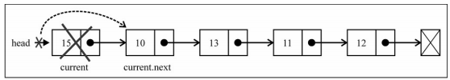

+ 移除其他项的信息

  + 移除其他项的信息操作方式是相同的
  + 首先，我们需要通过while循环，找到正确的位置
  + 找到正确位置后，就可以直接将上一项的next指向current项的next，这样中间的项就没有引用指向它，也就不再存在于链表后，会面会被回收掉

  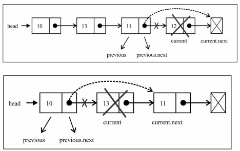

```typescript
// 根据位置删除节点
removeAt(position: number): T | null {
  // 1.越界判断
  if (position < 0 || position >= this.size) return null;

  // 2.定义变量
  let current = this.head;
  let previous: Node<T> | null = null;

  // 3.判断是否删除第一个节点
  if (position === 0) {
    this.head = current?.next || null;
  } else {
    let index = 0;
    while (index++ < position) {
      previous = current;
      current = current!.next;
    }
    previous!.next = current?.next || null;
  }

  this.size--;
  return current!.value;
}

    
// 遍历结点的操作重构----------------------------------------
removeAt(position: number): T | null {
  // 1.越界判断
  if (position < 0 || position >= this.size) return null;

  // 2.定义变量
  let current: Node<T> | null = this.head;

  // 3.判断是否删除第一个节点
  if (position === 0) {
    this.head = current?.next || null;
  } else {
    const previous = this.getNode(position - 1);
    current = previous!.next;
    previous!.next = previous?.next?.next ?? null;
  }

  this.size--;
  return current?.value ?? null;
}
```

#### 3.4 get方法

+ 获取对应位置的元素

```typescript
// 获取对应位置的元素
get(position: number): T | null {
  // 1.越界判断
  if (position < 0 || position > this.size) return null;

  // 2.查找元素
  let current = this.head;
  let index = 0;
  while (index++ < position) {
    current = current!.next;
  }

  return current!.value;
}


// 遍历结点的操作重构----------------------------------------
get(position: number): T | null {
  // 1.越界判断
  if (position < 0 || position > this.size) return null;

  // 2.查找元素
  return this.getNode(position)?.value ?? null;
}
```

#### 3.5 遍历结点的操作重构

+ 因为遍历结点的操作我们需要经常来做，所以可以进行如下的重构

  ```typescript
  // 封装私有方法
  // 根据position获取到当前的节点
  private getNode(position: number): Node<T> | null {
    let index = 0;
    let current = this.head;
    while (index++ < position && current) {
      current = current?.next;
    }
    return current;
  }
  ```

#### 3.6 update方法

+ 修改某个位置的元素

```typescript
// 修改某个位置的元素
update(value: T, position: number): boolean {
  // 1.越界判断
  if (position < 0 || position >= this.size) return false;

  // 2.修改元素
  const currentNode = this.getNode(position);
  currentNode!.value = value;
  return true;
}
```

#### 3.7 indexOf方法

+ 我们来完成另一个功能：根据元素获取它在链表中的位置

```typescript
// 根据元素获取它在链表中的位置
indexOf(value: T): number {
  // 从第一个节点开始遍历
  let current = this.head;
  let index = 0;
  while (current) {
    if (current.value === value) {
      return index;
    }
    index++;
    current = current.next;
  }

  return -1;
}
```

#### 3.8 remove方法

+ 有了上面的indexOf方法，我们可以非常方便实现根据元素来删除信息

```typescript
// 根据值删除元素
remove(value: T): T | null {
  const index = this.indexOf(value);
  return this.removeAt(index);
}
```

#### 3.9 isEmpty方法

+ 判断链表是否为空

```typescript
// 判断链表是否为空
isEmpty(): boolean {
  return this.size === 0;
}
```

### 4. 链表完整封装代码

+ 单向链表（有接口设计）

```typescript
interface IList<T> {
  peek(): T | undefined;
  isEmpty(): boolean;
  size(): number;
}

interface ILinkedList<T> extends IList<T> {
  append(value: T): void;
  traverse(): void;
  insert(value: T, position: number): boolean;
  removeAt(position: number): T | null;
  get(position: number): T | null;
  update(value: T, position: number): boolean;
  indexOf(value: T): number;
  remove(value: T): T | null;
}

// 1.创建Node类
class Node<T> {
  value: T;
  next: Node<T> | null = null;

  constructor(value: T) {
    this.value = value;
  }
}

// 2.创建LinkedList类
class LinkedList<T> implements ILinkedList<T> {
  private head: Node<T> | null = null;
  private length: number = 0;

  // 获取链表长度
  size(): number {
    return this.length;
  }

  // 返回链表第一个元素
  peek(): T | undefined {
    return this.head?.value;
  }

  // 封装私有方法
  // 根据position获取到当前的节点
  private getNode(position: number): Node<T> | null {
    let index = 0;
    let current = this.head;
    while (index++ < position && current) {
      current = current?.next;
    }
    return current;
  }

  // 追加节点
  append(value: T) {
    // 1.根据value创建一个新节点
    const newNode = new Node(value);

    // 2.判断this.head是否为null
    if (!this.head) {
      this.head = newNode;
    } else {
      let current = this.head;
      while (current.next) {
        current = current.next;
      }
      // current肯定是指向最后一个节点的
      current.next = newNode;
    }

    this.length++;
  }

  // 遍历链表
  traverse() {
    let values: T[] = [];
    let current = this.head;
    while (current) {
      values.push(current.value);
      current = current.next;
    }
    console.log(values.join(" -> "));
  }

  // 根据位置插入节点
  insert(value: T, position: number): boolean {
    // 1.越界判断
    if (position < 0 || position > this.length) return false;

    // 2.根据value创建新节点
    const newNode = new Node(value);

    // 3.判断是否需要插入头部
    if (position === 0) {
      newNode.next = this.head;
      this.head = newNode;
    } else {
      const previous = this.getNode(position - 1);
      newNode.next = previous!.next;
      previous!.next = newNode;
    }
    this.length++;
    return true;
  }

  // 根据位置删除节点
  removeAt(position: number): T | null {
    // 1.越界判断
    if (position < 0 || position >= this.length) return null;

    // 2.定义变量
    let current: Node<T> | null = this.head;

    // 3.判断是否删除第一个节点
    if (position === 0) {
      this.head = current?.next || null;
    } else {
      const previous = this.getNode(position - 1);
      current = previous!.next;
      previous!.next = previous?.next?.next ?? null;
    }

    this.length--;
    return current?.value ?? null;
  }

  // 获取对应位置的元素
  get(position: number): T | null {
    // 1.越界判断
    if (position < 0 || position > this.length) return null;

    // 2.查找元素
    return this.getNode(position)?.value ?? null;
  }

  // 修改某个位置的元素
  update(value: T, position: number): boolean {
    // 1.越界判断
    if (position < 0 || position >= this.length) return false;

    // 2.修改元素
    const currentNode = this.getNode(position);
    currentNode!.value = value;
    return true;
  }

  // 根据元素获取它在链表中的位置
  indexOf(value: T): number {
    // 从第一个节点开始遍历
    let current = this.head;
    let index = 0;
    while (current) {
      if (current.value === value) {
        return index;
      }
      index++;
      current = current.next;
    }

    return -1;
  }

  // 根据值删除元素
  remove(value: T): T | null {
    const index = this.indexOf(value);
    return this.removeAt(index);
  }

  // 判断链表是否为空
  isEmpty(): boolean {
    return this.length === 0;
  }
}

// 放入一个模块里面，不然在node环境里面，写class Node会有冲突的
export default LinkedList;
```

### 5. 链表常见的面试题

#### 5.1 设计链表 -字节、腾讯等公司面试题

> https://leetcode.cn/problems/design-linked-list/

+ 设计链表的实现
  + 您可以选择使用单链表或双链表
  + 单链表中的节点应该具有两个属性：`val` 和`next`。val 是当前节点的值，next 是指向下一个节点的指针/引用
  + 如果要使用双向链表，则还需要一个属性 prev 以指示链表中的上一个节点。假设链表中的所有节点都是 0-index 的
+ 在链表类中实现这些功能 (上面已经实现了)
  + `get(index)`：获取链表中第 index 个节点的值。如果索引无效，则返回-1
  + `addAtHead(val)`：在链表的第一个元素之前添加一个值为 val 的节点。插入后，新节点将成为链表的第一个节点
  + `addAtTail(val)`：将值为 val 的节点追加到链表的最后一个元素
  + `addAtIndex(index,val)`：在链表中的第 index 个节点之前添加值为 val 的节点。如果 index 等于链表的长度，则该节点将附加到链表的末尾。如果 index 大于链表长度，则不会插入节点。如果index小于0，则在头部插入节点
  + `deleteAtIndex(index)`：如果索引 index 有效，则删除链表中的第 index 个节点

#### 5.2 删除链表中的节点 – 字节、阿里等公司面试题

> https://leetcode.cn/problems/delete-node-in-a-linked-list/description/

+ 有一个单链表的 head，我们想删除它其中的一个节点 node
  + 给你一个需要删除的节点 node
  + 你将 无法访问 第一个节点 head
+ 链表的所有值都是 唯一的，并且保证给定的节点 node 不是链表中的最后一个节点
+ 删除给定的节点。注意，删除节点并不是指从内存中删除它。这里的意思是
  + 给定节点的值不应该存在于链表中
  + 链表中的节点数应该减少 1
  + node 前面的所有值顺序相同
  + node 后面的所有值顺序相同

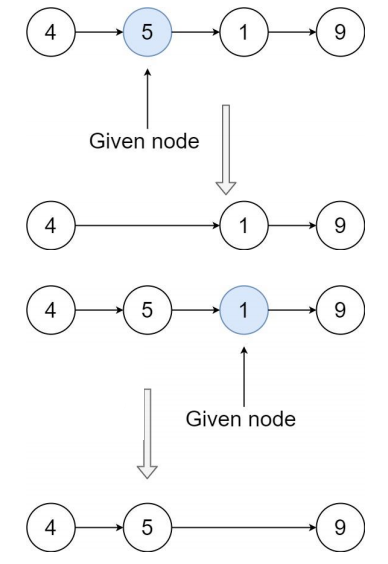

```typescript
// leetcode 给定的
class ListNode {
  val: number;
  next: ListNode | null;
  constructor(val?: number, next?: ListNode | null) {
    this.val = val === undefined ? 0 : val;
    this.next = next === undefined ? null : next;
  }
}

function deleteNode(node: ListNode | null): void {
  node!.val = node!.next!.val;
  node!.next = node!.next!.next;
}
```

#### 5.3 反转链表 – 字节、谷歌等面试题

> https://leetcode.cn/problems/reverse-linked-list/

+ 给你单链表的头节点 head ，请你反转链表，并返回反转后的链表

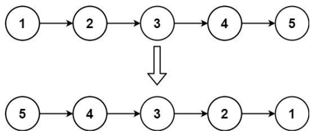

+ 进阶：链表可以选用迭代或递归方式完成反转。你能否用两种方法解决这道题？

+ 反转链表（栈方式）

  ```typescript
  // leetcode 给定的
  class ListNode {
    val: number;
    next: ListNode | null;
    constructor(val?: number, next?: ListNode | null) {
      this.val = val === undefined ? 0 : val;
      this.next = next === undefined ? null : next;
    }
  }

  function reverseList(head: ListNode | null): ListNode | null {
    // 什么情况下链表不需要处理？
    // 1.head本身为null的情况下
    if (head === null) return null;

    // 2.head本身只有一个节点
    if (head.next === null) return head;

    // 数组模拟栈结构
    const stack: ListNode[] = [];
    let current: ListNode | null = head;
    while (current) {
      stack.push(current);
      current = current.next;
    }

    // 依次从栈结构中取出元素，放到一个新的链表中
    const newHead: ListNode = stack.pop()!;
    let newHeadCurrent = newHead;
    while (stack.length) {
      const node = stack.pop()!;
      newHeadCurrent.next = node;
      newHeadCurrent = newHeadCurrent.next;
    }

    // 防止循环引用的问题
    newHeadCurrent.next = null;

    return newHead;
  }
  ```

+ 反转链表（循环方式）

  ```typescript
  // leetcode 给定的
  class ListNode {
    val: number;
    next: ListNode | null;
    constructor(val?: number, next?: ListNode | null) {
      this.val = val === undefined ? 0 : val;
      this.next = next === undefined ? null : next;
    }
  }

  function reverseList(head: ListNode | null): ListNode | null {
    if (!head || !head.next) return head;

    // 反转链表结构
    let newHead: ListNode | null = null;
    while (head) {
      const current: ListNode | null = head.next;
      head.next = newHead;
      newHead = head;
      head = current;
    }

    return newHead;
  }
  ```

+ 反转链表（递归方式）

  ```typescript
  // leetcode 给定的
  class ListNode {
    val: number;
    next: ListNode | null;
    constructor(val?: number, next?: ListNode | null) {
      this.val = val === undefined ? 0 : val;
      this.next = next === undefined ? null : next;
    }
  }
  
  function reverseList(head: ListNode | null): ListNode | null {
    if (!head || !head.next) return head;
  
    // 递归必有有结束条件
    const newHead = reverseList(head.next);
  
    // 让剩下的head节点的next节点的next节点指向head
    head.next.next = head;
  
    // head本身的next指向null
    head.next = null;
  
    return newHead;
  }
  ```

### 6. 算法的复杂度分析

#### 6.1 什么是算法复杂度（现实案例）

+ 前面我们已经解释了什么是算法？其实就是解决问题的一系列步骤操作、逻辑

+ 对于同一个问题，我们往往其实有多种解决它的思路和方法，也就是可以采用不同的算法

  + 但是`不同的算法`，其实`效率是不一样`的

+ 举个例子（现实的例子）：在一个庞大的图书馆中，我们需要找一本书

  + 在图书已经按照某种方式摆好的情况下（数据结构是固定的）

  

+ 方式一：顺序查找

  + 一本本找，直到找到想要的书（累死）

+ 方式二：先找分类，分类中找这本书

  + 先找到分类，在分类中再顺序或者某种方式查找

+ 方式三：找到一台电脑，查找书的位置，直接找到

  + 图书馆通常有自己的图书管理系统
  + 利用图书管理系统先找到书的位置，再直接过去找到

#### 6.2 什么是算法复杂度（程序案例）

+ 我们再具一个程序中的案例：让我们来比较两种不同算法在查找数组中（`数组有序`）给定元素的时间复杂度

+ 方式一：顺序查找

  + 这种算法从头到尾遍历整个数组，依次比较每个元素和给定元素的值
  + 如果找到相等的元素，则返回下标；如果遍历完整个数组都没找到，则返回-1

  ```typescript
  function sequentSearch(array: number[], num: number) {
    for (let i = 0; i < array.length; i++) {
      const item = array[i];
      if (item === num) {
        return i;
      }
    }
    return -1;
  }

  const arr = [1, 3, 4, 6, 7, 8, 10, 13, 14];
  console.log(sequentSearch(arr, 4)); // 2
  ```

+ 方式二：二分查找

  + 这种算法假设数组是有序的，每次选择数组中间的元素与给定元素进行比较
  + 如果相等，则返回下标；如果给定元素比中间元素小，则在数组的左半部分继续查找
  + 如果给定元素比中间元素大，则在数组的右半部分继续查找
  + 这样每次查找都会将查找范围减半，直到找到相等的元素或者查找范围为空

  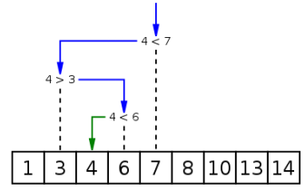

  ```typescript
  function binarySearch(array: number[], num: number) {
    // 1.定义左边索引
    let left = 0;
  
    // 2.定义右边索引
    let right = array.length - 1;
  
    // 3.开始查找
    while (left <= right) {
      let mid = Math.floor((left + right) / 2);
      const midNum = array[mid];
      if (midNum === num) {
        return mid;
      } else if (midNum < num) {
        left = mid + 1;
      } else {
        right = mid - 1;
      }
    }
  
    return -1;
  }
  
  const arr = [1, 3, 4, 6, 7, 8, 10, 13, 14];
  console.log(binarySearch(arr, 4)); // 2
  ```

#### 6.3 顺序查找和二分查找的测试

+ 顺序查找：顺序查找算法的时间复杂度是： `O(n)`

  ```typescript
  import sequentSearch from "./01.查找算法-顺序查找";

  const MAX_LENGTH = 10000000;
  const nums = new Array(MAX_LENGTH).fill(0).map((_, index) => index);
  const num = MAX_LENGTH / 2;

  const startTime = performance.now();
  const index = sequentSearch(nums, num);
  const endTime = performance.now();

  // 目标元素的索引是：5000000
  // 顺序查找消耗的时间：5.1935000000000855ms
  console.log(`目标元素的索引是：${index}`);
  console.log(`顺序查找消耗的时间：${endTime - startTime}ms`);
  ```

+ 二分查找：二分查找算法的时间复杂度是： `O(log n)`

  ```typescript
  import binarySearch from "./02.查找算法-二分查找";
  
  const MAX_LENGTH = 10000000;
  const nums = new Array(MAX_LENGTH).fill(0).map((_, index) => index);
  const num = MAX_LENGTH / 2;
  
  const startTime = performance.now();
  const index = binarySearch(nums, num);
  const endTime = performance.now();
  
  // 目标元素的索引是：5000000
  // 顺序查找消耗的时间：0.15049999999996544ms
  console.log(`目标元素的索引是：${index}`);
  console.log(`顺序查找消耗的时间：${endTime - startTime}ms`);
  ```


+ coderwhy老师自己封装的库测试：`npm install hy-algokit`

  ```typescript
  import { testOrderSearchEfficiency } from "hy-algokit";
  import sequentSearch from "./01.查找算法-顺序查找";
  import binarySearch from "./02.查找算法-二分查找";
  
  const MAX_LENGTH = 10000000;
  const nums = new Array(MAX_LENGTH).fill(0).map((_, index) => index);
  const num = MAX_LENGTH / 2;
  
  testOrderSearchEfficiency(sequentSearch, nums, num);
  testOrderSearchEfficiency(binarySearch, nums, num);
  ```

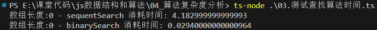

#### 6.4 大O表示法（Big O notation）

+ 大O表示法（Big O notation）英文翻译为大O符号（维基百科翻译），中文通常翻译为大O表示法（标记法）

  + 这个记号则是在`德国数论学家`爱德蒙·兰道的著作中才推广的，因此它有时又称为`兰道符号（Landau symbols）`
  + 代表“`order of ...”（……阶）`的`大O`，最初是`一个大写希腊字母“Ο”（omicron）`，现今用的是`大写拉丁字母“O”`

+ 大O符号在分析`算法效率的时候非常有用`

  + 举个例子，解决`一个规模为n的问题所花费的时间（或者所需步骤的数目）可以表示为`：

    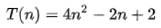

    + 当`n增大`时，`n²项`开始`占据主导地位，其他各项可以被忽略`

  + 举例说明：当n=500

    + `4n²项`是`2n项`的`1000倍大`，因此在大多数场合下，`省略后者对表达式的值的影响将是可以忽略不计`的

    + 进一步看，如果我们与任一其他级的表达式比较，`n²的系数也是无关紧要`的

      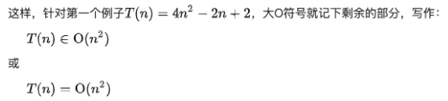

+ 我们就说该算法`具有n²阶（平方阶）的时间复杂度，表示为O(n²)`

#### 6.5 大O表示法 - 常见的对数结

+ 常用的函数阶

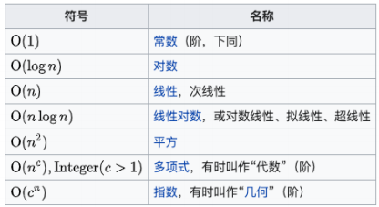

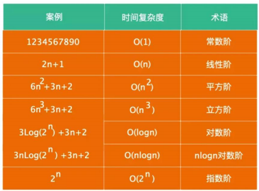

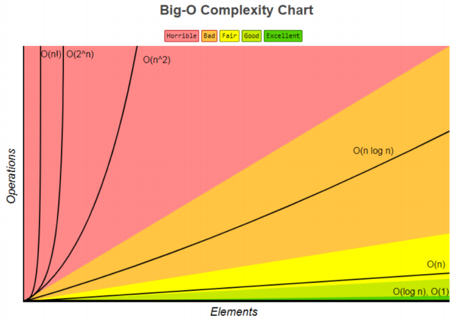

#### 6.6 空间复杂度

+ 空间复杂度指的是程序运行过程中所需要的额外存储空间
  + 空间复杂度`也可以用大O表示法`来表示
  + `空间复杂度的计算方法与时间复杂度类似`，通常需要分析程序中`需要额外分配的内存空间，如数组、变量、对象、递归调用`等
+ 举个栗子?
  + 对于一个简单的`递归算法`来说，每次调用都`会在内存中分配新的栈帧，这些栈帧占用了额外的空间`
    + 因此，该算法的空间复杂度是O(n)，其中n是递归深度
  + 而对于`迭代算法来`说，在`每次迭代中不需要分配额外的空间`，因此`其空间复杂度为O(1)`
+ 当空间复杂度很大时，可能会导致内存不足，程序崩溃


+ 在平时进行算法优化时，我们通常会进行如下的考虑：
  + 使用尽量少的空间（优化空间复杂度）
  + 使用尽量少的时间（优化时间复杂度）
  + 特定情况下：使用`空间换时间`或使用`时间换空间`

### 7. 数组和链表的对比

+ 接下来，我们使用大O表示法来对比一下数组和链表的时间复杂度

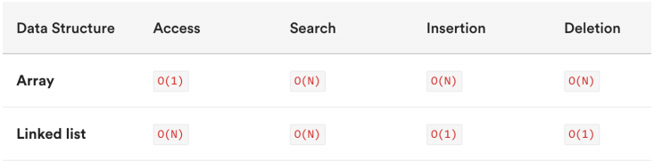

+ `数组`是一种连续的存储结构，通过下标可以直接访问数组中的任意元素
  + `时间复杂度`：对于数组，随机访问时间复杂度为O(1)，插入和删除操作时间复杂度为O(n)
  + `空间复杂度`：数组需要连续的存储空间，空间复杂度为O(n)
+ `链表`是一种链式存储结构，通过指针链接起来的节点组成，访问链表中元素需要从头结点开始遍历
  + `时间复杂度`：对于链表，随机访问时间复杂度为O(n)，插入和删除操作时间复杂度为O(1)
  + `空间复杂度`：链表需要为每个节点分配存储空间，空间复杂度为O(n)
+ 在实际开发中，选择使用数组还是链表需要根据具体应用场景来决定
  + 如果数据量不大，且需要频繁随机访问元素，使用数组可能会更好
  + 如果数据量大，或者需要频繁插入和删除元素，使用链表可能会更好

## (六) 哈希表（HashTable）

### 1. 哈希表介绍和特性

#### 1.1 哈希表的介绍

+ 哈希表是一种非常重要的数据结构，但是`很多学习编程的人`一直搞不懂哈希表到底是如何实现的
  + 在这一章节中，我们就一点点来实现一个自己的哈希表
  + 通过实现来理解哈希表`背后的原理`和`它的优势`
+ 几乎所有的编程语言都有`直接或者间接`的应用这种数据结构
+ 哈希表通常是基于`数组`进行实现的，但是相对于数组，它也很多的优势
  + 它可以提供非常快速的`插入-删除-查找操作`
  + 无论多少数据，插入和删除值都接近常量的时间：即O(1)的时间复杂度。实际上，只需要`几个机器指令`即可完成
  + 哈希表的速度比`树还要快`，基本可以瞬间查找到想要的元素
  + 哈希表相对于树来说编码要容易很多
+ 哈希表相对于数组的一些`不足`
  + 哈希表中的数据是`没有顺序`的，所以不能以一种固定的方式(比如从小到大)来遍历其中的元素（没有特殊处理情况下）
  + 通常情况下，哈希表中的key是`不允许重复`的，不能放置相同的key，用于保存不同的元素

#### 1.2 哈希表到底是什么呢？

+ 那么，哈希表到底是什么呢？

  + 我们只是说了一下它的优势，似乎还是没有说它到底长什么样子？
  + 这也是哈希表不好理解的地方，不像数组和链表，甚至是树，直接画出你就知道它的结构，甚至是原理
  + `它的结构就是数组`，但是它神奇的地方在于对数组`下标值的一种变换`，这种`变换`我们可以使用`哈希函数`，通过哈希函数可以获取到`HashCode`

  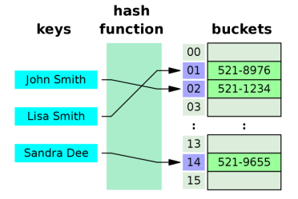

  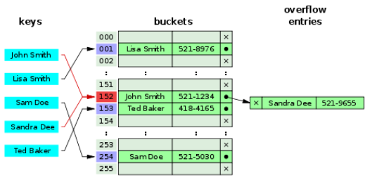

  + 不着急，我们慢慢来认识它到底是什么

+ 我们通过二个案例，案例需要你挑选某种数据结构，而你会发现最好的选择就是哈希表

  + 案例一：公司使用一种数据结构来保存所有员工
  + 案例二：使用一种数据结构存储单词信息，比如有50000个单词。找到单词后每个单词有自己的翻译&读音&应用等等

#### 1.3 案例一：公司员工存储

+ 案例介绍：
  + 假如一家公司有1000个员工，现在我们需要将这些员工的信息使用某种数据结构来保存起来
  + 你会采用什么数据结构呢？
+ 方案一：数组
  + 一种方案是按照顺序将所有的员工依次存入一个`长度为1000的数组`中
  + `每个员工的信息都保存在数组的某个位置上`
  + 但是我们要`查看某个具体员工的信息怎么办`呢？`一个个找吗？不太好找`
  + `数组最大的优势是什么`？通过`下标值去获取信息`
  + 所以为了可以通过数组快速定位到某个员工，最好给员工信息中添加一个`员工编号(工号)`，而编号对应的就是`员工的下标值`
  + 当查找某个员工的信息时，通过员工编号可以快速定位到员工的信息位置
+ 方案二：链表
  + 链表对应插入和删除数据有一定的优势
  + 但是对于获取员工的信息，每次都必须从头遍历到尾，这种方式显然不是特别适合我们这里
+ 最终方案：
  + 这样看`最终方案似乎就是数组`了。但是数组还是有缺点，什么缺点呢？
  + 但是如果我们`只知道员工的姓名`，比如why，但是`不知道why的员工编号`，你怎么办呢？
+ 只能线性查找？效率非常的低
  + 能不能有一种办法，让`why的名字和它的员工编号`产生直接的关系呢？
  + 也就是通过why这个名字，我们就能`获取到它的索引值`，而再通过索引值我就能获取到why的信息呢？
  + 这样的方案已经存在了，就是使用哈希函数，让`某个key的信息`和`索引值对应起来`

#### 1.4 案例二：50000个单词的存储

+ 案例介绍：
  + 使用`一种数据结构存储单词信息`，比如有`50000个单词`
  + 找到单词后`每个单词有自己的翻译&读音&应用`等等
+ 方案一：数组？
  + 这个案例`更加明显能感受到数组的缺陷`
  + 我拿到一个单词 `Iridescent`，我想知道这个单词的`翻译/读音/应用`
  + 怎么可以`从数组中查到这个单词的位置`呢？
  + 线性查找？50000次比较？
  + 如果你使用数组来实现这个功能，效率会非常非常低，而且你一定没有学习过数据结构
+ 方案二：链表？
  + 不需要考虑了吧？
+ 方案三：有没有一种方案，可以`将单词转成数组的下标值`呢？
  + 如果单词转成数组的下标，以后我们要查找某个单词的信息，直接`按照下标值一步即可访问到想要的元素`

### 2. 数据的哈希化过程

#### 2.1 字母转数字的方案一

+ 似乎所有的案例都指向了一目标：`将字符串转成下标值`
+ 但是，怎样才能将一个字符串转成数组的下标值呢？
  + `单词/字符串`转`下标值`，其实就是`字母/文字`转`数字`
  + 怎么转？
+ 现在我们需要设计一种方案，可以将`单词`转成`适当的下标值`
  + 其实计算机中有`很多的编码方案`就是用数字代替单词的字符。就是字符编码。(常见的`字符编码`？)
  + 比如`ASCII编码`：a是97，b是98，依次类推122代表z
  + 我们也可以设计一个`自己的编码系统`，比如`a是1，b是2，c是3，依次类推，z是26`
  + 当然我们可以加上`空格用0代替`，就是`27个字符`(不考虑大写问题)
  + 但是，有了编码系统后，一个单词如何转成数字呢？
+ 方案一：数字相加
  + 一种转换单词的`简单方案`就是把单词每个字符的编码求和
  + 例如单词`cats转成数字`：3 + 1 + 20 + 19 = 43，那么43就作为cats单词的下标存在数组中
+ 问题：按照这种方案有一个很明显的问题就是`很多单词`最终的下标可能`都是43`
  + 比如was/tin/give/tend/moan/tick等等
  + 我们知道数组中`一个下标值`位置`只能存储一个数据`
  + 如果存入后来的数据，必然会造成`数据的覆盖`
  + 一个下标存储这么多单词显然是`不合理`的
  + 虽然后面的方案也会出现，但是要尽量避免

#### 2.2 字母转数字的方案二

+ 方案二：幂的连乘

  + 现在，我们想通过一种算法，让cats转成数字后`不那么普通`
  + `数字相加`的方案就有些`过于普通`了
  + 有一种方案就是使用`幂的连乘`，什么是幂的连乘呢？
  + 其实我们平时使用的`大于10的数字`，可以用一种`幂的连乘来表示`它的唯一性，比如：7654 = 7\*10³ + 6\*10² + 5\*10 + 4
  + 我们的单词也可以使用这种方案来表示：比如cats = 3\*27³ + 1\*27² + 20*27 + 19= 60337
  + 这样得到的数字可以`基本`保证它的`唯一性`，不会和别的单词重复

+ 问题：如果一个单词是zzzzzzzzzz(一般英文单词不会超过10个字符)。那么得到的数字超过7000000000000

  + 数组可以表示`这么大的下标值`吗？
  + 而且就算能创建这么大的数组，事实上有很多是无效的单词
  + `创建这么大的数组是没有意义`的，会造成很多空间的浪费

  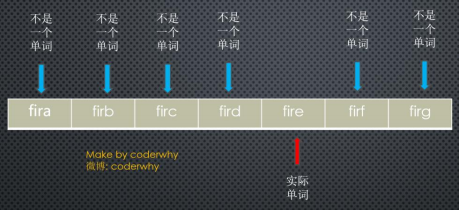

+ 两种方案总结：

  + 第一种方案(把数字相加求和)产生的`数组下标太少`
  + 第二种方案(与27的幂相乘求和)产生的`数组下标又太多`

#### 2.3 下标的压缩算法

+ 现在需要一种`压缩方法`，把幂的连乘方案系统中得到的`巨大整数范围`压缩到`可接受的数组范围`中
+ 对于英文词典，多大的数组才合适呢？
  + 如果只有`50000个单词`，可能`会定义一个长度为50000的数组`
  + 但是实际情况中，往往需要`更大的空间`来存储这些单词。因为我们`不能保证单词会映射到每一个位置`
  + 比如`两倍的大小：100000`
+ 如何压缩呢？
  + 现在，就找一种方法，把0到超过7000000000000的范围，`压缩`为从0到100000
  + 有一种简单的方法就是使用`取余操作符`，它的作用是得到一个数被另外一个数整除后的`余数`
+ 取余操作的实现：
  + 为了看到这个方法如何工作，我们先来看一个`小点的数字范围`压缩到一个`小点的空间`中
  + 假设把从0~199的数字，比如使用`largeNumber`代表，压缩为从0到9的数字，比如使用`smallRange`代表
  + 下标值的结果：index = largeNumber % smallRange
  + 当一个数被10整除时，余数一定在0~9之间
  + 比如13%10=3，157%10=7
  + 当然，这`中间还是会有重复，不过重复的数量明显变小`了。因为我们的数组是100000，而只有50000个单词
  + 就好比，你在0~199中间选取5个数字，放在这个长度为10的数组中，也会重复，但是重复的概率非常小。(后面我们会讲到真的发生重复了应该怎么解决)

#### 2.4 哈希表的一些概念

+ 认识了上面的内容，相信你应该懂了哈希表的原理了，我们来看看几个概念：
  + **哈希化**：将`大数字`转化成`数组范围内下标`的过程，我们就称之为`哈希化`
  + **哈希函数**：通常我们会将`单词`转成`大数字`，`大数字`在进行`哈希化`的代码实现放在一个函数中，这个函数我们称为`哈希函数`
  + **哈希表**：最终将数据插入到的这个`数组`，对整个`结构的封装`，我们就称之为是一个`哈希表`
+ 但是，我们还有问题需要解决：
  + 虽然，我们在一个100000的数组中，放50000个单词已经足够
  + 但是通过哈希化后的下标值依然可能会重复，如何解决这种重复的问题呢？

### 3. 地址冲突解决方案

#### 3.1 什么是冲突？

+ 尽管50000个单词，我们使用了100000个位置来存储，并且通过一种相对比较好的哈希函数来完成。但是依然有`可能会发生冲突`
  + 比如melioration这个单词，通过哈希函数得到它数组的下标值后，发现那个位置上已经存在一个单词demystify
  + 因为它经过哈希化后和melioration得到的下标实现相同的
+ 这种情况我们成为冲突
+ 虽然我们不希望这种情况发生，当然更希望每个下标对应一个数据项，但是通常这是不可能的
+ 冲突`不可避免`，我们只能解决`冲突`


+ 就像之前0~199的数字选取5个放在长度为10的单元格中
  + 如果我们随机选出来的是33，82，11，45，90，那么最终它们的位置会是3-2-1-5-0，没有发生冲突
  + 但是如果其中有一个33，还有一个73呢？还是发生了冲突
+ 我们需要针对 `这种冲突` 提出一些`解决方案`
  + 虽然冲突的`可能性比较小`，你依然需要`考虑到这种情况`
  + 以便发生的时候进行对应的`处理代码`
+ 如何解决这种冲突呢？常见的情况有两种方案
  + `链地址法`
  + `开放地址法`

#### 3.2 链地址法

##### 3.2.1 链地址法（一定要理解）

+ 链地址法是一种比较常见的解决冲突的方案。(也称为拉链法)

  + 其实，如果你理解了为什么产生冲突，看到图后就可以立马理解链地址法是什么含义了

  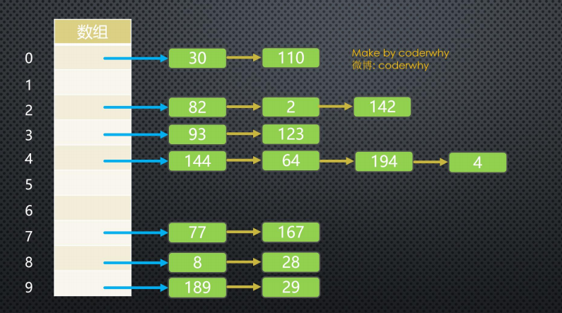

##### 3.2.2 链地址法解析

+ 图片解析：
  + 从图片中我们可以看出，链地址法解决冲突的办法是`每个数组单元`中存储的不再是`单个数据`，而是一个`链条`
  + 这个链条使用什么数据结构呢？常见的是`数组或者链表`
  + 比如是`链表`，也就是每个数组单元中存储着一个链表。一旦发现重复，将重复的元素`插入`到链表的`首端或者末端`即可
  + 当查询时，先根据哈希化后的下标值找到对应的位置，再取出链表，依次查询找寻找的数据
+ 数组还是链表呢？
  + 数组或者链表在这里其实都可以，`效率上也差不多`
  + 因为根据哈希化的index找出这个数组或者链表时，通常就会使用`线性查找`，这个时候数组和链表的效率是差不多的
  + 当然在某些实现中，会将新插入的数据放在`数组或者链表的最前面`，因为觉得`新插入的数据`用于`取出的可能性更大`
  + `这种情况最好采用链表`，因为数组在首位插入数据是需要所有其他项后移的，链表就没有这样的问题
  + 当然，我觉得出于这个也看`业务需求`，不见得新的数据就访问次数会更多：比如我们微信新添加的好友，可能是刚认识的，联系的频率不见得比我们的老朋友更多，甚至新加的只是聊一两句
  + 所以，这里个人觉得选择`数组或者链表`都是可以的

#### 3.3 开放地址法

##### 3.3.1 开放地址法

+ 开放地址法的主要工作方式是`寻找空白的单元格`来添加重复的数据
+ 我们还是通过图片来了解开放地址法的工作方式

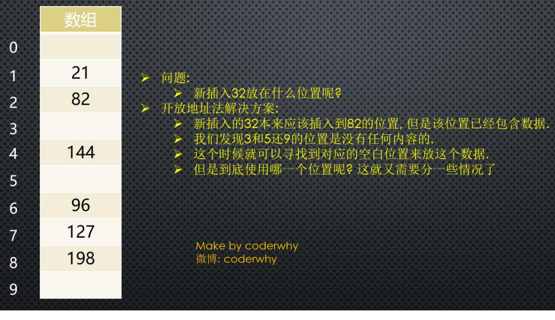

+ 图片解析：
  + 从图片的文字中我们可以了解到
  + 开放地址法其实就是要`寻找空白的位置`来放置冲突的数据项
+ 但是探索这个位置的方式不同，有三种方法：
  + `线性探测`
  + `二次探测`
  + `再哈希法`

##### 3.3.2 线性探测

+ 线性探测非常好理解：线性的查找空白的单元
+ 插入的32：
  + 经过哈希化得到的index=2，但是在插入的时候，发现该位置已经有了82。怎么办呢？
  + 线性探测就是从`index位置+1`开始一点点查找`合适的位置`来放置32，什么是合适的位置呢？
  + `空的位置就是合适的位置`，在我们上面的例子中就是index=3的位置，这个时候32就会放在该位置
+ 查询32呢？
  + 查询32和插入32比较相似
  + 首先经过哈希化得到index=2，比如2的位置结果和查询的数值是否相同，相同那么就直接返回
  + 不相同呢？线性查找，从index位置+1开始查找和32一样的
  + 这里有一个特别需要注意的地方：如果32的位置我们之前`没有插入`，是否将整个哈希表查询一遍来确定32存不存在吗？
  + 当然不是，查询过程有一个约定，就是查询到`空位置`，`就停止`
  + 因为查询到这里有空位置，32之前不可能跳过空位置去其他的位置

**线性探测的问题：**

+ 删除32呢？
  + 删除操作和插入查询比较类似，但是也有一个`特别注意点`
  + 注意：删除操作一个数据项时，`不可以`将这个位置下标的内容`设置为null`，为什么呢？
  + 因为将它设置为null可能会影响我们之后查询其他操作，所以通常`删除一个位置的数据项`时，我们可以`将它进行特殊处理`(比如设置为-1)
  + 当我们之后看到-1位置的数据项时，就知道查询时要`继续查询`，但是插入时这个位置可以放置数据
+ 线性探测的问题：
  + 线性探测有一个比较严重的问题，就是聚集。什么是聚集呢？
  + 比如我在没有任何数据的时候，插入的是22-23-24-25-26，那么意味着下标值：2-3-4-5-6的位置都有元素
  + 这种`一连串填充单元`就叫做`聚集`
  + 聚集会影响哈希表的`性能`，无论是插入/查询/删除都会影响
  + 比如我们插入一个32，会发现`连续的单元`都`不允许`我们放置数据，并且在这个过程中我们需要探索多次
  + 二次探测可以解决一部分这个问题，我们一起来看一看

##### 3.3.3 二次探测

+ 我们刚才谈到，线性探测存在的问题：
  + 如果之前的数据是`连续插入`的，那么新插入的一个数据可能需要`探测很长的距离`
+ 二次探测在线性探测的基础上进行了优化：
  + 二次探测主要优化的是`探测时的步长`，什么意思呢？
  + `线性探测`，我们可以看成是`步长为1`的探测，比如从下标值x开始，那么线性测试就是x+1，x+2，x+3依次探测
  + `二次探测`，对步长做了优化，比如从下标值x开始，x+1²，x+2²，x+3²
  + 这样就可以`一次性探测比较长的距离`，比避免那些聚集带来的影响
+ 二次探测的问题：
  + 但是二次探测依然存在问题，比如我们连续插入的是32-112-82-2-192，那么它们依次累加的时候步长的相同的
  + 也就是这种情况下会造成`步长不一样的一种聚集`。还是会影响效率。(当然这种可能性相对于`连续的数字`会小一些)
  + 怎么根本解决这个问题呢？让`每个人的步长不一样`，一起来看看`再哈希法`吧

##### 3.3.4 再哈希法

+ 为了消除线性探测和二次探测中无论步长+1还是步长+平法中存在的问题，还有一种最常用的解决方案: `再哈希法`
+ 再哈希法：
  + 二次探测的算法产生的探测序列步长是固定的: 1, 4, 9, 16, 依次类推
  + 现在需要一种方法: 产生一种`依赖关键字的探测序列`， 而不是每个关键字都一样
  + 那么，`不同的关键字`即使映射到`相同的数组下标`， 也可以使用不同的探测序列
  + 再哈希法的做法就是：把关键字用另外一个哈希函数，`再做一次哈希化`，用这次哈希化的`结果作为步长`
  + 对于`指定的关键字`，`步长`在整个探测中是`不变`的，不过`不同的关键字`使用`不同的步长`
+ 第二次哈希化需要具备如下特点：
  + 和`第一个哈希函数不同 `(不要再使用上一次的哈希函数了, 不然结果还是原来的位置)
  + `不能输出为0`(否则，将没有步长，每次探测都是原地踏步，算法就进入了死循环)
+ 其实，我们不用费脑细胞来设计了，`计算机专家`已经设计出一种工作很好的哈希函数：
  + `stepSize = constant - (key % constant)`
  + 其中constant是质数，且小于数组的容量
  + 例如：stepSize = 5 - (key % 5)，满足需求，并且结果不可能为0

#### 3.4 哈希化的效率

+ 哈希表中执行插入和搜索操作效率是非常高的
  + 如果`没有产生冲突`，那么效率就会更高
  + 如果`发生冲突`，存取时间就依赖后来的探测长度
  + 平均探测长度以及平均存取时间，取决于`填装因子`，随着填装因子变大，探测长度也越来越长
  + 随着填装因子变大，效率下降的情况，在不同开放地址法方案中比链地址法更严重，所以我们来对比一下他们的效率，再决定我们选取的方案
+ 在分析效率之前，我们先了解一个概念：`装填因子`
  + 装填因子表示当前哈希表中已经`包含的数据项`和`整个哈希表长度`的`比值`
  + `装填因子 = 总数据项 / 哈希表长度`
  + `开放地址法的装填因子`最大是多少呢？`1`，因为它必须寻找到空白的单元才能将元素放入
  + `链地址法的装填因子`呢？可以大于`1`，因为拉链法可以无限的延伸下去，只要你愿意。(当然后面效率就变低了)

##### 3.4.1 线性探测效率

- 下面的等式显示了线性探测时，探测序列(P)和填装因子(L)的关系
- 公式来自于Knuth(算法分析领域的专家，现代计算机的先驱人物)，这些公式的推导自己去看了一下，确实有些繁琐，这里不再给出推导过程，仅仅说明它的效率

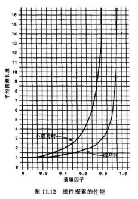

- 图片解析：
  - 当填装因子是1/2时，成功的搜索需要1.5次比较，不成功的搜索需要2.5次
  - 当填装因子为2/3时，分别需要2.0次和5.0次比较
  - 如果填装因子更大，比较次数会非常大
  - 应该使填装因子保持在2/3以下，最好在1/2以下，另一方面，填装因子越低，对于给定数量的数据项，就需要越多的空间
  - 实际情况中，最好的填装因子取决于存储效率和速度之间的平衡，随着填装因子变小，存储效率下降，而速度上升

##### 3.4.2 二次探测和再哈希化效率

+ 二次探测和再哈希法的性能相当。它们的性能比线性探测略好

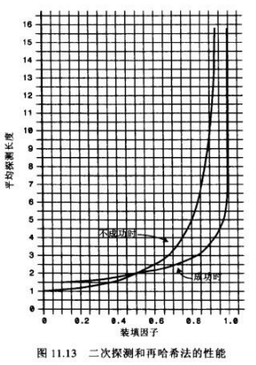

+ 图片解析：
  + 当填装因子是0.5时，成功和不成的查找平均需要2次比较
  + 当填装因子为2/3时，分别需要2.37和3.0次比较
  + 当填装因子为0.8时，分别需要2.9和5.0次
  + 因此对于较高的填装因子，对比线性探测，二次探测和再哈希法还是可以忍受的

##### 3.4.3 链地址法效率

+ 链地址法的效率分析有些不同，一般来说比开放地址法简单。我们来分析一下这个公式应该是怎么样的

  + 假如哈希表包含arraySize个数据项，每个数据项有一个链表，在表中一共包含N个数据项
  + 那么，平均起来每个链表有多少个数据项呢？非常简单，`N / arraySize`
  + 有没有发现这个公式有点眼熟？其实就是`装填因子`

+ OK，那么我们现在就可以求出查找成功和不成功的次数了

  + 成功可能只需要查找链表的一半即可：`1 + loadFactor/2`
  + 不成功呢？可能需要将整个链表查询完才知道不成功：`1 + loadFactor`

+ 经过上面的比较我们可以发现，**链地址法相对来说效率是好于开放地址法的**

+ 所以在真实开发中，使用`链地址法`的情况较多

  + 因为它不会因为添加了某元素后性能急剧下降
  + 比如在Java的HashMap中使用的就是链地址法

  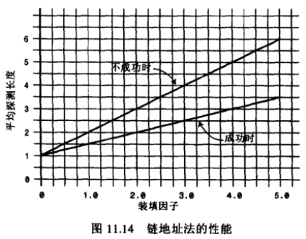

### 4. 哈希函数代码实现

#### 4.1 哈希函数

+ 讲了很久的哈希表理论知识，你有没有发现在整个过程中，一个非常重要的东西：`哈希函数`呢？
+ 好的哈希函数应该尽可能让计算的过程变得简单，提高计算的效率
  + 哈希表的主要`优点是它的速度`，所以在速度上不能满足，那么就达不到设计的目的了
  + 提高速度的一个办法就是让哈希函数中`尽量少的有乘法和除法`。因为它们的性能是比较低的
+ 设计好的哈希函数应该具备哪些优点呢？
  + `快速的计算`
    + 哈希表的优势就在于效率，所以快速获取到对应的hashCode非常重要
    + 我们需要通过快速的计算来获取到元素对应的hashCode
  + `均匀的分布`
    + 哈希表中，无论是链地址法还是开放地址法，当多个元素映射到同一个位置的时候，都会影响效率
    + 所以，优秀的哈希函数应该尽可能将元素映射到不同的位置，让元素在哈希表中均匀的分布

#### 4.2 快速计算：霍纳法则

+ 在前面，我们计算哈希值的时候使用的方式
  + cats = 3\*27³ + 1\*27² + 20*27 + 19 = 60337
+ 这种方式是`直观的计算结果`，那么这种计算方式会进行`几次乘法几次加法`呢？
  + 当然，我们可能不止4项，可能有更多项
  + 我们抽象一下，这个表达式其实是一个多项式：a(n)x^n + a(n-1)x^(n-1) + …+ a(1)x + a(0)
+ 现在问题就变成了多项式`有多少次乘法和加法`：
  + 乘法次数 (不考虑前面的系数)：n＋(n－1)＋…＋1＝n(n+1)/2
  + 加法次数：n次
  + O(N²)
+ 多项式的优化：`霍纳法则`
  + 解决这类求值问题的高效算法--`霍纳法则`。在中国，霍纳法则也被称为`秦九韶算法`
+ 通过如下变换我们可以得到一种`快得多`的算法，即
  + Pn(x) =  anx^n + a(n－1)x^(n-1) + … + a1x + a0 = ((…(((anx +an－1)x+an－2)x+ an－3)…)x+a1)x+a0
  + 这种求值的方式我们称为`霍纳法则`
+ 变换后，我们需要`多少次乘法，多少次加法`呢？
  + 乘法次数：N次
  + 加法次数：N次
  + 如果使用大O表示时间复杂度的话，我们直接从 O(N²) 降到了 O(N)

#### 4.3 均匀分布

+ 均匀的分布
  + 在设计哈希表时，我们已经有办法处理`映射到相同下标值`的情况：链地址法或者开放地址法
  + 但是无论哪种方案，为了提供效率，最好的情况还是让数据在哈希表中`均匀分布`
  + 因此，我们需要在`使用常量的地方`，尽量使用`质数`
  + 哪些地方我们会使用到常量呢？
+ 质数的使用：
  + 哈希表的长度 (取余操作的时候分布的更加均匀)
  + N次幂的底数 (我们之前使用的是27)
+ 为什么他们使用质数，会让哈希表分布更加均匀呢？
  + 质数和其他数相乘的结果相比于其他数字更容易产生唯一性的结果，减少哈希冲突
  + Java中的N次幂的底数选择的是31，是经过长期观察分布结果得出的

#### 4.4 Java中的HashMap

+ Java中的哈希表采用的是`链地址法`
+ HashMap的`初始长度是16`，每次`自动扩展`(我们还没有聊到扩展的话题)，长度必须是2的次幂
  + 这是为了`服务于从Key映射到index`的算法。60000000 % 100 = 数字。下标值
+ HashMap中为了提高效率，采用了`位运算的方式`
  + HashMap中index的计算公式：index = HashCode（Key） & （Length - 1）
  + 比如计算book的hashcode，结果为十进制的3029737，二进制的101110001110101110 1001
  + 假定HashMap长度是默认的16，计算Length-1的结果为十进制的15，二进制的1111
  + 把以上两个结果做与运算，101110001110101110 1001 & 1111 = 1001，十进制是9，所以 index=9
+ 但是，我个人发现JavaScript中进行较大数据的位运算时会出问题，所以我的代码实现中还是使用了取模
  + 另外，我这里为了方便代码之后向`开放地址法中迁移，容量还是选择使用质数`

#### 4.5 N次幂的底数

+ 这里采用质数的原因是为了产生的数据不按照某种规律递增
  + 比如我们这里有一组数据是按照4进行递增的：0 4 8 12 16，将其映射到长度为8的哈希表中
  + 它们的位置是多少呢？0 - 4 - 0 - 4，依次类推 (取余操作)
  + 如果我们哈希表本身不是质数，而我们递增的数量可以使用质数，比如5，那么 0 5 10 15 20
  + 它们的位置是多少呢？0 - 5 - 2 - 7 - 4，依次类推。也可以尽量让数据均匀的分布
  + 我们之前使用的是27，这次可以使用一个接近的数，比如31/37/41等等。一个比较常用的数是31或37
+ 总之，质数是一个非常神奇的数字
+ 这里建议两处都使用质数：
  + 哈希表中数组的长度
  + N次幂的底数

### 5. 哈希表创建和操作

#### 5.1 哈希函数的实现

```typescript
// 哈希函数：将key映射成index
function hashFunc(key: string, max: number): number {
  // 1.计算hashCode  cats => 60337 (27为底的时候)
  let hashCode = 0;
  const length = key.length;
  for (let i = 0; i < length; i++) {
    // 霍纳法则计算 (31为底)
    hashCode = 31 * hashCode + key.charCodeAt(i);
  }

  // 2.求出索引值 (取余)
  const index = hashCode % max;
  return index;
}

// 测试哈希函数
console.log(hashFunc("abc", 7)); // 6
console.log(hashFunc("cba", 7)); // 1
console.log(hashFunc("nba", 7)); // 2
console.log(hashFunc("mba", 7)); // 0
```

#### 5.2 创建哈希表

+ 经过前面那么多内容的学习，我们现在可以真正`实现自己的哈希表`了

  + 可能你学到这里的时候，已经感觉到数据结构的一些复杂性
  + 但是如果你仔细品味，你也会发现它在设计时候的巧妙和优美
  + 当你爱上它的那一刻，你也真正爱上了编程，爱上数据结构

+ 我们这里采用`链地址法`来实现哈希表

  + 实现的哈希表 (基于storage的数组)每个index对应的是一个数组(bucket)。(当然基于链表也可以)
  + bucket中存放什么呢？我们最好将key和value都放进去，我们继续使用一个数组。(其实其他语言使用元组更好)
  + 最终我们的哈希表的数据格式是这样：[ [[k，v]，[k，v]，[k，v]] ，[[k，v]，[k，v]]，[[k，v]] ]

+ 代码解析，我们定义了三个属性：

  + `storage`作为我们的数组，数组中存放相关的元素
  + `count`表示当前已经存在了多少数据
  + `limit`用于标记数组中一共可以存放多少个元素

  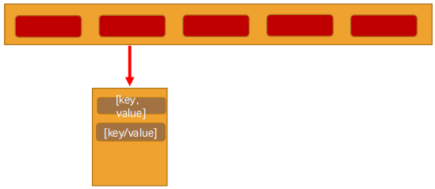

  ```typescript
  class HashTable<T = any> {
    // 创建一个数组，用来存放链地址法中的链子(数组)
    // [string, T] 表示一个元组类型
    private storage: [string, T][][] = [];
    // 记录数组的长度
    private length: number = 7;
    // 记录已经存放元素的个数
    // 装填因子loadFactor = count / length
    private count: number = 0;
  
    // 哈希函数
    private hashFunc(key: string, max: number): number {
      // 1.计算hashCode  cats => 60337 (27为底的时候)
      let hashCode = 0;
      const length = key.length;
      for (let i = 0; i < length; i++) {
        // 霍纳法则计算 (31为底)
        hashCode = 31 * hashCode + key.charCodeAt(i);
      }
  
      // 2.求出索引值 (取余)
      const index = hashCode % max;
      return index;
    }
  
    // 扩容函数
    private resize(newLength: number) {}
  
    // 在此处封装哈希表相关方法
    put(key: string, value: T) {}
    get(key: string): T | null {}
    delete(key: string): T | null  {}
  }
  
  const hashTable = new HashTable();
  ```

#### 5.3 插入 & 修改数据

+ 哈希表的插入和修改操作是同一个函数
  + 因为，当使用者传入一个&lt;Key，Value>时
  + 如果原来不存该key，那么就是插入操作
  + 如果已经存在该key，那么就是修改操作
+ 代码解析
  + 步骤1：根据传入的key获取对应的hashCode，也就是数组的index
  + 步骤2：从哈希表的index位置中取出桶(另外一个数组)
  + 步骤3：查看上一步的bucket是否为null
    + 为null，表示之前在该位置没有放置过任何的内容，那么就新建一个数组[]
  + 步骤4：查看是否之前已经放置过key对应的value
    + 如果放置过，那么就是依次替换操作，而不是插入新的数据
    + 我们使用一个变量override来记录是否是修改操作
  + 步骤5：如果不是修改操作，那么插入新的数据
    + 在bucket中push新的[key，value]即可
    + 注意：这里需要将count+1，因为数据增加了一项

```typescript
// 插入&修改数据
put(key: string, value: T) {
  // 1.根据key获取数组中对应的索引值
  const index = this.hashFunc(key, this.length);

  // 2.取出对应位置的桶(bucket)
  let bucket = this.storage[index];
  if (!bucket) {
    bucket = [];
    this.storage[index] = bucket;
  }

  // 3.判断是新增还是修改原来的值
  let isCover = false;
  for (let i = 0; i < bucket.length; i++) {
    const tuple = bucket[i];
    if (tuple[0] === key) {
      // 修改操作
      tuple[1] = value;
      isCover = true;
      break;
    }
  }

  // 4.如果上面的代码没有进行覆盖，那么在该位置进行添加
  if (!isCover) {
    bucket.push([key, value]);
    this.count++;
  }
}
```

#### 5.4 获取数据

+ 获取数据：根据key获取对应的value
+ 代码解析
  + 步骤1：根据key获取hashCode(也就是index)
  + 步骤2：根据index取出bucket
  + 步骤3：因为如果bucket都是null，那么说明这个位置之前并没有插入过数据
  + 步骤4：有了bucket，就遍历，并且如果找到，就将对应的value返回即可
  + 步骤5：没有找到，返回null

```typescript
// 获取数据
get(key: string): T | null {
  // 1.根据key获取索引值index
  const index = this.hashFunc(key, this.length);

  // 2.根据索引获取桶bucket
  const bucket = this.storage[index];
  if (!bucket) return null;

  // 3.遍历桶中的数据
  for (let i = 0; i < bucket.length; i++) {
    const tuple = bucket[i];
    if (tuple[0] === key) {
      return tuple[1];
    }
  }

  return null;
}
```

#### 5.5 删除数据

+ 删除数据：我们根据对应的key，删除对应的key/value
+ 代码解析：思路和获取数据相似，不再给出解析

```typescript
// 删除数据
delete(key: string): T | null {
  // 1.根据key获取index
  const index = this.hashFunc(key, this.length);

  // 2.根据索引获取桶bucket
  const bucket = this.storage[index];
  if (!bucket) return null;

  // 3.遍历桶中的数据
  for (let i = 0; i < bucket.length; i++) {
    const tuple = bucket[i];
    if (tuple[0] === key) {
      bucket.splice(i, 1);
      this.count--;
      return tuple[1];
    }
  }

  return null;
}
```

### 6. 哈希表的自动扩容

#### 6.1 哈希表扩容的思想

+ 为什么需要扩容？
  + 目前，我们是将所有的数据项放在`长度为7的数组`中的
  + 因为我们使用的是`链地址法`，`loadFactor`可以大于1，所以这个哈希表可以无限制的插入新数据
  + 但是，随着`数据量的增多`，每一个index对应的bucket会越来越长，也就造成`效率的降低`
  + 所以，在合适的情况对数组进行`扩容`，比如扩容两倍
+ 如何进行扩容？
  + 扩容可以简单的将容量`增大两倍`(不是质数吗？质数的问题后面再讨论)
  + 但是这种情况下，所有的数据项`一定要同时进行修改`(重新调用哈希函数，来获取到不同的位置)
  + 比如hashCode=12的数据项，在length=8的时候，index=4。在长度为16的时候呢？index=12
  + 这是一个`耗时的过程`，但是如果`数组需要扩容`，那么这个过程是`必要的`
+ 什么情况下扩容呢？
  + 比较常见的情况是`loadFactor > 0.75`的时候进行扩容
  + 比如Java的哈希表就是在装填因子大于0.75的时候，对哈希表进行扩容

#### 6.2 扩容函数

+ 我们来实现一下扩容函数
+ 代码解析
  + 步骤1：先将之前数组保存起来，因为我们待会儿会将storeage = []
  + 步骤2：之前的属性值需要重置
  + 步骤3：遍历所有的数据项，重新插入到哈希表中
+ 在什么时候调用扩容方法呢？
  + 在每次添加完新的数据时，都进行判断。(也就是put方法中)

```typescript
// 扩容函数
private resize(newLength: number) {
  // 设置新的长度
  this.length = newLength;

  // 获取原来的数据，并且重新放入到新的容量数组中
  // 1.对数据进行初始化操作
  const oldStorage = this.storage;
  this.storage = [];
  this.count = 0;

  // 2.获取原来的数据，放入新的数组中
  oldStorage.forEach((bucket) => {
    if (!bucket) return;
    for (let i = 0; i < bucket.length; i++) {
      const tuple = bucket[i];
      this.put(tuple[0], tuple[1]);
    }
  });
}
```

#### 6.3 put/remove方法修改

```typescript
// 插入&修改数据
put(key: string, value: T) {
  // 1.根据key获取数组中对应的索引值
  const index = this.hashFunc(key, this.length);

  // 2.取出对应位置的桶(bucket)
  let bucket = this.storage[index];
  if (!bucket) {
    bucket = [];
    this.storage[index] = bucket;
  }

  // 3.判断是新增还是修改原来的值
  let isCover = false;
  for (let i = 0; i < bucket.length; i++) {
    const tuple = bucket[i];
    if (tuple[0] === key) {
      // 修改操作
      tuple[1] = value;
      isCover = true;
      break;
    }
  }

  // 4.如果上面的代码没有进行覆盖，那么在该位置进行添加
  if (!isCover) {
    bucket.push([key, value]);
    this.count++;

    // 扩容操作
    // 发现loadFactor比例已经大于0.75了，那么就进行扩容
    const loadFactor = this.count / this.length;
    if (loadFactor > 0.75) {
      this.resize(this.length * 2);
    }
  }
}


// 删除数据-------------------------------------------------------------
delete(key: string): T | null {
  // 1.根据key获取index
  const index = this.hashFunc(key, this.length);

  // 2.根据索引获取桶bucket
  const bucket = this.storage[index];
  if (!bucket) return null;

  // 3.遍历桶中的数据
  for (let i = 0; i < bucket.length; i++) {
    const tuple = bucket[i];
    if (tuple[0] === key) {
      bucket.splice(i, 1);
      this.count--;

      // 缩容操作：数组长度最小为7，只有大于7的时候，才需要进行缩容操作
      const loadFactor = this.count / this.length;
      if (loadFactor < 0.25 && this.length > 7) {
        this.resize(Math.floor(this.length / 2));
      }

      return tuple[1];
    }
  }

  return null;
}
```

#### 6.4 容量质数

+ 我们前面提到过，容量最好是质数
  + 虽然在链地址法中将容量设置为质数，没有在开放地址法中重要
  + 但是其实链地址法中质数作为容量也更利于数据的均匀分布。所以，我们还是完成一下这个步骤
+ 我们这里先讨论一个常见的面试题，`判断一个数是质数`
+ 质数的特点：
  + 质数也称为`素数`
  + 质数表示大于1的自然数中，`只能被1和自己整除的数`
+ OK，了解了这个特点，应该不难写出它的算法

```typescript
// 判断一个数是否是质数
function isPrime(num: number): boolean {
  for (let i = 2; i < num; i++) {
    // 质数的特点是只能被1和num整除
    if (num % i === 0) {
      return false;
    }
  }
  return true;
}

console.log(isPrime(3));  // true
console.log(isPrime(32)); // false
console.log(isPrime(37)); // true
console.log(isPrime(45)); // false
```

#### 6.5 更高效的质数判断

+ 但是，这种做法的效率并不高。为什么呢？
  + 对于每个数n，其实并不需要从2判断到n-1
  + 一个数若可以进行因数分解，那么分解时得到的两个数一定是一个小于等于sqrt(n)，一个大于等于sqrt(n)
    + 注意： sqrt是square root的缩写，表示平方根
  + 比如16可以被分别。那么是2\*8，2小于sqrt(16)，也就是4，8大于4。而4*4都是等于sqrt(n)
  + 所以其实我们遍历到等于sqrt(n)即可

```typescript
// 判断一个数是否是质数
function isPrime(num: number): boolean {
  const sqrt = Math.sqrt(num);
  for (let i = 2; i <= sqrt; i++) {
    // 质数的特点是只能被1和num整除
    if (num % i === 0) {
      return false;
    }
  }
  return true;
}

console.log(isPrime(3));  // true
console.log(isPrime(32)); // false
console.log(isPrime(37)); // true
console.log(isPrime(45)); // false
```

#### 6.6 扩容的质数 (完整封装)

+ 前面，我们有对容量进行扩展，方式是：原来的容量 x 2
  + 比如之前的容量是7，那么扩容后就是14。14还是一个质数吗？
  + 显然不是，所以我们还需要一个方法，来实现一个新的容量为质数的算法
+ 那么我们可以封装获取新的容量的代码(质数)
+ 哈希表质数扩容(完整代码)


```typescript
class HashTable<T = any> {
  // 创建一个数组，用来存放链地址法中的链子(数组)
  // [string, T] 表示一个元组类型
  private storage: [string, T][][] = [];
  // 记录数组的长度
  private length: number = 7;
  // 记录已经存放元素的个数
  // 装填因子loadFactor = count / length
  private count: number = 0;

  // 哈希函数
  private hashFunc(key: string, max: number): number {
    // 1.计算hashCode  cats => 60337 (27为底的时候)
    let hashCode = 0;
    const length = key.length;
    for (let i = 0; i < length; i++) {
      // 霍纳法则计算 (31为底)
      hashCode = 31 * hashCode + key.charCodeAt(i);
    }

    // 2.求出索引值 (取余)
    const index = hashCode % max;
    return index;
  }

  // 判断数字是否是质数
  private isPrime(num: number): boolean {
    const sqrt = Math.sqrt(num);
    for (let i = 2; i <= sqrt; i++) {
      // 质数的特点是只能被1和num整除
      if (num % i === 0) {
        return false;
      }
    }
    return true;
  }

  // 寻找下一个质数
  private getNextPrime(num: number): number {
    let newPrime = num;
    while (!this.isPrime(newPrime)) {
      newPrime++;
    }
    return newPrime;
  }

  // 扩容函数
  private resize(newLength: number) {
    // 设置新的长度(新的长度是质数，并且最小长度为7)
    let newPrime = this.getNextPrime(newLength);
    if (newPrime < 7) {
      newPrime = 7;
    }
    this.length = newPrime;

    // 获取原来的数据，并且重新放入到新的容量数组中
    // 1.对数据进行初始化操作
    const oldStorage = this.storage;
    this.storage = [];
    this.count = 0;

    // 2.获取原来的数据，放入新的数组中
    oldStorage.forEach((bucket) => {
      if (!bucket) return;
      for (let i = 0; i < bucket.length; i++) {
        const tuple = bucket[i];
        this.put(tuple[0], tuple[1]);
      }
    });
  }

  // 插入&修改数据
  put(key: string, value: T) {
    // 1.根据key获取数组中对应的索引值
    const index = this.hashFunc(key, this.length);

    // 2.取出对应位置的桶(bucket)
    let bucket = this.storage[index];
    if (!bucket) {
      bucket = [];
      this.storage[index] = bucket;
    }

    // 3.判断是新增还是修改原来的值
    let isCover = false;
    for (let i = 0; i < bucket.length; i++) {
      const tuple = bucket[i];
      if (tuple[0] === key) {
        // 修改操作
        tuple[1] = value;
        isCover = true;
        break;
      }
    }

    // 4.如果上面的代码没有进行覆盖，那么在该位置进行添加
    if (!isCover) {
      bucket.push([key, value]);
      this.count++;

      // 扩容操作
      // 发现loadFactor比例已经大于0.75了，那么就进行扩容
      const loadFactor = this.count / this.length;
      if (loadFactor > 0.75) {
        this.resize(this.length * 2);
      }
    }
  }

  // 获取数据
  get(key: string): T | null {
    // 1.根据key获取索引值index
    const index = this.hashFunc(key, this.length);

    // 2.根据索引获取桶bucket
    const bucket = this.storage[index];
    if (!bucket) return null;

    // 3.遍历桶中的数据
    for (let i = 0; i < bucket.length; i++) {
      const tuple = bucket[i];
      if (tuple[0] === key) {
        return tuple[1];
      }
    }

    return null;
  }

  // 删除数据
  delete(key: string): T | null {
    // 1.根据key获取index
    const index = this.hashFunc(key, this.length);

    // 2.根据索引获取桶bucket
    const bucket = this.storage[index];
    if (!bucket) return null;

    // 3.遍历桶中的数据
    for (let i = 0; i < bucket.length; i++) {
      const tuple = bucket[i];
      if (tuple[0] === key) {
        bucket.splice(i, 1);
        this.count--;

        // 缩容操作：数组长度最小为7，只有大于7的时候，才需要进行缩容操作
        const loadFactor = this.count / this.length;
        if (loadFactor < 0.25 && this.length > 7) {
          this.resize(Math.floor(this.length / 2));
        }

        return tuple[1];
      }
    }

    return null;
  }
}
```

## (七) 树结构（Tree）

### 1. 认识树结构以及特性

#### 1.1 什么是树？

+ 真实的树：相信每个人对`现实生活中的树`都会非常熟悉
+ 我们来看一下树有什么特点？
  + 树通常有一个`根`，连接着根的是`树干`
  + 树干到上面之后会进行分叉成`树枝`，树枝还会分叉成更小的`树枝`
  + 在树枝的最后是`叶子`
+ 树的抽象：专家们对树的结构进行了抽象，发现树可以`模拟生活`中的`很多场景`


#### 1.2 模拟树结构

+ `公司组织架构`

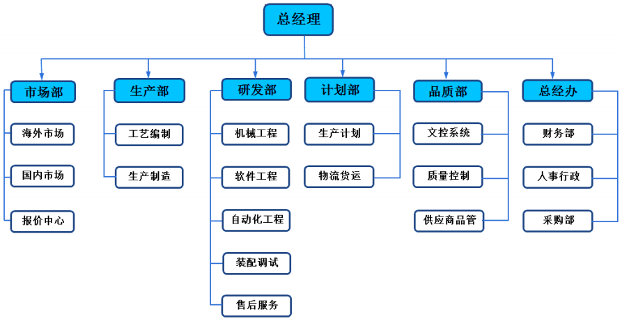

+ `红楼梦家谱`

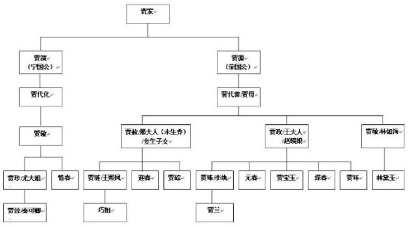

+ `前端非常熟悉的 DOM Tree`

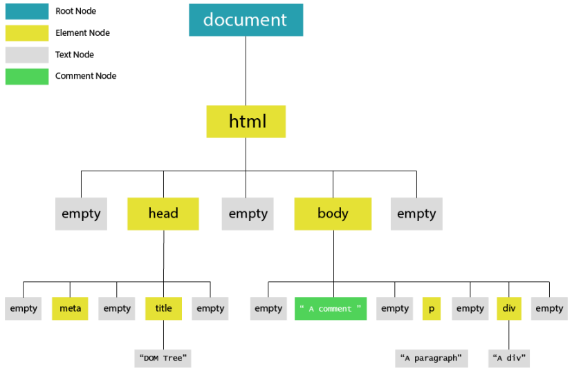

#### 1.3 树结构的抽象

+ 我们再将里面的`数据移除`，仅仅抽象出来`结构`，那么就是我们要学习的`树结构`

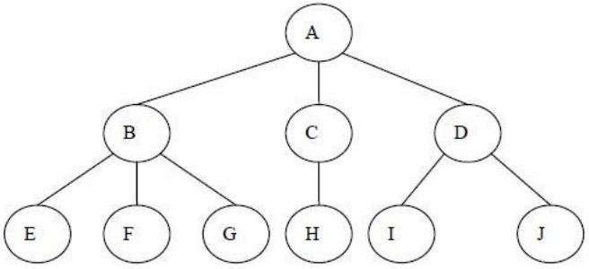

### 2. 树结构的优点和术语 

#### 2.1 树的优点

+ 我们之前已经学习了多种数据结构来保存数据，为什么要`使用树结构`来保存数据呢？
+ `树结构`和`数组/链表/哈希表的对比`有什么`优点`呢？
+ **数组**

  + 优点：

    + 数组的主要优点是根据`下标值访问`效率会很高
    + 但是如果我们希望根据元素来查找对应的位置呢？
    + 比较好的方式是先对数组进行`排序`，再进行`二分查找`

  + 缺点：

    + 需要先对数组进行`排序`，生成`有序数组`，才能提高查找效率
    + 另外数组在插入和删除数据时，需要有大量的`位移操作`(插入到首位或者中间位置的时候)，效率很低。
+ **链表**
  + 优点：
    + 链表的插入和删除操作效率都很高
  + 缺点：
    + `查找`效率很低，需要从头开始依次访问链表中的每个数据项，直到找到
    + 而且即使插入和删除操作效率很高，但是如果要插入和删除中间位置的数据，还是需要重头先找到对应的数据
+ **哈希表**
  + 优点：
    + 我们学过哈希表后，已经发现了哈希表的插入/查询/删除效率都是非常高的
    + 但是哈希表也有很多缺点
  + 缺点：
    + `空间利用率不高`，底层使用的是数组，并且某些单元是没有被利用的
    + 哈希表中的元素是`无序`的，不能按照固定的顺序来遍历哈希表中的元素
    + 不能快速的找出哈希表中的`最大值或者最小值`这些特殊的值
+ **树结构**
  + 我们不能说树结构比其他结构都要好，因为`每种数据结构都有自己特定的应用场景`
  + 但是`树确实也综合了上面的数据结构的优点`(当然优点不足于盖过其他数据结构，比如效率一般情况下没有哈希表高)
  + 并且`也弥补了上面数据结构的缺点`
+ **而且为了模拟某些场景，我们使用树结构会更加方便**
  + 因为数结构的非线性的，可以表示`一对多`的关系
  + 比如`文件的目录结构`

#### 2.2 树的术语

+ 在描述树的各个部分的时候有很多`术语`

  + 为了让介绍的内容更容易理解，需要知道一些`树的术语`
  + 不过大部分术语都与真实世界的`树相关`，或者和`家庭关系相关`(如父节点和子节点)，所以它们比较容易理解

+ 树（Tree）：n（n≥0）个节点构成的`有限集合`

  + 当n=0时，称为`空树`

+ 对于任一棵非空树（n> 0），它具备以下性质：

  + 树中有一个称为`“根（Root）”`的特殊节点，用 r 表示
  + 其余节点可分为m(m>0)个互不相交的有限集T1，T2，..。，Tm，其中每个集合本身又是一棵树，称为原来树的`“子树（SubTree）”`

  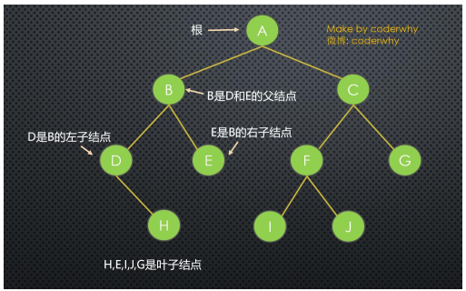

+ **树的术语**

  + `节点的度（Degree）`：节点的`子树个数`
  + `树的度 （Degree）` ：树的所有节点中`最大的度数`
  + `叶节点（Leaf）`：`度为0的节点`。(也称为`叶子节点`)
  + `父节点（Parent）`：有子树的节点是其子树的根节点的父节点
  + `子节点（Child）`：若A节点是B节点的父节点，则称B节点是A节点的子节点；子节点也称孩子节点
  + `兄弟节点（Sibling）`：具有同一父节点的各节点彼此是兄弟节点
  + `路径和路径长度`：从节点n1到nk的路径为一个节点序列n1 ，n2，… ，nk
    + ni是 n(i+1)的父节点
    + 路径所包含 边 的个数为路径的长度
  + `节点的层次（Level）`：规定`根节点在1层`，其它任一节点的层数是其父节点的`层数加1`
  + `树的深度（Depth）`：对于任意节点n，n的深度为从根到n的唯一路径长，根的深度为0
  + `树的高度（Height）`：对于任意节点n，n的高度为从n到一片树叶的最长路径长，所有树叶的高度为0

### 3. 树结构常见表示方法

+ 普通的表示方式

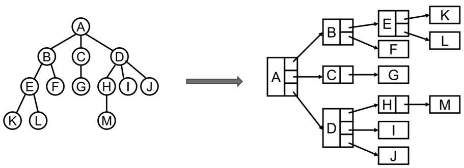

+ 儿子 - 兄弟表示法

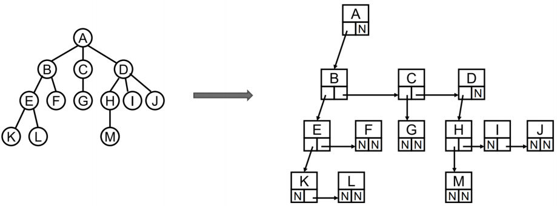

+ 儿子 - 兄弟表示法旋转

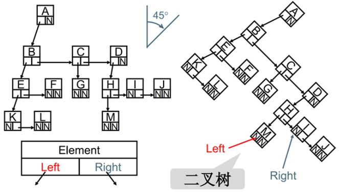

+ **你发现上面规律了吗？**
  + 其实所有的树本质上都可以`使用二叉树模拟出来`
  + 所以在学习树的过程中，`二叉树非常重要`

### 4. 二叉树特性以及概念

#### 4.1 二叉树的概念

+ 果树中每个节点`最多只能有两个子节点`，这样的树就成为`"二叉树"`
  + 前面，我们已经提过二叉树的重要性，不仅仅是因为简单，也因为几乎上所有的树都可以表示成二叉树的形式
+ 二叉树的定义
  + 二叉树`可以为空`，也就是`没有节点`
  + 若`不为空`，则它是`由根节点` 和 称为其 `左子树TL`和 `右子树TR` 的两个不相交的二叉树组成
+ 二叉树有五种形态

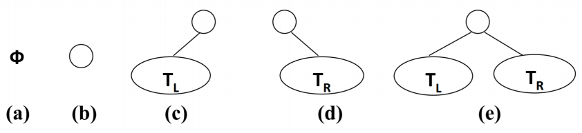

#### 4.2 二叉树的特性

+ 二叉树有几个比较重要的特性，在笔试题中比较常见

  + 一颗二叉树`第 i 层的最大节点数`为：2^(i-1)，i >= 1
  + 深度`为k的二叉树有最大节点总数`为： 2^k - 1，k >= 1
  + 对`任何非空二叉树T`，若n0表示叶节点的个数、n2是度为2的非叶节点个数，那么两者满足关系n0 = n2 + 1

  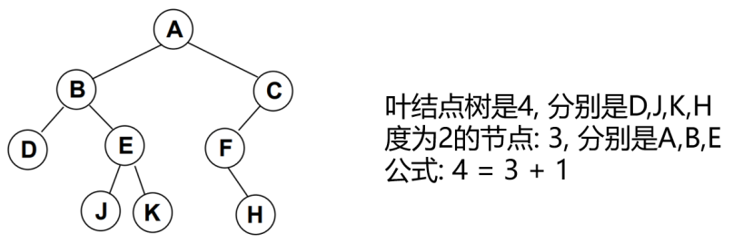

#### 4.3 完美二叉树

+ 完美二叉树(Perfect Binary Tree) ，也称为满二叉树(Full Binary Tree）
  + 在二叉树中，除了`最下一层的叶节点外，每层节点都有2个子节点`，就构成了`满二叉树`

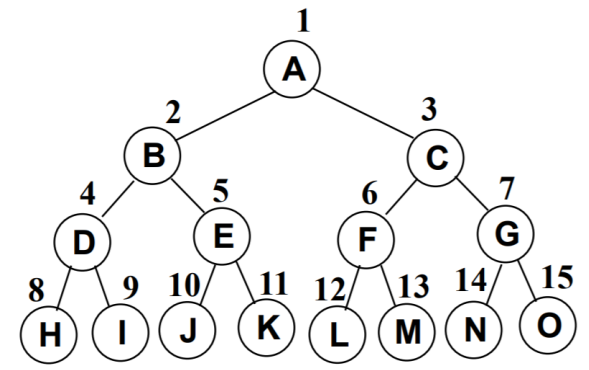

#### 4.4 完全二叉树

+ 完全二叉树(Complete Binary Tree)
  + 除`二叉树最后一层外，其他各层的节点数都达到最大个数`
  + 且`最后一层从左向右的叶节点连续存在，只缺右侧若干节点`
  + `完美二叉树`是特殊的`完全二叉树`
+ 下面不是完全二叉树，因为D节点还没有右节点，但是E节点就有了左右节点


### 5. 二叉树常见存储方式

+ 二叉树的存储常见的方式是`数组`和`链表`

+ **使用数组**

  + `完全二叉树`：按从上至下、从左到右顺序存储

     

  + `非完全二叉树`
    + 非完全二叉树要转成完全二叉树才可以按照上面的方案存储

    + 但是会造成很大的空间浪费

       

+ **链表存储**

  + 二叉树最常见的方式还是使用链表存储
    + `每个节点封装成一个Node`，Node中`包含存储的数据，左节点的引用，右节点的引用`

  

### 6. 认识二叉搜索树特性

#### 6.1 什么是二叉搜索树？

+ 二叉搜索树（BST，Binary Search Tree），也称二叉排序树或二叉查找树

+ 二叉搜索树是一颗二叉树，可以为空

+ 如果不为空，满足以下`性质`：

  + 非空左子树的所有键值小于其根节点的键值
  + 非空右子树的所有键值大于其根节点的键值
  + 左、右子树本身也都是二叉搜索树

+ 下面哪些是二叉搜索树，哪些不是？

  

+ 二叉搜索树的`特点`：

  + 二叉搜索树的特点就是相对`较小的值`总是保存在`左节点`上，相对`较大的值`总是保存在`右节点`上
  + 那么利用这个特点，我们可以做什么事情呢？
  + 查找效率非常高，这也是`二叉搜索树`中，`搜索的来源`

#### 6.2 二叉搜索树

+ 下面是一个二叉搜索

  

+ 这样的数据结构有什么好处呢？我们试着`查找一下值为10的节点`

  

+ 这种方式就是二分查找的思想

  + `查找所需的最大次数`等于`二叉搜索树的深度`
  + `插入节点`时，也`利用类似的方法，一层层比较大小，找到新节点合适的位置`

### 7. 二叉搜索树类的封装

+ 们像封装其他数据结构一样，先来封装一个BSTree的类


+ 代码解析：
  + 封装BSTree的类
  + 还需要封装一个用于保存每一个节点的类TreeNode
  + 该类包含三个属性：节点对应的value，指向的左子树left，指向的右子树right
  + 对于BSTree来说，只需要保存根节点即可，因为其他节点都可以通过根节点找到

```typescript
class Node<T> {
  value: T;
  constructor(value: T) {
    this.value = value;
  }
}

class TreeNode<T> extends Node<T> {
  left: TreeNode<T> | null = null;
  right: TreeNode<T> | null = null;
    
  // 新增属性
  // 当前节点的父节点
  parent: TreeNode<T> | null = null;
  // 当前节点是父节点的左子节点
  get isLeft(): boolean {
    return !!(this.parent && this.parent.left === this);
  }
  // 当前节点是父节点的右子节点
  get isRight(): boolean {
    return !!(this.parent && this.parent.right === this);
  }
}

class BSTree<T> {
  private root: TreeNode<T> | null = null;

  // 树常见操作的方法
  print() {}
  private searchNode(value: T): TreeNode<T> | null {}

  // 插入操作
  insert(value: T) {}
  insertNode(node: TreeNode<T>, newNode: TreeNode<T>) {}
  // 遍历操作
  preOrderTraverse() {}
  private preOrderTraverseNode() {}
  inOrderTraverse() {}
  private inOrderTraverseNode() {}
  postOrderTraverse() {}
  private postOrderTraverseNode() {}
  levelOrderTraversal() {}
  // 最大值/最小值
  getMinValue(): T | null {}
  getMaxValue(): T | null {}
  // 搜索
  search(value: T): boolean {}
  // 删除
  private getSuccessor(delNode: TreeNode<T>): TreeNode<T> {}
  remove(value: T): boolean {}
}
```

### 8. 二叉搜索树常见操作

+ 二叉搜索树有哪些常见的操作呢？
+ 插入操作：
  + `insert(value)`：向树中插入一个新的数据
+ 查找操作：
  + `search(value)`：在树中查找一个数据，如果节点存在，则返回true；如果不存在，则返回false
  + `min`：返回树中最小的值/数据
  + `max`：返回树中最大的值/数据
+ 遍历操作：
  + `inOrderTraverse`：通过`中序遍历`方式遍历所有节点
  + `preOrderTraverse`：通过`先序遍历`方式遍历所有节点
  + `postOrderTraverse`：通过`后序遍历`方式遍历所有节点
  + `levelOrderTraverse`：通过`层序遍历`方式遍历所有节点
+ 删除操作（有一点点复杂）：
  + `remove(value)`：从树中移除某个数据

### 9. 二叉搜索树插入操作

+ 我们分两个部分来完成这个功能

+ **首先，外界调用的insert方法**

  ```typescript
  // 插入数据的操作
  insert(value: T) {
    // 1.创建新节点
    const newNode = new TreeNode(value);

    // 2.判断是否有根节点
    if (!this.root) {
      this.root = newNode;
    } else {
      this.insertNode(this.root, newNode);
    }
  }
  ```

+ 代码解析：

  + 首先，根据传入的value，创建对应的Node
  + 其次，向树中插入数据需要分成两种情况：
    + 第一次插入，直接修改根节点即可
    + 其他次插入，需要进行相关的比较决定插入的位置
  + 代码中的insertNode方法，我们还没有实现，也是我们接下来要完成的任务

+ **其次，插入非根节点**

  ```typescript
  // 插入非根节点
  insertNode(node: TreeNode<T>, newNode: TreeNode<T>) {
    if (newNode.value < node.value) {
      // 向左子树插入
      if (node.left === null) {
        node.left = newNode;
      } else {
        this.insertNode(node.left, newNode);
      }
    } else {
      // 向右子树插入
      if (node.right === null) {
        node.right = newNode;
      } else {
        this.insertNode(node.right, newNode);
      }
    }
  }
  ```

+ 代码解析：

  + 插入其他节点时，我们需要判断该值到底是插入到左边还是插入到右边
  + 判断的依据来自于新节点的value和原来节点的value值的比较
    + 如果新节点的newvalue小于原节点的oldvalue，那么就向左边插入
    + 如果新节点的newvalue大于原节点的oldvalue，那么就向右边插入
  + 代码的1序号位置，就是准备向左子树插入数据。但是它本身又分成两种情况
    + 情况一(代码1.1位置)：左子树上原来没有内容，那么直接插入即可
    + 情况二(代码1.2位置)：左子树上已经有了内容，那么就一次向下继续查找新的走向，所以使用递归调用即可
  + 代码的2序号位置，和1序号位置几乎逻辑是相同的，只是是向右去查找
    + 情况一(代码2.1位置)：左右树上原来没有内容，那么直接插入即可
    + 情况二(代码2.2位置)：右子树上已经有了内容，那么就一次向下继续查找新的走向，所以使用递归调用即可

+ **测试插入代码**


```typescript
import { btPrint } from "hy-algokit";

// 打印树的方法
print() {
  // 使用coderwhy老师封装的库hy-algokit，查看树的结构，传入树的根节点
  btPrint(this.root);
}

const bst = new BSTree<number>();
// 插入数据
bst.insert(11);
bst.insert(7);
bst.insert(15);
bst.insert(5);
bst.insert(3);
bst.insert(9);
bst.insert(8);
bst.insert(10);
bst.insert(13);
bst.insert(12);
bst.insert(14);
bst.insert(20);
bst.insert(18);
bst.insert(25);
bst.insert(6);

// 调用打印树的方法
bst.print();
```


### 10. 二叉搜索树遍历操作

+ 前面，我们向树中插入了很多的数据，为了能很多的看到测试结果。我们先来学习一下`树的遍历`
  + 注意：这里我们学习的树的遍历，`针对所有的二叉树`都是适用的，`不仅仅是二叉搜索树`
+ 树的遍历
  + 遍历一棵树是指访问`树的每个节点`(也可以对每个节点进行某些操作，我们这里就是简单的打印)
  + 但是树和线性结构不太一样，线性结构我们通常按照`从前到后的顺序遍历`，但是树呢？
  + 应该从树的顶端还是底端开始呢？ 从左开始还是从右开始呢？
+ 二叉树的遍历常见的有`四种方式`，先序/中序/后序，取决于访问根节点（root）的时机
  + 先序遍历：根节点 - 左子树 - 右子树
  + 中序遍历：左子树 - 根节点 - 右子树
  + 后序遍历：左子树 - 右子树 - 根节点
  + 层序遍历：从上向下逐层遍历

#### 10.1 先序遍历

+ 遍历过程为：

  + ①访问根节点
  + ②先序遍历其左子树
  + ③先序遍历其右子树

  

  

```typescript
// 先序遍历
preOrderTraverse() {
  this.preOrderTraverseNode(this.root);
}
private preOrderTraverseNode(node: TreeNode<T> | null) {
  if (node) {
    console.log(node.value);
    this.preOrderTraverseNode(node.left);
    this.preOrderTraverseNode(node.right);
  }
}

// 输出：11 - 7 - 5 - 3 - 6 - 9 - 8 - 10 - 15 - 13 - 12 - 14 - 20 - 18 - 25
```

+ 先序遍历（非递归 – 课下扩展）

 

#### 10.2 中序遍历

+ 遍历过程为：
  + ①中序遍历其左子树
  + ②访问根节点
  + ③中序遍历其右子树


```typescript
// 中序遍历
inOrderTraverse() {
  this.inOrderTraverseNode(this.root);
}
private inOrderTraverseNode(node: TreeNode<T> | null) {
  if (node) {
    this.inOrderTraverseNode(node.left);
    console.log(node.value);
    this.inOrderTraverseNode(node.right);
  }
}

 // 输出：3 - 5 - 6 - 7 - 8 - 9 - 10 - 11 - 12 - 13 - 14 - 15 - 18 - 20 - 25
```

+ 中序遍历（非递归 – 课下扩展）

 

#### 10.3 后序遍历

+ 遍历过程为：
  + ①后序遍历其左子树
  + ②后序遍历其右子树
  + ③访问根节点


```typescript
// 后序遍历
postOrderTraverse() {
  this.postOrderTraverseNode(this.root);
}
private postOrderTraverseNode(node: TreeNode<T> | null) {
  if (node) {
    this.postOrderTraverseNode(node.left);
    this.postOrderTraverseNode(node.right);
    console.log(node.value);
  }
}

// 输出：3 - 6 - 5 - 8 - 10 - 9 - 7 - 12 - 14 - 13 - 18 - 25 - 20 - 15 - 11
```

+ 后序遍历（非递归 – 课下扩展）

 

#### 10.4 层序遍历

+ 遍历过程为：
  + 层序遍历很好理解，就是从上向下逐层遍历
  + 层序遍历通常我们会借助于队列来完成，也是队列的一个经典应用场景


```typescript
// 层序遍历
levelOrderTraversal() {
  // 没有根节点，直接返回
  if (!this.root) return;

  // 创建一个队列
  const queue: TreeNode<T>[] = [];
  queue.push(this.root);

  while (queue.length !== 0) {
    const current = queue.shift()!;
    console.log(current?.value);

    if (current.left !== null) {
      queue.push(current.left);
    }

    if (current.right !== null) {
      queue.push(current.right);
    }
  }
}

// 输出：11 - 7 - 15 - 5 - 9 - 13 - 20 - 3 - 6 - 8 - 10 - 12 - 14 - 18 - 25
```

### 11. 二叉搜索树最大值 & 最小值

+ 在二叉搜索树中搜索最值是一件非常简单的事情，其实用眼睛看就可以看出来了


```typescript
// 最小值：3
getMinValue(): T | null {
  let current = this.root;
  while (current && current.left) {
    current = current.left;
  }
  return current?.value ?? null;
}

// 最大值：25
getMaxValue(): T | null {
  let current = this.root;
  while (current && current.right) {
    current = current.right;
  }
  return current?.value ?? null;
}
```

### 12. 二叉搜索树搜索操作

+ 二叉搜索树不仅仅获取最值效率非常高，搜索特定的值效率也非常高
  + 注意：这里的实现返回boolean类型即可
+ 代码解析：
  + 这里我们还是使用了递归的方式
  + 递归必须有退出条件，我们这里是两种情况下退出
    + node === null，也就是后面不再有节点的时候
    + 找到对应的value，也就是node.value === value的时候
  + 在其他情况下，根据node.的value和传入的value进行比较来决定向左还是向右查找
    + 如果node.value > value，那么说明传入的值更小，需要向左查找
    + 如果node.value < value，那么说明传入的值更大，需要向右查找

```typescript
// 搜索
search(value: T): boolean {
  return this.searchNode(this.root, value);
}
private searchNode(node: TreeNode<T> | null, value: T): boolean {
  // 1.如果节点为null，那么直接退出递归
  if (node === null) return false;

  // 2.判断节点的value和传入的value的大小
  if (node.value > value) {
    // 在左边继续查找
    return this.searchNode(node.left, value);
  } else if (node.value < value) {
    // 在右边继续查找
    return this.searchNode(node.right, value);
  } else {
    return true;
  }
}
```

+ search搜索特定的值（非递归）

```typescript
// 搜索
search(value: T): boolean {
  let current = this.root;
  while (current) {
    if (current.value === value) return true;
    if (current.value < value) {
      current = current.right;
    } else {
      current = current.left;
    }
  }
  return false;
}
```

### 13. 二叉搜索树删除操作

+ 二叉搜索树的删除有些复杂，我们一点点完成
+ 删除节点要从查找要删的节点开始，找到节点后，需要考虑三种情况：
  + 该节点是叶节点 (没有字节点，比较简单)
  + 该节点有一个子节点 (也相对简单)
  + 该节点有两个子节点 (情况比较复杂，我们后面慢慢道来)
+ 我们先从查找要删除的节点入手
+ `1> 先找到要删除的节点，如果没有找到，不需要删除`
+ `2> 找到要删除节点`
  + `1) 删除叶子节点`
  + `2) 删除只有一个子节点的节点`
  + `3) 删除有两个子节点的节点`

#### 13.1 情况一：没有子节点

+ 情况一：没有子节点

  + 这种情况相对比较简单，我们需要检测current的left以及right是否都为null
  + 都为null之后还要检测一个东西，就是是否current就是根，都为null，并且为根，那么相当于要清空二叉树(当然，只是清空了根，因为只有它)
  + 否则就把父节点的left或者right字段设置为null即可

  

+ 如果只有一个单独的根，直接删除即可


```typescript
// 搜索 & 删除方法有重复代码，进行重构，叶子节点删除
import { btPrint } from "hy-algokit";

class Node<T> {
  value: T;
  constructor(value: T) {
    this.value = value;
  }
}

class TreeNode<T> extends Node<T> {
  left: TreeNode<T> | null = null;
  right: TreeNode<T> | null = null;

  // 新增属性
  // 当前节点的父节点
  parent: TreeNode<T> | null = null;
  // 当前节点是父节点的左子节点
  get isLeft(): boolean {
    return !!(this.parent && this.parent.left === this);
  }
  // 当前节点是父节点的右子节点
  get isRight(): boolean {
    return !!(this.parent && this.parent.right === this);
  }
}

class BSTree<T> {
  private root: TreeNode<T> | null = null;

  // 打印树的方法
  print() {
    // 使用coderwhy老师封装的库hy-algokit，查看树的结构
    // 传入树的根节点
    btPrint(this.root);
  }

  // 搜索节点
  private searchNode(value: T): TreeNode<T> | null {
    let current = this.root;
    let parent: TreeNode<T> | null = null;
    while (current) {
      // 1.如果找到current，直接返回即可
      if (current.value === value) {
        return current;
      }

      // 2.继续向下找
      parent = current;
      if (current.value < value) {
        current = current.right;
      } else {
        current = current.left;
      }

      // 如果current有值，那么current保存自己的父节点
      if (current) current.parent = parent;
    }

    return null;
  }

  // 插入数据的操作
  insert(value: T) {
    // 1.创建新节点
    const newNode = new TreeNode(value);

    // 2.判断是否有根节点
    if (!this.root) {
      this.root = newNode;
    } else {
      this.insertNode(this.root, newNode);
    }
  }

  // 插入非根节点
  insertNode(node: TreeNode<T>, newNode: TreeNode<T>) {
    if (newNode.value < node.value) {
      // 向左子树插入
      if (node.left === null) {
        node.left = newNode;
      } else {
        this.insertNode(node.left, newNode);
      }
    } else {
      // 向右子树插入
      if (node.right === null) {
        node.right = newNode;
      } else {
        this.insertNode(node.right, newNode);
      }
    }
  }

  // 搜索方法重构
  search(value: T): boolean {
    return !!this.searchNode(value);
  }

  // 删除
  remove(value: T): boolean {
    // 1.搜索：当前是否有这个value
    let current = this.searchNode(value);
    if (!current) return false;

    // 2.获取三个属性：当前节点、父节点、当前节点是父节点的左子节点还是右子节点
    // 2.1.如果删除的是叶子节点
    if (current.left === null && current.right === null) {
      if (current === this.root) {
        // 当前节点是根节点
        this.root = null;
      } else if (current.isLeft) {
        // 当前节点是父节点的左子节点
        current.parent!.left = null;
      } else {
        // 当前节点是父节点的右子节点
        current.parent!.right = null;
      }
    }

    return true;
  }
}

const bst = new BSTree<number>();

// 插入数据
bst.insert(11);
bst.insert(7);
bst.insert(15);
bst.insert(5);
bst.insert(3);
bst.insert(9);
bst.insert(8);
bst.insert(10);
bst.insert(13);
bst.insert(12);
bst.insert(14);
bst.insert(20);
bst.insert(18);
bst.insert(25);
bst.insert(6);

// 调用打印树的方法
bst.print();
bst.remove(6);
bst.remove(12);
bst.print();
```


#### 13.2 情况二：一个子节点

+ 情况二：有一个子节点

  + 这种情况也不是很难
  + 要删除的current节点，只有2个连接(如果有两个子节点，就是三个连接了)，一个连接父节点，一个连接唯一的子节点
  + 需要从这三者之间：爷爷 - 自己 - 儿子，将自己(current)剪短，让爷爷直接连接儿子即可
  + 这个过程要求改变父节点的left或者right，指向要删除节点的子节点
  + 当然，在这个过程中还要考虑是否current就是根

  

+ 图解过程

  + 如果是根的情况，大家可以自己画一下，比较简单，这里不再给出
  + 如果不是根，并且只有一个子节点的情况

```typescript
// 删除
remove(value: T): boolean {
  // 1.搜索：当前是否有这个value
  let current = this.searchNode(value);
  if (!current) return false;

  // 2.获取三个属性：当前节点、父节点、当前节点是父节点的左子节点还是右子节点
  // 2.1.如果删除的是叶子节点
  if (current.left === null && current.right === null) {
    if (current === this.root) {
      // 当前节点是根节点
      this.root = null;
    } else if (current.isLeft) {
      // 当前节点是父节点的左子节点
      current.parent!.left = null;
    } else {
      // 当前节点是父节点的右子节点
      current.parent!.right = null;
    }
  } else if (current.right === null) {
    // 2.2.只有一个子节点：只有左子节点
    if (current === this.root) {
      this.root = current.left;
    } else if (current.isLeft) {
      current.parent!.left = current.left;
    } else {
      current.parent!.right = current.left;
    }
  } else if (current.left === null) {
    // 2.2.只有一个子节点：只有右子节点
    if (current === this.root) {
      this.root = current.right;
    } else if (current.isLeft) {
      current.parent!.left = current.right;
    } else {
      current.parent!.right = current.right;
    }
  }

  return true;
}
```

#### 13.3 情况三：两个子节点


+ 如果我们要`删除的节点有两个子节点`，甚至`子节点还有子节点`，这种情况下我们需要从`下面的子节点中找到一个节点`，来替换`当前的节点`
+ 但是找到的这个节点`有什么特征呢`？ 应该是current节点下面所有节点中`最接近current节点`的
  + 要么`比current节点小一点点`，要么比`current节点大一点点`
  + 总结你`最接近current`，你就可以用来`替换current的位置`
+ 这个节点怎么找呢？
  + 比current`小一点点的节点`，一定是current`左子树的最大值`
  + 比current`大一点点的节点`，一定是current`右子树的最小值`
+ 前驱&后继
  + 在二叉搜索树中，这两个特别的节点，有两个`特别的名字`
  + 比current小一点点的节点，称为current节点的`前驱`
  + 比current大一点点的节点，称为current节点的`后继`
+ 也就是为了能够删除有两个子节点的current，要么找到它的前驱，要么找到它的后继
+ 所以，接下来，我们先找到这样的节点 (前驱或者后继都可以，我这里以找后继为例)

```typescript
// 实现删除操作
private getSuccessor(delNode: TreeNode<T>): TreeNode<T> {
  // 获取右子树
  let current = delNode.right;
  // 后继节点
  let successor: TreeNode<T> | null = null;

  // 寻找右子树的最小节点
  while (current) {
    successor = current;
    current = current.left;
    if (current) {
      current.parent = successor;
    }
  }

  if (successor !== delNode.right) {
    successor!.parent!.left = successor!.right;
    successor!.right = delNode.right;
  }

  // 将删除节点的left，赋值给后继节点的left
  successor!.left = delNode.left;

  // 找到了后继节点
  return successor!;
}

// 删除
remove(value: T): boolean {
  // 1.搜索：当前是否有这个value
  let current = this.searchNode(value);
  if (!current) return false;

  // 2.获取三个属性：当前节点、父节点、当前节点是父节点的左子节点还是右子节点
  // 2.1.如果删除的是叶子节点
  if (current.left === null && current.right === null) {
    if (current === this.root) {
      // 当前节点是根节点
      this.root = null;
    } else if (current.isLeft) {
      // 当前节点是父节点的左子节点
      current.parent!.left = null;
    } else {
      // 当前节点是父节点的右子节点
      current.parent!.right = null;
    }
  } else if (current.right === null) {
    // 2.2.只有一个子节点：只有左子节点
    if (current === this.root) {
      this.root = current.left;
    } else if (current.isLeft) {
      current.parent!.left = current.left;
    } else {
      current.parent!.right = current.left;
    }
  } else if (current.left === null) {
    // 2.2.只有一个子节点：只有右子节点
    if (current === this.root) {
      this.root = current.right;
    } else if (current.isLeft) {
      current.parent!.left = current.right;
    } else {
      current.parent!.right = current.right;
    }
  } else {
    // 2.2.有两个子节点
    const successor = this.getSuccessor(current);
    if (current === this.root) {
      this.root = successor;
    } else if (current.isLeft) {
      current.parent!.left = successor;
    } else {
      current.parent!.right = successor;
    }
  }

  return true;
}
```

#### 13.4 删除操作总结

+ 看到这里，你就会发现删除节点`相当棘手`
+ 实际上，因为它`非常复杂`，一些程序员都尝试着避开`删除操作`
  + 他们的做法是在Node类中添加一个boolean的字段，比如名称为`isDeleted`
  + 要删除一个节点时，就将此字段设置为`true`
  + 其他操作，比如find()在查找之前先判断这个节点是不是标记为删除
  + 这样相对比较简单，每次删除节点不会改变原有的树结构
  + 但是在二叉树的存储中，还保留着那些本该已经被删除掉的节点
+ 上面的做法看起来很`聪明`，其实是一种`逃避`
  + 这样会造成`很大空间的浪费`，特别是针对数据量较大的情况
  + 而且，作为程序员要学会通过这些`复杂的操作`，锻炼`自己的逻辑`

### 14. 二叉搜索树完整封装

#### 14.1 代码重构

```typescript
import { btPrint } from "hy-algokit";

class Node<T> {
  value: T;
  constructor(value: T) {
    this.value = value;
  }
}

class TreeNode<T> extends Node<T> {
  left: TreeNode<T> | null = null;
  right: TreeNode<T> | null = null;

  // 新增属性
  // 当前节点的父节点
  parent: TreeNode<T> | null = null;
  // 当前节点是父节点的左子节点
  get isLeft(): boolean {
    return !!(this.parent && this.parent.left === this);
  }
  // 当前节点是父节点的右子节点
  get isRight(): boolean {
    return !!(this.parent && this.parent.right === this);
  }
}

class BSTree<T> {
  private root: TreeNode<T> | null = null;

  // 打印树的方法
  print() {
    // 使用coderwhy老师封装的库hy-algokit，查看树的结构
    // 传入树的根节点
    btPrint(this.root);
  }

  // 搜索节点
  private searchNode(value: T): TreeNode<T> | null {
    let current = this.root;
    let parent: TreeNode<T> | null = null;
    while (current) {
      // 1.如果找到current，直接返回即可
      if (current.value === value) {
        return current;
      }

      // 2.继续向下找
      parent = current;
      if (current.value < value) {
        current = current.right;
      } else {
        current = current.left;
      }

      // 如果current有值，那么current保存自己的父节点
      if (current) current.parent = parent;
    }

    return null;
  }

  // 插入数据的操作
  insert(value: T) {
    // 1.创建新节点
    const newNode = new TreeNode(value);

    // 2.判断是否有根节点
    if (!this.root) {
      this.root = newNode;
    } else {
      this.insertNode(this.root, newNode);
    }
  }

  // 插入非根节点
  insertNode(node: TreeNode<T>, newNode: TreeNode<T>) {
    if (newNode.value < node.value) {
      // 向左子树插入
      if (node.left === null) {
        node.left = newNode;
      } else {
        this.insertNode(node.left, newNode);
      }
    } else {
      // 向右子树插入
      if (node.right === null) {
        node.right = newNode;
      } else {
        this.insertNode(node.right, newNode);
      }
    }
  }

  // 先序遍历
  preOrderTraverse() {
    this.preOrderTraverseNode(this.root);
  }
  private preOrderTraverseNode(node: TreeNode<T> | null) {
    if (node) {
      console.log(node.value);
      this.preOrderTraverseNode(node.left);
      this.preOrderTraverseNode(node.right);
    }
  }

  // 中序遍历
  inOrderTraverse() {
    this.inOrderTraverseNode(this.root);
  }
  private inOrderTraverseNode(node: TreeNode<T> | null) {
    if (node) {
      this.inOrderTraverseNode(node.left);
      console.log(node.value);
      this.inOrderTraverseNode(node.right);
    }
  }

  // 后序遍历
  postOrderTraverse() {
    this.postOrderTraverseNode(this.root);
  }
  private postOrderTraverseNode(node: TreeNode<T> | null) {
    if (node) {
      this.postOrderTraverseNode(node.left);
      this.postOrderTraverseNode(node.right);
      console.log(node.value);
    }
  }

  // 层序遍历
  levelOrderTraversal() {
    // 没有根节点，直接返回
    if (!this.root) return;

    // 创建一个队列
    const queue: TreeNode<T>[] = [];
    queue.push(this.root);

    while (queue.length !== 0) {
      const current = queue.shift()!;
      console.log(current?.value);

      if (current.left !== null) {
        queue.push(current.left);
      }

      if (current.right !== null) {
        queue.push(current.right);
      }
    }
  }

  // 最小值
  getMinValue(): T | null {
    let current = this.root;
    while (current && current.left) {
      current = current.left;
    }
    return current?.value ?? null;
  }

  // 最大值
  getMaxValue(): T | null {
    let current = this.root;
    while (current && current.right) {
      current = current.right;
    }
    return current?.value ?? null;
  }

  // 搜索
  search(value: T): boolean {
    return !!this.searchNode(value);
  }


  // 实现删除操作
  private getSuccessor(delNode: TreeNode<T>): TreeNode<T> {
    // 获取右子树
    let current = delNode.right;
    // 后继节点
    let successor: TreeNode<T> | null = null;

    // 寻找右子树的最小节点
    while (current) {
      successor = current;
      current = current.left;
      if (current) {
        current.parent = successor;
      }
    }

    if (successor !== delNode.right) {
      successor!.parent!.left = successor!.right;
      successor!.right = delNode.right;
    }

    // 将删除节点的left，赋值给后继节点的left
    successor!.left = delNode.left;

    // 找到了后继节点
    return successor!;
  }

  // 删除
  remove(value: T): boolean {
    // 1.搜索：当前是否有这个value
    let current = this.searchNode(value);
    if (!current) return false;

    // 2.获取三个属性：当前节点、父节点、当前节点是父节点的左子节点还是右子节点
    let replaceNode: TreeNode<T> | null = null;

    // 2.1.如果删除的是叶子节点
    if (current.left === null && current.right === null) {
      replaceNode = null;
    } else if (current.right === null) {
      // 2.2.只有一个子节点：只有左子节点
      replaceNode = current.left;
    } else if (current.left === null) {
      // 2.2.只有一个子节点：只有右子节点
      replaceNode = current.right;
    } else {
      // 2.2.有两个子节点
      const successor = this.getSuccessor(current);
      replaceNode = successor;
    }

    if (current === this.root) {
      this.root = replaceNode;
    } else if (current.isLeft) {
      current.parent!.left = replaceNode;
    } else {
      current.parent!.right = replaceNode;
    }

    return true;
  }
}
```

#### 14.2 树存放对象

```typescript
class Product {
  constructor(public name: string, public price: number) {}
  // 用于比较对象
  valueOf() {
    return this.price;
  }
}

const bst = new BSTree<Product>();

const p1 = new Product("iPhone", 100);
const p2 = new Product("huawei", 120);
const p3 = new Product("xiaomi", 80);
const p4 = new Product("oppo", 90);
const p5 = new Product("vivo", 70);

bst.insert(p1);
bst.insert(p2);
bst.insert(p3);
bst.insert(p4);
bst.insert(p5);

bst.print();
```


+ **树打印展示对象类型**

```typescript
import { btPrint, PrintableNode } from "hy-algokit";

// Node类里面的value改成了data
class Node<T> {
  data: T;
  constructor(value: T) {
    this.data = value;
  }
}

// 后面新增实现接口：PrintableNode，实现接口必须有接口里面所有的属性
// interface PrintableNode {
//   left: PrintableNode | null;
//   right: PrintableNode | null;
//   value: any;
// }
class TreeNode<T> extends Node<T> implements PrintableNode {
  left: TreeNode<T> | null = null;
  right: TreeNode<T> | null = null;

  // 新增一个属性value
  // 打印树的时候，hy-algokit库取值是value属性，我们自定义一个value
  get value() {
    const data = this.data as Product;
    return `${data.name}-${data.price}`;
  }

  // 新增属性
  // 当前节点的父节点
  parent: TreeNode<T> | null = null;
  // 当前节点是父节点的左子节点
  get isLeft(): boolean {
    return !!(this.parent && this.parent.left === this);
  }
  // 当前节点是父节点的右子节点
  get isRight(): boolean {
    return !!(this.parent && this.parent.right === this);
  }
}

class BSTree<T> {
  private root: TreeNode<T> | null = null;

  // 打印树的方法
  print() {
    // 使用coderwhy老师封装的库hy-algokit，查看树的结构
    // 传入树的根节点
    btPrint(this.root);
  }

  // 搜索节点
  private searchNode(value: T): TreeNode<T> | null {
    let current = this.root;
    let parent: TreeNode<T> | null = null;
    while (current) {
      // 1.如果找到current，直接返回即可
      if (current.data === value) {
        return current;
      }

      // 2.继续向下找
      parent = current;
      if (current.data < value) {
        current = current.right;
      } else {
        current = current.left;
      }

      // 如果current有值，那么current保存自己的父节点
      if (current) current.parent = parent;
    }

    return null;
  }

  // 插入数据的操作
  insert(value: T) {
    // 1.创建新节点
    const newNode = new TreeNode(value);

    // 2.判断是否有根节点
    if (!this.root) {
      this.root = newNode;
    } else {
      this.insertNode(this.root, newNode);
    }
  }

  // 插入非根节点
  insertNode(node: TreeNode<T>, newNode: TreeNode<T>) {
    if (newNode.data < node.data) {
      // 向左子树插入
      if (node.left === null) {
        node.left = newNode;
      } else {
        this.insertNode(node.left, newNode);
      }
    } else {
      // 向右子树插入
      if (node.right === null) {
        node.right = newNode;
      } else {
        this.insertNode(node.right, newNode);
      }
    }
  }

  // 先序遍历
  preOrderTraverse() {
    this.preOrderTraverseNode(this.root);
  }
  private preOrderTraverseNode(node: TreeNode<T> | null) {
    if (node) {
      console.log(node.data);
      this.preOrderTraverseNode(node.left);
      this.preOrderTraverseNode(node.right);
    }
  }

  // 中序遍历
  inOrderTraverse() {
    this.inOrderTraverseNode(this.root);
  }
  private inOrderTraverseNode(node: TreeNode<T> | null) {
    if (node) {
      this.inOrderTraverseNode(node.left);
      console.log(node.data);
      this.inOrderTraverseNode(node.right);
    }
  }

  // 后序遍历
  postOrderTraverse() {
    this.postOrderTraverseNode(this.root);
  }
  private postOrderTraverseNode(node: TreeNode<T> | null) {
    if (node) {
      this.postOrderTraverseNode(node.left);
      this.postOrderTraverseNode(node.right);
      console.log(node.data);
    }
  }

  // 层序遍历
  levelOrderTraversal() {
    // 没有根节点，直接返回
    if (!this.root) return;

    // 创建一个队列
    const queue: TreeNode<T>[] = [];
    queue.push(this.root);

    while (queue.length !== 0) {
      const current = queue.shift()!;
      console.log(current?.data);

      if (current.left !== null) {
        queue.push(current.left);
      }

      if (current.right !== null) {
        queue.push(current.right);
      }
    }
  }

  // 最小值
  getMinValue(): T | null {
    let current = this.root;
    while (current && current.left) {
      current = current.left;
    }
    return current?.data ?? null;
  }

  // 最大值
  getMaxValue(): T | null {
    let current = this.root;
    while (current && current.right) {
      current = current.right;
    }
    return current?.data ?? null;
  }

  // 搜索
  search(value: T): boolean {
    return !!this.searchNode(value);
  }

  // 实现删除操作
  private getSuccessor(delNode: TreeNode<T>): TreeNode<T> {
    // 获取右子树
    let current = delNode.right;
    // 后继节点
    let successor: TreeNode<T> | null = null;

    // 寻找右子树的最小节点
    while (current) {
      successor = current;
      current = current.left;
      if (current) {
        current.parent = successor;
      }
    }

    if (successor !== delNode.right) {
      successor!.parent!.left = successor!.right;
      successor!.right = delNode.right;
    }

    // 将删除节点的left，赋值给后继节点的left
    successor!.left = delNode.left;

    // 找到了后继节点
    return successor!;
  }

  // 删除
  remove(value: T): boolean {
    // 1.搜索：当前是否有这个value
    let current = this.searchNode(value);
    if (!current) return false;

    // 2.获取三个属性：当前节点、父节点、当前节点是父节点的左子节点还是右子节点
    let replaceNode: TreeNode<T> | null = null;

    // 2.1.如果删除的是叶子节点
    if (current.left === null && current.right === null) {
      replaceNode = null;
    } else if (current.right === null) {
      // 2.2.只有一个子节点：只有左子节点
      replaceNode = current.left;
    } else if (current.left === null) {
      // 2.2.只有一个子节点：只有右子节点
      replaceNode = current.right;
    } else {
      // 2.2.有两个子节点
      const successor = this.getSuccessor(current);
      replaceNode = successor;
    }

    if (current === this.root) {
      this.root = replaceNode;
    } else if (current.isLeft) {
      current.parent!.left = replaceNode;
    } else {
      current.parent!.right = replaceNode;
    }

    return true;
  }
}

class Product {
  constructor(public name: string, public price: number) {}
  // 用于比较对象
  valueOf() {
    return this.price;
  }
}

const bst = new BSTree<Product>();

const p1 = new Product("iPhone", 100);
const p2 = new Product("huawei", 120);
const p3 = new Product("xiaomi", 80);
const p4 = new Product("oppo", 90);
const p5 = new Product("vivo", 70);

bst.insert(p1);
bst.insert(p2);
bst.insert(p3);
bst.insert(p4);
bst.insert(p5);

bst.print();
```


### 15. 二叉搜索树的缺陷

+ 二叉搜索树作为数据存储的结构有重要的优势

  + 可以`快速的`找到给定关键字的数据项 并且可以快速地`插入和删除数据项`

+ 但是，二叉搜索树有一个很麻烦的问题：

  + 如果插入的数据时`有序的数据`，比如下面的情况

  + 有一棵初始化为 9 8 12 的二叉树

     

  + 插入下面的数据：7 6 5 4 3

     

+ 非平衡树：

  + 较好的二叉搜索树数据应该是`左右分布均匀`的
  + 但是插入`连续数据`后，`分布的不均匀`，我称这种树为`非平衡树`
  + 对于一棵`平衡二叉树`来说，插入/查找等操作的效率是`O(logN)`
  + 对于一棵`非平衡二叉树`，相当于编写了一个链表，查找效率变成了`O(N)`

### 16. 树的平衡性

+ 为了能以`较快的时间O(logN)`来操作一棵树，我们需要`保证树总是平衡`的：
  + 至少大部分是平衡的，那么时间复杂度也是接近O(logN)的
  + 也就是说树中`每个节点左边的子孙节点`的个数，应该尽可能的等于`右边的子孙节点的个数`
  + 常见的平衡树有哪些呢？
+ AVL树：
  + AVL树是最早的一种平衡树。它有些办法保持`树的平衡`(每个节点多存储了一个额外的数据)
  + 因为AVL树是`平衡的`，所以时间复杂度也是O(logN)
  + 但是，每次插入/删除操作相对于红黑树效率都不高，所以`整体效率不如红黑树`
+ 红黑树：
  + 红黑树也通过`一些特性`来保持树的平衡
  + 因为是平衡树，所以时间复杂度也是在O(logN)
  + 另外插入/删除等操作，红黑树的性能要优于AVL树，所以现在平衡树的应用基本都是红黑树

## (八) 图结构（Graph）

### 1. 认识图结构以及特性

#### 1.1 什么是图?

+ 在计算机程序设计中，`图结构`也是一种非常常见的数据结构
  + 但是，`图论`其实是一个非常大的话题
  + 我们通过本章的学习来认识一下关于图的一些内容 - 图的抽象数据类型 – 一些算法实现
+ 什么是图?
  + 图结构是一种与`树结构`有些相似的数据结构
  + `图论`是`数学`的一个分支，并且，在数学的概念上，`树是图的一种`
  + 它以图为研究对象，研究`顶点` 和`边`组成的`图形的数学理论和方法`
  + 主要研究的目的是`事物之间的关系`，`顶点`代表`事物`，`边`代表两个事物间的`关系`
+ 我们知道树可以用来模拟很多现实的数据结构
  + 比如： `家谱/公司组织架构`等等
  + 那么图长什么样子? 
  + 或者什么样的数据使用图来模拟更合适呢?

#### 1.2 图的现实案例

+ 人与人之间的关系网

  + 甚至科学家们在观察人与人之间的关系网时，还发现了`六度空间理论`

+ 六度空间理论

  + 理论上认为世界上任何两个互相不认识的两人
  + 只需要很少的中间人就可以建立起联系
  + 并非一定要经过6步，只是需要很少的步骤

  

+ 图的实现案例一：北京地铁图

  

+ 图的现实案例二：村庄间的关系网

  

#### 1.3 再次 什么是图?

+ 那么，什么是图呢?
  + 我们会发现，上面的节点(其实图中叫`顶点Vertex`)之间的关系，是不能使用树来表示
  + 使用`任何的树结构`都不可以模拟
  + 这个时候，我们就可以使用图来模拟它们
+ 图通常有什么特点呢?
  + `一组顶点`：通常用 V (Vertex) 表示顶点的集合
  + `一组边`：通常用 E (Edge) 表示边的集合
    + 边是顶点和顶点之间的连线
    + 边可以是有向的，也可以是无向的
    + 比如A --- B，通常表示无向。 A --> B，通常表示有向

#### 1.4 历史故事

+ 18世纪著名古典数学问题之一

  + 在哥尼斯堡的一个公园里，有`七座桥`将`普雷格尔河中两个岛`及`岛与河岸连接起来`(如图)
  + 有人提出问题： 一个人怎样才能不重复、不遗漏地一次走完七座桥，最后回到出发点

  

+ 1735年，有`几名大学生`写信给当时正在俄罗斯的彼得斯堡科学院任职的瑞典天才数学家`欧拉`，请他帮忙解决这一问题

  + 欧拉在亲自观察了哥伦斯堡的七桥后，认真思考走法，但是始终没有成功，于是他怀疑七桥问题是不是无解的
  + 1736年29岁的欧拉向`彼得斯堡`科学院递交了《哥尼斯堡的七座桥》的论文，在解答问题的同时，开创了数学的一个新的分支——`图论与几何拓扑`，也由此展开了数学史上的新历程

### 2. 欧拉和七桥问题解法

+ 他不仅解决了该问题，并且给出了`连通图`可以一笔画的充要条件是：
  + `奇点的数目不是0个就是2个`
  + 连到一点的`边的数目`如果是`奇数条`，就称为奇点
  + 如果是`偶数条`就称为偶点
  + 要想一笔画成，必须中间点均是偶点
  + 也就是有`来路必有另一条去路，奇点只可能在两端`，因此`任何图能一笔画成，奇点要么没有要么在两端`

  
+ 个人思考：
  + 欧拉在思考这个问题的时候，并不是针对某一个特性的问题去考虑，而是将`岛和桥`抽象成了`点和线`
  + 抽象是`数学的本质`，而编程我们也一再强调抽象的重要性
  + 汇编语言是对机器语言的抽象，高级语言是对汇编语言的抽象
  + 操作系统是对硬件的抽象，应用程序在操作系统的基础上构建

### 3. 图结构的常见术语

#### 3.1 图的术语

+ 关于术语的概述

  + 我们在学习树的时候，树有很多的`相关术语`
  + 了解这些术语有助于我们更好的`理解树结构`

+ 我们也来学习一下图相关的术语

  + 但是图的术语其实`非常多`，如果你找一本专门讲图的各个方面的书籍，会发现`只是术语`就可以`占据满满的一个章节`
  + 这里，我们先介绍几个`比较常见的术语`，某些术语后面用到的时候，再了解
  + 没有用到的，在自行深入学习的过程中，可以通过查资料去了解

+ 我们先来看一个`抽象出来的图`，用`数字`更容易我们从整体来`观察整个图结构`

  

+ **顶点：**

  + 顶点刚才我们已经介绍过了，表示图中的一个`节点`
  + 比如地铁站中`某个站/多个村庄中的某个村庄/互联网中的某台主机/人际关系中的人`

+ **边：**

  + 边刚才我们也介绍过了，表示`顶点和顶点`之间的`连线`
  + 比如地铁站中`两个站点之间`的直接连线，就是一个边
  + 注意： 这里的边不要叫做路径，路径有其他的概念，待会儿我们会介绍到
  + 之前的图中： 0 - 1有一条边，1 - 2有一条边，0 - 2没有边

+ **相邻顶点：**

  + 由一条边连接在一起的顶点称为`相邻顶点`
  + 比如0 - 1是相邻的，0 - 3是相邻的。 0 - 2是不相邻的

+ **度：**

  + 一个顶点的度是`相邻顶点的数量`
  + 比如0顶点和其他两个顶点相连，0顶点的度是2
  + 比如1顶点和其他四个顶点相连，1顶点的度是4

+ **路径：**

  + 路径是顶点`v1，v2...，vn的一个连续序列`，比如上图中0 1 5 9就是一条路径
  + 简单路径： 简单路径要求不包含重复的顶点。 比如 0 1 5 9是一条简单路径
  + 回路： 第一个顶点和最后一个顶点`相同`的路径称为回路。 比如 0 1 5 6 3 0

+ **无向图：**

  + 上面的图就是一张无向图，因为`所有的边都没有方向`
  + 比如 0 - 1之间有变，那么说明这条边可以保证 0 -> 1，也可以保证 1 -> 0

+ **有向图：**

  + 有向图表示的`图中的边`是有`方向`的
  + 比如 0 -> 1，不能保证一定可以 1 -> 0，要根据方向来定

+ **无权图：**

  + 我们上面的图就是`一张无权图`(边没有携带权重)
  + 我们上面的图中的边是`没有任何意义`的
  + 不能说 0 - 1的边，比4 - 9的边更远或者用的时间更长

+ **带权图：**

  + 带权图表示`边有一定的权重`
  + 这里的权重可以是`任意你希望表示的数据`：比如`距离`或者`花费的时间`或者`票价`

  

#### 3.2 图的表示

+ 怎么在程序中表示图呢?
  + 我们知道一个图包含`很多顶点`，另外包含`顶点和顶点之间的连线(边)`
  + 这两个都是非常重要的`图信息`，因此都需要在程序中`体现出来`
+ 顶点的表示相对简单，我们先讨论顶点的表示
  + 上面的顶点，我们`抽象成了1 2 3 4`，也可以`抽象成A B C D`
  + 在后面的案例中，我们使用A B C D
  + 那么这些A B C D我们可以使用一个`数组`来存储起来(存储所有的顶点)
  + 当然，A，B，C，D也可以表示其他含义的数据(比如村庄的名字)
+ 那么边怎么表示呢？
  + 因为边是`两个顶点之间的关系`，所以`表示起来会稍微麻烦一些`
  + 下面，我们具体讨论一下边常见的`表示方式`
    + 邻接矩阵
    + 邻接表

### 4. 邻接矩阵和邻接表

#### 4.1 邻接矩阵

+ 一种比较常见的表示图的方式：`邻接矩阵`

  + 接矩阵让`每个节点和一个整数项关联`，该`整数作为数组的下标值`
  + 我们用一个`二维数组来表示顶点之间的连接`
  + 二维数组\[0][2] -> A -> C

+ 画图演示：

   

+ 图片解析：

  + 在二维数组中，`0表示没有连线，1表示有连线`
  + 通过二维数组，我们可以很快的找到`一个顶点和哪些顶点有连线`。(比如A顶点，只需要遍历第一行即可)
  + 另外，A - A，B - B(也就是顶点到自己的连线)，通常使用0表示

+ 邻接矩阵的问题：

  + 邻接矩阵还有一个比较严重的问题，就是如果图是一个`稀疏图`
  + 那么矩阵中将存在`大量的0`，这意味着我们`浪费了计算机存储空间来表示根本不存在的边`

#### 4.2 邻接表

+ 另外一种常用的表示图的方式： `邻接表`

  + 邻接表由图中`每个顶点以及和顶点相邻的顶点列表`组成
  + 这个列表有很多种方式来存储： `数组/链表/字典(哈希表)`都可以

+ 画图演示：

   

+ 图片解析：

  + 其实图片比较容易理解
  + 比如我们要表示和`A顶点有关联的顶点`(边)，`A和B/C/D有边`
  + 那么我们可以通过A找到对应的数组/链表/字典，再取出其中的内容就可以啦

+ 邻接表的问题：

  + 邻接表计算`"出度"`是比较简单的(出度： 指向别人的数量，入度： 指向自己的数量)
  + 邻接表如果需要计算有向图的`"入度"`，那么是一件非常麻烦的事情
  + 它必须构造一个`"逆邻接表"`，才能有效的计算"入度"。但是开发中`"入度"`相对用的比较少

### 5. 创建图类

+ 我们先来创建Graph类

  ```typescript
  class Graph<T> {
    // 顶点
    private verteces: T[] = [];
    // 邻接表表示边
    private adjList: Map<T, T[]> = new Map();
      
    // 方法
    addVertex(v: T) {}
    addEdge(v: T, w: T) {}
    printEdges() {}
    bfs() {}
    dfs() {}
  }
  ```

+ 代码解析

  + 创建Graph的构造函数，这个我们在封装其他数据结构的时候已经非常熟悉了
  + 定义了两个属性：
    + `vertexes`： 用于存储所有的顶点，我们说过使用一个数组来保存
    + `adjList`： adj是adjoin的缩写，邻接的意思。adjList用于存储所有的边，我们这里采用`邻接表`的形式

+ 之后，我们来定义一些方法以及实现一些算法就是一个完整的图类了

#### 5.1 添加方法

+ 在我们来增加一些添加方法

  + `添加顶点`： 可以向图中添加一些顶点
  + `添加边`： 可以指定顶点和顶点之间的边

  ```typescript
  // 添加顶点
  addVertex(v: T) {
    // 将顶点添加数组中保存
    this.verteces.push(v);
    // 创建一个邻接表中的数组
    this.adjList.set(v, []);
  }

  // 添加边
  addEdge(v: T, w: T) {
    this.adjList.get(v)?.push(w);
    this.adjList.get(w)?.push(v);
  }
  ```

+ 添加顶点代码解析：

  + 我们将添加的顶点放入到数组中
  + 另外，我们给该顶点创建一个数组[]，该数组用于存储顶点连接的所有的边 (回顾邻接表的实现方式)

+ 添加边代码解析

  + 添加边需要传入两个顶点，因为边是两个顶点之间的边，边不可能单独存在
  + 根据顶点v取出对应的数组，将w加入到它的数组中
  + 根据顶点w取出对应的数组，将v加入到它的数组中
  + 因为我们这里实现的是无向图，所以边是可以双向的

+ 测试代码

  ```typescript
  const graph = new Graph<string>();
  
  // 添加顶点
  const arr = ["A", "B", "C", "D", "E", "F", "G", "H", "I"];
  arr.forEach((item) => {
    graph.addVertex(item);
  });
  
  // 添加边
  graph.addEdge("A", "B");
  graph.addEdge("A", "C");
  graph.addEdge("A", "D");
  graph.addEdge("C", "D");
  graph.addEdge("C", "G");
  graph.addEdge("D", "G");
  graph.addEdge("D", "H");
  graph.addEdge("B", "E");
  graph.addEdge("B", "F");
  graph.addEdge("E", "I");
  ```

  

#### 5.2 printEdges方法

+ 为了能够正确的显示图的结果，我们来实现一下Graph的printEdges方法

  ```typescript
  // 显示图的结果
  printEdges() {
    console.log("Edges：");
    this.verteces.forEach((vertex) => {
      console.log(`${vertex} -> ${this.adjList.get(vertex)?.join(" ")}`);
    });
  }
  ```


### 6. 图的遍历

#### 6.1 图的遍历

+ 图的遍历思想
  + 图的遍历思想和树的遍历思想是一样的
  + 图的遍历意味着需要将图中`每个顶点访问一遍`，并且`不能有重复的访问`
+ 有两种算法可以对图进行遍历
  + 广度优先搜索(Breadth-First Search，简称`BFS`)
  + 深度优先搜索(Depth-First Search，简称`DFS`)
  + 两种遍历算法，都需要明确指定`第一个被访问的顶点`
+ 它们的遍历过程分别是怎么样呢
  + 我们以一个迷宫中关灯为例
  + 现在需要你进入迷宫，将迷宫中的灯一个个关掉，你会怎么关呢?


#### 6.2 遍历的思想

+ 两种算法的思想：
  + BFS： 基于队列，入队列的顶点先被探索
  + DFS： 基于栈或使用递归，通过将顶点存入栈中，顶点是沿着路径被探索的，存在新的相邻顶点就去访问
+ 为了记录顶点是否被访问过，我们使用`三种颜色`来反应它们的状态
  + `白色`： 表示该顶点还没有被访问
  + `灰色`： 表示该顶点被访问过，但并未被探索过
  + `黑色`： 表示该顶点被访问过且被完全探索过
+ 或者我们也可以使用Set来存储被访问过的节点

#### 6.3 广度优先搜索

+ 广度优先搜索算法的思路：
  + 广度优先算法会从指定的第一个顶点开始遍历图，先访问其所有的相邻点，就像一次访问图的一层
  + 换句话说，就是先宽后深的访问顶点
+ 图解BFS


+ 广度优先搜索的实现：

```typescript
// 广度优先搜索
bfs() {
  // 1.判断是否有顶点
  if (!this.verteces.length) return;

  // 2.创建队列结构
  const queue: T[] = [];
  queue.push(this.verteces[0]);

  // 3.创建Set结构，记录某一个顶点是否被访问过
  const visited = new Set<T>();
  visited.add(this.verteces[0]);

  // 4.遍历队列中每一个顶点
  while (queue.length) {
    // 访问队列中的第一个顶点
    const vertes = queue.shift()!;
    console.log(vertes);

    // 相邻的顶点
    const neighbors = this.adjList.get(vertes);
    if (!neighbors) continue;
    for (const nei of neighbors) {
      if (!visited.has(nei)) {
        visited.add(nei);
        queue.push(nei);
      }
    }
  }
}

// 输出：A - B - C - D - E - F - G - H - I
```

#### 6.4 深度优先搜索

+ 深度优先搜索的思路：
  + 深度优先搜索算法将会从第一个指定的顶点开始遍历图，沿着路径知道这条路径最后被访问了
  + 接着原路回退并探索下一条路径
+ 图解DFS：


+ 深度优先搜索算法的实现：
  + 广度优先搜索算法我们使用的是队列，这里可以使用栈完成，也可以使用递归

```typescript
// 深度优先搜索
dfs() {
  // 1.判断是否有顶点
  if (!this.verteces.length) return;

  // 2.创建一个栈结构
  const stack: T[] = [];
  stack.push(this.verteces[0]);

  // 3.创建Set结构
  const visited = new Set<T>();
  visited.add(this.verteces[0]);

  // 4.从第一个顶点开始访问
  while (stack.length) {
    const vertex = stack.pop()!;
    console.log(vertex);

    const neighbors = this.adjList.get(vertex);
    if (!neighbors) continue;
    // 反过来遍历邻接表
    for (let i = neighbors.length - 1; i >= 0; i--) {
      const nei = neighbors[i];
      if (!visited.has(nei)) {
        visited.add(nei);
        stack.push(nei);
      }
    }
  }
}

// 输出：A - B - E - I - F - C - G - D - H
```

### 7. 图完整封装

```typescript
class Graph<T> {
  // 顶点
  private verteces: T[] = [];
  // 邻接表表示边
  private adjList: Map<T, T[]> = new Map();

  // 添加顶点
  addVertex(v: T) {
    // 将顶点添加数组中保存
    this.verteces.push(v);
    // 创建一个邻接表中的数组
    this.adjList.set(v, []);
  }

  // 添加边
  addEdge(v: T, w: T) {
    this.adjList.get(v)?.push(w);
    this.adjList.get(w)?.push(v);
  }

  // 显示图的结果
  printEdges() {
    console.log("Edges：");
    this.verteces.forEach((vertex) => {
      // 这个不能注释，现在注释是为了解决笔记里面下面代码变红，不好看的问题
      // console.log(`${vertex} -> ${this.adjList.get(vertex)?.join(" ")}`);
    });
  }

  // 广度优先搜索
  bfs() {
    // 1.判断是否有顶点
    if (!this.verteces.length) return;

    // 2.创建队列结构
    const queue: T[] = [];
    queue.push(this.verteces[0]);

    // 3.创建Set结构，记录某一个顶点是否被访问过
    const visited = new Set<T>();
    visited.add(this.verteces[0]);

    // 4.遍历队列中每一个顶点
    while (queue.length) {
      // 访问队列中的第一个顶点
      const vertes = queue.shift()!;
      console.log(vertes);

      // 相邻的顶点
      const neighbors = this.adjList.get(vertes);
      if (!neighbors) continue;
      for (const nei of neighbors) {
        if (!visited.has(nei)) {
          visited.add(nei);
          queue.push(nei);
        }
      }
    }
  }

  // 深度优先搜索
  dfs() {
    // 1.判断是否有顶点
    if (!this.verteces.length) return;

    // 2.创建一个栈结构
    const stack: T[] = [];
    stack.push(this.verteces[0]);

    // 3.创建Set结构
    const visited = new Set<T>();
    visited.add(this.verteces[0]);

    // 4.从第一个顶点开始访问
    while (stack.length) {
      const vertex = stack.pop()!;
      console.log(vertex);

      const neighbors = this.adjList.get(vertex);
      if (!neighbors) continue;
      // 反过来遍历邻接表
      for (let i = neighbors.length - 1; i >= 0; i--) {
        const nei = neighbors[i];
        if (!visited.has(nei)) {
          visited.add(nei);
          stack.push(nei);
        }
      }
    }
  }
}
```

### 8. 图结构的常见建模

+ 交通流量建模
  + 顶点可以表示街道的十字路口，边可以表示街道
  + 加权的边可以表示限速或者车道的数量或者街道的距离
  + 建模人员可以用这个系统来判定最佳路线以及最可能堵车的街道
+ 对飞机航线建模
  + 航空公司可以用图来为其飞行系统建模
  + 将每个机场看成顶点，将经过两个顶点的每条航线看作一条边
  + 加权的边可以表示从一个机场到另一个机场的航班成本，或两个机场间的距离
  + 建模人员可以利用这个系统有效的判断从一个城市到另一个城市的最小航行成本

## (九) 循环链表 – 双向链表

### 1. 循环链表结构介绍

+ 前面我们已经从零去封装了一个链表结构，其实我们还可以封装更灵活的链表结构：循环链表和双向链表
+ 循环链表（Circular LinkedList）是一种特殊的链表数据结构：
  + 在普通链表的基础上，最后一个节点的下一个节点不再是 null，而是指向链表的第一个节点
  + 这样形成了一个环，使得链表能够被无限遍历
  + 这样，我们就可以在单向循环链表中`从任意一个节点出发，不断地遍历下一个节点，直到回到起点`


+ 单向循环链表我们有两种实现方式：
  + 方式一：从零去实现一个新的链表，包括其中所有的属性和方法
  + 方式二：继承自之前封装的LinkedList，只实现差异化的部分

### 2. 单向链表代码重构（方便继承）

+ 修饰符改成protected（重构一）
+ 新增属性tail指向尾部节点（重构二）
  + append方法：（重构三）
    + this.tail.next = newNode
    + this.tail = newNode
  + insert方法：判断是否是插入最后一个节点（重构四）
  + removeAt方法：（重构五）
    + this.length === 1
      + this.tail = null
    + position === this.length – 1
      + this.tail = previous
+ 新增判断最后节点方法：判断是否是最后一个节点（重构六）
+ 重构traverse方法（重构七）
+ 重构indexOf方法（重构八）

```typescript
interface IList<T> {
  peek(): T | undefined;
  isEmpty(): boolean;
  size(): number;
}

interface ILinkedList<T> extends IList<T> {
  append(value: T): void;
  traverse(): void;
  insert(value: T, position: number): boolean;
  removeAt(position: number): T | null;
  get(position: number): T | null;
  update(value: T, position: number): boolean;
  indexOf(value: T): number;
  remove(value: T): T | null;
}

// 1.创建Node类
class Node<T> {
  value: T;
  next: Node<T> | null = null;

  constructor(value: T) {
    this.value = value;
  }
}

// 2.创建LinkedList类
class LinkedList<T> implements ILinkedList<T> {
  // 重构一：属性修饰符由private改成protected
  protected head: Node<T> | null = null;
  protected length: number = 0;

  // 重构二：新增属性tail，总是指向链表的尾部
  protected tail: Node<T> | null = null;

  // 获取链表长度
  size(): number {
    return this.length;
  }

  // 返回链表第一个元素
  peek(): T | undefined {
    return this.head?.value;
  }

  // 重构六：新增方法，判断是否是最后一个节点
  private isTail(node: Node<T>): boolean {
    return node === this.tail;
  }

  // 重构：属性修饰符由private改成protected
  // 根据position获取到当前的节点
  protected getNode(position: number): Node<T> | null {
    let index = 0;
    let current = this.head;
    while (index++ < position && current) {
      current = current?.next;
    }
    return current;
  }

  // 重构三：append方法使用tail属性
  // 追加节点
  append(value: T) {
    // 1.根据value创建一个新节点
    const newNode = new Node(value);

    // 2.判断this.head是否为null
    if (!this.head) {
      this.head = newNode;
    } else {
      this.tail!.next = newNode;
    }

    this.tail = newNode;
    this.length++;
  }

  // 重构七：重构traverse方法
  // 遍历链表
  traverse() {
    let values: T[] = [];
    let current = this.head;
    while (current) {
      values.push(current.value);
      // 判断current是否为最后一个节点
      if (!this.isTail(current)) {
        current = current.next;
      } else {
        current = null;
      }
    }
    if (this.head && this.tail?.next === this.head) {
      values.push(this.head!.value);
    }
    console.log(values.join(" -> "));
  }

  // 重构四：判断是否是插入最后一个节点，改变tail指向
  // 根据位置插入节点
  insert(value: T, position: number): boolean {
    // 1.越界判断
    if (position < 0 || position > this.length) return false;

    // 2.根据value创建新节点
    const newNode = new Node(value);

    // 3.判断是否需要插入头部
    if (position === 0) {
      newNode.next = this.head;
      this.head = newNode;
    } else {
      const previous = this.getNode(position - 1);
      newNode.next = previous!.next;
      previous!.next = newNode;

      if (position === this.length) {
        this.tail = newNode;
      }
    }
    this.length++;
    return true;
  }

  // 重构五：removeAt方法修改tail指向
  // 根据位置删除节点
  removeAt(position: number): T | null {
    // 1.越界判断
    if (position < 0 || position >= this.length) return null;

    // 2.定义变量
    let current: Node<T> | null = this.head;

    // 3.判断是否删除第一个节点
    if (position === 0) {
      this.head = current?.next || null;
      if (this.length === 1) {
        this.tail = null;
      }
    } else {
      const previous = this.getNode(position - 1);
      current = previous!.next;
      previous!.next = previous?.next?.next ?? null;
      if (position === this.length - 1) {
        this.tail = previous;
      }
    }

    this.length--;
    return current?.value ?? null;
  }

  // 获取对应位置的元素
  get(position: number): T | null {
    // 1.越界判断
    if (position < 0 || position > this.length) return null;

    // 2.查找元素
    return this.getNode(position)?.value ?? null;
  }

  // 修改某个位置的元素
  update(value: T, position: number): boolean {
    // 1.越界判断
    if (position < 0 || position >= this.length) return false;

    // 2.修改元素
    const currentNode = this.getNode(position);
    currentNode!.value = value;
    return true;
  }

  // 重构八：重构indexOf方法
  // 根据元素获取它在链表中的位置
  indexOf(value: T): number {
    // 从第一个节点开始遍历
    let current = this.head;
    let index = 0;
    while (current) {
      if (current.value === value) {
        return index;
      }
      if (!this.isTail(current)) {
        current = current.next;
      } else {
        current = null;
      }
      index++;
    }

    return -1;
  }

  // 根据值删除元素
  remove(value: T): T | null {
    const index = this.indexOf(value);
    return this.removeAt(index);
  }

  // 判断链表是否为空
  isEmpty(): boolean {
    return this.length === 0;
  }
}
```

### 3. 循环链表代码完整实现

```typescript
import LinkedList from "./01.单向链表代码重构操作";

// 循环链表 继承 单向链表
class CircularLinkedList<T> extends LinkedList<T> {
  // 实现append方法
  append(value: T): void {
    super.append(value);
    this.tail!.next = this.head;
  }

  // 实现insert方法
  insert(value: T, position: number): boolean {
    const isSuccess = super.insert(value, position);
    if (isSuccess && (position === 0 || position === this.length - 1)) {
      this.tail!.next = this.head;
    }
    return isSuccess;
  }

  // 实现removeAt方法
  removeAt(position: number): T | null {
    const value = super.removeAt(position);
    if (value && this.tail && (position === 0 || position === this.length)) {
      this.tail.next = this.head;
    }
    return value;
  }
}
```

### 4. 双向链表结构介绍

#### 4.1 双向链表的结构

+ 双向链表:
  + 既可以`从头遍历到尾`, 又可以`从尾遍历到头`
  + 也就是链表相连的过程是`双向`的. 那么它的实现原理, 你能猜到吗?
  + 一个节点既有`向前连接的引用prev`, 也有一个`向后连接的引用next`
+ 双向链表有什么缺点呢?
  + 每次在`插入或删除`某个节点时, 需要处理四个引用, 而不是两个. 也就是实现起来要困难一些
  + 并且相当于单向链表, 必然占用`内存空间更大`一些
  + 但是这些缺点和我们使用起来的方便程度相比, 是微不足道的


#### 4.2 双向链表的画图


### 5. 双向链表节点封装

+ 双向链表的节点，需要进一步添加一个prev属性，用于指向前一个节点

  ```typescript
  import LinkedList from "./01.单向链表代码重构操作";
  class Node<T> {
    value: T;
    next: Node<T> | null = null;
  
    constructor(value: T) {
      this.value = value;
    }
  }
  
  class DoublyNode<T> extends Node<T> {
    prev: DoublyNode<T> | null = null;
    next: DoublyNode<T> | null = null;
  }
  
  // 双向链表 继承 单向链表
  class DoublyLinkedList<T> extends LinkedList<T> {
    // 重写属性
    protected head: DoublyNode<T> | null = null;
    protected tail: DoublyNode<T> | null = null;
  
    // 重写方法
    append(value: T): void {}
    prepend(value: T): void {}
    postTraverse() {}
    insert(value: T, position: number): boolean {}
    removeAt(position: number): T | null {}
  }
  ```

### 6. 双向链表方法实现

+ 双向链表中添加、删除方法的实现和单向链表有较大的区别，所以我们可以对其方法进行重新实现
  + `append`方法：在尾部追加元素
  + `prepend`方法：在头部添加元素
  + `postTraverse`方法：从尾部遍历所有节点
  + `insert`方法：根据索引插入元素
  + `removeAt`方法：根据索引删除元素
+ 那么接下来我们就一个个实现这些方法，其他方法都是可以继承的

#### 6.1 append方法


```typescript
// 尾部追加节点
append(value: T): void {
  const newNode = new DoublyNode(value);
  if (!this.head) {
    this.head = newNode;
    this.tail = newNode;
  } else {
    this.tail!.next = newNode;
    // 不能将一个父类的对象，赋值给一个子类的类型
    // 可以将一个子类的对象，赋值给一个父类的类型（多态）
    newNode.prev = this.tail;
    this.tail = newNode;
  }
  this.length++;
}
```

#### 6.2 prepend方法


```typescript
// 头部添加节点
prepend(value: T): void {
  const newNode = new DoublyNode<T>(value);
  if (!this.head) {
    this.head = newNode;
    this.tail = newNode;
  } else {
    newNode.next = this.head;
    this.head.prev = newNode;
    this.head = newNode;
  }
  this.length++;
}
```

#### 6.3 postTraverse方法

```typescript
// 反向遍历
postTraverse() {
  let values: T[] = [];
  let current = this.tail;
  while (current) {
    values.push(current.value);
    current = current.prev;
  }
  console.log(values.join(" -> "));
}
```

#### 6.4 insert方法


```typescript
// 根据索引插入元素
insert(value: T, position: number): boolean {
  if (position < 0 || position > this.length) return false;

  if (position === 0) {
    this.prepend(value);
  } else if (position === this.length) {
    this.append(value);
  } else {
    const newNode = new DoublyNode<T>(value);
    const current = this.getNode(position) as DoublyNode<T>;

    current.prev!.next = newNode;
    newNode.prev = current.prev;
    current.prev = newNode;
    newNode.next = current;

    this.length++;
  }

  return true;
}
```

#### 6.5 removeAt方法


```typescript
// 根据索引删除元素
removeAt(position: number): T | null {
  if (position < 0 || position >= this.length) return null;

  let current = this.head;
  if (position === 0) {
    if (this.length === 1) {
      this.head = null;
      this.tail = null;
    } else {
      this.head = this.head!.next;
      this.head!.prev = null;
    }
  } else if (position === this.length - 1) {
    current = this.tail;
    this.tail = this.tail!.prev;
    this.tail!.next = null;
  } else {
    current = this.getNode(position) as DoublyNode<T>;
    current.prev!.next = current.next;
    current.next!.prev = current.prev;
  }
  this.length--;

  return current?.value ?? null;
}
```

#### 6.6 双向链表代码完整实现

```typescript
import LinkedList from "./01.单向链表代码重构操作";
class Node<T> {
  value: T;
  next: Node<T> | null = null;

  constructor(value: T) {
    this.value = value;
  }
}

class DoublyNode<T> extends Node<T> {
  prev: DoublyNode<T> | null = null;
  next: DoublyNode<T> | null = null;
}

// 双向链表 继承 单向链表
class DoublyLinkedList<T> extends LinkedList<T> {
  protected head: DoublyNode<T> | null = null;
  protected tail: DoublyNode<T> | null = null;

  // 尾部追加节点
  append(value: T): void {
    const newNode = new DoublyNode(value);
    if (!this.head) {
      this.head = newNode;
      this.tail = newNode;
    } else {
      this.tail!.next = newNode;
      // 不能将一个父类的对象，赋值给一个子类的类型
      // 可以将一个子类的对象，赋值给一个父类的类型（多态）
      newNode.prev = this.tail;
      this.tail = newNode;
    }
    this.length++;
  }

  // 头部添加节点
  prepend(value: T): void {
    const newNode = new DoublyNode<T>(value);
    if (!this.head) {
      this.head = newNode;
      this.tail = newNode;
    } else {
      newNode.next = this.head;
      this.head.prev = newNode;
      this.head = newNode;
    }
    this.length++;
  }

  // 反向遍历
  postTraverse() {
    let values: T[] = [];
    let current = this.tail;
    while (current) {
      values.push(current.value);
      current = current.prev;
    }
    console.log(values.join(" -> "));
  }

  // 根据索引插入元素
  insert(value: T, position: number): boolean {
    if (position < 0 || position > this.length) return false;

    if (position === 0) {
      this.prepend(value);
    } else if (position === this.length) {
      this.append(value);
    } else {
      const newNode = new DoublyNode<T>(value);
      const current = this.getNode(position) as DoublyNode<T>;
      current.prev!.next = newNode;
      newNode.prev = current.prev;
      current.prev = newNode;
      newNode.next = current;
      this.length++;
    }

    return true;
  }

  // 根据索引删除元素
  removeAt(position: number): T | null {
    if (position < 0 || position >= this.length) return null;

    let current = this.head;
    if (position === 0) {
      if (this.length === 1) {
        this.head = null;
        this.tail = null;
      } else {
        this.head = this.head!.next;
        this.head!.prev = null;
      }
    } else if (position === this.length - 1) {
      current = this.tail;
      this.tail = this.tail!.prev;
      this.tail!.next = null;
    } else {
      current = this.getNode(position) as DoublyNode<T>;
      current.prev!.next = current.next;
      current.next!.prev = current.prev;
    }
    this.length--;

    return current?.value ?? null;
  }
}
```

## (十) 堆结构（Heap）

### 1. 认识堆结构的特性

#### 1.1 什么是堆（Heap）结构？

+ 堆是也是一种非常常见的数据结构，但是相对于前面的数据结构来说，要稍微难理解一点
+ 堆的本质是一种`特殊的树形数据结构`，使用`完全二叉树`来实现
  + 堆可以进行`很多分类`，但是平时使用的`基本都是二叉堆`
  + 二叉堆又可以划分为`最大堆和最小堆`
+ 最大堆和最小堆
  + 最小堆：堆中每一个节点都`小于等于（<=）`它的子节点
  + 最大堆：堆中每一个节点都`大于等于（>=）`它的子节点


#### 1.2 为什么需要堆（Heap）结构？

+ 但是这个`堆东西`有什么意义呢？
  + 对于每一个新的数据结构，我们都需要搞清楚`为什么需要它`，这是我们能够`记住并且把握它的关键`
  + 它到底`帮助我们解决了什么问题`？
+ 如果有一个集合，我们希望获取其中的`最大值或者最小值`，有哪些方案呢？
  + `数组/链表`：获取最大或最小值是O(n)级别的
    + 可以进行排序，但是我们只是获取最大值或者最小值而已
    + 排序本身就会消耗性能
  + `哈希表`：不需要考虑了
  + `二叉搜索树`：获取最大或最小值是O(logn)级别的
    + 但是二叉搜索树操作较为复杂，并且还要维护树的平衡时才是O(logn)级别
+ 这个时候需要一种数据结构来解决这个问题，就是`堆结构`

#### 1.3 认识堆（Heap）结构

+ 堆结构通常是用来解决Top K问题的：

  + Top K问题是指在一组数据中，找出最前面的K个最大/最小的元素
  + 常用的解决方案有使用排序算法、快速选择算法、堆结构等

+ 但是我们还是不知道具体长什么样子，以及它是如何实现出来的：

  + 二叉堆用树形结构表示出来是`一颗完全二叉树`
  + 通常在实现的时候我们底层会`使用数组来实现`

   

+ 每个节点在数组中对应的索引 i（index）有如下的规律：

  + 如果` i = 0` ，它是`根`节点
  + 父节点的公式：`floor((i – 1) / 2)`
  + 左子节点：`2i + 1`
  + 右子节点：`2i + 2`

#### 1.4 堆结构的性质


### 2. 堆结构的设计

+ 接下来，让我们对堆结构进行设计，看看需要有哪些属性和方法
+ 常见的属性：
  + `data`：存储堆中的元素，通常使用数组来实现
  + `size`：堆中当前元素的数量
+ 常见的方法：
  + `insert(value)`：在堆中插入一个新元素
  + `extract/delete()`：从堆中删除最大/最小元素
  + `peek()`：返回堆中的最大/最小元素
  + `isEmpty()`：判断堆是否为空
  + `build_heap(list)`：通过一个列表来构造堆
+ 那么接下来我们就来实现这个堆结构吧！

### 3. 堆结构的封装

+ 封装Heap的类
+ 这个堆结构里面只包含了两个属性：data和length
  + `data`是一个泛型数组，存储堆中的元素
  + `length`是当前堆中元素的数量

```typescript
class Heap<T> {
  // 属性
  private data: T[] = [];
  private length: number = 0;

  // 交换数组中两个位置的元素
  private swap(i: number, j: number) {
    const temp = this.data[i];
    this.data[i] = this.data[j];
    this.data[j] = temp;
  }

  // 方法
  traverse() {}
  insert(value: T) {}
  private heapifyUp() {}
  delete(): T | undefined {}
  private heapifyDown() {}
  peek(): T | undefined {}
  size() {}
  isEmpty(): boolean {}
  buildHeap(arr: T[]) {}
}
```

### 4. 最大堆结构方法实现

#### 4.1 insert插入方法

+ 如果你想`实现一个最大堆`，那么可以从实现`insert`方法开始
  + 因为每次插入元素后，检测是否符合最大堆的特性，需要对堆进行重构，以维护最大堆的性质
  + 这种策略叫做`上滤`（percolate up， percolate [ˈpɜːkəleɪt] 是过滤的意思），上滤是有固定的步骤，我们需要将新插入的元素与父元素进行比较操作：
    + 新元素的索引index： `data.length - 1`
    + 父元素的索引index：`floor((index - 1) / 2)`
    + 如果当前新元素是小于等于父元素的，直接break跳出循环
    + 如果当前新元素是大于父元素的，那么直接和父元素`交换位置`
    + 如果进行的是`交换操作`，那么将索引inde修改为父元素的索引，进行下一次循环
    + 什么时候是循环结束条件：index < 0

```typescript
// 插入方法
insert(value: T) {
  // 1.将元素放到数组的尾部
  this.data.push(value);
  this.length++;

  // 2.维护最大堆的特性（最后位置的元素需要进行上滤操作）
  this.heapifyUp();
}

// 上滤操作
private heapifyUp() {
  let index = this.length - 1;
  while (index > 0) {
    let parentIndex = Math.floor((index - 1) / 2);
    if (this.data[index] <= this.data[parentIndex]) {
      break;
    }
    this.swap(index, parentIndex);
    index = parentIndex;
  }
}
```

+ 插入元素 insert：如果我们现在有这样一个结构的最大堆：插入120


```typescript
const heap = new Heap<number>();
const arr = [19, 100, 36, 17, 3, 25, 1, 2, 7];
for (const item of arr) {
  heap.insert(item);
}
heap.insert(120);  

// 数据：[120, 100, 36, 17, 19, 25, 1, 2, 7, 3]
```

+ 可视化网站的推荐和使用：
  + https://www.cs.usfca.edu/~galles/visualization/Algorithms.html（加利福尼亚州的旧金山大学）
  + https://visualgo.net/en/heap?slide=1
  + http://btv.melezinek.cz/binary-heap.html

#### 4.2 delete删除方法

+ 删除操作也需要考虑在删除元素后的操作
  + 因为每次删除元素后，需要对堆进行重构，以维护最大堆的性质
  + 这种向下替换元素的策略叫作`下滤`（percolate down）
    + 数组中第一项(最大的也是要删除的元素)，和数组最后一个元素交换位置，然后删除最后一个元素
    + 交换之后，数组中的第一项不符合最大堆的特性，进行下滤操作
      + index = 0
      + 左子节点的索引leftChildIndex：`2 * index + 1`
      + 右子节点的索引rightChildIndex：`2 * index + 2`
    + 比较leftChildIndex 和 rightChildIndex，找到较大的那个值，largeIndex设置为较大值的索引
    + 停止条件：如果largeIndex索引的元素，小于index索引的元素，直接break停止
    + 如果没有break停止操作，交换索引index和largeIndex位置的元素，index值设置为largeIndex
    + 整个循环结束条件：2 * index + 1 < this.length，没有左子节点

```typescript
// 从堆中删除最大元素
delete(): T | null {
  // 1.判断元素的个数为0或者1的情况
  if (this.length === 0) return null;
  if (this.length === 1) {
    this.length--;
    return this.data.pop()!;
  }

  // 2.提取并且需要返回的最大值
  const topValue = this.data[0];
  this.data[0] = this.data.pop()!;
  this.length--;

  // 3.维护最大堆的特性，进行下滤操作
  this.heapifyDown(0);

  return topValue;
}

// 下滤操作
private heapifyDown(start: number) {
  // 1.定义索引位置
  let index = start;

  while (2 * index + 1 < this.length) {
    // 2.找到左右子节点索引
    let leftChildIndex = 2 * index + 1;
    let rightChildIndex = 2 * index + 2;

    // 3.找到左右子节点索引较大的值
    let largeIndex = leftChildIndex;
    // rightChildIndex对应索引有值，并且rightChildIndex对应值大于leftChildIndex对应值
    if (
      rightChildIndex < this.length &&
      this.data[rightChildIndex] > this.data[leftChildIndex]
    ) {
      largeIndex = rightChildIndex;
    }

    // 4.较大的值和index索引位置的值进行比较
    if (this.data[index] >= this.data[largeIndex]) {
      break;
    }

    // 5.交换位置
    this.swap(index, largeIndex);
    index = largeIndex;
  }
}
```

+ 删除操作delete图解：

 


```typescript
const heap = new Heap<number>();
const arr = [19, 100, 36, 17, 3, 25, 1, 2, 7];
for (const item of arr) {
  heap.insert(item);
}
heap.insert(120);
heap.delete();

// 数据：[100, 19, 36, 17, 3, 25, 1, 2, 7]
```

#### 4.3 堆结构的其他方法

```typescript
// 返回堆中的最大元素
peek(): T | null {
  return this.data[0] ?? null;
}

// 堆的元素数量
size(): number {
  return this.length;
}

// 判断堆是否为空
isEmpty(): boolean {
  return this.length === 0;
}
```

#### 4.4 数组进行原地建堆

+ “原地建堆” （In-place heap construction.）是指建立堆的过程中，不使用额外的内存空间，直接在原有数组上进行操作
+ 这种原地建堆的方式，我们称之为`自下而上的下滤操作`，也可以使用自上而下的上滤操作，但是效率较低

```typescript
// 原地建堆
buildHeap(arr: T[]) {
  // 1.使用arr的值：数组/长度
  this.data = arr;
  this.length = arr.length;

  // 2.从第一个非叶子节点开始，进行自下而上的下滤操作
  // 获取第一个非叶子节点的公式：Math.floor(this.length / 2 - 1)
  const start = Math.floor(this.length / 2 - 1);
  for (let i = start; i >= 0; i--) {
    // 下滤操作
    this.heapifyDown(i);
  }
}

const heap = new Heap<number>();
// arr数组不是一个堆结构，通过调用buildHeap方法，将arr数组变成一个堆结构
const arr = [9, 11, 20, 56, 23, 45];
heap.buildHeap(arr);
console.log(arr);  // 输出：[56, 23, 45, 11, 9, 20]
```


#### 4.5 最大堆完整代码实现

```typescript
class Heap<T> {
  // 属性
  private data: T[] = [];
  private length: number = 0;

  // 交换数组中两个位置的元素
  private swap(i: number, j: number) {
    const temp = this.data[i];
    this.data[i] = this.data[j];
    this.data[j] = temp;
  }

  // 插入方法
  insert(value: T) {
    // 1.将元素放到数组的尾部
    this.data.push(value);
    this.length++;

    // 2.维护最大堆的特性（最后位置的元素需要进行上滤操作）
    this.heapifyUp();
  }

  // 上滤操作
  private heapifyUp() {
    let index = this.length - 1;
    while (index > 0) {
      let parentIndex = Math.floor((index - 1) / 2);
      if (this.data[parentIndex] >= this.data[index]) {
        break;
      }
      this.swap(index, parentIndex);
      index = parentIndex;
    }
  }

  // 从堆中删除最大元素
  delete(): T | null {
    // 1.判断元素的个数为0或者1的情况
    if (this.length === 0) return null;
    if (this.length === 1) {
      this.length--;
      return this.data.pop()!;
    }

    // 2.提取并且需要返回的最大值
    const topValue = this.data[0];
    this.data[0] = this.data.pop()!;
    this.length--;

    // 3.维护最大堆的特性，进行下滤操作
    this.heapifyDown(0);

    return topValue;
  }

  // 下滤操作
  private heapifyDown(start: number) {
    // 1.定义索引位置
    let index = start;

    while (2 * index + 1 < this.length) {
      // 2.找到左右子节点索引
      let leftChildIndex = 2 * index + 1;
      let rightChildIndex = 2 * index + 2;

      // 3.找到左右子节点索引较大的值
      let largeIndex = leftChildIndex;
      // rightChildIndex对应索引有值，并且rightChildIndex对应值大于等于leftChildIndex对应值
      if (
        rightChildIndex < this.length &&
        this.data[rightChildIndex] >= this.data[leftChildIndex]
      ) {
        largeIndex = rightChildIndex;
      }

      // 4.较大的值和index索引位置的值进行比较
      if (this.data[index] >= this.data[largeIndex]) {
        break;
      }

      // 5.交换位置
      this.swap(index, largeIndex);
      index = largeIndex;
    }
  }

  // 返回堆中的最大元素
  peek(): T | null {
    return this.data[0] ?? null;
  }

  // 堆的元素数量
  size(): number {
    return this.length;
  }

  // 判断堆是否为空
  isEmpty(): boolean {
    return this.length === 0;
  }

  // 原地建堆
  buildHeap(arr: T[]) {
    // 1.使用arr的值：数组/长度
    this.data = arr;
    this.length = arr.length;

    // 2.从第一个非叶子节点开始，进行下滤操作
    // 获取第一个非叶子节点的公式：Math.floor(this.length / 2 - 1)
    const start = Math.floor(this.length / 2 - 1);
    for (let i = start; i >= 0; i--) {
      // 下滤操作
      this.heapifyDown(i);
    }
  }
}
```

### 5.最小堆完整代码实现

```typescript
class Heap<T> {
  // 属性
  private data: T[] = [];
  private length: number = 0;

  // 交换数组中两个位置的元素
  private swap(i: number, j: number) {
    const temp = this.data[i];
    this.data[i] = this.data[j];
    this.data[j] = temp;
  }

  // 插入方法
  insert(value: T) {
    // 1.将元素放到数组的尾部
    this.data.push(value);
    this.length++;

    // 2.维护最小堆的特性（最后位置的元素需要进行上滤操作）
    this.heapifyUp();
  }

  // 上滤操作
  private heapifyUp() {
    let index = this.length - 1;
    while (index > 0) {
      let parentIndex = Math.floor((index - 1) / 2);
      // 修改一：大于等于 改为 小于等于
      if (this.data[parentIndex] <= this.data[index]) {
        break;
      }
      this.swap(index, parentIndex);
      index = parentIndex;
    }
  }

  // 从堆中删除最小元素
  delete(): T | null {
    // 1.判断元素的个数为0或者1的情况
    if (this.length === 0) return null;
    if (this.length === 1) {
      this.length--;
      return this.data.pop()!;
    }

    // 2.提取并且需要返回的最小值
    const topValue = this.data[0];
    this.data[0] = this.data.pop()!;
    this.length--;

    // 3.维护最小堆的特性，进行下滤操作
    this.heapifyDown(0);

    return topValue;
  }

  // 下滤操作
  private heapifyDown(start: number) {
    // 1.定义索引位置
    let index = start;

    while (2 * index + 1 < this.length) {
      // 2.找到左右子节点索引
      let leftChildIndex = 2 * index + 1;
      let rightChildIndex = 2 * index + 2;

      // 3.找到左右子节点索引较小的值
      let largeIndex = leftChildIndex;
      // 修改二：this.data[rightChildIndex] <= this.data[leftChildIndex]，大于等于 变成 小于等于
      // rightChildIndex对应索引有值，并且rightChildIndex对应值小于leftChildIndex对应值
      if (
        rightChildIndex < this.length &&
        this.data[rightChildIndex] <= this.data[leftChildIndex]
      ) {
        largeIndex = rightChildIndex;
      }

      // 4.较小的值和index索引位置的值进行比较
      // 修改三：大于等于 改为 小于等于
      if (this.data[index] <= this.data[largeIndex]) {
        break;
      }

      // 5.交换位置
      this.swap(index, largeIndex);
      index = largeIndex;
    }
  }

  // 返回堆中的最小元素
  peek(): T | null {
    return this.data[0] ?? null;
  }

  // 堆的元素数量
  size(): number {
    return this.length;
  }

  // 判断堆是否为空
  isEmpty(): boolean {
    return this.length === 0;
  }

  // 原地建堆
  buildHeap(arr: T[]) {
    // 1.使用arr的值：数组/长度
    this.data = arr;
    this.length = arr.length;

    // 2.从第一个非叶子节点开始，进行下滤操作
    // 获取第一个非叶子节点的公式：Math.floor((this.length - 1) / 2)
    const start = Math.floor((this.length - 1) / 2);
    for (let i = start; i >= 0; i--) {
      // 下滤操作
      this.heapifyDown(i);
    }
  }
}

const heap1 = new Heap<number>();
const arr1 = [19, 100, 36, 17, 3, 25];
// 测试插入操作
for (const item of arr1) {
  heap1.insert(item);
}
// 测试删除操作
while (!heap1.isEmpty()) {
  console.log(heap1.delete()); // 输出：3 -> 17 -> 19 -> 25 -> 36 -> 100
}

// 测试原地建堆
const heap2 = new Heap<number>();
const arr2 = [19, 100, 36, 17, 3, 25];
heap2.buildHeap(arr2);
console.log(arr2); // 输出：[3, 17, 25, 19, 100, 36];
```

### 6. 最大堆和最小堆同时实现

```typescript
import { cbtPrint } from "hy-algokit";

class Heap<T> {
  // 属性
  private data: T[] = [];
  private length: number = 0;
  // isMax：true表示最大堆，false表示最小堆
  private isMax: boolean;

  constructor(isMax: boolean = true) {
    this.isMax = isMax;
  }

  // 交换数组中两个位置的元素
  private swap(i: number, j: number) {
    const temp = this.data[i];
    this.data[i] = this.data[j];
    this.data[j] = temp;
  }

  // 最小堆/最大堆有3个地方的区别，比较的方法
  private compare(i: number, j: number): boolean {
    if (this.isMax) {
      // 最大堆比较
      return this.data[i] >= this.data[j];
    } else {
      // 最小堆比较
      return this.data[i] <= this.data[j];
    }
  }

  // 遍历堆
  traverse() {
    // 使用coderwhy封装的hy-algokit库，遍历堆
    cbtPrint(this.data);
  }

  // 插入方法
  insert(value: T) {
    // 1.将元素放到数组的尾部
    this.data.push(value);
    this.length++;

    // 2.维护堆的特性（最后位置的元素需要进行上滤操作）
    this.heapifyUp();
  }

  // 上滤操作
  private heapifyUp() {
    let index = this.length - 1;
    while (index > 0) {
      let parentIndex = Math.floor((index - 1) / 2);
      // 最小堆：this.data[parentIndex] <= this.data[index]
      // 最大堆：this.data[parentIndex] >= this.data[index]
      if (this.compare(parentIndex, index)) {
        break;
      }
      this.swap(index, parentIndex);
      index = parentIndex;
    }
  }

  // 从堆中删除最小/最大元素
  delete(): T | null {
    // 1.判断元素的个数为0或者1的情况
    if (this.length === 0) return null;
    if (this.length === 1) {
      this.length--;
      return this.data.pop()!;
    }

    // 2.提取并且需要返回的最小/最大值
    const topValue = this.data[0];
    this.data[0] = this.data.pop()!;
    this.length--;

    // 3.维护堆的特性，进行下滤操作
    this.heapifyDown(0);

    return topValue;
  }

  // 下滤操作
  private heapifyDown(start: number) {
    // 1.定义索引位置
    let index = start;

    while (2 * index + 1 < this.length) {
      // 2.找到左右子节点索引
      let leftChildIndex = 2 * index + 1;
      let rightChildIndex = 2 * index + 2;

      // 3.找到左右子节点索引较小/较大的值
      let largeIndex = leftChildIndex;
      // 最小堆：this.data[rightChildIndex] <= this.data[leftChildIndex]
      // 最大堆：this.data[rightChildIndex] >= this.data[leftChildIndex]
      if (
        rightChildIndex < this.length &&
        this.compare(rightChildIndex, leftChildIndex)
      ) {
        largeIndex = rightChildIndex;
      }

      // 4.较小/较大的值和index索引位置的值进行比较
      // 最小堆：this.data[index] <= this.data[largeIndex]
      // 最大堆：this.data[index] >= this.data[largeIndex]
      if (this.compare(index, largeIndex)) {
        break;
      }

      // 5.交换位置
      this.swap(index, largeIndex);
      index = largeIndex;
    }
  }

  // 返回堆中的最小/最大元素
  peek(): T | null {
    return this.data[0] ?? null;
  }

  // 堆的元素数量
  size(): number {
    return this.length;
  }

  // 判断堆是否为空
  isEmpty(): boolean {
    return this.length === 0;
  }

  // 原地建堆
  buildHeap(arr: T[]) {
    // 1.使用arr的值：数组/长度
    this.data = arr;
    this.length = arr.length;

    // 2.从第一个非叶子节点开始，进行下滤操作
    // 获取第一个非叶子节点的公式：Math.floor(this.length / 2 - 1)
    const start = Math.floor(this.length / 2 - 1);
    for (let i = start; i >= 0; i--) {
      // 下滤操作
      this.heapifyDown(i);
    }
  }
}

const arr = [19, 100, 36, 17, 3, 25, 1, 2, 7];
const minHeap = new Heap<number>(false);
const maxHeap = new Heap<number>();

for (const item of arr) {
  minHeap.insert(item);
  maxHeap.insert(item);
}

minHeap.traverse();
maxHeap.traverse();
```


## (十一) 双端队列(Deque) – 优先队列(Priority Queue)

### 1. 认识双端队列的特性（Deque）

+ 前面我们已经学习了队列（Queue）结构，它是一种受限的线性结构，并且限制非常的严格
+ 双端队列在单向队列的基础上解除了一部分限制：允许在队列的两端添加（入队）和删除（出队）元素
  + 因为解除了一部分限制，所以在解决一些特定问题时会更加的方便

  

  + 比如滑动窗口问题：https://leetcode.cn/problems/sliding-window-maximum/description/


### 2. 双端队列的代码实现

+ 普通队列(前面实现过)

```typescript
interface IList<T> {
  peek(): T | undefined;
  isEmpty(): boolean;
  size(): number;
}

// 接口继承接口
interface IQueue<T> extends IList<T> {
  enqueue(element: T): void;
  dequeue(): T | undefined;
}

class ArrayQueue<T> implements IQueue<T> {
  protected data: T[] = [];

  // enqueue方法：向队列尾部添加一个（或多个）新的项
  enqueue(element: T): void {
    this.data.push(element);
  }

  // dequeue方法：移除队列的第一（即排在队列最前面的）项，并返回被移除的元素
  dequeue(): T | undefined {
    return this.data.shift();
  }

  // peek方法：返回队列队列的第一的元素，不对队列做任何修改
  peek(): T | undefined {
    return this.data[0];
  }

  // isEmpty方法：判断队列是否为空
  isEmpty(): boolean {
    return this.data.length === 0;
  }

  // size方法：返回队列里的元素个数
  size(): number {
    return this.data.length;
  }
}

export default ArrayQueue;
```

+ 双端队列

```typescript
import ArrayQueue from "./00.普通队列";

class Deque<T> extends ArrayQueue<T> {
  // 头部追加元素
  addFront(value: T) {
    this.data.unshift(value);
  }

  // 尾部移移除元素
  removeBack(): T | null {
    return this.data.pop() ?? null;
  }
}
```

### 3. 认识优先级队列结构（Priority Queue）

+ 优先级队列(Priority Queue)是一种比普通队列更加高效的数据结构
  + 它每次出队的元素都是具有最高优先级的，可以理解为元素按照关键字进行排序
  + 优先级队列可以用数组、链表等数据结构来实现，但是堆是最常用的实现方式
+ 优先级队列的应用
+ 一个现实的例子就是机场`登机的顺序`
  + 头等舱和商务舱乘客的优先级要高于经济舱乘客
  + 在有些国家，老年人和孕妇（或带小孩的妇女）登机时也享有高于其他乘客的优先级
+ 另一个现实中的例子是医院的（`急诊科`）候诊室
  + 医生会优先处理病情比较严重的患者
  + 当然，一般情况下是按照排号的顺序
+ 计算机中，我们也可以通过`优先级队列`来重新排序队列中任务的顺序
  + 比如每个线程处理的任务重要性不同，我们可以通过优先级的大小，来决定该线程在队列中被处理的次序

### 4. 优先级队列的实现一

+ 优先级队列的实现方式一：创建优先级的节点，保存在堆结构中(一般情况下使用最大堆)

```typescript
import Heap from "../09_堆结构（Heap）/03.最大堆和最小堆同时实现";

// 优先级node的节点
class PriorityNode<T> {
  priority: number;
  value: T;
  constructor(value: T, priority: number) {
    this.value = value;
    this.priority = priority;
  }

  valueOf() {
    return this.priority;
  }
}

class priorityQueue<T> {
  private heap: Heap<PriorityNode<T>> = new Heap();

  // enqueue方法：向队列尾部添加一个新的项
  enqueue(value: T, priority: number): void {
    const node = new PriorityNode(value, priority);
    this.heap.insert(node);
  }

  // dequeue方法：移除队列的优先级最高的项，并返回被移除的元素
  dequeue(): T | undefined {
    return this.heap.delete()?.value;
  }

  // peek方法：返回队列的优先级最高的元素，不对队列做任何修改
  peek(): T | undefined {
    return this.heap.peek()?.value;
  }

  // isEmpty方法：判断队列是否为空
  isEmpty(): boolean {
    return this.heap.isEmpty();
  }

  // size方法：返回队列里的元素个数
  size(): number {
    return this.heap.size();
  }
}

const pQueue = new priorityQueue<string>();
pQueue.enqueue("why", 98);
pQueue.enqueue("kobe", 90);
pQueue.enqueue("james", 105);

while (!pQueue.isEmpty()) {
  console.log(pQueue.dequeue()); // 输出：james -> why -> kobe
}
```

### 5. 优先级队列的实现二

+ 优先级队列的实现方式二：数据自身返回优先级的比较值

```typescript
import Heap from "../09_堆结构（Heap）/03.最大堆和最小堆同时实现";

class priorityQueue<T> {
  private heap: Heap<T> = new Heap();

  // enqueue方法：向队列尾部添加一个新的项
  enqueue(value: T): void {
    this.heap.insert(value);
  }

  // dequeue方法：移除队列的优先级最高的项，并返回被移除的元素
  dequeue(): T | null {
    return this.heap.delete() ?? null;
  }

  // peek方法：返回队列的优先级最高的元素，不对队列做任何修改
  peek(): T | null {
    return this.heap.peek();
  }

  // isEmpty方法：判断队列是否为空
  isEmpty(): boolean {
    return this.heap.isEmpty();
  }

  // size方法：返回队列里的元素个数
  size(): number {
    return this.heap.size();
  }
}

class Person {
  constructor(public name: string, public age: number) {}
  // 数据自身返回优先级的比较值
  valueOf() {
    return this.age;
  }
}

const pQueue = new priorityQueue<Person>();
pQueue.enqueue(new Person("why", 98));
pQueue.enqueue(new Person("kobe", 90));
pQueue.enqueue(new Person("james", 105));

while (!pQueue.isEmpty()) {
  console.log(pQueue.dequeue());
  // 依次输出：
  // Person { name: 'james', age: 105 }
  // Person { name: 'why', age: 98 }
  // Person { name: 'kobe', age: 90 }
}
```

## (十二) 平衡二叉树（AVL树）

### 1. 平衡的二叉搜索树

#### 1.1 平衡树（Balanced Tree）

+ 平衡树（Balanced Tree）是一种特殊的二叉搜索树：
  + 其目的是通过一些`特殊的技巧`来维护`树的高度平衡`
  + 从而保证树的搜索、插入、删除等操作的时间复杂度都较低
+ 为什么需要平衡树呢？
  + 如果一棵树`退化成链状结构`，那么`搜索、插入、删除等操作的时间复杂度`就会达到最坏情况，即`O(n)`，因此不能满足要求
  + 平衡树通过不断调整树的结构，使得`树的高度尽量平衡`，从而保证搜索、插入、删除等操作的时间复杂度都较低，通常为`O(logn)`
  + 因此，如果我们需要高效地处理大量的数据，那么`平衡树`就显得非常重要了
+ 平衡树的应用非常广泛，如`索引、内存管理、图形学`等领域均有广泛使用
+ 比如我们连续的插入1、2、3、4、5、6的数字，那么前面的二叉搜索树最终形成的结构如下


+ 事实上不只是添加会导致树的不平衡，删除元素也可能会导致树的不平衡

#### 1.2 如何让树可以更加平衡呢？

+ 方式一：限制插入、删除的节点（比如在树特性的状态下，不允许插入或者删除某些节点，不现实）
+ 方式二：在随机插入或者删除元素后，通过某种方式观察树是否平衡，如果不平衡通过特定的方式（比如旋转），让树保持平衡


#### 1.3 常见的平衡二叉搜索树

+ 常见的平衡二叉搜索树有哪些呢？
  + `AVL树`：这是一种最早的平衡二叉搜索树，在1962年由G.M. Adelson-Velsky和E.M. Landis发明
  + `红黑树`：这是一种比较流行的平衡二叉搜索树，由R. Bayer在1972年发明
  + `Splay树`：这是一种动态平衡二叉搜索树，通过旋转操作对树进行平衡
  + `Treap`：这是一种随机化的平衡二叉搜索树，是`二叉搜索树和堆`的结合
  + `B-树`：这是一种适用于磁盘或其他外存存储设备的多路平衡查找树
+ 这些平衡二叉搜索树都用于保证搜索树的平衡，从而在插入、删除、查找操作时保证了较低的时间复杂度
+ 红黑树和AVL树是应用最广泛的平衡二叉搜索树
  + 红黑树：红黑树被广泛应用于实现诸如操作系统内核、数据库、编译器等软件中的数据结构，其原因在于它在插入、删除、查找操作时都具有较低的时间复杂度
  + AVL树：AVL树被用于实现各种需要`高效查询的数据结构`，如计算机图形学、数学计算和计算机科学研究中的一些特定算法

### 2. AVL树介绍和特性

#### 2.1 AVL树

+ AVL树（Adelson-Velsky and Landis Tree）是由G.M. Adelson-Velsky和E.M. Landis在1962年发明的
  + 它是一种`自（Self）平衡二叉搜索树`
  + 它是二叉搜索树的一个变体，在保证二叉搜索树性质的同时，通过`旋转操作保证树的平衡`
+ 在AVL树中，每个节点都有一个`权值`，该权值代表了以`该节点为根节点的子树的高度差`
  + 在AVL树中，`任意节点的权值只有1或-1或0`，因此AVL树也被称为`高度平衡树`
  + 对于每个节点，它的左子树和右子树的高度差不超过1
  + 这使得AVL树具有比普通的二叉搜索树更高的查询效率
  + 当插入或删除节点时，AVL树可以通过旋转操作来重新平衡树，从而保证其平衡性
+ AVL树的插入和删除操作与普通的二叉搜索树类似，但是在插入或者删除之后，需要继续保持树的平衡
  + AVL树需要通过`旋转操作`来维护平衡
  + 有四种情况旋转操作：左左情况、右右情况、左右情况和右左情况双旋
  + 具体使用哪一种旋转，要根据不同的情况来进行区分和判断
+ 由于AVL树具有自平衡性，因此其最坏情况下的时间复杂度仅O(log n)


#### 2.2 AVL树的旋转情况


#### 2.3 AVL树结构的封装过程

- 手写实现AVL树本身的过程是相当的复杂的，所以对于它的学习路线我进行了专门的设计
- 我们如何学习呢？
  - 步骤一：学习AVL树节点的封装
  - 步骤二：学习AVL树的旋转情况下如何编写代码
  - 步骤三：写出不同情况下进行的不同旋转操作
  - 步骤四：写出插入操作后，树的再平衡操作
  - 步骤五：写出删除操作后，树的再平衡操作
- 我们可以通过分治的思想，一步步实现上面的功能，再将功能组合在一起就完成了AVL树的编写过程

### 3. 步骤一：AVL树节点的封装（AVLTreeNode）

```typescript
class Node<T> {
  value: T;
  constructor(value: T) {
    this.value = value;
  }
}

class TreeNode<T> extends Node<T> {
  left: TreeNode<T> | null = null;
  right: TreeNode<T> | null = null;

  // 新增属性
  // 当前节点的父节点
  parent: TreeNode<T> | null = null;
  // 当前节点是父节点的左子节点
  get isLeft(): boolean {
    return !!(this.parent && this.parent.left === this);
  }
  // 当前节点是父节点的右子节点
  get isRight(): boolean {
    return !!(this.parent && this.parent.right === this);
  }
}

class AVLTreeNode<T> extends TreeNode<T> {
  // 保证获取到的left/right节点的类型是AVLTreeNode
  left: AVLTreeNode<T> | null = null;
  right: AVLTreeNode<T> | null = null;
  parent: AVLTreeNode<T> | null = null;

  // 获取每个节点的高度
  private getHeight(): number {
    const leftHeight = this.left ? this.left.getHeight() : 0;
    const rightHeight = this.right ? this.right.getHeight() : 0;
    return Math.max(leftHeight, rightHeight) + 1;
  }

  // 权重：平衡因子(左边height - 右边height)
  private getBalanceFactor(): number {
    const leftHeight = this.left ? this.left.getHeight() : 0;
    const rightHeight = this.right ? this.right.getHeight() : 0;
    return leftHeight - rightHeight;
  }

  // 直接判断当前节点是否平衡
  get isBalanced(): boolean {
    const factor = this.getBalanceFactor();
    return factor >= -1 && factor <= 1;
  }

  // 获取更高子节点：不平衡的节点轴心，是去寻找左右子节点中更高的子节点
  public get higherChild(): AVLTreeNode<T> | null {
    const leftHeight = this.left ? this.left.getHeight() : 0;
    const rightHeight = this.right ? this.right.getHeight() : 0;

    if (leftHeight > rightHeight) return this.left;
    if (leftHeight < rightHeight) return this.right;
    // 高度一样：当前节点是父节点的左节点，就返回左节点；当前节点是父节点的右节点，就返回右节点
    return this.isLeft ? this.left : this.right;
  }

  // 旋转操作：右旋转
  rightRotation(): AVLTreeNode<T> {}

  // 旋转操作：左旋转
  leftRotation(): AVLTreeNode<T> {}
}
```

### 4. 步骤二：AVL左旋转右旋转

#### 4.1 AVL树的旋转 – 右旋转


```typescript
// 旋转操作：右旋转
rightRotation(): AVLTreeNode<T> {
  // 判断是父节点的左节点还是右节点
  const isLeft = this.isLeft;
  const isRight = this.isRight;

  // 1.处理pivot节点
  const pivot = this.left!;
  pivot.parent = this.parent;

  // 2.处理pivot的right
  this.left = pivot.right;
  if (pivot.right) {
    pivot.right.parent = this;
  }

  // 3.处理this
  pivot.right = this;
  this.parent = pivot;

  // 4.挂载pivot
  if (!pivot.parent) {
    // pivot直接作为tree的根
    return pivot;
  } else if (isLeft) {
    // pivot直接作为父节点的左子节点
    pivot.parent.left = pivot;
  } else if (isRight) {
    // pivot直接作为父节点的右子节点
    pivot.parent.right = pivot;
  }

  return pivot;
}
```

+ 实现步骤分析
  + 处理pivot的位置：
    + 1.选择当前节点的左子节点作为旋转轴心(pivot)
    + 2.pivot的父节点指向this(root)当前节点的父节点
  + 处理pivot右节点的位置：
    + 3.this(root)当前节点的左节点，指向pivot的右节点
    + 4.如果右节点有值，那么右节点的父节点指向this节点
  + 处理this节点的位置：
    + 5.pivot的右节点指向this
    + 6.this节点的父节点指向pivot
  + 挂载pivot节点
    + 7.判断是否有父节点，父节点的left/right指向pivot

#### 4.2 AVL树的旋转 – 左旋转


```typescript
// 旋转操作：左旋转
leftRotation(): AVLTreeNode<T> {
  // 判断是父节点的左节点还是右节点
  const isLeft = this.isLeft;
  const isRight = this.isRight;

  // 1.处理pivot节点
  const pivot = this.right!;
  pivot.parent = this.parent;

  // 2.处理pivot的left
  this.right = pivot.left;
  if (pivot.left) {
    pivot.left.parent = this;
  }

  // 3.处理this
  pivot.left = this;
  this.parent = pivot;

  // 4.挂载pivot
  if (!pivot.parent) {
    // pivot直接作为tree的根
    return pivot;
  } else if (isLeft) {
    // pivot直接作为父节点的左子节点
    pivot.parent.left = pivot;
  } else if (isRight) {
    // pivot直接作为父节点的右子节点
    pivot.parent.right = pivot;
  }

  return pivot;
}
```

+ 实现步骤分析
  + 1.选择当前节点的右子节点作为旋转轴心(pivot)
  + 2.pivot的父节点指向this(root)当前节点的父节点
  + 3.this(root)当前节点的右节点，指向pivot的左节点
  + 4.如果左节点有值，那么左节点的父节点指向this节点
  + 5.pivot的左节点指向this
  + 6.this节点的父节点指向pivot
  + 7.判断是否有父节点，父节点的left/right指向pivot

### 5. 封装AVLTree

```typescript
import { BSTree } from "./00.二叉搜索树BSTree";
import AVLTreeNode from "./01.封装AVLTreeNode";

// AVLTree 继承 二叉搜索树
class AVLTree<T> extends BSTree<T> {
  protected createNode(value: T): TreeNode<T> {}
  protected checkBanalce(node: AVLTreeNode<T>, isAdd: boolean = true) {}
    
  /**
   * 根据不平衡节点的情况(LL/RR/LR/RL)让子树平衡
   * @param root 找到不平衡节点
  */
  rebalance(root: AVLTreeNode<T>) {}
}
```

### 6. 步骤三：不同情况旋转代码

#### 6.1 旋转的四种情况 - 分析


+ 如何对AVL树进行旋转呢？
+ 首先，我们需要先找到失衡的节点：
  + 失衡的节点称之为root
  + 失衡节点的儿子（更高的儿子）称之为pivot
  + 失衡节点的孙子（更高的孙子）称之为current
+ 如果从root到current的是：
  + LL：左左情况，那么右旋转
  + RR：右右情况，那么左旋转
  + LR：左右情况，那么先对pivot进行左旋转，再对root进行右旋转
  + RL：右左情况，那么先对pivot进行右旋转，再对root进行左旋转

#### 6.2 旋转的四种情况 - 代码实现

```typescript
/**
 * 根据不平衡节点的情况(LL/RR/LR/RL)让子树平衡
 * @param root 找到不平衡节点
 */
rebalance(root: AVLTreeNode<T>) {
  const pivot = root.higherChild;
  const current = pivot?.higherChild;
  let resultNode: AVLTreeNode<T> | null = null;

  if (pivot?.isLeft) {
    // 左边L
    if (current?.isLeft) {
      // LL左左：root右旋转
      resultNode = root.rightRotation();
    } else {
      // LR左右：先对pivot进行左旋转，再对root进行右旋转
      pivot.leftRotation();
      resultNode = root.rightRotation();
    }
  } else {
    // 右边R
    if (current?.isLeft) {
      // RL右左：先对pivot进行右旋转，再对root进行左旋转
      pivot?.rightRotation();
      resultNode = root.leftRotation();
    } else {
      // RR右右：root左旋转
      resultNode = root.leftRotation();
    }
  }

  if (resultNode.parent === null) {
    this.root = resultNode;
  }
}
```

### 7. 步骤四：AVL插入时的调整

#### 7.1 插入的案例演示


#### 7.2 insert的调整和再平衡

+ 细节一：Node节点的类型
  + 这里有一个小细节 - BSTree插入的节点类型 TreeNode
  + 我们可以封装一个模板方法，让子类来进行重写即可


+ 细节二：Node节点需要保存父节点
  + 因为之后我们需要从当前节点中寻找parent节点，所以最好让每一个节点都保存一份parent节点（之前代码是不需要的）


+ 我们可以继续使用之前的插入操作，在插入完成后去检查树的平衡：

  + BSTree二叉搜索树里面的代码

  ```typescript
  // 设计模式：模板模式(创建节点)
  protected createNode(value: T): TreeNode<T> {
    return new TreeNode(value);
  }
  
  // 检测节点是否平衡
  protected checkBanalce(node: TreeNode<T>) {}
  
  // 插入数据的操作
  insert(value: T) {
    // 1.创建新节点
    const newNode = this.createNode(value);
  
    // 2.判断是否有根节点
    if (!this.root) {
      this.root = newNode;
    } else {
      this.insertNode(this.root, newNode);
    }
  
    // 3.检测节点是否平衡
    this.checkBanalce(newNode);
  }
  
  // 插入非根节点
  insertNode(node: TreeNode<T>, newNode: TreeNode<T>) {
    if (newNode.value < node.value) {
      // 向左子树插入
      if (node.left === null) {
        node.left = newNode;
        newNode.parent = node; // 设置父节点
      } else {
        this.insertNode(node.left, newNode);
      }
    } else {
      // 向右子树插入
      if (node.right === null) {
        node.right = newNode;
        newNode.parent = node; // 设置父节点
      } else {
        this.insertNode(node.right, newNode);
      }
    }
  }
  ```

  + AVLBSTree里面的代码

  ```typescript
  // 重写调用的createNode方法
  // 多态：父类引用指向子类对象，AVLTreeNode 继承 TreeNode
  protected createNode(value: T): TreeNode<T> {
    return new AVLTreeNode(value);
  }
  
  // 检测节点是否平衡
  protected checkBanalce(node: AVLTreeNode<T>) {
    let current = node.parent;
    while (current) {
      if (!current.isBalanced) {
        this.rebalance(current);
      }
      current = current.parent;
    }
  }
  ```


+ 我们可以随机一些数字，插入到AVLTree中来查看树是否平衡：

```typescript
const avlTree = new AVLTree<number>();
for (let i = 0; i < 20; i++) {
  const num = Math.ceil(Math.random() * 200);
  avlTree.insert(num);
}

avlTree.print();
```


### 8. 步骤五：AVL删除时的调整

#### 8.1 删除的案例演示


#### 8.2 remove的调整和再平衡

+ 问题 – checkBalance传入谁？
  + 思考： checkBalance传入谁？
    + 很明显应该是删除的节点
    + 但是如果有两个子节点的情况，需要找的是前期和后继，最终是将前驱和后继位置的节点删除掉的
    + 寻找的应该是从AVL树中被移除位置的节点
  + 情况一：删除节点本身是叶子节点
    + 传入current节点即可，并且需要根据current节点的parent去寻找失衡节点
  + 情况二：删除节点只有一个子节点
    + 传入current节点即可，并且需要根据current节点的parent去寻找失衡节点
  + 情况三：删除节点有两个子节点：
    + 找到后继节点successor原来的位置，并且需要根据successor节点去寻找失衡节点
  + 这里的关键点是两个：
    + 关键点一：必须要找到检测位置的节点
    + 关键点二：检测位置的节点必须有父节点
+ 关键点一：寻找delNode节点


+ 关键点二：delNode节点的父节点，delNode节点有正确的父节点，但是后面的替换节点会失去正确的父节点


+ 关键点三：delNode节点的父节点
  + 如果需要找后继节点，那么父节点的操作会比较复杂
  + 我们可以利用我之前提到的第二种方案，来减少一些父节点的设置操作


+ BSTree代码修改


```typescript
// 实现删除操作
// 之前：将后继节点替换到被删除节点的位置
// 现在：将被删除节点的value，换成后继节点的value
// 好处：平衡的时候，减少了多个节点修改parent指向
private getSuccessor(delNode: TreeNode<T>): TreeNode<T> {
  // 获取右子树
  let current = delNode.right;
  // 后继节点
  let successor: TreeNode<T> | null = null;

  // 寻找右子树的最小节点
  while (current) {
    successor = current;
    current = current.left;
    if (current) {
      current.parent = successor;
    }
  }

  if (successor !== delNode.right) {
    successor!.parent!.left = successor!.right;
    // successor!.right = delNode.right;
    if (successor?.right) {
      successor.right.parent = successor.parent;
    }
  } else {
    delNode.right = successor!.right;
    if (successor?.right) {
      successor.right.parent = delNode;
    }
  }

  // 将删除节点的left，赋值给后继节点的left
  // successor!.left = delNode.left;

  // 找到了后继节点
  return successor!;
}

// 删除
remove(value: T): boolean {
  // 1.搜索：当前是否有这个value
  let current = this.searchNode(value);
  if (!current) return false;

  let delNode: TreeNode<T> = current;

  // 2.获取三个属性：当前节点、父节点、当前节点是父节点的左子节点还是右子节点
  let replaceNode: TreeNode<T> | null = null;

  // 2.1.如果删除的是叶子节点
  if (current.left === null && current.right === null) {
    replaceNode = null;
  } else if (current.right === null) {
    // 2.2.只有一个子节点：只有左子节点
    replaceNode = current.left;
  } else if (current.left === null) {
    // 2.2.只有一个子节点：只有右子节点
    replaceNode = current.right;
  } else {
    // 2.2.有两个子节点
    const successor = this.getSuccessor(current);
    // 现在：将被删除节点的value，换成后继节点的value
    current.value = successor.value;

    // 这里是successor
    delNode = successor;
    this.checkBanalce(delNode);
    return true;
  }

  if (current === this.root) {
    this.root = replaceNode;
  } else if (current.isLeft) {
    current.parent!.left = replaceNode;
  } else {
    current.parent!.right = replaceNode;
  }

  // 判断replaceNode，设置父节点
  if (replaceNode && current.parent) {
    replaceNode.parent = current.parent;
  }

  // 删除完成后，检测节点是否平衡
  this.checkBanalce(delNode);

  return true;
}
```

+ 我们可以随机一些数字，插入，再删除，AVLTree中来查看树是否平衡

```typescript
const avlTree = new AVLTree<number>();
const nums: number[] = [];
for (let i = 0; i < 20; i++) {
  const num = Math.ceil(Math.random() * 200);
  // 测试的时候，可以多删除一点数据
  if (i < 2) nums.push(num);
  avlTree.insert(num);
}

avlTree.print();

for (const item of nums) {
  console.log("删除节点：", item);
  avlTree.remove(item);
  avlTree.print();
}
```


### 9. AVL再平衡的优化

+ rebalance的优化

  + 目前我们rebalance的操作是哪些节点会执行呢？
    + `插入节点`的所有父节点（一直向上查找父节点）
    + `删除节点`的所有父节点（一直向上查找父节点）
  + 但是 是否需要每次插入、删除都需要将所有的父节点都rebalance操作呢？
    + 这个取决于在`插入`一个节点后后，是否改变了祖父节点的高度
    + 这个取决于在`删除`一个节点后后，是否改变了祖父节点的高度

  

  + 我们得出结论：
    + 插入节点，再平衡rebalance后不需要继续后续节点的再平衡rebalance 
    + 删除节点，再平衡rebalance后需要继续后续节点的再平衡rebalance

+ 如何优化代码呢？


### 10. AVL树完整代码

+ 00.二叉搜索树BSTree.ts

```typescript
import { btPrint } from "hy-algokit";

class Node<T> {
  value: T;
  constructor(value: T) {
    this.value = value;
  }
}

class TreeNode<T> extends Node<T> {
  left: TreeNode<T> | null = null;
  right: TreeNode<T> | null = null;

  // 新增属性
  // 当前节点的父节点
  parent: TreeNode<T> | null = null;
  // 当前节点是父节点的左子节点
  get isLeft(): boolean {
    return !!(this.parent && this.parent.left === this);
  }
  // 当前节点是父节点的右子节点
  get isRight(): boolean {
    return !!(this.parent && this.parent.right === this);
  }
}

class BSTree<T> {
  protected root: TreeNode<T> | null = null;

  // 打印树的方法
  print() {
    // 使用coderwhy老师封装的库hy-algokit，查看树的结构
    // 传入树的根节点
    btPrint(this.root);
  }

  // 搜索节点
  private searchNode(value: T): TreeNode<T> | null {
    let current = this.root;
    let parent: TreeNode<T> | null = null;
    while (current) {
      // 1.如果找到current，直接返回即可
      if (current.value === value) {
        return current;
      }

      // 2.继续向下找
      parent = current;
      if (current.value < value) {
        current = current.right;
      } else {
        current = current.left;
      }

      // 如果current有值，那么current保存自己的父节点
      if (current) current.parent = parent;
    }

    return null;
  }

  // 设计模式：模板模式
  protected createNode(value: T): TreeNode<T> {
    return new TreeNode(value);
  }

  // 检测节点是否平衡
  protected checkBanalce(node: TreeNode<T>, isAdd: boolean = true) {}

  // 插入数据的操作
  insert(value: T) {
    // 1.创建新节点
    const newNode = this.createNode(value);

    // 2.判断是否有根节点
    if (!this.root) {
      this.root = newNode;
    } else {
      this.insertNode(this.root, newNode);
    }

    // 3.检测节点是否平衡
    this.checkBanalce(newNode);
  }

  // 插入非根节点
  insertNode(node: TreeNode<T>, newNode: TreeNode<T>) {
    if (newNode.value < node.value) {
      // 向左子树插入
      if (node.left === null) {
        node.left = newNode;
        newNode.parent = node; // 设置父节点
      } else {
        this.insertNode(node.left, newNode);
      }
    } else {
      // 向右子树插入
      if (node.right === null) {
        node.right = newNode;
        newNode.parent = node; // 设置父节点
      } else {
        this.insertNode(node.right, newNode);
      }
    }
  }

  // 先序遍历
  preOrderTraverse() {
    this.preOrderTraverseNode(this.root);
  }
  private preOrderTraverseNode(node: TreeNode<T> | null) {
    if (node) {
      console.log(node.value);
      this.preOrderTraverseNode(node.left);
      this.preOrderTraverseNode(node.right);
    }
  }

  // 中序遍历
  inOrderTraverse() {
    this.inOrderTraverseNode(this.root);
  }
  private inOrderTraverseNode(node: TreeNode<T> | null) {
    if (node) {
      this.inOrderTraverseNode(node.left);
      console.log(node.value);
      this.inOrderTraverseNode(node.right);
    }
  }

  // 后序遍历
  postOrderTraverse() {
    this.postOrderTraverseNode(this.root);
  }
  private postOrderTraverseNode(node: TreeNode<T> | null) {
    if (node) {
      this.postOrderTraverseNode(node.left);
      this.postOrderTraverseNode(node.right);
      console.log(node.value);
    }
  }

  // 层序遍历
  levelOrderTraversal() {
    // 没有根节点，直接返回
    if (!this.root) return;

    // 创建一个队列
    const queue: TreeNode<T>[] = [];
    queue.push(this.root);

    while (queue.length !== 0) {
      const current = queue.shift()!;
      console.log(current?.value);

      if (current.left !== null) {
        queue.push(current.left);
      }

      if (current.right !== null) {
        queue.push(current.right);
      }
    }
  }

  // 最小值
  getMinValue(): T | null {
    let current = this.root;
    while (current && current.left) {
      current = current.left;
    }
    return current?.value ?? null;
  }

  // 最大值
  getMaxValue(): T | null {
    let current = this.root;
    while (current && current.right) {
      current = current.right;
    }
    return current?.value ?? null;
  }

  // 搜索
  search(value: T): boolean {
    return !!this.searchNode(value);
  }

  // 实现删除操作
  // 之前：将后继节点替换到被删除节点的位置
  // 现在：将被删除节点的value，换成后继节点的value
  // 好处：平衡的时候，减少了多个节点修改parent指向
  private getSuccessor(delNode: TreeNode<T>): TreeNode<T> {
    // 获取右子树
    let current = delNode.right;
    // 后继节点
    let successor: TreeNode<T> | null = null;

    // 寻找右子树的最小节点
    while (current) {
      successor = current;
      current = current.left;
      if (current) {
        current.parent = successor;
      }
    }

    if (successor !== delNode.right) {
      successor!.parent!.left = successor!.right;
      // successor!.right = delNode.right;
      if (successor?.right) {
        successor.right.parent = successor.parent;
      }
    } else {
      delNode.right = successor!.right;
      if (successor?.right) {
        successor.right.parent = delNode;
      }
    }

    // 将删除节点的left，赋值给后继节点的left
    // successor!.left = delNode.left;

    // 找到了后继节点
    return successor!;
  }

  // 删除
  remove(value: T): boolean {
    // 1.搜索：当前是否有这个value
    let current = this.searchNode(value);
    if (!current) return false;

    let delNode: TreeNode<T> = current;

    // 2.获取三个属性：当前节点、父节点、当前节点是父节点的左子节点还是右子节点
    let replaceNode: TreeNode<T> | null = null;

    // 2.1.如果删除的是叶子节点
    if (current.left === null && current.right === null) {
      replaceNode = null;
    } else if (current.right === null) {
      // 2.2.只有一个子节点：只有左子节点
      replaceNode = current.left;
    } else if (current.left === null) {
      // 2.2.只有一个子节点：只有右子节点
      replaceNode = current.right;
    } else {
      // 2.2.有两个子节点
      const successor = this.getSuccessor(current);
      // 现在：将被删除节点的value，换成后继节点的value
      current.value = successor.value;

      // 这里是successor
      delNode = successor;
      this.checkBanalce(delNode, false);
      return true;
    }

    if (current === this.root) {
      this.root = replaceNode;
    } else if (current.isLeft) {
      current.parent!.left = replaceNode;
    } else {
      current.parent!.right = replaceNode;
    }

    // 判断replaceNode，设置父节点
    if (replaceNode && current.parent) {
      replaceNode.parent = current.parent;
    }

    // 删除完成后，检测节点是否平衡
    this.checkBanalce(delNode, false);

    return true;
  }
}

export { TreeNode, BSTree };
```

+ 01.封装AVLTreeNode.ts

```typescript
import { TreeNode } from "./00.二叉搜索树BSTree";

class AVLTreeNode<T> extends TreeNode<T> {
  // 保证获取到的left/right节点的类型是AVLTreeNode
  left: AVLTreeNode<T> | null = null;
  right: AVLTreeNode<T> | null = null;
  parent: AVLTreeNode<T> | null = null;

  // 获取每个节点的高度
  private getHeight(): number {
    const leftHeight = this.left ? this.left.getHeight() : 0;
    const rightHeight = this.right ? this.right.getHeight() : 0;
    return Math.max(leftHeight, rightHeight) + 1;
  }

  // 权重：平衡因子(左边height - 右边height)
  private getBalanceFactor(): number {
    const leftHeight = this.left ? this.left.getHeight() : 0;
    const rightHeight = this.right ? this.right.getHeight() : 0;
    return leftHeight - rightHeight;
  }

  // 直接判断当前节点是否平衡
  get isBalanced(): boolean {
    const factor = this.getBalanceFactor();
    return factor >= -1 && factor <= 1;
  }

  // 获取更高子节点：不平衡的节点轴心，是去寻找左右子节点中更高的子节点
  public get higherChild(): AVLTreeNode<T> | null {
    const leftHeight = this.left ? this.left.getHeight() : 0;
    const rightHeight = this.right ? this.right.getHeight() : 0;

    if (leftHeight > rightHeight) return this.left;
    if (leftHeight < rightHeight) return this.right;
    // 高度一样：当前节点是父节点的左节点，就返回左节点；当前节点是父节点的右节点，就返回右节点
    return this.isLeft ? this.left : this.right;
  }

  // 旋转操作：右旋转
  rightRotation(): AVLTreeNode<T> {
    // 判断是父节点的左节点还是右节点
    const isLeft = this.isLeft;
    const isRight = this.isRight;

    // 1.处理pivot节点
    const pivot = this.left!;
    pivot.parent = this.parent;

    // 2.处理pivot的right
    this.left = pivot.right;
    if (pivot.right) {
      pivot.right.parent = this;
    }

    // 3.处理this
    pivot.right = this;
    this.parent = pivot;

    // 4.挂载pivot
    if (!pivot.parent) {
      // pivot直接作为tree的根
      return pivot;
    } else if (isLeft) {
      // pivot直接作为父节点的左子节点
      pivot.parent.left = pivot;
    } else if (isRight) {
      // pivot直接作为父节点的右子节点
      pivot.parent.right = pivot;
    }

    return pivot;
  }

  // 旋转操作：左旋转
  leftRotation(): AVLTreeNode<T> {
    // 判断是父节点的左节点还是右节点
    const isLeft = this.isLeft;
    const isRight = this.isRight;

    // 1.处理pivot节点
    const pivot = this.right!;
    pivot.parent = this.parent;

    // 2.处理pivot的left
    this.right = pivot.left;
    if (pivot.left) {
      pivot.left.parent = this;
    }

    // 3.处理this
    pivot.left = this;
    this.parent = pivot;

    // 4.挂载pivot
    if (!pivot.parent) {
      // pivot直接作为tree的根
      return pivot;
    } else if (isLeft) {
      // pivot直接作为父节点的左子节点
      pivot.parent.left = pivot;
    } else if (isRight) {
      // pivot直接作为父节点的右子节点
      pivot.parent.right = pivot;
    }

    return pivot;
  }
}

export default AVLTreeNode;
```

+ 02.封装AVLTree.ts

```typescript
import { BSTree, TreeNode } from "./00.二叉搜索树BSTree";
import AVLTreeNode from "./01.封装AVLTreeNode";

// AVLTree 继承 二叉搜索树
class AVLTree<T> extends BSTree<T> {
  // 重写调用的createNode方法
  // 多态：父类引用指向子类对象，AVLTreeNode 继承 TreeNode
  protected createNode(value: T): TreeNode<T> {
    return new AVLTreeNode(value);
  }

  // 检测节点是否平衡
  protected checkBanalce(node: AVLTreeNode<T>, isAdd: boolean = true) {
    let current = node.parent;
    while (current) {
      if (!current.isBalanced) {
        this.rebalance(current);
        // 添加的情况是不需要进一步向上查找的，直接break
        // 删除的情况是需要进一步向上查找的，不break
        if (isAdd) break;
      }
      current = current.parent;
    }
  }

  /**
   * 根据不平衡节点的情况(LL/RR/LR/RL)让子树平衡
   * @param root 找到不平衡节点
   */
  rebalance(root: AVLTreeNode<T>) {
    const pivot = root.higherChild;
    const current = pivot?.higherChild;
    let resultNode: AVLTreeNode<T> | null = null;

    if (pivot?.isLeft) {
      // 左边L
      if (current?.isLeft) {
        // LL左左：root右旋转
        resultNode = root.rightRotation();
      } else {
        // LR左右：先对pivot进行左旋转，再对root进行右旋转
        pivot.leftRotation();
        resultNode = root.rightRotation();
      }
    } else {
      // 右边R
      if (current?.isLeft) {
        // RL右左：先对pivot进行右旋转，再对root进行左旋转
        pivot?.rightRotation();
        resultNode = root.leftRotation();
      } else {
        // RR右右：root左旋转
        resultNode = root.leftRotation();
      }
    }

    if (resultNode.parent === null) {
      this.root = resultNode;
    }
  }
}

```

## (十三) 平衡二叉树（红黑树）

### 1. 红黑树介绍和特性

#### 1.1 邂逅红黑树

+ 首先，红黑树是数据结构中很难的一个知识点，难到什么程度呢?
  + 基本你跟别人聊数据结构的时候，他不会和你聊红黑树, 因为它是数据结构中`一个难点中的难点`
  + 数据结构的学习本来就比较难了，红黑树是又将难度`上升一个档次`的知识点


+ 面试的时候经常出现这个场景：
  + 面试官：你知道红黑树吗？
  + 面试者：知道啊
  + 面试官：知道原理吗？
  + 面试者：不知道啊
  + 面试官：那你让“不”过来面试我们公司吧，你先回去等通知吧
+ 哪些面试会出现红黑树呢？
  + 在面试时基本不会让手写红黑树（即使是面试Google、Apple这样的公司，也很少会出现）
  + 通常是这样问题的（比如腾讯的一次面试题）：为什么已经有平衡二叉树（比如AVL树）了，还需要红黑树呢？

#### 1.2 红黑树的介绍

+ 红黑树（英语：Red–black tree）是一种自平衡二叉查找树，是在计算机科学中用到的一种数据结构
  + 它在1972年由`鲁道夫·贝尔`发明，被称为“对称二叉B树”，它现代的名字源于Leo J. Guibas和`罗伯特·塞奇威克`于`1978年`写的一篇论文
+ 红黑树，除了符合二叉搜索树的基本规则外，还添加了一下特性：
  + `1.节点是红色或黑色`
  + `2.根节点是黑色`
  + `3.每个叶子节点都是黑色的空节点（NIL节点，空节点）`
    + 第三条性质要求每个叶节点（空节点）是黑色的
    + 这是因为在红黑树中，黑色节点的数量表示从根节点到叶子节点的黑色节点数量
  + `4.每个红色节点的两个子节点都是黑色。(从每个叶子到根的所有路径上不能有两个连续的红色节点)`
    + 第四条性质保证了红色节点的颜色不会影响树的平衡，同时保证了红色节点的出现不会导致连续的红色节点
  + `5.从任一节点到其每个叶子的所有路径都包含相同数目的黑色节点`
    + 第五条性质是最重要的性质，保证了红黑树的平衡性
+ 这些规则会让人一头雾水
  + 完成搞不懂规则叠加起来，怎么让一棵树平衡的
  + 但是它们还是被一些聪明的人发明出来了

#### 1.3 红黑树的图例


### 2. 红黑树的相对平衡

+ 前面的性质约束，确保了红黑树的关键特性：
  + 从`根到叶子`的`最长可能路径`，不会超过`最短可能路径`的`两倍长`
  + 结果就是这个树`基本`是平衡的
  + 虽然`没有做到绝对的平衡`，但是`可以保证在最坏的情况下，依然是高效`的
+ 为什么可以做到 `最长路径不超过最短路径的两倍` 呢？
  + 性质五决定了最短路径和最长路径必须有相同的黑色节点
  + 路径最短的情况：全部是黑色节点n
  + 路径最长的情况：黑色节点的数量也是n，中间全部是红色节点n – 1
    + 性质二：根节点是黑节点
    + 性质三：叶子节点都是黑节点
    + 性质四：两个红色节点不能相连
  + 最短路径为 n – 1（边的数量）
  + 长路径为 (n + n – 1) - 1 = 2n – 2
  + 所以 最长路径 `一定不超过` 最短路径的2倍

### 3. 红黑树的代码思路

+ 手写一个 TypeScript 红黑树的详细步骤：
  + `定义红黑树的节点`：定义一个带有键、值、颜色、左子节点、右子节点和父节点的类
  + `实现左旋操作`：将一个节点向左旋转，保持红黑树的性质
  + `实现右旋操作`：将一个节点向右旋转，保持红黑树的性质
  + `实现插入操作`：在红黑树中插入一个新的节点，并保持红黑树的性质
  + `实现删除操作`：从红黑树中删除一个节点，并保持红黑树的性质
  + `实现修复红黑树性质`：在插入或删除操作后，通过旋转和变色来修复红黑树的性质
  + 其他方法较为简单，可以自行实现
+ 具体代码参考我的Markdown笔记

```typescript
// 红黑树：此代码给出了主要是左旋、右旋、插入、搜索节点的方法
import { btPrint, PrintableNode } from "hy-algokit";

enum Color {
  RED,
  BLACK,
}

class RedBlackNode<T> implements PrintableNode {
  data: T;
  color: Color;
  parent: RedBlackNode<T> | null;
  left: RedBlackNode<T> | null;
  right: RedBlackNode<T> | null;

  get value() {
    return `${this.data}-${Color[this.color]}`;
  }

  constructor(
    data: T,
    color: Color = Color.RED,
    parent: RedBlackNode<T> | null = null,
    left: RedBlackNode<T> | null = null,
    right: RedBlackNode<T> | null = null
  ) {
    this.data = data;
    this.color = color;
    this.parent = parent;
    this.left = left;
    this.right = right;
  }
}

class RedBlackTree<T> {
  root: RedBlackNode<T> | null = null;

  /**
   * 插入一个新节点
   * @param data 待插入节点的值
   */
  insert(data: T) {
    // 创建一个新节点
    let newNode = new RedBlackNode(data);

    // 如果红黑树为空，将该节点作为根节点
    if (!this.root) {
      this.root = newNode;
      // 根节点为黑色
      newNode.color = Color.BLACK;
      return;
    }

    // 初始化搜索变量current和parent
    let current: RedBlackNode<T> | null = this.root;
    let parent: RedBlackNode<T> | null = null;

    // 搜索合适的插入位置
    while (current) {
      parent = current;
      // 如果data小于当前节点，则继续往左子树搜索
      if (data < current.data) {
        current = current.left;
        // 否则继续往右子树搜索
      } else {
        current = current.right;
      }
    }

    // 将新节点的父节点设置为搜索到的父节点
    newNode.parent = parent;
    // 将新节点插入到合适的位置
    if (data < parent!.data) {
      parent!.left = newNode;
    } else {
      parent!.right = newNode;
    }

    // 修复插入导致的红黑树性质破坏
    this.fixInsertion(newNode);
  }

  // 修复红黑树性质
  private fixInsertion(node: RedBlackNode<T>) {
    // 当父节点存在且颜色为红时
    while (node.parent && node.parent.color === Color.RED) {
      // 获取祖父节点
      let grandParent = node.parent.parent!;

      // 父节点是祖父节点的左子节点
      if (node.parent === grandParent.left) {
        // 获取叔叔节点
        let uncle = grandParent.right;
        // 叔叔节点存在且颜色为红
        if (uncle && uncle.color === Color.RED) {
          // 将父节点颜色改为黑，叔叔节点颜色改为黑，祖父节点颜色改为红，node节点变为祖父节点，继续循环
          node.parent.color = Color.BLACK;
          uncle.color = Color.BLACK;
          grandParent.color = Color.RED;
          node = grandParent;
        } else {
          // 当前节点是父节点的右子节点
          if (node === node.parent.right) {
            // 将当前节点变为父节点，进行左旋操作
            node = node.parent;
            this.leftRotate(node);
          }
          // 将父节点颜色改为黑，祖父节点颜色改为红，进行右旋操作
          node.parent!.color = Color.BLACK;
          grandParent.color = Color.RED;
          this.rightRotate(grandParent);
        }
      } else {
        // 父节点是祖父节点的右子节点，与上面的同理
        let uncle = grandParent.left;
        // 如果叔叔节点是红色的
        if (uncle && uncle.color === Color.RED) {
          // 父节点设置为黑色
          node.parent.color = Color.BLACK;
          // 叔叔节点设置为黑色
          uncle.color = Color.BLACK;
          // 祖父节点设置为红色
          grandParent.color = Color.RED;
          // 将当前节点设置为祖父节点
          node = grandParent;
        } else {
          // 如果当前节点是父节点的左节点
          if (node === node.parent.left) {
            // 将当前节点设置为父节点
            node = node.parent;
            // 右旋父节点
            this.rightRotate(node);
          }
          // 父节点设置为黑色
          node.parent!.color = Color.BLACK;
          // 祖父节点设置为红色
          grandParent.color = Color.RED;
          // 左旋祖父节点
          this.leftRotate(grandParent);
        }
      }
    }
    // 根节点设置为黑色节点
    this.root!.color = Color.BLACK;
  }

  /**
   * 左旋操作
   *
   * @param node 要进行左旋的结点
   */
  private leftRotate(node: RedBlackNode<T>) {
    // 获取 node 的右子节点
    let rightChild = node.right!;
    // 将右子节点的左子节点赋值给 node 的右子节点
    node.right = rightChild.left;

    // 如果右子节点的左子节点不为空，则将右子节点的左子节点的父节点指向 node
    if (rightChild.left) {
      rightChild.left.parent = node;
    }

    // 将右子节点的父节点指向 node 的父节点
    rightChild.parent = node.parent;
    // 如果 node 的父节点为空，则将右子节点设为根结点
    if (!node.parent) {
      this.root = rightChild;
    }
    // 如果 node 是它父节点的左子节点，则将右子节点设为 node 父节点的左子节点
    else if (node === node.parent.left) {
      node.parent.left = rightChild;
    }
    // 否则，将右子节点设为 node 父节点的右子节点
    else {
      node.parent.right = rightChild;
    }

    // 将 node 的父节点指向 rightChild，并将 rightChild 的左子节点指向 node
    rightChild.left = node;
    node.parent = rightChild;
  }

  /**
   * 右旋转
   * @param node 旋转节点
   */
  private rightRotate(node: RedBlackNode<T>) {
    // 获取旋转节点的左子节点
    let leftChild = node.left!;
    // 将旋转节点的左子节点的右子节点，接到旋转节点的左边
    node.left = leftChild.right;

    // 如果左子节点的右子节点不为空，设置它的父节点为旋转节点
    if (leftChild.right) {
      leftChild.right.parent = node;
    }

    // 将左子节点的父节点设为旋转节点的父节点
    leftChild.parent = node.parent;
    // 如果旋转节点的父节点不存在，说明左子节点变成根节点
    if (!node.parent) {
      this.root = leftChild;
    } else if (node === node.parent.right) {
      // 如果旋转节点是它父节点的右子节点，将父节点的右子节点设为左子节点
      node.parent.right = leftChild;
    } else {
      // 如果旋转节点是它父节点的左子节点，将父节点的左子节点设为左子节点
      node.parent.left = leftChild;
    }

    // 将旋转节点设为左子节点的右子节点
    leftChild.right = node;
    // 将旋转节点的父节点设为左子节点
    node.parent = leftChild;
  }

  // 查找红黑树中的最小值
  minimum(node: RedBlackNode<T> | null = this.root): RedBlackNode<T> | null {
    let current = node;
    while (current && current.left) {
      current = current.left;
    }
    return current;
  }

  // 查找红黑树中的某个节点
  private search(data: T): RedBlackNode<T> | null {
    let node = this.root;
    let parent: RedBlackNode<T> | null = null;
    while (node) {
      if (node.data === data) {
        node.parent = parent;
        return node;
      }
      parent = node;
      if (data < node.data) {
        node = node.left;
      } else {
        node = node.right;
      }
    }
    return null;
  }
}

const rbtree = new RedBlackTree<number>();
rbtree.insert(10);
rbtree.insert(20);
rbtree.insert(30);
rbtree.insert(40);
rbtree.insert(50);
rbtree.insert(60);
rbtree.insert(70);
rbtree.insert(80);
rbtree.insert(90);

// 打印
btPrint(rbtree.root);
```


### 4. 红黑树的性能分析

+ 事实上，红黑树的性能在搜索上是不如AVL树的，为什么呢？
+ 我们来看一下下面的红黑树：
  + 首先，它符合是一颗红黑树吗？符合
  + 这个时候我们插入 节点30，会被插入到哪里呢？
    + 27的右边，并且节点30是红色节点时，依然符合红黑树的性质
  + 也就是对于红黑树来说，它不需要进行任何操作


+ 那么AVL树会怎么样呢？
  + 如果是AVL树必然要对17、25、27节点进行右旋转
  + 事实上左旋转是一系列的操作


+ 但是红黑树的高度比AVL树要高：
  + 所以如果同样是搜索30，那么红黑树需要搜索4次，AVL树搜索3次
  + 所以红黑树相当于牺牲了一点点的搜索性能，来提高了插入和删除的性能

### 5. AVL树和红黑树的选择

+ AVL树和红黑树的性能对比
  + AVL树是一种平衡度更高的二叉搜索树，所以在`搜索效率`上会更高
  + 但是AVL树为了维护这种平衡性，在`插入和删除操作`时，通常会进行更多的旋转操作，所以`效率相对红黑树较低`
  + 红黑树在平衡度上相较于AVL树没有那么严格，所以`搜索效率上会低一些`
  + 但是红黑树在`插入和删除操作`时，通常需要更少的旋转操作，所以`效率相对AVL树较高`
  + 它们的搜索、添加、删除时间复杂度都是O(logn)，但是细节上会有一些差异
+ 开发中如何进行选择呢？
  + 选择AVL树还是红黑树，取决于具体的应用需求
  + 如果需要保证每个节点的高度尽可能地平衡，可以选择AVL树
  + 如果需要保证删除操作的效率，可以选择红黑树
+ 在早期的时候，很多场景会选择AVL树，目前选择红黑树的越来越多（AVL树依然是一种重要的平衡树）
  + 比如操作系统内核中的内存管理
  + 比如Java的TreeMap、TreeSet底层的源码


# JavaScript算法和面试题

## （一）排序算法（Sorting algorithm）

### 1. 排序算法的介绍

+ 什么是排序？
  + 排序（Sorting）是一个非常 非常 非常 常见的功能，在平时生活中也是随处可见的


### 2. 人和计算机区别

#### 2.1 如何排序？ 人来排序

+ 如何排序？
  + 需求：对一组身高不等的10个人进行排序
+ 人来排序：
  + 如果是人来排序事情会非常简单，因为人`只要扫过去一眼`就能看出来谁最高谁最低
  + 然后让最低（或者最高）的站在前面，其他人依次后移
  + 按照这这样的方法，依次类推就可以了
+ 人排序的特点：
  + 可以`统筹全局`，直接获取到最高或者最低的结果
  + `不需要考虑空间`的问题，因为通常情况下都有足够的空间来`相互推嚷`
+ 人排序的缺点：
  + 容易出错
  + 数据量非常庞大时，很难进行排序（比如有1000000的数据量）

#### 2.2 如何排序？ 计算机来排序

+ 计算机来排序：
  + 计算机有些笨拙，它只能`执行指令`，所以没办法一眼扫过去
  + 计算机也很聪明，只要你写出了正确的指令，可以让它帮你做`无数次`类似的事情而不用担心`出现错误`
  + 并且计算机排序也无需担心`数据量的大小`，想象一下，让人排序10000个，甚至更大的数据项你还能一眼扫过去吗?
  + 人在排序时不一定要固定`特有的空间`，他们可以相互推推嚷嚷就腾出了位置，还能互相前后站立
  + 但是计算机必须有`严密的逻辑`和`特定的指令`
+ 计算机排序的特点：
  + 计算机不能像人一样，一眼扫过去这样通览所有的数据
  + 它只能根据计算机的`比较操作原理`，在`同一个时间对两个队员进行比较`
  + 在人类看来很简单的事情，计算机的算法却不能看到全景
  + 因此，它只`能一步步解决具体问题和遵循一些简单的规则`

### 3. 常见的排序算法

#### 3.1 认识排序算法

+ 排序算法就是研究如何对一个集合进行高效排序的算法，也是在面试时非常常见的面试题型之一
+ 维基百科堆排序算法的解释：
  + 在计算机科学与数学中，一个`排序算法`（英语：Sorting algorithm）是一种能将`一串资料`依照特定排序方式排列的算法
  + 虽然排序算法从名称来看非常容易理解，但是从计算机科学发展以来，在此问题上已经有大量的研究
+ 由于排序非常重要而且可能非常耗时，所以它已经成为一个计算机科学中广泛研究的课题
  + 而且人们已经研究出一套`成熟的方案`来实现排序
  + 因此，幸运的是你`并不需要是发明某种排序算法`，而是站在巨人的肩膀上即可
+ 在计算机科学所使用的排序算法通常依以下标准分类：
  + `计算的时间复杂度`：使用大O表示法，也可以实际测试消耗的时间
  + `内存使用量`（甚至是其他电脑资源）：比如外部排序，使用磁盘来存储排序的数据
  + `稳定性`：稳定排序算法会让原本有相等键值的纪录维持相对次序
  + 排序的方法：插入、交换、选择、合并等等

#### 3.2 常见的排序算法

+ 常见的排序算法非常多：
  + 冒泡排序
  + 选择排序
  + 插入排序
  + `归并排序`
  + `快速排序`
  + `堆排序`
  + 希尔排序
  + 计数排序
  + 桶排序
  + 基数排序
  + 内省排序
  + 平滑排序

#### 3.3 排序算法的时间复杂度


### 4. 排序的学习思路

+ 因为我们要学习多种排序算法，所以我对他们的学习思路进行了统一的安排：
  + ① 介绍某种排序算法：如果该排序算法有一些历史背景或者故事，我们也会一起介绍
  + ② 分析某种排序算法的思路步骤
  + ③ 某种排序算法的图解
  + ④ 排序算法的代码实现过程（一步步手写实现）
  + ⑤ 排序算法的复杂度分析
  + ⑥ 排序算法的小结

### 5. 冒泡排序

#### 5.1 冒泡排序的定义

+ 我们要学习非常多种类的排序算法，那么我们可以先从一个最简单的排序算法入手：冒泡排序
+ 冒泡排序（Bubble Sort）是一种简单的排序方法
  + 基本思路是通过`两两比较相邻的元素并交换它们的位置`，从而使整个序列按照顺序排列
  + 该算法一趟排序后，`最大值总是会移到数组最后面`，那么接下来就不用再考虑这个最大值
  + 一直重复这样的操作，最终就可以得到排序完成的数组
+ 这个算法的名字由来是因为越大的元素会经由交换慢慢“浮”到数组的尾端，故名 “冒泡排序”


#### 5.2 冒泡排序的流程

+ 冒泡排序的流程如下：
  + 从第一个元素开始，逐一比较相邻元素的大小
  + 如果前一个元素比后一个元素大，则交换位置
  + 在第一轮比较结束后，最大的元素被移动到了最后一个位置
  + 在下一轮比较中，不再考虑最后一个位置的元素，重复上述操作
  + 每轮比较结束后，需要排序的元素数量减一，直到没有需要排序的元素，排序结束
  + 这个流程会一直循环，直到所有元素都有序排列为止


#### 5.3 冒泡排序的图解


#### 5.4 冒泡排序的代码

```typescript
function swap(arr: number[], i: number, j: number) {
  const temp = arr[i];
  arr[i] = arr[j];
  arr[j] = temp;
}

function bubbleSort(arr: number[]): number[] {
  // 1.获取数组的长度
  const n = arr.length;

  // 2.外层循环
  for (let i = 0; i < n; i++) {
    // 看内层循环某一次是否交换
    let swapped = false;

    // 3.内层循环，比较两个相邻的元素，将较大值交换到右侧
    for (let j = 0; j < n - 1 - i; j++) {
      if (arr[j] > arr[j + 1]) {
        swap(arr, j, j + 1);
        swapped = true;
      }
    }

    // 某一次内层循环没有交换，说明已经排序好了
    if (!swapped) break;
  }

  return arr;
}

const nums = [18, 45, 27, 9, 15, 88, 65];
// 输出：[9, 15, 18, 27, 45, 65, 88]
console.log(bubbleSort(nums));
```

+ 测试数组排序的自动化函数：utils.ts

```typescript
// utils.ts
// 交换数组元素位置
export function swap(arr: number[], i: number, j: number) {
  const temp = arr[i];
  arr[i] = arr[j];
  arr[j] = temp;
}

// 排序的顺序对不对
export function isSorted(arr: number[]): boolean {
  for (let i = 0; i < arr.length - 1; i++) {
    if (arr[i] > arr[i + 1]) return false;
  }
  return true;
}

// 编写一个工具，直接测试排序方法
type SortAlgoFn = (arr: number[]) => number[];
export function testSort(sortFn: SortAlgoFn) {
  // 1.初始化一个长度为10的数组，值是随机200以内的数字
  const nums = Array.from({ length: 10 }, () => {
    return Math.floor(Math.random() * 200);
  });

  // 2.使用排序方法，对数组进行排序
  console.log("排序前的原数组：", nums);
  const newNums = sortFn(nums);
  console.log("排序后的新数组：", newNums);
  console.log("是否排序后有正确的顺序：", isSorted(newNums));
}

// 调用：testSort里面会随机个长度为10的数组，然后调用排序算法
// 排序前的原数组：[87, 6, 159, 53, 108, 187, 66, 75, 69, 190]
// 排序后的新数组：[6, 53, 66, 69, 75, 87, 108, 159, 187, 190]
// 是否排序后有正确的顺序： true
testSort(bubbleSort);
```

#### 5.5 冒泡排序的时间复杂度

+ 在冒泡排序中，每次比较两个相邻的元素，并交换他们的位置，如果左边的元素比右边的元素大，则交换它们的位置。这样的比较和交换的过程可以用一个循环实现
+ `最好情况：O(n)`
  + 即待排序的序列已经是有序的
  + 此时仅需遍历一遍序列，不需要进行交换操作
+ `最坏情况：O(n^2)`
  + 即待排序的序列是逆序的
  + 需要进行n-1轮排序，每一轮中需要进行n-i-1次比较和交换操作
+ `平均情况：O(n^2)`
  + 即待排序的序列是随机排列的
  + 每一对元素的比较和交换都有1/2的概率发生，因此需要进行n-1轮排序，每一轮中需要进行n-i-1次比较和交换操作
+ 由此可见，冒泡排序的时间复杂度主要取决于数据的初始顺序，最坏情况下时间复杂度是O(n^2)，不适用于大规模数据的排序

```typescript
// 使用coderwhy整个库里面的工具，测试冒泡排序的时间
import { measureSort } from "hy-algokit";

// 传入冒泡排序的函数
// 输出：使用 bubbleSort 算法 排序 100000 个元素 消耗时间为 14238.68 毫秒.
measureSort(bubbleSort);
```

#### 5.6 冒泡排序的总结

+ 冒泡排序适用于数据规模较小的情况，因为它的时间复杂度为O(n^2)，对于`大数据量的排序会变得很慢`
+ 同时，它的实现简单，代码实现也容易理解，适用于学习排序算法的初学者
+ 但是，在实际的应用中，冒泡排序并不常用，因为它的效率较低
+ 因此，在实际应用中，冒泡排序通常被更高效的排序算法代替，如快速排序、归并排序等

### 6. 选择排序

#### 6.1 选择排序的定义

+ 选择排序（Selection Sort）是一种简单的排序算法
+ 它的基本思想是：
  + 首先在`未排序的数列中找到最小（大）元素`，然后`将其存放到数列的起始位置`
  + 接着，再从剩余未排序的元素中`继续寻找最小（大）元素`，然后`放到已排序序列的末尾`
  + 以此类推，`直到所有元素均排序完毕`
+ 选择排序的主要优点与数据移动有关
  + 如果`某个元素位于正确的最终位置`，则它`不会被移动`
  + 选择排序`每次交换一对元素`，它们当中至少有一个将被移到其最终位置上，因此对n个元素的表进行排序总共进行`至多n-1次交换`
  + 在所有的完全`依靠交换去移动元素的排序方法`中，`选择排序属于非常好`的一种
+ 选择排序的实现方式很简单，并且容易理解，因此它是学习排序算法的很好的选择

#### 6.2 选择排序的流程

+ 选择排序的实现思路可以分为以下几个步骤：
+ 遍历数组，找到未排序部分的最小值
  + ① 首先，将未排序部分的第一个元素标记为最小值
  + ② 然后，从未排序部分的第二个元素开始遍历，依次和已知的最小值进行比较
  + ③ 如果找到了比最小值更小的元素，就更新最小值的位置
+ 将未排序部分的最小值放置到已排序部分的后面
  + ① 首先，用解构赋值的方式交换最小值和已排序部分的末尾元素的位置
  + ② 然后，已排序部分的长度加一，未排序部分的长度减一
+ 重复执行步骤 1 和 2，直到所有元素都有序


#### 6.3 选择排序的图解


#### 6.4 选择排序的代码

```typescript
import { measureSort } from "hy-algokit";
import { swap, testSort } from "./utils";

function selectionSort(arr: number[]): number[] {
  const n = arr.length;
  // 外层循环：经过多少次找最小值
  for (let i = 0; i < n - 1; i++) {
    // 记录未排序部分最小值的索引
    let minIndex = i;
    // 内层循环：每次找出最小值的索引
    for (let j = i + 1; j < n; j++) {
      if (arr[j] < arr[minIndex]) {
        minIndex = j;
      }
    }

    // 交换位置
    if (i !== minIndex) {
      swap(arr, i, minIndex);
    }
  }
  return arr;
}

// 排序前的原数组： [167, 121, 134, 125, 14, 5, 194, 2, 20, 157]
// 排序后的新数组： [2, 5, 14, 20, 121, 125, 134, 157, 167, 194]
// 是否排序后有正确的顺序： true
testSort(selectionSort);

// 输出：使用 selectionSort 算法 排序 100000 个元素 消耗时间为 3122.97 毫秒.
measureSort(selectionSort);
```

#### 6.5 选择排序的时间复杂度

+ 选择排序的时间复杂度是比较容易分析的
+ `最好情况时间复杂度：O(n^2)`
  + 最好情况是指待排序的数组本身就是有序的
  + 在这种情况下，内层循环每次都需要比较 n-1 次，因此比较次数为 n(n-1)/2，交换次数为 0
  + 所以，选择排序的时间复杂度为 O(n^2)
+ `最坏情况时间复杂度：O(n^2)`
  + 最坏情况是指待排序的数组是倒序排列的
  + 在这种情况下，每次内层循环都需要比较 n-i-1 次，因此比较次数为 n(n-1)/2，交换次数也为 n(n-1)/2
  + 所以，选择排序的时间复杂度为 O(n^2)
+ `平均情况时间复杂度：O(n^2)`
  + 平均情况是指待排序的数组是随机排列的
  + 这种情况下，每个元素在内层循环中的位置是等概率的，因此比较次数和交换次数的期望值都是 n(n-1)/4
  + 所以，选择排序的时间复杂度为 O(n^2)

#### 6.6 选择排序的总结

+ 虽然选择排序的实现非常简单，但是它的时间复杂度较高，对于大规模的数据排序效率较低
  + 如果需要对大规模的数据进行排序，通常会选择其他更为高效的排序算法，例如快速排序、归并排序等
+ 总的来说，选择排序适用于小规模数据的排序和排序算法的入门学习，对于需要高效排序的场合，可以选择其他更为高效的排序算法

### 7. 插入排序

#### 7.1 插入排序的定义

+ 插入排序就像我们打扑克牌时，摸到一张新牌需要插入到手牌中的合适位置一样
  + 我们`会将新牌和手牌中已有的牌进行比较`，找到一个`合适的位置插入新牌`
  + 如果`新牌比某张牌小`，那么`我们就把这张牌向右移动一位，为新牌腾出位置`
  + `一直比较直到找到一个合适的位置将新牌插入`，这样就完成了一次插入操作
+ 与打牌类似，插入排序（Insertion sort）的实现方法是：
  + 首先假设第一个数据是已经排好序的，接着取出下一个数据，在已经排好序的数据中从后往前扫描，`找到比它小的数的位置`，将`该位置之后的数整体后移一个单位，然后再将该数插入到该位置`
  + 不断重复上述操作，直到所有的数据都插入到已经排好序的数据中，排序完成


#### 7.2 插入排序的流程

+ 插入排序的流程如下：
  + ① 首先，假设数组的第一个元素已经排好序了，因为它只有一个元素，所以可以认为是有序的
  + ② 然后，从第二个元素开始，不断与前面的有序数组元素进行比较
  + ③ 如果当前元素小于前面的有序数组元素，则把当前元素插入到前面的合适位置
  + ④ 否则，继续与前面的有序数组元素进行比较
  + ⑤ 以此类推，直到整个数组都有序
  + ⑥ 循环步骤2~5，直到最后一个元素
  + ⑦ 完成排序


#### 7.3 插入排序的图解


#### 7.4 插入排序的代码

```typescript
import { measureSort } from "hy-algokit";
import { testSort } from "./utils";

function insertionSort(arr: number[]): number[] {
  const n = arr.length;
  for (let i = 1; i < n; i++) {
    // 记录要排序的数据
    const temp = arr[i];
    let j = i - 1;
    // 不确定循环次数的情况下，使用while循环
    while (j >= 0 && arr[j] > temp) {
      arr[j + 1] = arr[j];
      j--;
    }
    arr[j + 1] = temp;
  }
  return arr;
}

// 排序前的原数组： [159, 49, 183, 145, 41, 85, 117, 85, 80, 71]
// 排序后的新数组： [41, 49, 71, 80, 85, 85, 117, 145, 159, 183]
// 是否排序后有正确的顺序： true
testSort(insertionSort);

// 输出：使用 insertionSort 算法 排序 100000 个元素 消耗时间为 2151.10 毫秒.
measureSort(insertionSort);
```

#### 7.5 插入排序的时间复杂度

+ 插入排序的时间复杂度的分析


+ `最好情况： O(n)`
  + 如果待排序数组已经排好序
  + 那么每个元素只需要比较一次就可以确定它的位置，因此比较的次数为 n-1，移动的次数为 0
  + 所以最好情况下，插入排序的时间复杂度为线性级别，即 O(n)
+ `最坏情况： O(n^2)`
  + 如果待排序数组是倒序排列的
  + 那么每个元素都需要比较和移动 i 次，其中 i 是元素在数组中的位置
  + 因此比较的次数为 n(n-1)/2，移动的次数也为 n(n-1)/2
  + 所以最坏情况下，插入排序的时间复杂度为平方级别，即 O(n^2)
+ `平均情况：O(n^2)`
  + 对于一个随机排列的数组，插入排序的时间复杂度也为平方级别，即 O(n^2)
+ 总而言之，如果数组部分有序，插入排序可以比冒泡排序和选择排序更快
  + 但是如果数组完全逆序，则插入排序的时间复杂度比较高，不如快速排序或归并排序

#### 7.6 插入排序的总结

+ 插入排序是一种简单直观的排序算法，它的基本思想就是将待排序数组分为已排序部分和未排序部分，然后将未排序部分的每个元素插入到已排序部分的合适位置
+ 插入排序的时间复杂度为 O(n^2)，虽然这个复杂度比较高，但是插入排序的实现非常简单，而且在某些情况下性能表现也很好
  + 比如，如果待排序数组的大部分元素已经排好序，那么插入排序的性能就会比较优秀
+ 总之，插入排序虽然没有快速排序和归并排序等高级排序算法的复杂性和高效性，但是它的实现非常简单，而且在一些特定的场景下表现也很好

### 8. 归并排序

#### 8.1 归并排序的定义

+ 归并排序（merge sort）是一种常见的排序算法：
  + 它的基本思想是将`待排序数组分成若干个子数组`
  + 然后将相邻的`子数组归并成一个有序数组`
  + 最后再将这些有序数组`归并（merge）成一个整体有序的数组`
+ 这个算法最早出现在1945年，由`约翰·冯·诺伊曼`（John von Neumann）（又一个天才，现代计算机之父，冯·诺依曼结构、普林斯顿结构）首次提出
  + 当时他在为美国政府工作，研究原子弹的问题
  + 由于当时计算机，他在研究中提出了一种高效计算的方法，这个方法就是`归并排序`


+ 归并排序的基本思路是先将待排序数组递归地拆分成两个子数组，然后对每个子数组进行排序，最后将两个有序子数组合并成一个有序数组
  + 在实现中，我们可以`使用“分治法”来完成这个过程，即将大问题分解成小问题`来解决
+ 归并排序的算法复杂度为 **O(nlogn)**，是一种比较高效的排序算法，因此在实际应用中被广泛使用
+ 虽然归并排序看起来比较复杂，但是只要理解了基本思路，实现起来并不困难，而且它还是一个非常有趣的算法

#### 8.2 归并排序的思路

+ 归并排序是一种基于分治思想的排序算法，其基本思路可以分为三个步骤
+ 步骤一：**分解（Divide）**：归并排序使用`递归算法`来实现分解过程，具体实现中可以分为以下几个步骤：
  + ① 如果待排序数组长度为1，认为这个数组已经有序，直接返回
  + ② 将待排序数组分成两个长度相等的子数组，分别对这两个子数组进行递归排序
  + ③ 将两个排好序的子数组合并成一个有序数组，返回这个有序数组
+ 步骤二：**合并（Merge）**：合并过程中，需要比较每个子数组的元素并将它们有序地合并成一个新的数组：
  + ① 可以使用两个指针 i 和 j 分别指向两个子数组的开头，比较它们的元素大小，并将小的元素插入到新的有序数组中
  + ② 如果其中一个子数组已经遍历完，就将另一个子数组的剩余部分直接插入到新的有序数组中
  + ③ 最后返回这个有序数组。
+ 步骤三：归并排序的递归终止条件：
  + 归并排序使用递归算法来实现分解过程，当子数组的长度为1时，认为这个子数组已经有序，递归结束
+ 总体来看，归并排序的基本思路是分治法，分成子问题分别解决，然后将子问题的解合并成整体的解

#### 8.3 归并排序的图解

+ 图解一：

  

+ 图解二：

  

#### 8.4 归并排序的代码

```typescript
import { measureSort } from "hy-algokit";
import { testSort } from "./utils";

function mergeSort(arr: number[]): number[] {
  if (arr.length <= 1) return arr;

  // 1.分解(divide)：对数字进行分解(分解成两个小数组)
  // 1.1.切割数组
  const mid = Math.floor(arr.length / 2);
  const leftArr = arr.slice(0, mid);
  const rightArr = arr.slice(mid);

  // 1.2.递归切割leftArr和rightArr
  const newLeftArr = mergeSort(leftArr);
  const newRightArr = mergeSort(rightArr);

  // 2.合并(merge)：对两个子数组进行合并(双指针)
  // 2.1.定义双指针
  const newArr: number[] = [];
  let i = 0;
  let j = 0;
  while (i < newLeftArr.length && j < newRightArr.length) {
    if (newLeftArr[i] <= newRightArr[j]) {
      newArr.push(newLeftArr[i]);
      i++;
    } else {
      newArr.push(newRightArr[j]);
      j++;
    }
  }

  // 2.2.判断是否某一个数组中还有剩余
  // 循环完左边还有剩余
  if (i < newLeftArr.length) {
    newArr.push(...newLeftArr.slice(i));
  }
  // 循环完右边还有剩余
  if (j < newRightArr.length) {
    newArr.push(...newRightArr.slice(j));
  }

  return newArr;
}

// 排序前的原数组： [53, 36, 7, 188, 49, 1, 189, 93, 144, 137]
// 排序后的新数组： [1, 7, 36, 49, 53, 93, 137, 144, 188, 189]
// 是否排序后有正确的顺序： true
testSort(mergeSort);

// 输出：使用 mergeSort 算法 排序 100000 个元素 消耗时间为 24.36 毫秒.
measureSort(mergeSort);
```

#### 8.5 归并排序的时间复杂度

+ 复杂度的分析过程：
  + 假设数组长度为 n，需要进行 logn 次归并操作
  + 每次归并操作需要 O(n) 的时间复杂度
  + 因此，归并排序的时间复杂度为 O(nlogn)
+ `最好情况： O(log n)`
  + 最好情况下，待排序数组已经是有序的，那么每个子数组都只需要合并一次，即只需要进行一次归并操作
  + 因此，此时的时间复杂度是 O(log n)
+ `最坏情况： O(nlogn)`
  + 最坏情况下，待排序数组是逆序的，那么每个子数组都需要进行多次合并
  + 因此，此时的时间复杂度为 O(nlogn)
+ `平均情况： O(nlogn)`
  + 在平均情况下，我们假设待排序数组中任意两个元素都是等概率出现的
  + 此时，可以证明归并排序的时间复杂度为 O(nlogn)

#### 8.6 归并排序的总结

+ 归并排序是一种非常高效的排序算法，它的核心思想是分治，即将待排序数组分成若干个子数组，分别对这些子数组进行排序，最后将排好序的子数组合并成一个有序数组
+ 归并排序的时间复杂度为 O(nlogn)，并且在最好、最坏和平均情况下都可以达到这个时间复杂度
+ 虽然归并排序看起来比较复杂，但是只要理解了基本思路，实现起来并不困难，而且它是一种非常高效的排序算法

### 9. 快速排序

#### 9.1 快速排序的介绍

+ 快速排序（ Quicksort ）是一种经典的排序算法，有时也被称为“划分交换排序”（partition-exchange sort） ，它的发明人是一位名叫 Tony Hoare （东尼·霍尔）的计算机科学家
  + Tony Hoare 在1960年代初期发明了`快速排序`，是在一份`ALGOL60 （一种编程语言，作者也是）手稿`中
  + 为了`让稿件更具可读性`，他采用了这种`新的排序算法`
  + 当时，快速排序还没有正式命名，后来被 Tony Hoare 命名为` quicksort`，也就是快速排序的意思
  + 由于快速排序的思想非常巧妙，因此在计算机科学中得到了广泛的应用
+ 虽然它的名字叫做“快速排序”，但并不意味着它总是最快的排序算法，它的实际运行速度取决于很多因素，如输入数据的分布情况、待排序数组的长度等等


#### 9.2 快速排序的定义

+ 快速排序（Quick Sort）是一种基于分治思想的排序算法：
  + 基本思路是将`一个大数组分成两个小数组`，然后`递归地对两个小数组进行排序`
  + 具体实现方式是通过`选择一个基准元素（pivot）`，将`数组分成左右两部分，左部分的元素都小于或等于基准元素，右部分的元素都大于基准元素`
  + 然后，对`左右两部分分别进行递归调用快速排序`，最终`将整个数组排序`
+ 快速排序是一种原地排序算法，不需要额外的数组空间
  + 同时，快速排序的时间复杂度是` O(nlogn)`，在最坏情况下是` O(n^2)`
  + 但是这种情况出现的概率非常小，因此快速排序通常被认为是一种`非常高效`的排序算法
+ 虽然快速排序看起来比较复杂，但是只要理解了基本思路，实现起来并不困难

#### 9.3 快速排序的思路分析

+ 快速排序的思路可以分解成以下几个步骤：
  + ① 首先，我们需要选择一个基准元素，通常选择第一个或最后一个元素作为基准元素
  + ② 然后，我们定义两个指针 i 和 j，分别指向数组的左右两端
  + ③ 接下来，我们从右侧开始，向左移动 j 指针，直到找到一个小于或等于基准元素的值
  + ④ 然后，我们从左侧开始，向右移动 i 指针，直到找到一个大于或等于基准元素的值
  + ⑤ 如果 i 指针小于或等于 j 指针，交换 i 和 j 指针所指向的元素
  + ⑥ 重复步骤 3-5，直到 i 指针大于 j 指针，这时，我们将基准元素与 j 指针所指向的元素交换位置，将基准元素放到中间位置
  + ⑦ 接着，我们将数组分为两部分，左侧部分包含小于或等于基准元素的元素，右侧部分包含大于基准元素的元素
  + ⑧ 然后，对左右两部分分别进行递归调用快速排序，直到左右两部分只剩下一个元素
  + ⑨ 最终，整个数组就变得有序了。

#### 9.4 快速排序的图解


#### 9.5 快速排序的代码

```typescript
import { measureSort } from "hy-algokit";
import { swap, testSort } from "./utils";

function quickSort(arr: number[]): number[] {
  function partition(left: number, right: number) {
    if (left >= right) return;

    // 1.找到基准元素(pivot轴心)
    const pivot = arr[right];

    // 2.双指针进行交换操作(左边都是pivot小的数字，右边都是pivot大的数字)
    let i = left;
    let j = right - 1;
    while (i <= j) {
      // 找到一个比pivot大的元素
      while (arr[i] < pivot) {
        i++;
      }
      // 找到一个比pivot小的元素
      while (arr[j] > pivot) {
        j--;
      }
      // 说明我们已经找到了
      if (i <= j) {
        swap(arr, i, j);
        i++;
        j--;
      }
    }

    // 将基准元素和i位置的元素交换位置
    swap(arr, i, right);

    // 递归的对左右两个子数组进行快速排序
    partition(left, j);
    partition(i + 1, right);
  }

  partition(0, arr.length - 1);
  return arr;
}

// 排序前的原数组： [17, 83, 1, 128, 39, 98, 63, 176, 104, 8]
// 排序后的新数组： [1, 8, 17, 39, 63, 83, 98, 104, 128, 176]
// 是否排序后有正确的顺序： true
testSort(quickSort);

// 输出：使用 quickSort 算法 排序 100000 个元素 消耗时间为 16.57 毫秒.
measureSort(quickSort);
```

#### 9.6 快速排序的复杂度分析

+ 快速排序的时间复杂度主要取决于基准元素的选择、数组的划分、递归深度等因素
+ 下面是快速排序的复杂度算法分析过程：
+ `最好情况： O(nlogn)`
  + 当每次划分后，两部分的大小都相等，即基准元素恰好位于数组的中间位置，此时递归的深度为 O(log n)
  + 每一层需要进行 n 次比较，因此最好情况下的时间复杂度为 O(nlogn)
+ `最坏情况： O(n^2)`
  + 当每次划分后，其中一部分为空，即基准元素是数组中的最大或最小值，此时递归的深度为 O(n)
  + 每一层需要进行 n 次比较，因此最坏情况下的时间复杂度为 O(n^2)
  + 需要注意的是，采用三数取中法或随机选择基准元素可以有效避免最坏情况的发生
+ `平均情况： O(nlogn)`
  + 在平均情况下，每次划分后，两部分的大小大致相等，此时递归的深度为 O(log n)
  + 每一层需要进行大约 n 次比较，因此平均情况下的时间复杂度为 O(nlogn)
+ 需要注意的是，快速排序是一个原地排序算法，不需要额外的数组空间

#### 9.7 快速排序的总结

+ 快速排序的性能优于许多其他排序算法，因为它具有良好的局部性和使用原地排序的优点
  + 它在大多数情况下的时间复杂度为 O(n log n)，但在最坏情况下会退化到 O(n^2)
  + 为了避免最坏情况的发生，可以使用一些优化策略，比如随机选择基准元素和三数取中法
+ 总之，快速排序是一种高效的排序算法，它在实践中被广泛使用

### 10. 堆排序

#### 10.1 堆排序的定义

+ 堆排序（Heap Sort）是堆排序是一种基于比较的排序算法，它的核心思想是使用`二叉堆`来维护一个有序序列
  + 二叉堆是一种完全二叉树，其中`每个节点都满足父节点比子节点大（或小）的条件`
  + 在堆排序中，我们`使用最大堆来进行排序`，也就是`保证每个节点都比它的子节点大`
+ 在堆排序中，我们首先构建一个最大堆
  + 然后，我们`将堆的根节点（也就是最大值）与堆的最后一个元素交换`，这样`最大值就被放在了正确的位置`上
  + 接着，我们`将堆的大小减小一，并将剩余的元素重新构建成一个最大堆`
  + 我们不断重复这个过程，直到堆的大小为 1
  + 这样，我们就得到了一个有序的序列
+ 堆排序和选择排序有一定的关系，因为它们都利用了“选择”这个基本操作
  + 选择排序的基本思想是`在待排序的序列中选出最小（或最大）的元素`，然后将其放置到序列的起始位置
  + 堆排序也是一种选择排序算法，它`使用最大堆来维护一个有序序列，然后不断选择出最大的值`
+ 堆排序的时间复杂度为 O(nlogn)
+ 注意：学习堆排序之前最好先理解堆结构，这样更有利于对堆排序的理解

#### 10.2 堆排序的思路分析

+ 堆排序可以分成两大步骤：构建最大堆和排序
+ 构建最大堆：
  + ① 遍历待排序序列，从最后一个非叶子节点开始，依次对每个节点进行调整
  + ② 假设当前节点的下标为 i，左子节点的下标为 2i+1，右子节点的下标为 2i+2，父节点的下标为 (i-1)/2
  + ③ 对于每个节点 i，比较它和左右子节点的值，找出其中最大的值，并将其与节点 i 进行交换
  + ④ 重复进行这个过程，直到节点 i 满足最大堆的性质
  + ⑤ 依次对每个非叶子节点进行上述操作，直到根节点，这样我们就得到了一个最大堆
+ 排序：
  + ① 将堆的根节点（也就是最大值）与堆的最后一个元素交换，这样最大值就被放在了正确的位置上
  + ② 将堆的大小减小一，并将剩余的元素重新构建成一个最大堆
  + ③ 重复进行步骤 ① 和步骤 ②，直到堆的大小为 1，这样我们就得到了一个有序的序列

#### 10.3 堆排序的图解


#### 10.4 堆排序的代码实现

```typescript
import { measureSort } from "hy-algokit";
import { swap, testSort } from "./utils";

/**
 * 下滤操作
 * @param arr 下滤操作的数组
 * @param n 数组的长度
 * @param index 从哪一个位置开始下滤操作
 */
function heapifyDown(arr: number[], n: number, index: number) {
  while (2 * index + 1 < n) {
    // 1.找到左右子节点索引
    let leftChildIndex = 2 * index + 1;
    let rightChildIndex = 2 * index + 2;

    // 2.找到左右子节点索引较大的值
    let largeIndex = leftChildIndex;
    // rightChildIndex对应索引有值，并且rightChildIndex对应值大于leftChildIndex对应值
    if (rightChildIndex < n && arr[rightChildIndex] > arr[leftChildIndex]) {
      largeIndex = rightChildIndex;
    }

    // 3.较大的值和index索引位置的值进行比较
    if (arr[index] >= arr[largeIndex]) break;

    // 4.交换位置
    swap(arr, index, largeIndex);
    index = largeIndex;
  }
}

function heapSort(arr: number[]): number[] {
  // 1.获取数组的长度
  const n = arr.length;

  // 2.原地建堆：从非叶子节点开始进行下滤操作
  const start = Math.floor(n / 2 - 1);
  for (let i = start; i >= 0; i--) {
    heapifyDown(arr, n, i);
  }

  // 3.依次取出堆顶元素，并且放到正确的位置上
  for (let i = n - 1; i > 0; i--) {
    // 0位置和最后位置交换
    swap(arr, 0, i);
    heapifyDown(arr, i, 0);
  }

  return arr;
}

// 排序前的原数组： [54, 29, 164, 4, 27, 57, 195, 11, 136, 57]
// 排序后的新数组： [4, 11, 27, 29, 54, 57, 57, 136, 164, 195]
// 是否排序后有正确的顺序： true
testSort(heapSort);

// 输出：使用 heapSort 算法 排序 100000 个元素 消耗时间为 10.96 毫秒.
measureSort(heapSort);
```

#### 10.5 堆排序的复杂度分析

+ 堆排序的时间复杂度分析较为复杂，因为它既涉及到堆的建立过程，也涉及到排序过程
+ 下面我们分别对这两个步骤的时间复杂度进行分析
+ 步骤一：堆的建立过程
  + 堆的建立过程包括`n/2 次堆的向下调整操作`，因此它的`时间复杂度为 O(n)`
+ 步骤二：排序过程
  + 排序过程`需要执行 n 次堆的删除最大值操作`，每次操作都需要`将堆的最后一个元素与堆顶元素交换`，然后`向下调整堆`
  + 每次`向下调整操作的时间复杂度为 O(log n)`，因此`整个排序过程的时间复杂度为 O(nlog n)`
+ 综合起来，堆排序的`时间复杂度为 O(nlog n)`
+ 需要注意的是，堆排序的空间复杂度为 O(1)，因为它只使用了常数个辅助变量来存储堆的信息

#### 10.6 堆排序的总结

+ 堆排序是一种高效的排序算法，它利用堆这种数据结构来实现排序
+ 堆排序具有时间复杂度为 O(n log n) 的优秀性能，并且由于它只使用了常数个辅助变量来存储堆的信息，因此空间复杂度为 O(1)
+ 但是，由于堆排序的过程是不稳定的，即相同元素的相对位置可能会发生变化，因此在某些情况下可能会导致排序结果不符合要求
+ 总的来说，堆排序是一种高效的、通用的排序算法，它适用于各种类型的数据，并且可以应用于大规模数据的排序

### 11. 希尔排序

#### 11.1 希尔排序的介绍

+ 希尔排序（ Shell Sort ）是一种`创新的排序算法`，它的名字来源于它的发明者Donald Shell（`唐纳德·希尔`），1959年，希尔排序算法诞生了
+ 在简单排序算法诞生后的很长一段时间内，人们不断尝试发明各种各样的排序算法，但是当时的排序算法的时间复杂度都是O(N²)，看起来很难超越
  + 当时计算机学术界充满了`“排序算法不可能突破O(N²)”` 的声音，这与人类100米短跑不可能突破10秒大关的想法一样
  + 这是因为很多著名的排序算法，如冒泡排序、选择排序、插入排序等，`它们的时间复杂度都是 O(N²) 级别的`
  + 因此，人们普遍认为，除非发生突破性的创新，`否则排序算法的时间复杂度是不可能达到O(Nlog N) 级别的`
+ 在这种情况下，希尔排序的提出成为了一种重要的突破
  + 希尔排序`利用了分组和插入排序的思想`，通过`不断缩小间隔的方式`，让数据不断地接近有序状态，从而达到了较高的排序效率
  + 希尔排序的`时间复杂度不仅低于 O(N²)`，而且`可以通过调整步长序列来进一步优化`。这一突破性的创新引起了广泛的关注和研究，也为后来的排序算法研究提供了重要的借鉴


#### 11.2 插入排序的回顾

+ 回顾插入排序的过程：
  + 由于希尔排序基于插入排序，所以有必须回顾一下前面的插入排序
  + 我们设想一下，在插入排序执行到一半的时候，标记符左边这部分数据项都是排好序的，而标识符右边的数据项是没有排序的
  + 这个时候，取出指向的那个数据项，把它存储在一个临时变量中，接着，从刚刚移除的位置左边第一个单元开始，每次把有序的数据项向右移动一个单元，直到存储在临时变量中的数据项可以成功插入
+ 插入排序的问题：
  + 假设一个很小的数据项在很靠近右端的位置上，这里本来应该是较大的数据项的位置
  + 把这个小数据项移动到左边的正确位置，所有的中间数据项都必须向右移动一位
  + 如果每个步骤对数据项都进行N次移动，平均下来是移动N/2，N个元素就是 N*N/2 = N²/2
  + 所以我们通常认为插入排序的效率是O(N²)
  + 如果有某种方式，不需要一个个移动所有中间的数据项，就能把较小的数据项移动到左边，那么这个算法的执行效率就会有很大的改进

#### 11.3 希尔排序的思路

+ 希尔排序的做法：
  + 比如下面的数字，81，94，11，96，12，35，17，95，28，58，41，75，15
  + 我们先让间隔为5，进行排序。 (35，81)，(94，17)，(11，95)，(96，28)，(12，58)，(35，41)，(17，75)，(95，15)
    + 排序后的新序列，一定可以让数字离自己的正确位置更近一步
  + 我们再让间隔位3，进行排序。 (35，28，75，58，95)，(17，12，15，81)，(11，41，96，94)
    + 排序后的新序列，一定可以让数字离自己的正确位置又近了一步
  + 最后，我们让间隔为1，也就是正确的插入排序。 这个时候数字都离自己的位置更近，那么需要复制的次数一定会减少很多


#### 11.4 希尔排序的增量

+ 希尔排序的基本思想是利用`分组插入排序`的思想，通过`不断缩小间隔`来让数据逐步趋于有序。步骤思路如下：
  + ① 定义一个增量序列 d1, d2, ..., dk，一般选择增量序列最后一个元素为1，即 dk=1
  + ② 以 dk 为间隔将待排序的序列分成 dk 个子序列，对每个子序列进行插入排序
  + ③ 缩小增量，对缩小后的每个子序列进行插入排序，直到增量为1
+ 其中，第一步的增量序列的选择比较重要，增量序列的不同选择会影响到排序效率的好坏。目前比较常用的增量序列有`希尔增量`、`Hibbard增量`、`Knuth增量`等
+ 以希尔增量为例，希尔增量的计算方法为：dk = floor(n/2^k)，其中，k 为增量序列的元素下标，n 为待排序序列的长度。当 k=0 时，dk=1

#### 11.5 希尔排序的代码实现（希尔增量）

```typescript
import { measureSort } from "hy-algokit";
import { testSort } from "./utils";

function shellSort(arr: number[]): number[] {
  const n = arr.length;

  // 选择不同的增量(步长/间隔)
  let gap = Math.floor(n / 2);

  // 1.第一层循环：不断改变步长的过程
  while (gap > 0) {
    // 2.第二层循环：找到不同的数列集合进行插入排序的操作
    // 获取到不同的gap，使用gap进行插入排序
    for (let i = gap; i < n; i++) {
      let j = i;
      const num = arr[i];

      // 3.第三层循环：while循环，对数列结合进行插入排序的过程
      // while循环，使用num向前去找到一个比num小的值
      while (j > gap - 1 && arr[j - gap] > num) {
        arr[j] = arr[j - gap];
        j -= gap;
      }
      arr[j] = num;
    }

    gap = Math.floor(gap / 2);
  }

  return arr;
}

// 排序前的原数组： [168, 133, 67, 93, 132, 15, 59, 143, 26, 188]
// 排序后的新数组： [15, 26, 59, 67, 93, 132, 133, 143, 168, 188]
// 是否排序后有正确的顺序： true
testSort(shellSort);

// 输出：使用 shellSort 算法 排序 100000 个元素 消耗时间为 18.04 毫秒.
measureSort(shellSort);
```

#### 11.6 希尔排序的复杂度

+ **希尔排序的效率**
  + 希尔排序的效率和`增量`是有关系的
  + 但是，它的效率证明非常困难，甚至某些增量的效率到目前依然没有被证明出来
  + 但是经过统计，希尔排序使用原始增量，最坏的情况下时间复杂度为O(N²)，通常情况下都要好于O(N²)
+ **Hibbard 增量序列**
  + 增量的算法为2^k - 1。 也就是为1 3 5 7。。。等等
  + 这种增量的最坏复杂度为O(N^3/2)，猜想的平均复杂度为O(N^5/4)，目前尚未被证明
+ **Sedgewick增量序列**
  + {1，5，19，41，109，… }，该序列中的项或者是9\*4^i - 9*2^i + 1或者是4^i - 32^i + 1
  + 这种增量的最坏复杂度为O(N^4/3)，平均复杂度为O(N^7/6)，但是均未被证明
+ 总之，我们使用希尔排序大多数情况下效率都高于简单排序

#### 11.7 希尔排序的代码实现（Hibbard 增量）

 

#### 11.8 希尔排序的总结

+ 希尔排序是一种改进版的插入排序，从历史的角度来看，它是一种非常非常重要的排序算法，因为它解除了人们对原有排序的固有认知
+ 希尔排序的时间复杂度取决于步长序列的选择，目前最优的步长序列还没有被证明，因此希尔排序的时间复杂度依然是一个开放的问题
+ 但是现在已经有很多更加优秀的排序算法：归并排序、快速排序等，所以从实际的应用角度来说，希尔排序已经使用的非常非常少了
+ 因为，我们只需要了解其核心思想即可

### 12. 测试多种排序算法

```typescript
import { compareSort } from "hy-algokit";
import bubbleSort from "./01.冒泡排序 (BubbleSort)";
import selectionSort from "./02.选择排序 (SelectionSort)";
import insertionSort from "./03.插入排序 (InsertionSort)";
import mergeSort from "./04.归并排序 (MergeSort)";
import quickSort from "./05.快速排序 (QuickSort)";
import heapSort from "./06.堆排序 (HeapSort)";
import shellSort from "./07.希尔排序 (ShellSort)";

compareSort(
  [
    bubbleSort,
    selectionSort,
    insertionSort,
    mergeSort,
    quickSort,
    heapSort,
    shellSort,
  ],
  100000
);
```


## （二）动态规划（Dynamic programming）

### 1. 认识动态规划DP

#### 1.1 认识动态规划

+ 什么是动态规划？维基百科的解释
  + `动态规划（英语：Dynamic programming，简称DP）`是一种在数学、管理科学、计算机科学、经济学和生物信息学中使用的，通过把原问题分解为相对简单的子问题的方式求解复杂问题的方法
+ 动态规划的名字来源于20世纪50年代的一个`美国数学家 Richard Bellman`
  + 他在处理一类具有重叠子问题和最优子结构性质的问题时，想到了一种“动态”地求解问题的方法
  + 它通过将问题划分为若干个子问题，并在计算子问题的基础上，逐步构建出原问题的解
  + 他使用“动态规划”这个术语来描述这种方法，并将它应用于各种领域，如控制论、经济学、运筹学等
+ 动态规划（Dynamic Programming，可以简称DP）是一个非常重要的算法思想：
  + 在`算法竞赛、数据结构、机器学习`等领域中，动态规划都是必不可少的知识之一
+ 动态规划也是互联网大厂和算法竞赛中非常喜欢考察的一类题目：
  + 因为通过动态规划可以很好的看出一个人的思考问题的能力、逻辑的强度、程序和算法的设计等等
  + 那么通过学习动态规划，可以`提高算法设计和分析的能力`，为解决复杂问题提供强有力的工具和思路

#### 1.2 动态规划的解题思路

+ 高深莫测、晦涩难懂？
  + 很多人第一次接触动态规划时，往往会觉得这类题目高深莫测、晦涩难懂，不知道从何下手，甚至压根读不懂题意
  + 往往会因为还没有完全入门就产生了困惑、迷茫，甚至是恐惧，最后直接放弃
  + 我认为完全没有必要，只要掌握了动态规划的基本思路和实现方法，就可以很好地应用它解决各种问题
+ 动态规划的核心思想是`“将问题划分为若干个子问题，并在计算子问题的基础上，逐步构建出原问题的解”`
+ 具体地说，动态规划通常涉及以下四个步骤：
  + 步骤一：`定义状态`
    + 将原问题划分为若干个子问题，定义状态表示子问题的解，通常使用一个数组或者矩阵来表示
  + 步骤二：`确定状态转移方程`
    + 在计算子问题的基础上，逐步构建出原问题的解
    + 这个过程通常使用“状态转移方程”来描述，表示从一个状态转移到另一个状态时的转移规则
  + 步骤三：`初始化状态`
  + 步骤四：`计算原问题的解（最终答案）`
    + 通过计算状态之间的转移，最终计算出原问题的解
    + 通常使用递归或者迭代（循环）的方式计算
+ 这四个步骤是动态规划的核心思想，其中状态定义和状态转移方程是动态规划的关键

#### 1.3 如何开始动态规划呢？

+ 我们可以从一个最简单的算法：斐波那契数列开始。
+ 斐波那契数列是一个经典的数列，在自然界中很多地方都可以找到，它的定义如下：
  + 第 0 个和第 1 个斐波那契数分别为0和1，即 F0 = 0, F1 = 1
  + 从第 2 个数开始，每个斐波那契数都是它前面两个斐波那契数之和，即F2 = F0 + F1，F3 = F1 + F2，F4 = F2 + F3，以此类推


+ 那么我们来看一下，如果我们要求斐波那契数列第N个数的值
+ 那么我们有多少种求解的办法呢？
  + 方式一：`递归算法`
  + 方式二：`记忆化搜索`
  + 方式三：`动态规划的方案`
  + 方式四：`动态规划 – 状态压缩`

### 2. 斐波那契数列求解

#### 2.1 斐波那契数列 – 递归求解

+ 递归算法是一种基本的算法思想：
  + 其基本思想是将一个大问题拆分成若干个相似的小问题
  + 然后通过解决这些小问题来解决整个大问题
+ 递归算法通常采用函数自身调用的方式实现，每次调用函数时都会处理一个规模更小的问题，直到问题规模足够小，可以直接求解为止
+ 当 n 小于等于 1 时，直接返回 n；否则，递归调用 fibonacci 函数来计算 n-1 和 n-2 两个子问题的结果，然后将它们相加得到结果
+ 递归函数必须有一个终止条件，以确保递归过程能够结束

```typescript
function fibonacci(n: number): number {
  if (n <= 1) return n;
  return fibonacci(n - 1) + fibonacci(n - 2);
}

console.log(fibonacci(10)); // 55
```

#### 2.2 斐波那契数列 – 记忆化搜索

+ 对于递归算法，很容易出现重复计算的问题，因为在计算同一个子问题时，可能会被重复地计算多次
+ 为了避免这个问题，我们可以使用记忆化搜索（Memoization）的技巧，将已经计算过的结果保存下来，以便在后续的计算中直接使用
+ 下面是一个使用记忆化搜索优化的斐波那契数列实现，它可以避免重复计算，提高计算效率
+ 这个实现和前面的递归实现非常相似，只是增加了一个 memo 参数，用于保存已经计算过的结果
  + 在实际应用中，记忆化搜索可以极大地提高递归算法的效率，特别是对于有大量重复计算的问题，优化效果尤为明显
  + 这种解法也可以称之为`自顶向下`的解法

```typescript
function fibonacci(n: number, memo: number[] = []): number {
  if (n <= 1) return n;
  // 求n的值，直接拿到值返回即可
  if (memo[n]) return memo[n];

  // 没有从memo中取到值
  const result = fibonacci(n - 1, memo) + fibonacci(n - 2, memo);
  // 将n位置的结果存取到memo中
  memo[n] = result;

  return result;
}

console.log(fibonacci(10)); // 55
```

#### 2.3 斐波那契数列 – 动态规划

+ 从上面的斐波那契数列的例子中，我们可以发现，通过记忆化搜索的方式，可以避免重复计算，提高计算效率
+ 而动态规划（Dynamic Programming）算法就是一种利用历史状态信息来避免重复计算的算法
  + 动态规划算法可以看作是`记忆化搜索`的一种扩展，它通常采用`自底向上的方式计算子问题的结果`，并`将结果保存下来以便后续的计算使用`
  + 在动态规划算法中，通常需要明确`定义状态、设计状态转移方程、初始化状态，以及确定计算顺序`等
+ 下面我们可以以斐波那契数列为例，介绍如何用动态规划算法来解决这个问题
  + 需要注意的是，在动态规划算法中，为了`保证状态之间的依赖关系正确，通常需要按照一定的计算顺序来计算子问题的结果`
  + 对于斐波那契数列问题来说，我们`采用自底向上的方式计算子问题的结果`，`确保 dp[i-1] 和 dp[i-2] 的值`已经计算出来了，才能`计算 dp[i] 的值`

```typescript
function fibonacci(n: number): number {
  // 1.定义状态
  // dp保留斐波那契数列中每一个位置对应的值(状态)
  // dp[x]：表示的就是x位置对应的值(状态)

  // 2.状态转移方程：dp[i] = dp[i-1] + dp[i-2]
  // 状态转移方程，一般情况下都是写在循环(for/while)中的

  // 3.设置初始化状态：dp = [0, 1]
  // 4.计算最终的结果
  const dp: number[] = [0, 1];

  for (let i = 2; i <= n; i++) {
    // 自底向上的方式计算子问题的结果，将结果保存下来以便后续的计算使用
    dp[i] = dp[i - 1] + dp[i - 2];
  }

  return dp[n];
}

console.log(fibonacci(10)); // 55
console.log(fibonacci(50)); // 12586269025
```

#### 2.4 斐波那契数列 – 动态规划（状态压缩）

+ 在动态规划算法中，有一种常见的优化方法叫做状态压缩，可以`将状态的存储空间从数组优化为一个常数`
+ 对于斐波那契数列问题来说，我们只需要保存 dp[i-1] 和 dp[i-2] 两个状态的值，就能够计算出 dp[i] 的值，因此可以使用`两个变量`来存储这两个状态的值，从而`实现状态压缩的优化`
+ 以下是使用状态压缩优化后的代码：这个实现和前面的动态规划实现相比，`减少了存储空间的使用`，`优化了空间复杂度`

```typescript
function fibonacci(n: number): number {
  if (n <= 1) return n;

  // 1.定义状态
  // 2.初始化状态
  let prev = 0;
  let curr = 1;

  for (let i = 2; i <= n; i++) {
    // 3.状态转移方程
    const next = prev + curr;
    prev = curr;
    curr = next;
  }

  // 4.计算最终的结果
  return curr;
}

console.log(fibonacci(10)); // 55
console.log(fibonacci(50)); // 12586269025
```

#### 2.5 动态规划的统一解题步骤

+ 当遇到需要使用动态规划来解决的问题时，可以按照以下步骤进行解题
+ **步骤一：定义状态：**
  + 明确状态的含义，通常需要使用一个或多个变量来表示状态
  + 状态表示问题的解空间中的某个状态
+ **步骤二：找到状态转移方程：**
  + 根据题目的要求和状态的定义，写出状态转移方程
  + 状态转移方程表示的是从当前状态到下一个状态的转移规律，是动态规划算法的核心
+ **步骤三：确定初始状态：**
  + 确定状态转移过程中的初始状态，也就是问题的边界
  + 初始状态是转移方程的基础，也是状态转移的起点
+ **步骤四：计算最终状态：**
  + 根据状态转移方程和初始状态，计算出最终状态的值
  + 最终状态是问题的解，也是状态转移的终点

### 3. 跳台阶的问题求解

#### 3.1 爬楼梯（跳台阶）

+ 爬楼梯（或者称之为跳台阶，我个人一直叫跳台阶）是一道经典的动态规划题目，也是面试常考的一道题目
+ `爬楼梯`：假设你正在爬楼梯。需要 n 阶你才能到达楼顶
  + 每次你可以爬 1 或 2 个台阶。你有多少种不同的方法可以爬到楼顶呢？
+ `跳台阶`：假设有 n 级台阶，每次可以跳 1 级或 2 级台阶，问有多少种不同的跳法可以跳到第 n 级台阶
+ 题目解析：
  + 跳台阶问题是一道`经典的动态规划问题`，其本质是要求出到达第 n 级台阶的跳法数量
  + 而到达第 n 级台阶只能由第 n-1 级台阶或第 n-2 级台阶跳上来，因此需要借助动态规划算法进行求解
  + 通过引入状态、设计状态转移方程、初始化状态等方法，可以高效地求解跳台阶问题
+ 这道题目我们依然采用不同的方案来实现，让大家体会到动态规划的好处：
  + 方式一：`暴力递归`
  + 方式二：`记忆化搜索`
  + 方式三：`动态规划`
  + 方式四：`状态压缩`

#### 3.2 跳台阶 – 暴力递归

+ 我们可以先从暴力递归的方式开始，分析问题的本质，然后再逐步引入动态规划算法进行优化
+ 对于跳台阶问题，假设有 n 级台阶，我们要求出到达第 n 级台阶的不同跳法数量
  + 可以发现，从第 n 级台阶只能由第 n-1 级台阶或第 n-2 级台阶跳上来
  + 因此，到达第 n 级台阶的跳法数量等于到达第 n-1 级台阶的跳法数量加上到达第 n-2 级台阶的跳法数量
  + 即：jump(n) = jump(n-1) + jump(n-2)
  + 对于 n=0 和 n=1 的情况，跳法数量分别为 1 和 1

```typescript
function jump(n: number): number {
  if (n <= 1) return 1;
  return jump(n - 1) + jump(n - 2);
}

console.log(jump(20)); // 10946
```

#### 3.3 跳台阶 – 记忆化搜索

+ 在介绍完暴力递归之后，我们可以引入记忆化搜索（Memoization）的方式进行优化
  + 对于跳台阶问题，我们可以使用一个长度为 n+1 的数组 memo，用来记录每个阶梯的跳法数量
  + 初始时，我们将 memo 数组中所有元素都初始化为 0
  + 然后在递归过程中，如果 memo[n] 已经被计算过，直接返回 memo[n]
  + 否则计算 memo[n] 的值，并将其存储到 memo[n] 中

```typescript
function jumpMemo(n: number, memo: number[]): number {
  if (n <= 1) return 1;
  if (memo[n] !== 0) return memo[n];

  memo[n] = jumpMemo(n - 1, memo) + jumpMemo(n - 2, memo);
  return memo[n];
}

function jump(n: number): number {
  const memo = new Array(n + 1).fill(0);
  return jumpMemo(n, memo);
}

console.log(jump(20)); // 10946
```

#### 3.4 跳台阶 – 动态规划

+ 我们可以使用一个一维数组来记录跳台阶的结果
+ 我们可以定义一个长度为 n+1 的一维数组 dp，用来记录每个阶梯的跳法数量
  + 初始时，我们将 dp 数组中所有元素都初始化为 0
  + 然后设置 dp[0] = 1，dp[1] = 1，表示到达第 0 级台阶和第 1 级台阶时，只有 1 种跳法
  + 接下来，我们可以使用循环，依次计算 dp[2]、dp[3]、...、dp[n] 的值，最终得到 dp[n] 即为答案

```typescript
function jump(n: number): number {
  // 1.定义状态
  const dp: number[] = new Array(n + 1).fill(0);

  // 2.设置初始化状态
  dp[0] = 1;
  dp[1] = 1;

  // 3.状态转移方程：dp[i] = dp[i-1] + dp[i-2]
  for (let i = 2; i <= n; i++) {
    dp[i] = dp[i - 1] + dp[i - 2];
  }

  // 4.计算最终的结果
  return dp[n];
}

console.log(jump(20)); // 10946
```

#### 3.5 跳台阶 – 滚动数组（滑动窗口）

+ 另外一种常见的优化方法是滚动数组（滑动窗口）的方式
+ 滚动数组的基本思想是：
  + 由于每个状态只与它之前的状态有关
  + 因此我们不需要记录所有的状态，只需要记录当前状态和它之前的若干个状态即可
  + 通过不断更新这个滚动窗口，可以避免使用额外的空间，将空间复杂度进一步降低
+ 使用滚动数组的方式，可以将算法的空间复杂度降到 O(1)，是一种非常高效的动态规划优化方式

```typescript
function jump(n: number): number {
  // 1.定义状态
  // 2.初始化状态
  let a = 1;
  let b = 1;

  for (let i = 2; i <= n; i++) {
    // 3.状态转移方程
    const c = a + b;
    a = b;
    b = c;
  }

  // 4.计算最终的结果
  return b;
}

console.log(jump(20)); // 10946
```

### 4. 股票买卖的最大值

#### 4.1 买卖股票的最佳时机

+ 买卖股票的最佳时机：https://leetcode.cn/problems/best-time-to-buy-and-sell-stock/
+ 给定一个数组 prices ，它的第 i 个元素 prices[i] 表示一支给定股票第 i 天的价格
+ 你只能选择 **某一天** 买入这只股票，并选择在 **未来的某一个不同的日子** 卖出该股票。设计一个算法来计算你所能获取的最大利润
+ 返回你可以从这笔交易中获取的最大利润。如果你不能获取任何利润，返回 0


#### 4.2 动态规划的实现思路

+ 定义状态：设 dp[i] 表示前 i 天中能够获取的最大利润
+ 状态转移方程：
  + 对于第 i 天，有两种情况：
    + 在第 i 天卖出股票，在第i天的价格减去之前最便宜那天的买入价格，因此可以得到利润为prices[i] - minPrice
    + 在第 i 天不卖出股票，那么目前的最大利润依然是前一天的最大利润 dp[i-1]
  + 可以得到状态转移方程为：dp[i] = max(dp[i-1]，prices[i] - minPrice)
+ 初始状态：由于最小的天数是 1，因此初始状态为dp[0] = 0
+ 计算最终状态：最后一天保留下来的最大利润的值

```typescript
// 方法一：
function maxProfit(prices: number[]): number {
  const n = prices.length;
  if (n <= 1) return 0;

  // 1.定义状态
  const dp: number[] = [];

  // 2.设置始化值
  dp[0] = 0;

  // 3.状态转移方程求dp[i]
  let minPrice = prices[0];
  for (let i = 1; i < n; i++) {
    dp[i] = prices[i] - minPrice;
    minPrice = Math.min(prices[i], minPrice);
  }

  // 4.返回结果
  return Math.max(...dp);
}
const arr = [7, 1, 5, 3, 6, 0, 4];
console.log(maxProfit(arr)); // 5


// 方法二：优化一下-----------------------------------------------------------
function maxProfit(prices: number[]): number {
  const n = prices.length;
  if (n <= 1) return 0;

  // 1.定义状态
  const dp: number[] = [];

  // 2.设置始化值
  dp[0] = 0;

  // 3.状态转移方程求dp[i]
  let minPrice = prices[0];
  for (let i = 1; i < n; i++) {
    dp[i] = Math.max(dp[i - 1], prices[i] - minPrice);
    minPrice = Math.min(prices[i], minPrice);
  }

  // 4.返回结果
  return dp[n - 1];
}
const arr = [7, 1, 5, 3, 6, 0, 4];
console.log(maxProfit(arr)); // 5
```

#### 4.3 动态规划 - 状态压缩

+ 对于这个问题，实际上可以进行状态压缩
+ 由于在状态转移方程中，当前状态只与前一个状态有关，因此可以不用维护整个 dp 数组，只需要用一个变量来表示前一个状态的最大利润即可

```typescript
function maxProfit(prices: number[]): number {
  const n = prices.length;
  if (n <= 1) return 0;

  // 1.定义状态
  // 2.设置始化值
  let preValue = 0;
  let minPrice = prices[0];

  // 3.状态转移方程求dp[i]
  for (let i = 1; i < n; i++) {
    preValue = Math.max(preValue, prices[i] - minPrice);
    minPrice = Math.min(prices[i], minPrice);
  }

  // 4.返回结果
  return preValue;
}

const arr = [7, 1, 5, 3, 6, 0, 4];
console.log(maxProfit(arr)); // 5
```

### 5. 求最大子数组的和

#### 5.1 最大子数组和

+ 最大子数组和：https://leetcode.cn/problems/maximum-subarray/
+ 给你一个整数数组 nums ，请你找出一个具有最大和的连续子数组 (子数组最少包含一个元素)，返回其最大和
+ 子数组 是数组中的一个连续部分


#### 5.2 动态规划的实现思路


+ 动态规划的规律：
  + 以每个位置结尾的最大子序列的计算方式：
    + 如果前面的子序列是负数，那么最大子序列和一定是自己
    + 如果前面的子序列是正数，那么最大子序列和是自己+前值
  + 由此可以得出计算公式：dp[i] = max(dp[i-1] + nums[i]，nums[i])
  + 初始化值：dp[0] = nums[0]
  + 计算最终值：找出所有值中最大的值即可

```typescript
function maxSubArray(nums: number[]): number {
  const n = nums.length;
  // 1.定义状态
  // 2.设置初始化状态
  const dp: number[] = [];
  dp[0] = nums[0];

  // 3.状态转移方程
  let max = dp[0];
  for (let i = 1; i < n; i++) {
    const value1 = nums[i];
    const value2 = dp[i - 1] + nums[i];
    dp[i] = Math.max(value1, value2);

    max = Math.max(max, dp[i]);
  }

  // 4.计算最终的结果
  return max;
}

const arr = [-2, 1, -3, 4, -1, 2, 1, -5, 4];
console.log(maxSubArray(arr)); // 6
```

#### 5.3 状态压缩的优化

+ 在动态规划算法中，我们需要定义一个一维数组 dp，其中dp[i] 表示以第 i 个元素结尾的子数组的最大和
  + 根据动态转移方程 dp[i] = max(dp[i-1] + nums[i], nums[i])，我们可以计算出 dp 数组中的每个元素，从而求解原问题
  + 这个算法的空间复杂度为 O(n)
+ 然而，我们可以发现，dp 数组中的每个元素只与前一个元素有关
+ 因此，我们可以使用滚动数组的技巧，将一维数组 dp 压缩成一个变量 maxSum，从而将空间复杂度优化为 O(1)

```typescript
function maxSubArray(nums: number[]): number {
  const n = nums.length;
  // 1.定义状态
  // 2.设置初始化状态
  let preSum = nums[0];

  // 3.状态转移方程
  let max = preSum;
  for (let i = 1; i < n; i++) {
    const value1 = nums[i];
    const value2 = preSum + nums[i];
    preSum = Math.max(value1, value2);

    max = Math.max(max, preSum);
  }

  // 4.计算最终的结果
  return max;
}

const arr = [-2, 1, -3, 4, -1, 2, 1, -5, 4];
console.log(maxSubArray(arr)); // 6
```

### 6. 不同的路径的数量

#### 6.1 不同路径

+ 不同路径：https://leetcode.cn/problems/unique-paths/description/
+ 一个机器人位于一个 m x n 网格的左上角 （起始点在下图中标记为 “Start”，m表示行，n表示列）
+ 机器人每次只能`向下`或者`向右`移动一步。机器人试图达到网格的右下角（在下图中标记为 “Finish” ）
+ 问总共有多少条不同的路径？


#### 6.2 动态规划的实现思路

+ 这个题目和跳楼梯其实是一类题目
+ 设 dp\[i][j] 表示从起点到网格的 (i, j) 点的不同路径数
+ 对于每个格子，由于机器人只能从上面或左边到达该格子，因此有以下两种情况：
  + 从上面的格子到达该格子，即 dp\[i][j] = dp\[i-1][j]
  + 从左边的格子到达该格子，即 dp\[i][j] = dp\[i][j-1]
    + 因此，到达网格的 (i, j) 点的不同路径数就等于到达上面格子的路径数加上到达左边格子的路径数
  + 动态转移方程为：dp\[i][j] = dp\[i-1][j] + dp\[i][j-1]
+ 初始状态：对于边界情况，起点的路径数为 1，即 dp\[0][0] = 1
+ 计算最终状态：dp\[m-1][n-1]


```typescript
function uniquePaths(m: number, n: number): number {
  // 1.定义状态
  let dp = Array.from({ length: m }, () => Array(n).fill(0));

  // 2.初始化状态
  for (let i = 0; i < m; i++) {
    dp[i][0] = 1;
  }
  for (let j = 0; j < n; j++) {
    dp[0][j] = 1;
  }

  // 3.状态转移方程
  for (let i = 1; i < m; i++) {
    for (let j = 1; j < n; j++) {
      dp[i][j] = dp[i - 1][j] + dp[i][j - 1];
    }
  }

  // 4.计算最终的结果
  return dp[m - 1][n - 1];
}

console.log(uniquePaths(3, 7)); // 28
console.log(uniquePaths(3, 2)); // 3
```

#### 6.3 不同路径的组合数学（课下扩展）

+ 我们可以使用组合数学的方法，通过计算总共需要向下和向右走的步数，从而计算不同的路径数目
+ 假设总共需要向下走 n 步，向右走 m 步，则路径的总长度为 n + m，其中需要选择 n 个位置向下走，因此路径的总数目为 C(n + m, n)

```typescript
function uniquePaths(m: number, n: number): number {
  // 总共需要走的步数
  const total = m + n - 2;
  // 向下走的步数
  const down = n - 1;
  // 不同路径的数目
  let ans = 1;
  // 使用组合数学的方法计算不同路径数目
  for (let i = 1; i <= down; i++) {
    ans *= total - down + i; // C(total-down+i, i)的分子
    ans /= i; // C(total-down+i, i)的分母
  }
  // 返回计算结果
  return ans;
}

console.log(uniquePaths(3, 7)); // 28
console.log(uniquePaths(3, 2)); // 3
```

### 7. 礼物的最大价值

+ 礼物的最大价值：https://leetcode.cn/problems/li-wu-de-zui-da-jie-zhi-lcof/description/
+ 题目：
  + 在一个 m*n 的棋盘的每一格都放有一个礼物，每个礼物都有一定的价值（价值大于 0）。你可以从棋盘的左上角开始拿格子里的礼物，并每次`向右`或者`向下`移动一格、直到到达棋盘的右下角。给定一个棋盘及其上面的礼物的价值，请计算你最多能拿到多少价值的礼物？


```typescript
function jewelleryValue(frame: number[][]): number {
  const m = frame.length;
  const n = frame[0].length;

  // 1.定义状态
  let dp = Array.from({ length: m }, () => Array(n).fill(0));

  // 2.初始化状态
  dp[0][0] = frame[0][0];
  for (let i = 1; i < m; i++) {
    dp[i][0] = dp[i - 1][0] + frame[i][0];
  }
  for (let j = 1; j < n; j++) {
    dp[0][j] = dp[0][j - 1] + frame[0][j];
  }

  // 3.状态转移方程
  for (let i = 1; i < m; i++) {
    for (let j = 1; j < n; j++) {
      dp[i][j] = Math.max(dp[i - 1][j], dp[i][j - 1]) + frame[i][j];
    }
  }

  // 4.计算最终的结果
  return dp[m - 1][n - 1];
}

const frame = [
  [1, 3, 1],
  [1, 5, 1],
  [4, 2, 1],
];
console.log(jewelleryValue(frame)); // 12
```

### 8. 最长递增子序列

#### 8.1 最长递增子序列

+ 最长递增子序列（Longest Increasing Subsequence，简称LIS）
  + https://leetcode.cn/problems/longest-increasing-subsequence/description/
+ 题目：
  + 给你一个整数数组 nums ，找到其中最长严格递增子序列的长度
  + `子序列`是由数组派生而来的序列，删除（或不删除）数组中的元素而不改变其余元素的顺序。例如，[3, 6, 2, 7] 是数组 [0, 3, 1, 6, 2, 2, 7] 的子序列


#### 8.2 最长递增子序列 – 动态规划

+ 这道题目可以使用动态规划来解决
+ 定义状态：设dp[i]表示以第i个元素结尾的最长上升子序列的长度
+ 状态转移方程：
  + 对于每个i，我们需要找到在[0, i-1]范围内比nums[i]小的元素，以这些元素结尾的最长上升子序列中最长的那个子序列的长度
  + 然后将其加1即可得到以nums[i]结尾的最长上升子序列的长度
  + 状态转移方程为：dp[i] = max(dp[j]) + 1，其中j < i且nums[j] < nums[i]
+ 初始状态：对于每个i，dp[i]的初始值为1，因为每个元素本身也可以作为一个长度为1的上升子序列
+ 最终计算结果：最长上升子序列的长度即为dp数组中的最大值


```typescript
function lengthOfLIS(nums: number[]): number {
  const n = nums.length;

  // 1.定义状态dp
  // 2.初始化值
  const dp: number[] = new Array(n).fill(1);
  let max = dp[0];

  // 3.状态转移方程
  for (let i = 1; i < n; i++) {
    // 需要和前面所有的元素进行一次比较(找到比我小的元素)
    for (let j = 0; j < i; j++) {
      // 找到比i位置小的数字
      if (nums[j] < nums[i]) {
        dp[i] = Math.max(dp[j] + 1, dp[i]);
      }
    }
    max = Math.max(max, dp[i]);
  }

  return max;
}

const nums1 = [10, 9, 2, 5, 3, 7, 101, 18];
const nums2 = [0, 1, 0, 3, 2, 3];
const nums3 = [7, 7, 7, 7, 7, 7, 7];
console.log(lengthOfLIS(nums1)); // 4
console.log(lengthOfLIS(nums2)); // 4
console.log(lengthOfLIS(nums3)); // 1
```

#### 8.3 贪心 + 二分查找的思考过程


+ 维护一个数组tails，用于记录扫描到的元素应该存放的位置
+ 扫描原数组中的每个元素num，在tails数组中找是否有比自己更大的值
  + 如果有，那么找到对应位置，并且让num作为该位置的最小值
  + 如果没有，那么直接放到tails数组的尾部
+ tails数组的长度，就是最长递增子序列的长度

```typescript
function lengthOfLIS(nums: number[]): number {
  const n = nums.length;
  // 记录每个组中的最小值
  const tails: number[] = [];

  // 遍历每一个元素
  for (let i = 0; i < n; i++) {
    const num = nums[i];

    let left = 0;
    let right = tails.length - 1;

    while (left <= right) {
      const mid = Math.floor((left + right) / 2);
      if (num <= tails[mid]) {
        right = mid - 1;
      } else {
        left = mid + 1;
      }
    }

    // 是否找到对应的位置
    if (left === tails.length) {
      // 没有找到能存放的位置
      tails.push(num);
    } else {
      tails[left] = num;
    }
  }

  return tails.length;
}

const nums1 = [10, 9, 2, 5, 3, 7, 101, 18];
const nums2 = [0, 1, 0, 3, 2, 3];
const nums3 = [7, 7, 7, 7, 7, 7, 7];
console.log(lengthOfLIS(nums1)); // 4
console.log(lengthOfLIS(nums2)); // 4
console.log(lengthOfLIS(nums3)); // 1
```

+ **为什么这么神奇刚好是数组的长度呢？（了解）**
  + 情况一：如果是逆序的时候，一定会一直在一个上面加加加
  + 情况二：一旦出现了比前面的最小值的值大的，那么就一定会增加一个新的数列，说明在上升的过程
  + 情况三：如果之后出现一个比前面数列小的，那么就需要重新计算序列

## （三）大厂面试题（Leetcode）

### 1. 字符串大厂面试题

#### 1.1 最长公共前缀

+ 最长公共前缀（Longest Common Prefix）：https://leetcode.cn/problems/longest-common-prefix/
+ 题目：
  + 编写一个函数来查找字符串数组中的最长公共前缀
  + 如果不存在公共前缀，返回空字符串 ""


```typescript
function longestCommonPrefix(strs: string[]): string {
  if (!strs.length) return "";

  // 首先用数组第一项作为公共前缀
  let prefix = strs[0];
  for (let i = 1; i < strs.length; i++) {
    while (strs[i].indexOf(prefix) !== 0) {
      // 每次长度减1
      prefix = prefix.slice(0, prefix.length - 1);
    }

    if (prefix.length === 0) {
      return "";
    }
  }

  return prefix;
}

const strs1 = ["flower", "flow", "flight"];
const strs2 = ["dog", "racecar", "car"];

console.log(longestCommonPrefix(strs1)); // "fl"
console.log(longestCommonPrefix(strs2)); // ""
```

#### 1.2 无重复字符的最长子串

+ 无重复字符的最长子串：
  + https://leetcode.cn/problems/longest-substring-without-repeating-characters/description/
+ 题目：给定一个字符串 s ，请你找出其中不含有重复字符的`最长子串`的长度


```typescript
function lengthOfLongestSubstring(s: string): number {
  const n = s.length;

  // 定义需要用到的变量
  const map = new Map<string, number>();
  let maxLength = 0;
  let left = 0;

  for (let right = 0; right < n; right++) {
    const rightChar = s[right];

    // 保留最新的索引之前，先判断是否之前已经出现过这个字符了
    if (map.has(rightChar) && map.get(rightChar)! >= left) {
      left = map.get(rightChar)! + 1;
    }
    map.set(rightChar, right);

    const currLength = right - left + 1;
    maxLength = Math.max(currLength, maxLength);
  }

  return maxLength;
}

console.log(lengthOfLongestSubstring("abcabcbb")); // 3
console.log(lengthOfLongestSubstring("bbbbb"));    // 1
console.log(lengthOfLongestSubstring("pwwkew"));   // 3
```

#### 1.3 最长回文子串

+ 最长回文子串：https://leetcode.cn/problems/longest-palindromic-substring/description/
+ 题目：
  + 给你一个字符串 s，找到 s 中最长的回文子串
  + 如果字符串的反序与原始字符串相同，则该字符串称为回文字符串


```typescript
// 判断对称
function centerExpand(s: string, left: number, right: number) {
  while (left >= 0 && right < s.length && s[left] === s[right]) {
    left--;
    right++;
  }
  return right - left - 1;
}

function longestPalindrome(s: string): string {
  const n = s.length;

  // 边界判断的情况
  if (s.length <= 1) return s;

  let start = 0;
  let end = 0;

  // 核心思路：对称
  for (let i = 0; i < n; i++) {
    const length1 = centerExpand(s, i, i);
    const length2 = centerExpand(s, i, i + 1);
    const len = Math.max(length1, length2);

    if (len > end - start) {
      // 获取最长回文字符串的前后索引
      const left = i - Math.floor((len - 1) / 2);
      const right = i + Math.floor(len / 2);

      // 新的长度比原来保存的start/end要长，重新赋值
      start = left;
      end = right;
    }
  }

  return s.substring(start, end + 1);
}

console.log(longestPalindrome("babad")); // aba
console.log(longestPalindrome("cbbd"));  // bb
```

### 2. 栈结构大厂面试题

#### 2.1 二叉树展开为链表

+ 二叉树展开为链表：https://leetcode.cn/problems/flatten-binary-tree-to-linked-list/
+ 题目：给你二叉树的根结点 root ，请你将它展开为一个单链表
  + 展开后的单链表应该同样使用 TreeNode，其中right子指针指向链表中下一个结点，而左子指针始终为null 
  + 展开后的单链表应该与二叉树`先序遍历`顺序相同


+ 可以使用栈结构：
  + 将当前节点的右子树和左子树依次压入栈中
  + 然后再取出栈顶元素，将其左子树设为空，右子树设为栈顶元素
  + 再继续将新的右子树和左子树压入栈中，重复这个过程直到栈为空

```typescript
class TreeNode {
  val: number;
  left: TreeNode | null;
  right: TreeNode | null;
  constructor(val?: number, left?: TreeNode | null, right?: TreeNode | null) {
    this.val = val === undefined ? 0 : val;
    this.left = left === undefined ? null : left;
    this.right = right === undefined ? null : right;
  }
}

function flatten(root: TreeNode | null): void {
  // 边界判断
  if (!root) return;

  // 栈结构
  const stack = [root];
  let previous: TreeNode | null = null;

  while (stack.length) {
    const current = stack.pop()!;

    if (previous) {
      previous.left = null;
      previous.right = current;
    }

    // 将左右两边的节点压入栈中：先压right，后压left
    const left = current.left;
    const right = current.right;
    if (right) {
      stack.push(right);
    }
    if (left) {
      stack.push(left);
    }

    previous = current;
  }
}
```

#### 2.2 逆波兰表达式求值

+ 逆波兰表达式求值：https://leetcode.cn/problems/evaluate-reverse-polish-notation/description/
+ 题目：
  + 给你一个字符串数组 tokens ，表示一个根据`逆波兰表示法`表示的算术表达式
  + 请你计算该表达式，返回一个表示表达式值的整数
  + 注意：
    + 有效的算符为 '+'、'-'、'*' 和 '/' 
    + 每个操作数（运算对象）都可以是一个整数或者另一个表达式
    + 两个整数之间的除法总是`向零截断`
    + 表达式中不含除零运算
    + 输入是一个根据逆波兰表示法表示的算术表达式
    + 答案及所有中间计算结果可以用`32位`整数表示


+ 使用了一个栈来存储数字和运算符
  + 遍历 tokens 数组，遇到数字时将其压入栈中，遇到运算符时从栈中弹出两个数字并进行相应的计算，将计算结果再压入栈中
  + 最后栈中剩下的数字就是表达式的值

```typescript
function isOperator(token: string): boolean {
  return token === "+" || token === "-" || token === "*" || token === "/";
}

function evalRPN(tokens: string[]): number {
  const stack: number[] = [];

  // 遍历tokens
  for (const token of tokens) {
    if (isOperator(token)) {
      const num2 = stack.pop()!;
      const num1 = stack.pop()!;
      switch (token) {
        case "+":
          stack.push(num1 + num2);
          break;
        case "-":
          stack.push(num1 - num2);
          break;
        case "*":
          stack.push(num1 * num2);
          break;
        case "/":
          // Math.floor 和 Math.trunc 区别：
          // Math.floor(3/2) = 1     Math.floor(-3/2) = -2
          // Math.trunc(3/2) = 1     Math.trunc(-3/2) = -1
          stack.push(Math.trunc(num1 / num2));
          break;
      }
    } else {
      stack.push(Number(token));
    }
  }

  return stack.pop()!;
}

const tokens1 = ["2", "1", "+", "3", "*"];
const tokens2 = ["4", "13", "5", "/", "+"];
const tokens3 = ["10", "6", "9", "3", "+", "-11", "*", "/", "*", "17", "+", "5", "+"];

console.log(evalRPN(tokens1)); // 9
console.log(evalRPN(tokens2)); // 6
console.log(evalRPN(tokens3)); // 22
```

#### 2.3 用两个栈实现队列

+ 用两个栈实现队列：https://leetcode.cn/problems/yong-liang-ge-zhan-shi-xian-dui-lie-lcof/description/
+ 题目：用两个栈实现一个队列。队列的声明如下，请实现它的两个函数 `appendTail` 和 `deleteHead`，分别完成在队列尾部插入整数和在队列头部删除整数的功能。(若队列中没有元素，deleteHead 操作返回 -1 )


+ 使用两个栈 s1 和 s2：s1 用来插入元素，s2 用来删除元素
  + 其中插入元素只需要将元素插入 s1 即可
  + 删除元素则需要分情况：
    + 如果 s2 不为空，直接弹出 s2 的栈顶元素
    + 如果 s2 为空，将 s1 中的元素逐个弹出并压入 s2，然后弹出 s2 的栈顶元素

```typescript
class CQueue {
  private stack1: number[] = [];
  private stack2: number[] = [];

  appendTail(value: number): void {
    this.stack1.push(value);
  }

  deleteHead(): number {
    if (this.stack2.length > 0) {
      // stack2不为空
      return this.stack2.pop()!;
    } else if (this.stack1.length > 0) {
      // stack2为空，stack1不为空
      while (this.stack1.length > 0) {
        const item = this.stack1.pop()!;
        this.stack2.push(item);
      }
      return this.stack2.pop()!;
    } else {
      return -1;
    }
  }
}

const cQueue = new CQueue();
cQueue.appendTail(1);
cQueue.appendTail(2);
cQueue.appendTail(3);

// 队列：先进先出
console.log(cQueue.deleteHead()); // 1
console.log(cQueue.deleteHead()); // 2
console.log(cQueue.deleteHead()); // 3
console.log(cQueue.deleteHead()); // -1
```

### 3. 队列结构大厂面试题

#### 3.1 滑动窗口最大值

+ 滑动窗口最大值：https://leetcode.cn/problems/sliding-window-maximum/description/
+ 首先，我们需要定义一个`双端队列` deque 用来`存储下标`，一个空数组 res 用来存储结果
+ 接着，我们遍历整个数组，对于当前的数字 nums[i]，如果双端队列 deque 不为空，并且当前数字 nums[i] 大于等于队列末尾的数字，则我们弹出队列末尾的数字，直到队列为空或者当前数字 nums[i] 小于队列末尾的数字。这样可以保证队列中的数字是单调递减的。然后，我们将当前数字的下标 i 入队
+ 接下来，我们需要保证队列中的`数字是在滑动窗口范围内`的。如果队列头部的数字的下标`小于等于 i-k`，说明这个数字已经`不在滑动窗口内`，我们需要`弹出队列头部的数字`
+ 最后，如果当前下标 i 大于等于 k - 1，我们将队列头部数字所对应的 nums 中的数字加入到结果数组 res 中


+ 创建一个双端队列 (数组)
+ 遍历每一个元素，每遍历到一个元素，就将其添加到队列尾部中，如果新添加的元素，比队列原来尾部的元素要大，那么之前尾部的元素删除掉

```typescript
function maxSlidingWindow(nums: number[], k: number): number[] {
  const n = nums.length;
  // 创建双端队列结构(存放元素对应的索引)
  const deque: number[] = [];
  const res: number[] = [];

  // 遍历每一个元素
  for (let i = 0; i < n; i++) {
    // 将元素放到队列的尾部(队列存放的是下标值)
    while (deque.length && nums[i] > nums[deque[deque.length - 1]]) {
      deque.pop();
    }

    // 将索引放入队列里面
    deque.push(i);

    // 判断目前队列头部元素的索引是否在范围之内
    while (deque[0] <= i - k) {
      deque.shift();
    }

    // 获取头部的值，作为最大值
    if (i >= k - 1) {
      const max = nums[deque[0]];
      res.push(max);
    }
  }

  return res;
}

const nums = [1, 3, -1, -3, 5, 3, 6, 7];
console.log(maxSlidingWindow(nums, 3)); // [3, 3, 5, 5, 6, 7]
console.log(maxSlidingWindow([1], 1));  // [1]
```

### 4. 链表结构大厂面试题

#### 4.1 删除链表的倒数第 N 个结点

+ 删除链表的倒数第 N 个结点：https://leetcode.cn/problems/remove-nth-node-from-end-of-list/description/
+ 题目：给你一个链表，删除链表的倒数第 n 个结点，并且返回链表的头结点


+ 可以使用`双指针`来解决这个问题：
  + 首先让快指针先移动 n 步，然后让慢指针和快指针一起移动，直到快指针到达链表末尾
  + 此时慢指针所指的节点就是要删除的节点的前一个节点，可以将其指向下下个节点，从而删除倒数第 n 个节点
  + 其中 dummy 节点是为了方便处理边界情况而添加的（dummy是虚拟节点的意思）


```typescript
class ListNode {
  val: number;
  next: ListNode | null;
  constructor(val?: number, next?: ListNode | null) {
    this.val = val === undefined ? 0 : val;
    this.next = next === undefined ? null : next;
  }
}

function removeNthFromEnd(hea ListNode | null, n: number): ListNode | null {
  // 1.创建虚拟节点
  const dummy = new ListNode(0);
  dummy.next = head;

  // 2.创建双指针
  let slow = dummy;
  let fast = dummy;

  // 3.先让快指针移动 n+1 个位置
  for (let i = 0; i <= n; i++) {
    fast = fast.next!;
  }

  // 4.两个指针一起移动
  while (fast) {
    slow = slow.next!;
    fast = fast.next!;
  }

  // 5.slow指向的节点一定是要删除节点的前一个节点
  slow.next = slow.next!.next;

  return dummy.next;
}
```

#### 4.2 两两交换链表中的节点

+ 两两交换链表中的节点：https://leetcode.cn/problems/swap-nodes-in-pairs/description/
+ 题目：给你一个链表，两两交换其中相邻的节点，并返回交换后链表的头节点。你必须在不修改节点内部的值的情况下完成本题（即，只能进行节点交换）


+ 实现思路：
  + 首先添加一个 dummy 节点
  + 创建一个 current 节点，默认指向虚拟节点（这里因为有虚拟节点，所以可以直接调用next）
  + 使用一个指针 current 依次指向每组相邻的节点，然后交换这两个节点的位置，直到遍历完整个链表


```typescript
class ListNode {
  val: number;
  next: ListNode | null;
  constructor(val?: number, next?: ListNode | null) {
    this.val = val === undefined ? 0 : val;
    this.next = next === undefined ? null : next;
  }
}

function swapPairs(hea ListNode | null): ListNode | null {
  // 1.创建虚拟节点
  const dummy = new ListNode(0);
  dummy.next = head;

  // 2.创建current节点，指向虚拟节点
  let current = dummy;
  while (current.next && current.next.next) {
    const node1 = current.next;
    const node2 = current.next.next;

    // 3.交换位置
    current.next = node2;
    node1.next = node2.next;
    node2.next = node1;

    // 4.开始进行下一次交换
    current = node1;
  }

  return dummy.next;
}
```

### 5. 二叉树大厂面试题

#### 5.1 二叉树的前序遍历

+ 二叉树的前序遍历：https://leetcode.cn/problems/binary-tree-preorder-traversal/

```typescript
class TreeNode {
  val: number;
  left: TreeNode | null;
  right: TreeNode | null;
  constructor(val?: number, left?: TreeNode | null, right?: TreeNode | null) {
    this.val = val === undefined ? 0 : val;
    this.left = left === undefined ? null : left;
    this.right = right === undefined ? null : right;
  }
}

function preorderTraversal(root: TreeNode | null): number[] {
  const result: number[] = [];

  function traverse(node: TreeNode | null) {
    if (!node) return;

    result.push(node.val);
    traverse(node.left);
    traverse(node.right);
  }

  traverse(root);
  return result;
}
```

+ 栈实现

 

#### 5.2 二叉树的中序遍历

+ 二叉树的中序遍历：https://leetcode.cn/problems/binary-tree-inorder-traversal/

```typescript
class TreeNode {
  val: number;
  left: TreeNode | null;
  right: TreeNode | null;
  constructor(val?: number, left?: TreeNode | null, right?: TreeNode | null) {
    this.val = val === undefined ? 0 : val;
    this.left = left === undefined ? null : left;
    this.right = right === undefined ? null : right;
  }
}

function inorderTraversal(root: TreeNode | null): number[] {
  const result: number[] = [];

  function traverse(node: TreeNode | null) {
    if (!node) return;

    traverse(node.left);
    result.push(node.val);
    traverse(node.right);
  }

  traverse(root);
  return result;
}
```

+ 栈实现

 

#### 5.3 二叉树的后序遍历

+ 二叉树的后序遍历：https://leetcode.cn/problems/binary-tree-postorder-traversal/

```typescript
class TreeNode {
  val: number;
  left: TreeNode | null;
  right: TreeNode | null;
  constructor(val?: number, left?: TreeNode | null, right?: TreeNode | null) {
    this.val = val === undefined ? 0 : val;
    this.left = left === undefined ? null : left;
    this.right = right === undefined ? null : right;
  }
}

function postorderTraversal(root: TreeNode | null): number[] {
  const result: number[] = [];

  function traverse(node: TreeNode | null) {
    if (!node) return;

    traverse(node.left);
    traverse(node.right);
    result.push(node.val);
  }

  traverse(root);
  return result;
}
```

+ 栈实现

 

#### 5.4 二叉树的层序遍历

+ 二叉树的层序遍历：https://leetcode.cn/problems/binary-tree-level-order-traversal/description/

```typescript
class TreeNode {
  val: number;
  left: TreeNode | null;
  right: TreeNode | null;
  constructor(val?: number, left?: TreeNode | null, right?: TreeNode | null) {
    this.val = val === undefined ? 0 : val;
    this.left = left === undefined ? null : left;
    this.right = right === undefined ? null : right;
  }
}

function levelOrder(root: TreeNode | null): number[][] {
  if (!root) return [];

  let result: number[][] = [];
  let queue: TreeNode[] = [root];

  while (queue.length) {
    let level: number[] = [];
    let levelSize = queue.length;
    for (let i = 0; i < levelSize; i++) {
      let node = queue.shift()!;
      level.push(node.val);

      if (node.left) {
        queue.push(node.left);
      }
      if (node.right) {
        queue.push(node.right);
      }
    }

    result.push(level);
  }

  return result;
}
```

#### 5.5 翻转二叉树

+ 翻转二叉树（Max Howell去Google面试没有写出来的题目）
  + https://leetcode.cn/problems/invert-binary-tree/description/


+ 栈实现

```typescript
class TreeNode {
  val: number;
  left: TreeNode | null;
  right: TreeNode | null;
  constructor(val?: number, left?: TreeNode | null, right?: TreeNode | null) {
    this.val = val === undefined ? 0 : val;
    this.left = left === undefined ? null : left;
    this.right = right === undefined ? null : right;
  }
}

function invertTree(root: TreeNode | null): TreeNode | null {
  if (!root) return null;

  // 1.创建栈结构
  const stack = [root];

  // 2.从栈中不断取出节点，对节点的左右子节点交换
  while (stack.length) {
    const current = stack.pop()!;

    // 对current节点左右交换位置
    const temp = current.left;
    current.left = current.right;
    current.right = temp;

    // 将子节点加入栈中
    if (current.left) {
      stack.push(current.left);
    }
    if (current.right) {
      stack.push(current.right);
    }
  }

  return root;
}
```

+ 递归实现

```typescript
class TreeNode {
  val: number;
  left: TreeNode | null;
  right: TreeNode | null;
  constructor(val?: number, left?: TreeNode | null, right?: TreeNode | null) {
    this.val = val === undefined ? 0 : val;
    this.left = left === undefined ? null : left;
    this.right = right === undefined ? null : right;
  }
}

function invertTree(root: TreeNode | null): TreeNode | null {
  if (!root) return null;

  // root不为空
  const left = root.left;
  root.left = invertTree(root.right);
  root.right = invertTree(left);

  return root;
}
```

#### 5.6 二叉树中的最大路径和

+ 二叉树中的最大路径和：https://leetcode.cn/problems/binary-tree-maximum-path-sum/description/
+ 题目：
  + `路径`被定义为一条从树中任意节点出发，沿父节点-子节点连接，达到任意节点的序列。同一个节点在一条路径序列中`至多出现一次`，该路径`至少包含一个`节点，且不一定经过根节点
  + 路径和是`路径中各节点值的总和`
  + 给你一个二叉树的根节点 root ，返回其 最大路径和


+ 这道题目可以使用深度优先搜索（DFS）来解决
  + 我们可以从根节点开始递归，遍历二叉树中的所有节点
  + 对于每个节点，我们需要计算经过该节点的最大路径和
    + 在计算经过该节点的最大路径和时，我们需要考虑到左子树和右子树是否能够贡献最大路径和
    + 如果左子树的最大路径和大于 0，那么我们就将其加入到经过该节点的最大路径和中
    + 如果右子树的最大路径和大于 0，那么我们就将其加入到经过该节点的最大路径和中
  + 最后，我们将经过该节点的最大路径和与已经计算出的最大路径和进行比较，取两者中的较大值

```typescript
class TreeNode {
  val: number;
  left: TreeNode | null;
  right: TreeNode | null;
  constructor(val?: number, left?: TreeNode | null, right?: TreeNode | null) {
    this.val = val === undefined ? 0 : val;
    this.left = left === undefined ? null : left;
    this.right = right === undefined ? null : right;
  }
}

function maxPathSum(root: TreeNode | null): number {
  let maxSum = -Infinity;

  // 定义内部函数来进行递归的操作
  function dfs(node: TreeNode | null): number {
    if (!node) return 0;

    // 左右子树计算可以提供的非0最大值
    const leftSum = Math.max(dfs(node.left), 0);
    const rightSum = Math.max(dfs(node.right), 0);

    // 当前节点中能获取到的最大值
    const pathSum = node.val + leftSum + rightSum;
    maxSum = Math.max(pathSum, maxSum);

    // 返回当前节点能给父节点提供的最大值
    return node.val + Math.max(leftSum, rightSum);
  }

  dfs(root);
  return maxSum;
}

let tree20 = new TreeNode(20, new TreeNode(15), new TreeNode(7));
let root = new TreeNode(-10, new TreeNode(9), tree20);
console.log(maxPathSum(root)); // 42
```

