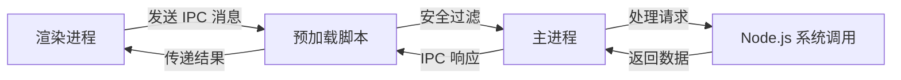
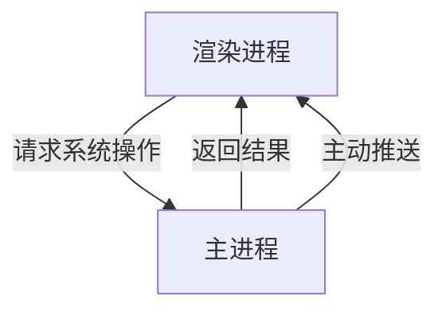

# 什么是 Electron

> Electron是一个使用 JavaScript、HTML 和 CSS 构建<font color=red>桌面应用程序</font>的框架，它的本质是结合了 Chromium 和 Node.js，是⼀个跨平台桌⾯应⽤开发框架，，让开发者能够使用 Web 技术构建原生桌面应用

## 核心架构

- **Chromium**：负责渲染用户界面（HTML/CSS/JavaScript）
- **Node.js**：提供文件系统访问、网络操作等底层能力
- **主进程与渲染进程：**
  - **主进程**：应用入口点，管理应用生命周期、原生窗口
  - **渲染进程**：每个窗口的独立进程，渲染网页内容


## Electron 的优势

- 🚀可跨平台：同⼀套代码可以构建出能在：Windows、macOS、Linux 上运⾏的应⽤程序。 
- 💻 上⼿容易：使⽤ Web 技术就可以轻松完成开发桌⾯应⽤程序。 
- 🔌底层权限：允许应⽤程序访问⽂件系统、操作系统等底层功能，从⽽实现复杂的系统交互。 
- 📦社区⽀持：拥有⼀个庞⼤且活跃的社区，开发者可以轻松找到⽂档、教程和开源库。


### 知名 Electron 应用

- Visual Studio Code
- GitHubDesktop
- 新版桌面端QQ


# Electron 核心

## 主进程 (Main Process)

每个 Electron 应⽤都有⼀个单⼀的主进程，作为应⽤程序的⼊⼝点。 主进程在 Node.js 环境中运 ⾏，它具有 require 模块和使⽤所有 Node.js API 的能⼒，主进程的核⼼就是<font color=red>使用BrowserWindow来创建和管理窗口</font>

**角色**：应用程序的"操作系统”

- **唯一性**：整个应用有且只有一个主进程
- **核心能力**：
  - 🖥️ 创建和管理浏览器窗口（`BrowserWindow`）
  - 📡 使用 Node.js 全量 API（文件系统、网络等）
  - 🔗 负责进程间通信（IPC）的中央枢纽
  - ⚙️ 管理应用生命周期（启动/退出/事件监听）


## 渲染进程 (Renderer Process)

每个 BrowserWindow 实例都对应⼀个单独的渲染器进程，运⾏在渲染器进程中的代码，必须遵 守⽹⻚标准，这也就意味着：<font color=red>渲染器进程无权直接访问或使用node.js的API</font>。

**角色**：应用程序的"浏览器标签页"

- **多实例**：每个窗口对应一个独立的渲染进程
- **核心限制**：
  - 🚫 **默认无 Node.js 访问权限**（安全沙箱限制）
  - 🌐 只能使用标准 Web API（DOM操作、Fetch等）
  - 🔒 通过预加载脚本安全访问系统能力


## 预处理脚本(Preload)

预加载（Preload）脚本是运⾏在渲染进程中的，但它是在**⽹⻚内容加载之前**执⾏的，这意味着它 具有⽐普通渲染器代码更⾼的权限，可以访问部分 Node.js 的 API，同时⼜可以与⽹⻚内容进⾏安全的交互。

简单说：它是 Node.js 和 Web API 的桥梁，Preload 脚本可以安全地将部分 Node.js 功能暴露 给⽹⻚，从⽽减少安全⻛险。


## 进程间通信 (IPC) 核心链路



> 值得注意的是： 
>
> 上⽂中的 `preload.js` ，⽆法使⽤全部` Node` 的 `API` ，⽐如：不能使⽤` Node` 中的 `fs` 模 块，但主进程（ `main.js` ）是可以的，这时就需要进程通信了。简单说：要 让 `preload.js` 通知 `main.js` 去调⽤` fs` 模块去⼲活。

关于 Electron 进程通信，我们要知道：

- IPC 全称为： InterProcess Communication ，即：进程通信。 
- IPC 是 Electron 中最为核⼼的内容，它是从 UI 调⽤原⽣ API 的唯⼀⽅法！ 
- Electron 中，主要使⽤` ipcMain` 和 `ipcRenderer` 来定义“通道”，进⾏进程通信。


## 为什么需要进程通信？

在 Electron 的双进程架构中：

- **主进程**：拥有完整 Node.js 访问权限
- **渲染进程**：运行在浏览器沙箱环境（默认无 Node.js 权限）
- **通信需求**：渲染进程需要请求主进程执行系统操作，主进程需要通知渲染进程更新状态




### IPC 核心模块

| 模块            | 作用位置   | 功能                       |
| :-------------- | :--------- | :------------------------- |
| `ipcMain`       | 主进程     | 监听和响应渲染进程的消息   |
| `ipcRenderer`   | 渲染进程   | 向主进程发送消息并接收响应 |
| `contextBridge` | 预加载脚本 | 安全暴露 API 给渲染进程    |


##  为什么需要双进程架构

1. **安全隔离**：渲染进程的 Web 内容不可直接访问系统

   > 📌 避免恶意网站通过 Electron 应用入侵用户系统

2. **稳定性保障**：单个窗口崩溃不会导致整个应用退出

3. **性能优化**：多进程利用多核 CPU 能力

4. **职责分离**：

   - 主进程：系统级操作
   - 渲染进程：UI 渲染和交互

>  **黄金法则**：保持渲染进程"无知"，所有系统操作通过主进程代理执行


## 三种通信模式详解

### 渲染进程 👉 主进程

**场景**：不需要返回值的简单通知

**概述**：在渲染器进程中 `ipcRenderer.send('信道',回调)` 发送消息，在主进程中使⽤ `ipcMain.on('信道',回调)` 接收消息。 常⽤于：在web中调用主进程的API ，例如下⾯的这个需求：

> 需求：点击按钮后，在⽤户的 D 盘创建⼀个 hello.txt ⽂件，⽂件内容来⾃于⽤户输⼊。

渲染进程：

```vue
<template>
  <div>
    <div class="wrap">
      <el-input v-model="content" placeholder="请输入"></el-input>
      <el-button type="danger" @click="handleWrite">点我写入文件</el-button>
    </div>
  </div>
</template>

<script setup lang="ts">
  // 写入文件
  const content = ref('');
  const handleWrite = () => {
    window.api.writeFile('test.txt', content.value);
  };
</script>

<style scoped>
  .wrap {
    display: flex;
  }
</style>

```

预处理脚本：

```js
import { contextBridge, ipcRenderer } from 'electron';

const api = {
    // 写入文件
  writeFile: (name: string, content: string) => {
    ipcRenderer.send('writeFile', name, content);
  },
}

contextBridge.exposeInMainWorld('api', api);
```

主进程：

```typescript
import { app, BrowserWindow, ipcMain, Notification } from 'electron';

const sendMsgFn = ({ title, body }) => {
  const notification = new Notification({
    title,
    body,
  });
  return notification.show();
};

app.whenReady().then(() => {
    ipcMain.on('writeFile', async (_, name, content) => {
    try {
      const filePath = path.join(app.getPath('desktop'), name);
      await fs.writeFile(filePath, content, 'utf-8');
      const title = '写入成功';
      const body = `文件${name}已保存到桌面`;
      sendMsgFn({ title, body });
    } catch (error: any) {
      sendMsgFn({
        title: '写入失败',
        body: `保存文件${name}时出错: ${error.message}`,
      });
    }
  });
})
// 在创建窗口之前监听事件
createWindow()
```


### 渲染进程 ↔️ 主进程

概述：渲染进程通过`ipcRenderer.invoke('信道',回调)` 发送消息，主进程使⽤ `ipcMain.handle('信道',回调)` 接收并处理消息。

> 备注：`ipcRender.invoke` 的返回值是 `Promise` 实例。

场景：从渲染进程调用主进程方法并等待结果

> 需求：点击按钮从桌面读取test.txt中的内容，并将结果弹窗展示

渲染进程

```vue
<template>
  <div>
    <el-button type="success" @click="handleRead">点我读取文件</el-button>
  </div>
</template>

<script setup lang="ts">
  // 读取文件
  const handleRead = async () => {
    const res = await window.api.readFile();
    if (res.success && res.content) {
      const result = await window.api.showDialog({
        type: 'info',
        title: '文件读取成功',
        message: res.content,
        buttons: ['确定', '打开文件位置'],
      });
      if (result === 1) {
        // 打开文件位置
        window.api.showItemInFolder(res.path);
      }
    }
  };
</script>

```

预处理脚本

```typescript
  // 读取文件
  readFile: () => {
    return ipcRenderer.invoke('readFile');
  },
  // 显示文件位置
  showItemInFolder: (path) => ipcRenderer.send('showItemInFolder', path),
    
  // 显示对话框
  showDialog: (options: Electron.MessageBoxOptions) => {
    return ipcRenderer.invoke('showDialog', options);
  },
```

主进程

```typescript
  // 双向通信
  ipcMain.handle('readFile', async () => {
    const pathToRoad = path.join(app.getPath('desktop'), 'test.txt');
    try {
      const res = await fs.readFile(pathToRoad, 'utf-8');
      return { success: true, content: res, path: pathToRoad };
    } catch (error) {
      return sendMsgFn({
        title: '读取失败',
        body: `读取文件${pathToRoad}时出错: ${error}`,
      });
    }
  });
```


### 主进程 👉 渲染进程

概述：主进程使⽤ `win.webContents.send('信道',回调)` 发送消息，渲染进程通过`ipcRenderer.on('信道',回调)` 处理消息

主进程：

```typescript
  // 主进程 -> 渲染进程
  let time;
  let counter = 0;
  timer = setInterval(() => {
    counter++;
    time = new Date();

    const data = { time, counter };
    mainWindow!.webContents.send('getMsgFromMain', data);
  }, 1000);
```

渲染进程

```typescript
  getMsgFromMain: (callback) => {
    return ipcRenderer.on('getMsgFromMain', (_, args) => {
      callback(args);
    });
  },
```

渲染进程

```js
  const count = ref();
  const timeValue = ref();
  onMounted(() => {
    window.api.getMsgFromMain((data) => {
      const { time, counter } = data;
      timeValue.value = dayjs(time).format('YYYY-MM-DD HH:mm:ss');
      count.value = counter;
    });
  });
```


# 打包

使用`electron-builder`打包应用


# electron 开发实战

[Electron开发模板](https://cn.electron-vite.org/guide/)

在命令行中运行以下命令：

```sh
npm create @quick-start/electron@latest
```

然后按照提示操作即可!

```sh
✔ Project name: … <electron-app>
✔ Select a framework: › vue
✔ Add TypeScript? … No / Yes
✔ Add Electron updater plugin? … No / Yes
✔ Enable Electron download mirror proxy? … No / Yes

Scaffolding project in ./<electron-app>...
Done.
```


## 文件结构

```text
my-electron-app/
├── src/
│   ├── main/        # 主进程代码
│   │   └── index.js
│   ├── renderer/    # 渲染进程代码（Vue/React等）
│   │   └── main.js
│   └── preload/     # 预加载脚本
│       └── index.js
├── index.html       # 主页面
├── package.json
└── electron.vite.config.js # 配置文件
```
