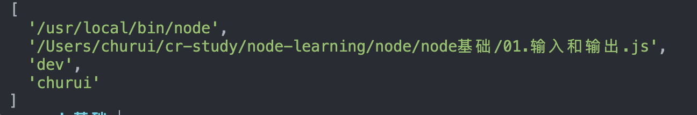
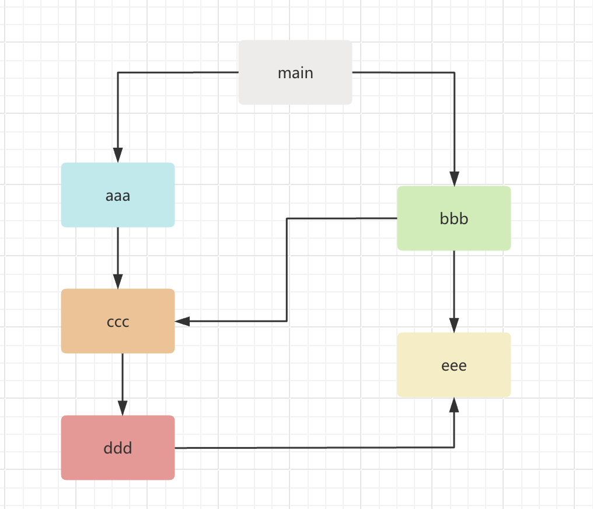
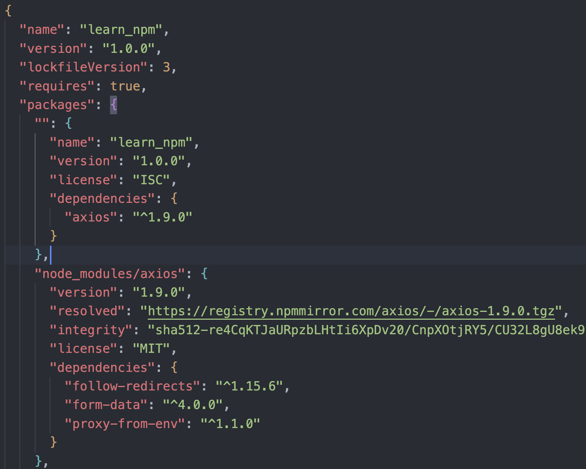
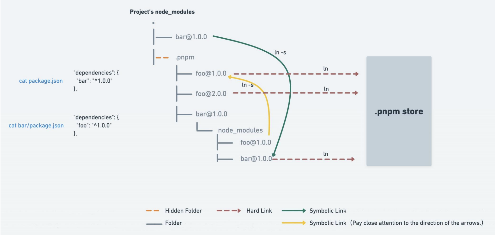
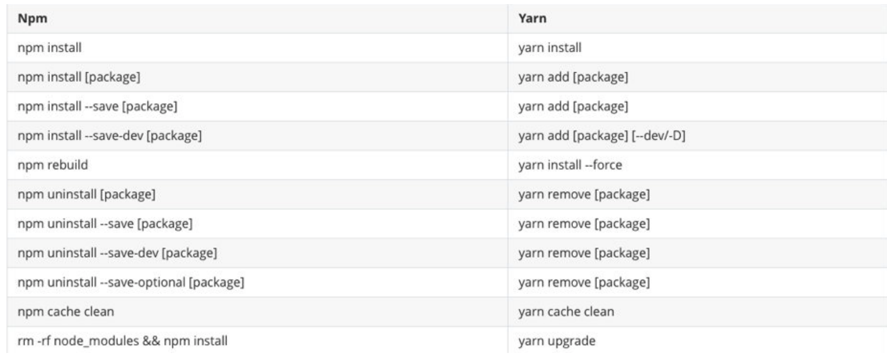

# Node.js是什么

官方对Node.js的定义：

> Node.js是一个基于V8 JavaScript引擎的JavaScript运行时环境。

也就是说Node.js基于V8引擎来执行JavaScript的代码，但是不仅仅只有V8引擎：

- 前面我们知道V8可以嵌入到任何C ++应用程序中，无论是Chrome还是Node.js，事实上都是嵌入了V8引擎来执行 JavaScript代码；
- 但是在Chrome浏览器中，还需要解析、渲染HTML、CSS等相关渲染引擎，另外还需要提供支持浏览器操作的API、浏览器 自己的事件循环等；
- 另外，在Node.js中我们也需要进行一些额外的操作，比如文件系统读/写、网络IO、加密、压缩解压文件等操作；


# Node程序传递参数

正常情况下执行一个node程序，直接跟上我们对应的文件即可：

```sh
node index.js
```

但是，在某些情况下执行node程序的过程中，我们可能希望给node传递一些参数：

```sh
node index.js env=development churui
```


**如果我们这样来使用程序，就意味着我们需要在程序中获取到传递的参数：**

- 获取参数其实是在process的内置对象中的；

- 如果我们直接打印这个内置对象，它里面包含特别的信息：
  - 其他的一些信息，比如版本、操作系统等大家可以自行查看，后面用到一些其他的我们还会提到；

现在，我们先找到其中的**argv**属性：

- 我们发现它是一个数组，里面包含了我们需要的参数；




# Node中的全局对象

例如：

```js
global globalThis  __dirname  __filename  exports module require setImmediate 等
```

```js
global === globalThis
```


```js
// 立即执行
setImmediate(() => {
  console.log("setImmediate");
});
```


## global和window的区别

- 但是在浏览器中执行的JavaScript代码，如果我们在顶级范围内通过var定义的一个属性，默认会被添加到window对象上
- 但是在node中，我们通过var定义一个变量，它只是在当前模块中有一个变量，不会放到全局中


# 模块化

## 没有模块化带来的问题

比如命名冲突的问题

当然，我们有办法可以解决上面的问题：

立即函数调用表达式（IIFE） IIFE (Immediately Invoked Function Expression)

但是，我们其实带来了新的问题：

- 第一，我必须记得每一个模块中返回对象的命名，才能在其他模块使用过程中正确的使用；
- 第二，代码写起来混乱不堪，每个文件中的代码都需要包裹在一个匿名函数中来编写；
- 第三，在没有合适的规范情况下，每个人、每个公司都可能会任意命名、甚至出现模块名称相同的情况；

所以，我们会发现，虽然实现了模块化，但是我们的实现过于简单，并且是没有规范的。

我们需要制定一定的规范来约束每个人都按照这个规范去编写模块化的代码；

这个规范中应该包括核心功能：模块本身可以导出暴露的属性，模块又可以导入自己需要的属性；

JavaScript社区为了解决上面的问题，涌现出一系列好用的规范。

## CommonJS规范

我们需要知道CommonJS是一个规范，最初提出来是在浏览器以外的地方使用，并且当时被命名为ServerJS，后来为了体现它的广泛性，修改为CommonJS，平时我们也会简称为CJS。

- `Node` 是CommonJS在服务器端一个具有代表性的实现；
- `Browserify` 是CommonJS在浏览器中的一种实现；
- `webpack`打包工具具备对CommonJS的支持和转换；

所以，Node中对CommonJS进行了支持和实现，让我们在开发node的过程中可以方便的进行模块化开发：

- 在Node中每一个js文件都是一个单独的模块；
- 这个模块中包括CommonJS规范的核心变量：exports、module.exports、require；
- 我们可以使用这些变量来方便的进行模块化开发；

前面我们提到过模块化的核心是导出和导入，Node中对其进行了实现：

- `exports`和`module.exports`可以负责对模块中的内容进行导出；
- `require`函数可以帮助我们导入其他模块（自定义模块、系统模块、第三方库模块）中的内容；

### exports导出

注意：exports是一个对象，我们可以在这个对象中添加很多个属性，添加的属性会导出

```js
exports.name = name;
```

另外一个文件中可以导入

```js
const main = require("./01.export导出");
```

### module.exports导出

```js
module.exports.name = name;
```

我们追根溯源，通过维基百科中对CommonJS规范的解析：

- CommonJS中是没有module.exports的概念的；
- 但是为了实现模块的导出，Node中使用的是Module的类，每一个模块都是Module的一个实例，也就是module；
- 所以**在Node中真正用于导出的其实根本不是exports，而是module.exports**；
- 因为module才是导出的真正实现者；


**module对象的exports属性是exports对象的一个引用**

```js
const name = "cr";

// exports导出
// exports.name = name;

// module.exports导出
// module.exports.name = name;

console.log(module.exports === exports); // true

// 开发中常用的导出方式
module.exports = {
  name,
};

console.log(module.exports === exports); // false
```

默认情况下 module.exports和exports相等

### require细节

require的查找规则：`require(x)`

- 情况一：X是一个Node核心模块，比如path、http
  - 直接返回核心模块，并且停止查找
- 情况二：X是以 ./ 或 ../ 或 /（根目录）开头的
  - 第一步：将X当做一个文件在对应的目录下查找；
    - 1.如果有后缀名，按照后缀名的格式查找对应的文件
    - 2.如果没有后缀名，会按照如下顺序：
      1. 直接查找文件X 
      2. 查找X.js文件 
      3. 查找X.json文件 
      4. 查找X.node文件
  - 第二步：没有找到对应的文件，将X作为一个目录查找目录下面的index文件
    - 1. 查找X/index.js文件 
      2. 查找X/index.json文件 
      3. 查找X/index.node文件
    - 如果没有找到，那么报错：not found
- 情况三：直接是一个X（没有路径），并且X不是一个核心模块
  - 会逐级寻找`node_modules`文件


### 模块的加载过程

- 模块在被第一次引入时，模块中的js代码会被运行一次
- 模块被多次引入时，会缓存，最终只加载（运行）一次
  - 为什么只会加载运行一次呢？
  - 这是因为每个模块对象module都有一个属性：loaded。
  - 为false表示还没有加载，为true表示已经加载；
- 如果有循环引入，Node采用的是深度优先算法
  - 即先执行完一个文件的所有引用，再执行第二个文件的引用：aaa -> ccc -> ddd -> eee -> bbb




### CommonJs规范的缺点

**CommonJS加载模块是同步的**

- 同步的意味着只有等到对应的模块加载完毕，当前模块中的内容才能被运行；
- 这个在服务器不会有什么问题，因为服务器加载的js文件都是本地文件，加载速度非常快；

如果将它应用于浏览器呢？

- 浏览器加载js文件需要先从服务器将文件下载下来，之后再加载运行；
- 那么采用同步的就意味着后续的js代码都无法正常运行，即使是一些简单的DOM操作；

在早期为了可以在浏览器中使用模块化，通常会采用AMD或CMD(自执行函数实现)。


## AMD规范

AMD主要是应用于浏览器的一种模块化规范：

- AMD是Asynchronous Module Definition（异步模块定义）的缩写；
- 它采用的是异步加载模块；

## CMD规范

CMD规范也是应用于浏览器的一种模块化规范：

- CMD 是Common Module Definition（通用模块定义）的缩写；
- 它也采用的也是异步加载模块，但是它将CommonJS的优点吸收了过来；
- 但是目前CMD使用也非常少了；


## ES Modul

ES Module和CommonJS的模块化有一些不同之处：

- 一方面它使用了import和export关键字；
- 另一方面它采用编译期的静态分析，并且也加入了动态引用的方式；

ES Module模块采用export和import关键字来实现模块化：

- `export`负责将模块内的内容导出；
- `import`负责从其他模块导入内容；

了解：采用ES Module将自动采用严格模式：`use strict`

案例：

```js
// foo.js
const name = "foo";

const age = 18;

const sayHello = () => {
  console.log("hello");
};

export { name, age, sayHello };
```

```js
// main.js
import { name, age, sayHello } from "./foo.js";

console.log(name);
console.log(age);
sayHello();
```

```html
// index.html
<script src="./main.js" type="module"></script>
```

<font color=red>注意：</font>

1. `export {}`的{}是固定写法，不是对象形式，里面放的是标识符；
2. 在html中引入时，要在script中加上`type="module"`
3. 本地测试 — 如果你通过本地加载Html 文件 (比如一个 file:// 路径的文件), 你将会遇到 <font color=red>CORS 错误</font>，因为Javascript 模块安全性需要；你需要通过一个服务器来测试；使用的VSCode插件：Live Server

### exports关键字

export关键字将一个模块中的变量、函数、类等导出；

我们希望将其他中内容全部导出，它可以有如下的方式：

方式一：在语句声明的前面直接加上export关键字

方式二：将所有需要导出的标识符，放到export后面的 {}中

- 注意：这里的 {}里面不是ES6的对象字面量的增强写法，{}也不是表示一个对象的；
- 所以： export {name: name}，是错误的写法；

方式三：导出时给标识符起一个别名通过`as`关键字起别名

案例：

```js
// 方式一：
export const name = "foo";

export const age = 18;

export const sayHello = () => {
  console.log("hello");
};

// 方式二：
const name = "foo";

const age = 18;

const sayHello = () => {
  console.log("hello");
};

export { name, age, sayHello };

// 方式三
export { name as fname, age, sayHello };
```

### import关键字

import关键字负责从另外一个模块中导入内容导入内容的方式也有多种：

方式一：import {标识符列表} from '模块'；

- 注意：这里的{}也不是一个对象，里面只是存放导入的标识符列表内容；

方式二：导入时给标识符起别名通过as关键字起别名

方式三：通过 * 将模块功能放到一个模块功能对象（a module object）上

案例：

```js
// 方式一：
import { name, age, sayHello } from "./foo.js";

// 方式二：
import { name as fname, age, sayHello } from "./foo.js";

// 方式三：
import * as foo from "./foo.js";

const name = "main";

console.log(name);
console.log(foo.name);
console.log(foo.age);
foo.sayHello();
```

### export和import结合使用

```js
// utils/index.js
export { formatDate } from "./format.js";

export { sumFn } from "./sum.js";
```

为什么要这样做呢？

- 在开发和封装一个功能库时，通常我们希望将暴露的所有接口放到一个文件中；
- 这样方便指定统一的接口规范，也方便阅读；

### default用法

- 默认导出export时可以不需要指定名字；

- 在导入时不需要使用 {}，并且可以自己来指定名字；

<font color=red>注意</font>：在一个模块中，只能有一个默认导出（default export）

案例：

```js
// 方法一：先定义，在导出
const foo = () => {
  return ["hello world 123"];
};
export default foo;

// 方法二：直接导出
export default () => {
  return ["hello world"];
};

// 引入
import foo from "./foo.js"; // foo只是标识符，可以为任意值

console.log(foo());
```


### import函数

通过import加载一个模块，是不可以在其放到逻辑代码中的，

为什么会出现这个情况呢？

- 这是因为ES Module在被JS引擎解析时，就必须知道它的依赖关系；
- 由于这个时候js代码没有任何的运行，所以无法在进行类似于if判断中根据代码的执行情况；

但是某些情况下，我们确确实实**希望动态的来加载某一个模块**：

如果根据不同的条件，动态来选择加载模块的路径；

- 这个时候我们需要使用 `import()` 函数来动态加载；
- **import函数返回一个Promise，可以通过then获取结果**；

案例：

```js
const flag = true;

if (flag) {
  import("./foo.js").then((res) => {
    console.log(res.age, res.name);
  });
}
```

### import meta

`import.meta` 是一个给JavaScript模块暴露特定上下文的元数据属性的对象。

- 它包含了这个模块的信息，比如说这个模块的URL；
- 在ES11（ES2020）中新增的特性；


### ES Module的解析流程

- 阶段一：构建（Construction），根据地址查找js文件，并且下载，将其解析成模块记录（Module Record）；
- 阶段二：实例化（Instantiation），对模块记录进行实例化，并且分配内存空间，解析模块的导入和导出语句，把模块指向对应的内存地址。
- 阶段三：运行（Evaluation），运行代码，计算值，并且将值填充到内存地址中；

<font color=red>注意：</font>

1. 解析`type=”module”`的script标签
2. 构建时生成了映射关系，不用再次下载
3. 实例化阶段，将**导出的变量**进行分配内存空间

# 包管理工具

## 前言

开发中我们可以通过模块化的方式来封装自己的代码，并且封装成一个工具，这个工具我们可以让同事通过导入的方式来使用，甚至你可以分享给世界各地的程序员来使用；如果我们分享给世界上所有的程序员使用，有哪些方式呢？

## 代码共享方案

方式一：上传到GitHub上、其他程序员通过GitHub下载我们的代码手动的引用；

- 缺点是大家必须知道你的代码GitHub的地址，并且从GitHub上手动下载；
- 需要在自己的项目中手动的引用，并且管理相关的依赖；
- 不需要使用的时候，需要手动来删除相关的依赖；
- 当遇到版本升级或者切换时，需要重复上面的操作；

显然，上面的方式是有效的，但是这种传统的方式非常麻烦，并且容易出错；

方式二：使用一个专业的工具来管理我们的代码

- 我们通过工具将代码发布到特定的位置；
- 其他程序员直接通过工具来安装、升级、删除我们的工具代码；

显然，通过第二种方式我们可以更好的管理自己的工具包，其他人也可以更好的使用我们的工具包。


## npm的配置文件

对于一个项目来说，我们如何使用npm来管理这么多包呢？ 

- 事实上，我们每一个项目都会有一个对应的配置文件，无论是前端项目（Vue、React）还是后端项目（Node）；
- 这个配置文件会记录着你项目的名称、版本号、项目描述等； 
- 也会记录着你项目所依赖的其他库的信息和依赖库的版本号； 

这个配置文件就是`package.json `

那么这个配置文件如何得到呢？ 

方式一：手动从零创建项目，`npm init –y` 

方式二：通过脚手架创建项目，脚手架会帮助我们生成package.json，并且里面有相关的配置


## npm常见属性

- 必须填写的属性：`name`、`version`
  - name是项目的名称；
  - version是当前项目的版本号；
  - description是描述信息，很多时候是作为项目的基本描述；
  - author是作者相关信息（发布时用到）；
  - license是开源协议（发布时用到）；
- private属性：
  - private属性记录当前的项目是否是私有的；
  - 当值为true时，npm是不能发布它的，这是防止私有项目或模块发布出去的方式；
- main属性：
  - 设置程序的入口。
- scripts属性
  - scripts属性用于配置一些脚本命令，以键值对的形式存在；
  - 配置后我们可以通过 npm run 命令的key来执行这个命令；
  - npm start和npm run start的区别是什么？
    - 它们是等价的；
    - 对于常用的 start、 test、stop、restart可以省略掉run直接通过 npm start等方式运行；
- dependencies属性
  - dependencies属性是指定无论开发环境还是生成环境都需要依赖的包；
- devDependencies属性
  - 一些包在生成环境是不需要的，比如webpack、babel等；
- peerDependencies属性
  - 还有一种项目依赖关系是对等依赖，也就是你依赖的一个包，它必须是以另外一个宿主包为前提的；
  - 比如element-plus是依赖于vue3的，ant design是依赖于react、react-dom；

## 依赖的版本管理

我们会发现安装的依赖版本出现：^2.0.3或~2.0.3，这是什么意思呢？

npm的包通常需要遵从semver版本规范：

- semver：https://semver.org/lang/zh-CN/
- npm semver：https://docs.npmjs.com/misc/semver

semver版本规范是X.Y.Z：

- X主版本号（major）：当你做了不兼容的 API 修改（可能不兼容之前的版本）；
- Y次版本号（minor）：当你做了向下兼容的功能性新增（新功能增加，但是兼容之前的版本）；
- Z修订号（patch）：当你做了向下兼容的问题修正（没有新功能，修复了之前版本的bug）；

我们这里解释一下 ^和~的区别：

- x.y.z：表示一个明确的版本号；
- ^x.y.z：表示x是保持不变的，y和z永远安装最新的版本；
- ~x.y.z：表示x和y保持不变的，z永远安装最新的版本；


## npm install原理

 npm install会检测是有package-lock.json文件： 

- 没有lock文件 
  - 分析依赖关系，这是因为我们可能包会依赖其他的包，并且多个包之间会产生相同依赖的情况； 
  - 从registry仓库中下载压缩包（如果我们设置了镜像，那么会从镜像服务器下载压缩包）； 
  - 获取到压缩包后会**对压缩包进行缓存（从npm5开始有的）**； 
  - 将压缩包解压到项目的node_modules文件夹中（前面我们讲过，require的查找顺序会在该包下面查找） 
- 有lock文件 
  - 检测lock中包的版本是否和package.json中一致（会按照semver版本规范检测）； 
    - 不一致，那么会重新构建依赖关系，直接会走顶层的流程； 
  - 一致的情况下，会去优先查找缓存 
    - 没有找到，会从registry仓库下载，直接走顶层流程； 
  - 查找到，会获取缓存中的压缩文件，并且将压缩文件解压到node_modules文件夹中；


## lock文件

package-lock.json文件解析： 以axios为例

- name：项目的名称； 
- version：项目的版本； 
- lockfileVersion：lock文件的版本； 
- requires：使用requires来跟踪模块的依赖关系； 
- dependencies：项目的依赖 
  - 当前项目依赖axios，但是axios依赖follow-redireacts； 
  - axios中的属性如下： 
    - version表示实际安装的axios的版本； 
    - resolved用来记录下载的地址，registry仓库中的位置； 
    - requires/dependencies记录当前模块的依赖； 
    - integrity用来从缓存中获取索引，再通过索引去获取压缩包文件；




## npm其他命令

卸载某个依赖包：

```sh
npm uninstall package
npm uninstall package --save-dev
npm uninstall package -D
```

强制重新build:

```sh
npm rebuild
```

清除缓存：

```sh
npm cache clean
```

npm的命令其实是非常多的： 

[更多的命令，可以根据需要查阅官方文档](https://docs.npmjs.com/cli-documentation/cli)

## pnpm的安装和使用

### 痛点

当使用 npm 或 Yarn 时，如果你有 100 个项目，并且所有项目都有一个相同的依赖包，那么， 你在硬盘上就需要保存 100 份该相同依赖包的副本。


### 硬链接和软链接

- 硬链接（hard link）： 
  - 硬链接（英语：hard link）是电脑文件系统中的<font color=red>多个文件平等地共享同一个文件存储单元</font>（电脑的硬盘空间中的文件）； 
  - 删除一个文件名字后，还可以用其它名字继续访问该文件； 
- 符号链接（软链接soft link、Symbolic link）： 
  - 符号链接（软链接、Symbolic link）是一类特殊的文件； 
  - 其包含有一条以绝对路径或者相对路径的形式指向其它文件或者目录的引用(类似创建的**快捷方式**)；

使用：

拷贝：

```sh
window: copy 原文件名 复制后的文件名
macos : cp 原文件名 复制后的文件名
```


硬链接：

```sh
window: mklink /H 硬链接后的文件名 原文件名
macos : ln foo.js foo_hard.js
```

> 修改原文件，会导致硬链接的文件被修改，反之同理


软链接：

```sh
window: mklink aaa_soft.js aaa.js
macos : ln -s foo.js foo_copy.js
```

> 软链接不能被修改，实际修改的是原文件


### pnpm做了什么

- 如果是使用 pnpm，依赖包将被 <font color=red>存放在一个统一的位置</font>，因此： 
  - 如果你对<font color=red>同一依赖包使用相同的版本</font>，那么<font color=red>磁盘上只有这个依赖包的一份文件</font>； 
  - 如果你对<font color=red>同一依赖包需要使用不同的版本</font>，则仅有 <font color=red>版本之间不同的文件会被存储起来</font>； 
  - 所有文件都保存在硬盘上的统一的位置： 
    - 当安装软件包时， 其包含的所有文件都会硬链接到此位置，而不会占用 额外的硬盘空间； 
    - 这让你可以在项目之间方便地共享相同版本的 依赖包；


- pnpm创建非扁平的 node_modules 目录

当使用 npm 或 Yarn安装依赖包时，所有软件包都将被提升到 node_modules 的 根目录下(扁平的node_modules目录)。其结果是，源码可以访问 本不属于当前项目所设定的依赖包；




### pnpm的使用

越来越多的公司在使用pnpm，我们也要跟上时代的步伐，那么我们应该如何安装pnpm呢？

[官网](https://www.pnpm.cn/installation)提供了很多种方式来安装pnpm

```sh
  npm install -g pnpm
```


以下 是一个与 npm 等价命令的对照表，帮助你快速入门：


### pnpm的存储store

我们可以通过一些终端命令获取这个目录：获取当前活跃的store目录

```sh
pnpm store path
```

另外一个非常重要的store命令是prune（修剪）：从store中删除当前未被引用的包来释放store的空间

```sh
pnpm store prune
```


## yarn的使用

安装

```sh
npm install yarn -g
```

使用




## npx的使用

npx的原理非常简单，它会到**当前目录的node_modules/.bin目录**下查找对应的命令，如果找不到，则会使用全局的。


## npm发布自己的包

封装完自己的代码之后，在文件的根目录使用`npm init -y`初始化，将项目打包(可以使用webpack)后就可以发布了，下面是发布的流程：

注册npm账号：

- https://www.npmjs.com/
- 选择sign up

在命令行登录：

```sh
npm login
```

修改package.json

发布到npm registry上

```sh
npm publish
```

更新仓库：

- 修改版本号(最好符合semver规范)
- 重新发布

删除发布的包：

```sh
npm unpublish
```

让发布的包过期：

```sh
npm deprecate
```


# 内置模块fs

fs是File System的缩写，表示文件系统。

对于任何一个为服务器端服务的语言或者框架通常都会有自己的文件系统：

- 因为服务器需要将各种数据、文件等放置到不同的地方；
- 比如用户数据可能大多数是放到数据库中的；
- 比如某些配置文件或者用户资源（图片、音视频）都是以文件的形式存在于操作系统上的；

Node也有自己的文件系统操作模块，就是`fs`

- 借助于Node帮我们封装的文件系统，我们可以在任何的操作系统（window、Mac OS、Linux）上面直接去操作文件；
- 这也是Node可以开发服务器的一大原因，也是它可以成为前端自动化脚本等热门工具的原因；

## fs的API介绍

### 文件的读取

```js
const fs = require("fs");
fs.readFileSync('文件路径',{encoding:'utf-8'}) // 同步读取

fs.readFile() // 异步读取
```

## 文件描述符

为了简化用户的工作，Node.js 抽象出操作系统之间的特定差异，并为所有打开的文件分配一个数字型的文件描述符。

`fs.open()`方法用于分配新的文件描述符。

- 一旦被分配，则文件描述符可用于从文件读取数据、 向文件写入数据、或请求关于文件的信息。


## 文件的读写

如果我们希望对文件的内容进行操作，这个时候可以使用文件的读写：

- ```js
  fs.readFile(path[, options], callback)：读取文件的内容；
  ```

- ```js
  fs.writeFile(file, data[, options], callback)：在文件中写入内容
  ```

在上面的代码中，你会发现有一个对象类型，这个是写入时填写的option参数：

`flag`：写入的方式。

`encoding`：字符的编码；

### flag选项

- w 打开文件写入，默认值； 
- w+打开文件进行读写（可读可写），如果不存在则创建文件； 
-  r打开文件读取，读取时的默认值； 
- r+ 打开文件进行读写，如果不存在那么抛出异常； 
- a打开要写入的文件，将流放在文件末尾。如果不存在则创建文件； 
- a+打开文件以进行读写（可读可写），将流放在文件末尾。如果不存在则创建文件

### encoding选项

如果不填写encoding，返回的结果是Buffer；

## 文件夹操作

新建一个文件夹：

使用``fs.mkdir()``或``fs.mkdirSync()``创建一个新文件夹：

案例：递归读取文件内容

```js
function readDirectory(dir) {
  fs.readdir(dir, { withFileTypes: true }, (err, files) => {
    files.forEach((item) => {
      if (item.isDirectory()) {
        readDirectory(`${dir}/${item.name}`);
      } else {
        console.log(item.name);
      }
    });
  });
}

readDirectory("./test");
```

# Buffer和二进制

我们会发现，对于前端开发来说，通常很少会和二进制直接打交道，但是对于服务器端为了做很多的功能，我们必须直接去操作其二进制的数据；所以Node为了可以方便开发者完成更多功能，提供给了我们一个类Buffer，并且它是全局的。

**Buffer中存储的是二进制数据，那么到底是如何存储呢**

- 我们可以将Buffer看成是一个存储二进制的数组；
- 这个数组中的每一项，可以保存8位二进制： 0000 0000


# MySQL数据库

## 常见的数据库

通常我们将数据划分成两类：<font color=red>关系型数据库</font>和<font color=red>非关系型数据库</font>；

- 关系型数据库：MySQL、Oracle、DB2、SQL Server、Postgre SQL等
  - 关系型数据库通常我们会创建<font color=red>很多个二维数据表</font>；
  - 数据表之间相互关联起来，形成<font color=red>一对一、一对多、多对多等</font>关系；
  - 之后可以利用<font color=red>SQL语句</font>在<font color=red>多张表</font>中查询我们所需的数据；
- 非关系型数据库：MongoDB、Redis、Memcached、HBse等；
  - 非关系型数据库的英文其实是Not only SQL，也简称为NoSQL；
  - 相对而言<font color=red>非关系型数据库比较简单一些，存储数据也会更加自由</font>（甚至我们可以直接将一个复杂的json对象直接塞入到数据 库中）
  - NoSQL是基于<font color=red>Key-Value的对应关系</font>，并且<font color=red>查询的过程中不需要经过SQL解析</font>；

## 安装MySQL

下载地址：https://dev.mysql.com/downloads/mysql/

推荐大家直接下载安装版本，在安装过程中会配置一些环境变量；

- Windows推荐下载MSI的版本；
- Mac推荐下载DMG的版本；

这里我安装的是MySQL最新的版本：8.3.0（不再使用旧的MySQL5.x的版本）

## MySQL的连接操作

打开终端，查看MySQL的安装：

```shell
mysql --version
```

配置环境变量

> Mac添加环境变量
>
> 在mac终端打开文件：`vi ~/.bashrc`加入语句：`PATH=$PATH:/usr/local/mysql/bin`使配置的语句生效：`source ~/.bashrc`

```sh
source ~/.zshrc		# 使用的是zsh
source ~/.bashrc	# 使用的是bash
```


## 终端连接数据库

`mysql -uroot -pxxxxxx`：xxxxxx是MySQL的登录密码

`mysql -uroot -p`：这种方式需要自己输入密码

## 显示数据库

`show databases;`

## 创建数据库-表

- 创建数据库

  ```sql
  create database churui;
  ```

- 使用创建的数据库churui

  ```sql
  use churui;
  ```

- 在数据库中创建一张表

  ```sql
  create table user(
  	name varchar(20),
    age int,
    height double,
  );
  ```

- 插入数据

  ```sql
  insert into user (name,age,height) values ('chu',18,1.88);
  ```

> <font color=red>注意：</font>
>
> - 每个命令都要使用``;``结尾

## 认识SQL语句

我们希望操作数据库（特别是在程序中），就需要有和数据库沟通的语言，这个语言就是SQL：

- SQL是<font color=red>Structured Query Language</font>，称之为<font color=red>结构化查询语言</font>，简称<font color=red>SQL</font>；
- SQL语句可以用于对数据库进行操作；

**SQL常用规范**

- 通常关键字使用大写的，比如CREATE、TABLE、SHOW等等；
- 一条语句结束后，需要以 ; 结尾；
- 如果遇到关键字作为表明或者字段名称，可以使用``包裹;

## SQL语句的分类

常见的SQL语句我们可以分成四类：

- <font color=red>DDL（Data Definition Language）</font>：数据定义语言
  - 可以通过DDL语句对数据库或者表进行：创建、删除、修改等操作;
- <font color=red>DML（Data Manipulation Language）</font>：数据操作语言；
  -  可以通过DML语句对表进行：添加、删除、修改等操作
- <font color=red>DQL（Data Query Language）</font>：数据查询语言； 
  - 可以通过DQL从数据库中查询记录；（重点） 
- <font color=red>DCL（Data Control Language）</font>：数据控制语言； 
  - 对数据库、表格的权限进行相关访问控制操作；

## 数据库操作

查看当前数据库

```sql
# 查看所有的数据
SHOW DATABASES;

# 使用某一个数据
USE xxx

# 查看当前正在使用的数据库
SELECT DATABASE();
```

创建新的数据库

```sql
CREATE DATABASE bilibili;
CREATE DATABASE IF NOT EXISTS bilibili;
CREATE DATABASE IF NOT EXISTS bilibili
				DEFAULT CHARACTER SET utf8mb4 COLLATE utf8mb4_0900_ai_ci;
```

删除数据库

```sql
DROP DATABASE bilibili;
DROP DATABASE IF EXIT bilibili;
```

修改数据库

```sql
# 修改数据库的字符集和排序规则
ALTER DATABASE bilibili CHARACTER SET = utf8 COLLATE = utf8_unicode_ci;
```

查看数据表

```sql
# 查看所有的数据表
SHOW TABLES;
# 查看某一个表结构
DESC user;
```

创建数据表

```sql

CREATE TABLE IF NOT EXISTS `users`(
	name VARCHAR(20),
	age INT,
	height DOUBLE
);
```

# Koa框架

## koa初体验

> 1. `npm init -y`
> 2. `npm i koa`


```js
const koa = require("koa");

const app = new koa();
app.use((ctx, next) => {
  console.log("request", ctx.request); // 请求对象：koa封装的请求对象
  // console.log(ctx.req); // 请求对象：node封装的请求对象

  console.log("response", ctx.response); // 响应对象：koa封装的响应对象
  // console.log(ctx.res); // 响应对象：node封装的响应对象

  ctx.body = "hello world";
});

app.listen(6666, () => {
  console.log("6666端口启动成功");
});

```

## 路由中间件的使用

koa官方并没有给我们提供路由的库，我们可以选择第三方库： `koa-router`

```shell
npm install @koa/router
```

- 我们可以先封装一个 user.router.js 的文件
- 在app中将router.routes()注册为中间件
- 注意：allowedMethods用于判断某一个method是否支持
  - 如果我们请求 get，那么是正常的请求，因为我们有实现 get；
  - 如果我们请求 put、delete、patch，那么就自动报错： Method Not Allowed，状态码：405；
  - 如果我们请求 link、copy、lock，那么就自动报错：Not Implemented，状态码：501

```js
const Koa = require("koa");
const KoaRouter = require("@koa/router"); // 引入koa-router

// 创建app对象
const app = new Koa();
const userRouter = new KoaRouter({ prefix: "/user" });

// 中间件
userRouter.get("/:id", (ctx, next) => {
  ctx.body = "获取某用户"
});

// 挂载路由
app.use(userRouter.routes()); // 挂载路由
app.use(userRouter.allowedMethods()); // 如果没有该请求方法，会提示不合法的请求，如果不写allowedMethods，会提示not found

// 启动服务器
app.listen(6666, () => {
  console.log("koa服务器启动成功,666端口监听中~");
});

```

## 参数解析

1. get: params方式, 例子:/:id
2. get: query方式, 例子: ?name=why&age=18
3. post: json方式, 例子: `{ "name": "why", "age": 18 }`
4. post: x-www-form-urlencoded
5. post: form-data


- params参数  
  - `ctx.params`

```js
// get/params参数
userRouter.get("/:id", (ctx, next) => {
  console.log(ctx.params.id);
  ctx.body = "userRouter.get";
});
```

- query参数
  - `ctx.params`

```js
userRouter.get("/", (ctx, next) => {
  console.log(ctx.query);
  ctx.body = "query参数";
});
```

- body的json方式
  - 安装依赖： `npm install koa-bodyparser`; 
  - 使用 `koa-bodyparser`的中间件；

```js
const Koa = require("koa");
const KoaRouter = require("@koa/router");
const bodyParser = require("koa-bodyparser");

const app = new Koa();

// 使用第三方中间件解析body数据
app.use(bodyParser());

// 注册路由对象
const userRouter = new KoaRouter({ prefix: "/user" });

userRouter.post("/json", (ctx, next) => {
  // 注意事项: 不能从ctx.body中获取数据
  // ctx.req.body 获取不到数据，该bodyParser中间件不支持
  console.log(ctx.request.body, ctx.req.body);

  // ctx.body用于向客户端返回数据
  ctx.body = "用户的json信息";
});

app.use(userRouter.routes());
app.use(userRouter.allowedMethods());

app.listen(6666, () => {
  console.log("server is running at port 6666");
});
```

- body的x-www-form-urlencoded方式
  - 和json方式相同
- post/form-data
  - 解析body中的数据，我们需要使用multer
  - 安装依赖：`npm install koa-multer`
  - 使用 `multer`中间件

```js
const Koa = require("koa");
const KoaRouter = require("@koa/router");
const multer = require("@koa/multer");

const app = new Koa();

// 使用第三方中间件解析body数据
const formParser = multer();

// 注册路由对象
const userRouter = new KoaRouter({ prefix: "/user" });

// formParser.any()允许任何类型的文件上传
userRouter.post("/formdata", formParser.any(), (ctx, next) => {
  console.log(ctx.request.body);
  ctx.body = "用户的formdata信息";
});

app.use(userRouter.routes());
app.use(userRouter.allowedMethods());

app.listen(6666, () => {
  console.log("server is running at port 6666");
});
```

> 在这段代码中，`formParser.any()` 是 `@koa/multer` 中间件的一个方法调用。`multer` 是一个 Node.js 的中间件，用于处理 `multipart/form-data` 类型的数据，通常用于上传文件。在这里，`.any()` 方法表示接受任意类型的文件上传。
>
> 所以，当请求到达 `/user/formdata` 路由时，`formParser.any()` 中间件会被调用，用于解析 `multipart/form-data` 类型的请求数据，然后将解析后的数据绑定到 `ctx.request.body` 中，以便后续中间件或路由处理程序使用。

## 部署静态服务器

使用第三方库`npm install koa-static`

```js
const Koa = require("koa");
const path = require("path");

const static = require("koa-static");

const app = new Koa();

app.use(static(path.join(__dirname) + "/dist/"));

app.listen(8000, () => {
  console.log("koa服务器启动成功");
});

```

解释：

- 在Chrome浏览器中，不要使用6000端口
- /dist/指的是静态文件存放的文件夹名称


## 响应结果的方式

输出结果：body将响应主体设置为以下之一： 

- string ：字符串数据 
- Buffer ：Buffer数据 
- Stream ：流数据 
- Object|| Array：对象或者数组 
- null ：不输出任何内容 (204)
- 如果response.status尚未设置，Koa会自动将状态设置为200或204。

```js
const fs = require('fs')
const Koa = require('koa')
const KoaRouter = require('@koa/router')

// 创建app对象
const app = new Koa()

// 注册路由对象
const userRouter = new KoaRouter({ prefix: '/users' })

userRouter.get('/', (ctx, next) => {
  // 1.body的类型是string
  // ctx.body = 'user list data~'

  // 2.body的类型是Buffer
  // ctx.body = Buffer.from('你好啊, 李银河~')

  // 3.body的类型是Stream
  // const readStream = fs.createReadStream('./uploads/1668331072032_kobe02.png')
  // ctx.type = 'image/jpeg'
  // ctx.body = readStream

  // 4.body的类型是数据(array/object) => 使用最多
  ctx.status = 201
  ctx.body = {
    code: 0,
    data: [
      { id: 111, name: 'iphone', price: 100 },
      { id: 112, name: 'xiaomi', price: 990 },
    ]
  }

  // 5.body的值是null, 自动设置http status code为204
  // ctx.body = null
})

app.use(userRouter.routes())
app.use(userRouter.allowedMethods())

// 启动服务器
app.listen(6000, () => {
  console.log('koa服务器启动成功~')
})

```

## 错误方案处理

方法：使用`EventEmitter`

在有错误的地方暴露出一个事件，在处理错误的地方接收，一般需要错误码和ctx(把错误信息返回给客户端)

```js
const Koa = require("koa");
const KoaRouter = require("@koa/router");
const errorHandle = require("./error-handle");

// 创建app对象
const app = new Koa();

// 注册路由对象
const userRouter = new KoaRouter({ prefix: "/users" });

userRouter.get("/", (ctx, next) => {
  const isAuth = false;
  if (isAuth) {
    ctx.body = "user list data~";
  } else {
    // EventEmitter
    ctx.app.emit("error", -1003, ctx);
  }
});

app.use(userRouter.routes());
app.use(userRouter.allowedMethods());

// 错误处理方案
errorHandle(app);

// 启动服务器
app.listen(6000, () => {
  console.log("koa服务器启动成功~");
});


// error-handle.js
function errorHandle(app) {
  app.on("error", (code, ctx) => {
    const errCode = code;
    let message = "";
    switch (errCode) {
      case -1001:
        message = "账号或者密码错误~";
        break;
      case -1002:
        message = "请求参数不正确~";
        break;
      case -1003:
        message = "未授权, 请检查你的token信息";
        break;
    }

    const body = {
      code: errCode,
      message,
    };

    ctx.body = body;
  });
}

module.exports = errorHandle;

```


