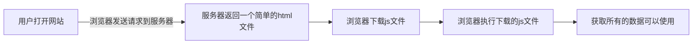
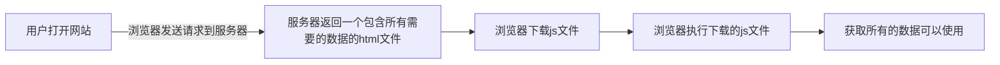

# 服务端渲染

## 单页面应用(SPA)

- 单页应用程序 (SPA) 全称是：Single-page application，SPA应用是在客户端呈现的（术语称：CRS）
  - SPA应用默认只返回一个空HTML页面，如：body只有&lt;div id="app">&lt;/div>
  - 而整个应用程序的内容都是通过 Javascript 动态加载，包括应用程序的逻辑、UI 以及与服务器通信相关的所有数据
  - 构建 SPA 应用常见的库和框架有： React、AngularJS、Vue.js 等。

- 客户端渲染原理



白屏、网站不可见，等应用挂载完成才可见

## SPA优缺点

- **优点**：
  - 只需加载一次
    - SPA应用程序只需要在第一次请求时加载页面，页面切换不需重新加载，而传统的Web应用程序必须在每次请求时都得加载页面，需要花费更多时间。因此，SPA页面加载速度要比传统 Web 应用程序更快

  - 更好的用户体验
    - SPA 提供类似于桌面或移动应用程序的体验。用户切换页面不必重新加载新页面
    - 切换页面只是内容发生了变化，页面并没有重新加载，从而使体验变得更加流畅

- **缺点：**
  - SPA应用默认只返回一个空HTML页面，不利于SEO （search engine optimization )
  - 首屏加载的资源过大时，会影响首屏的渲染

## 爬虫

抓取 -> 索引编制 -> 呈现搜索结果(网站排序)

## 服务器端渲染（SSR）

- 服务器端渲染全称是：Server Side Render，在服务器端渲染页面，并将渲染好HTML返回给浏览器呈现
  - SSR应用的页面是在服务端渲染的，用户每请求一个SSR页面都会先在服务端进行渲染，然后将渲染好的页面，返回给浏览器呈现。
  - 构建 SSR 应用常见的库和框架有： Vue Nuxt、 React Next.js 等（SSR应用也称同构应用）

- 服务端渲染流程



网站是可见的，但不能与之交互 等 客户端激活之后，可以交互

## SSR优缺点

- 优点
  - 更快的首屏渲染速度
    - 浏览器显示静态页面的内容要比 JavaScript 动态生成的内容快得多。&#x20;
    - 当用户访问首页时可立即返回静态页面内容，而不需要等待浏览器先加载完整个应用程序。

  - 更好的SEO
    - 爬虫是最擅长爬取静态的HTML页面，服务器端直接返回一个静态的HTML给浏览器。&#x20;
    - 这样有利于爬虫快速抓取网页内容，并编入索引，有利于SEO。

- 缺点
  - SSR 通常需要对服务器进行更多 API 调用，以及在服务器端渲染需要消耗更多的服务器资源，成本高。&#x20;
  - 增加了一定的开发成本，用户需要关心哪些代码是运行在服务器端，哪些代码是运行在浏览器端。&#x20;
  - SSR 配置站点的缓存通常会比SPA站点要复杂一点。

## SSR解决方案

> React : Next.js
>
> Vue3 : Nuxt3 | | Vue2 : Nuxt.js
>
> Angular : Angular Universal

Vue除了支持开发SPA应用之外，其实也是支持开发SSR应用的。&#x20;

在Vue中创建SSR应用，需要调用createSSRApp函数，而不是createApp&#x20;

&#x9;`createApp`：创建应用，直接挂载到页面上&#x20;

&#x9;`createSSRApp`：创建应用，是在激活的模式下挂载应用&#x20;

服务端用 @vue/server-renderer 包中的 `renderToString` 来进行渲染。

## 跨请求状态污染

- 在SPA中，整个生命周期中只有一个App对象实例 或 一个Router对象实例 或 一个Store对象实例都是可以的，因为每个用户在 使用浏览器访问SPA应用时，应用模块都会重新初始化，这也是一种**单例模式**。&#x20;

- 然而，在 SSR 环境下，App应用模块通常只在服务器启动时初始化一次。同一个应用模块会在多个服务器请求之间被复用，而 我们的单例状态对象也一样，也会在多个请求之间被复用，比如：&#x20;
  - 当某个用户对共享的单例状态进行修改，那么这个状态可能会意外地泄露给另一个在请求的用户。&#x20;
  - 我们把这种情况称为：==跨请求状态污染==。&#x20;

- 为了避免这种跨请求状态污染，SSR的解决方案是：&#x20;
  - 可以在每个请求中为整个应用创建一个全新的实例，包括后面的 router 和全局 store等实例。&#x20;
  - 所以我们在创建App 或 路由 或 Store对象时都是使用一个函数来创建，保证每个请求都会创建一个全新的实例。&#x20;
  - 这样也会有缺点：需要消耗更多的服务器的资源。

## Hydration（水合）

Hydration (/haɪˈdreɪʃn/)

服务器端渲染页面 + 客户端激活页面，使页面有交互效果（这个过程称为：Hydration 水合）

## Nuxt3

[Nuxt3官网](https://nuxt.com/)

### 推荐设置

- Node.js `v18.0.0` 及以上

### 项目搭建

```shell
npx nuxi@latest init <project-name>
```

### npx 和 npm的区别

1.  npm 是 Node.js 的包管理器，用于安装和管理 JavaScript 模块，以及在项目中运行脚本。npx 是 npm 5.2.0 及更高版本中包含的一个命令行工具，用于执行本地安装的或在线安装的 Node.js 包中的命令。
2.  npm 安装的包需要在本地全局或项目依赖中进行安装，才能在命令行中直接使用。而 npx 可以在不需要全局安装的情况下直接运行某个包中的命令。
3.  npx 会首先检查本地是否存在指定的包，如果存在则直接运行，如果不存在则先下载该包，再执行其中的命令。这使得 npx 更加灵活，不需要事先安装一个包就能立即运行它的命令。

总之，npm 主要用于管理和安装依赖包，而 npx 主要用于运行本地或在线安装的包中的命令。

### 运行项目

```shell
cd <project-name>

npm run dev -- -o

```

### 创建项目报错

初始化项目可能会出错：

```shell
ERROR  Error: Failed to download template from registry: request to
https://raw.githubusercontent.com/nuxt/starter/templates/templates/v3.json failed,
reason: getaddrinfo ENOENT raw.githubusercontent.com
```

解决办法：

方法一：科学上网🤓

方法二：

- ping raw\.githubusercontent.com 检查是否通
- 不通配置 host，本地解析域名
  - Mac电脑 host 配置路径： 打开finder -> shift + command + G -> /etc/hosts
  - Win 电脑 host 配置路由：c:/Windows/System32/drivers/etc/hosts

- 在host文件中新增一行 ，编写如下配置：
  - `185.199.108.133 raw.githubusercontent.com`
  - (185.199.108.133, 185.199.109.133, 185.199.110.133 and 185.199.111.133)

- 重新ping域名
- 重新开一个终端创建项目即可

### 项目配置

`nuxt.config.ts`中配置

> 修改完配置，重新启动项目

```typescript
export default defineNuxtConfig({
  compatibilityDate: "2024-04-03",
  devtools: { enabled: true },

  css: ["~/assets/css/base.scss"],

  // 运行时配置
  runtimeConfig: {
    // 服务端可以获取到
    count: 100,
    public: {
      // 服务端和客户端都可以获取到
      baseURL: "localhost",
    },
  },
});
```

### 代码执行环境

```javascript
官方提供的方法;
import.meta.client; // 客户端
typeof window === "object"; // 客户端(node环境没有window变量)

import.meta.server; // 服务端
```

### Nuxt配置

#### 运行时配置

<font color="red">runtimeConfig</font>：运行时配置，即<font color="red">定义环境变量</font>

方法一：在`nuxt.config.ts`中配置，会参与打包

```typescript
  runtimeConfig: {
    // 服务端可以获取到
    count: 100,
    public: {
      // 服务端和客户端都可以获取到
      baseURL: "localhost",
    },
  },

```

方法二：`.env`

    .env里的变量会覆盖掉`nuxt.config.ts`中的同名参数

方法：使用服务端以`NUXT_`开头，公用的`NUXT_PUBLIC_`开头

> .env的变量会打入到process.env中，符合规则的会覆盖runtimeConfig的变量
> `console.log(process.env)`
> .env一般用于某些终端启动应用时动态指定配置，同时支持dev和prod

#### 应用配置

<font color="red">appConfig</font>： 应用配置，定义在构建时确定的公共变量，如：theme

配置会和 app.config.ts 的配置合并<font color="red">（优先级 app.config.ts > appConfig）</font>

```typescript
// nuxt.config.ts
  appConfig: {
    title: "nuxt3",
    theme: {
      primary: "#1890ff",
    },
  },


方法二：
// 在根目录新建 app.config.ts 文件
export default defineAppConfig({
  title: "nuxt3",
  theme: {
    primary: "#1890ff",
  },
});


```

#### app配置

`head`：给每个页面上设置head信息，也支持 `useHead` 配置和内置组件。

> 内置组件优先级 > useHead优先级 > nuxt.config.ts

```typescript
  // nuxt.config.ts -> app配置
  app: {
    // 给app所有的页面的head添加的配置(SEO, 添加外部的资源)
    head: {
      title: "ggh",
      charset: "UTF-8",
      viewport:
        "width=device-width, initial-scale=1.0, maximum-scale=1.0, minimum-scale=1.0,user-scalable=no",
      meta: [
        {
          name: "keywords",
          content: "刚果红 ggh",
        },
        {
          name: "description",
          content: "手机商城 ggh",
        },
      ],
      link: [
        {
          rel: "shortcut icon",
          href: "favicon.ico",
          type: "image/x-icon",
        },
      ],
      style: [
        {
          children: `body{ color: red; }`,
        },
      ],
      script: [
        {
          src: "http://codercba.com",
        },
      ],
    },
  },
```

在页面中使用`useHead`函数

[官网](https://nuxt.com/docs/api/composables/use-head)

```vue
useHead({ title: "xiaochu", meta: [ { name: "chu", content: "rui", }, ], });
```

使用内置组件（<font color="red">**大写开头**</font>）

```vue
<template>
  <div>
    <h1>hello nuxt</h1>
    <Head>
      <Meta name="rui" content="churui"></Meta>
    </Head>
  </div>
</template>
```

#### 渲染模式

ssr：指定应用渲染模式，nuxt3默认是服务端渲染，仅支持history路由，如果将ssr切换为false则变成了spa，支持hash路由和history路由

```typescript
  // 渲染模式
  ssr:false,
  router:{
    options:{
      hashMode:true
    }
  }
```

> Nuxt 3 提供了一个 app.config.ts 应用配置文件，用来定义在构建时确定的公共变量，例如： 网站的标题、主题色 以及任何不敏感的项目配置
>
> - `app.config.ts` 配置文件中的选项不能使用env环境变量来覆盖，与 runtimeConfig 不同
> - 不要将秘密或敏感信息放在 app.config.ts 文件中，该文件是客户端公开

### 内置组件

- SEO优化

Nuxt 提供了`<Title>`, `<Base>`, `<NoScript>`, `<Style>`, `<Meta>`, `<Link>`, `<Body>`, `<Html>` 和`<Head>`

可以直接在组件模板中使用

> Head和Body可以嵌套其他的标签

- `NuxtWelcome`：欢迎页面组件，该组件是 @nuxt/ui的一部分

- `NuxtLayout`：是 Nuxt 自带的页面布局组件

- `NuxtPage`：是 Nuxt 自带的页面占位组件
  - 需要显示位于目录中的顶级或嵌套页面 pages/
  - 是对 router-view 的封装

- `ClientOnly`：该组件中的默认插槽的内容只在客户端渲染
  - 而fallback插槽的内容只在服务器端渲染

- `NuxtLink`：是 Nuxt 自带的页面导航组件 ，是 Vue Router组件 和 HTML标签的封装。

### 全局样式

**nuxt支持scss**

```sh
npm i sass -D
```

- 在assets中编写全局样式，比如：`base.scss`
- 接着在nuxt.config中的css选项中配置

```typescript
export default defineNuxtConfig({
  css: ["~/assets/css/base.scss", "xxx.css"],
});
```

### 全局样式变量

- 在assets中编写全局样式变量，比如：\_colors.scss

- 接着在nuxt.config中的`vite`选项中配置

- 然后就可以在任意组件中或scss文件中直接使用全局变量

```css
$color: purple;

$fs20: 20px;

// 混合
@mixin border() {
  border: 1px solid red;
}
```

```typescript
// vite配置，scss变量的自动导入
vite: {
  css: {
    preprocessorOptions: {
      scss: {
        // 自动的在scss文件首行添加 @use "@/assets/css/variable.scss" as *;
        additionalData: `@use "@/assets/css/variable.scss" as *;`;
      }
    }
  }
}
```

在页面中使用

```vue
<template>
  <div>
    <h2>index page</h2>
    <p class="demo">引入的css变量</p>
  </div>
</template>

<script setup lang="ts"></script>

<style scoped lang="scss">
@use "~/assets/css/variable.scss" as vb;
.demo {
  color: vb.$color;
  @include border();
}
</style>
```

> @use 和 @import的区别
>
> 1.  @import官方准备遗弃
> 2.  @use性能高，@import在下面引入的变量会覆盖上面引入的变量
> 3.  @use会添加一个命名空间，例如；as vb，如果使用`as *`, 则使用的时候可以省略==命名空间.xx==

### 资源的导入

- public目录
  - 用作静态资产的公共服务器，可在应用程序上直接通过 URL 直接访问
    - ```html
      
      ```

- assets目录
  - assets经常用于存放如样式表、字体或 SVG的资产
  - 可以使用 \~/assets/ 路径引用位于assets目录中的资产文件
  - \~/assets/ 路径也支持在背景中使用

### 路由

Nuxt项目中的页面是在 <font color="red">pages目录</font> 下创建的

在pages目录创建的页面，Nuxt会根据<font color="red">该页面的目录结构和其文件名来自动生成对应的路由</font>。

页面路由也称为文件系统路由器（file system router），路由是Nuxt的核心功能之一

#### 新建页面步骤

1.  在根目录创建<font color="red">pages</font>文件夹
2.  创建页面文件，比如： pages/index.vue或者home/index.vue
3.  将 内置组件`<NuxtPage />`添加到 app.vue

#### 使用命令行快速创建

```sh
npx nuxi add page home # 创建home页面
npx nuxi add page detail/[id] # 创建detail页面，[id]代表的是路由参数
npx nuxi add page user-[role]/[id] # 创建user页面

# 如果创建失败，尝试用""包裹，例如：
npx nuxi add 'page detail/[id]'
```

### 组件导航

- `<NuxtPage />`是Nuxt内置组件，用来实现页面导航，是对 RouterLink 的扩展，比如：进入视口的链接启用预取资源等。
  - 底层是一个标签，因此使用 a + href 属性也支持路由导航

  - 但是用a标签导航会有触发浏览器默认刷新事件，而 NuxtLink 不会，NuxtLink 还扩展了其它的属性和功能

- 应用Hydration后（已激活，可交互），页面导航会通过前端路由来实现。这可以防止整页刷新。当然，手动输入URL后，点击刷新浏览器也可导航，这会导致整个页面刷新

- NuxtLink 组件属性：
  - to：支持路由路径、路由对象、URL

  - href：to的别名

  - replace：默认为false，是否替换当前路由

  - activeClass：激活链接的类名

  - target：和a标签的target一样，指定何种方式显示新页面

### 编程导航

Nuxt3除了可以通过内置组件来实现导航，同时也支持编程导航：`navigateTo` 。

- 通过编程导航，在应用程序中就可以轻松<font color="red">实现动态导航</font>了，但是<font color="red">编程导航不利于SEO</font>。
- <font color="red">navigateTo 函数在服务器端和客户端都可用，也可以在插件、中间件中使用，也可以直接调用以执行页面导航</font>，例如：
  - 当用户触发该goToProfile()方法时，我们通过navigateTo函数来实现动态导航。
  - 建议： goToProfile方法总是返回 navigateTo 函数（该函数不需要导入）或 返回异步函数
- navigateTo( to , options) 函数:
  - to: 可以是纯字符串 或 外部URL 或 路由对象，如右图所示：
  - options: 导航配置，可选
    - replace：默认为false，为true时会替换当前路由页面
    - `external`：默认为false，<font color="red">不允许导航到外部连接</font>，true则允许

Nuxt3中的编程导航除了可以通过 navigateTo 来实现导航，同时也支持 useRouter ( 或 Options API 的 this.\$router )

- useRouter常用的API
  - back：页面返回，和 一样 router.go(-1)
  - forward：页面前进，同 router.go(1)
  - go：页面返回或前进，如 router.go(-1) or router.go(1)
  - push：以编程方式导航到新页面。建议改用 navigateTo 。支持性更好
  - replace：以编程方式导航到新页面，但会替换当前路由。建议改用 navigateTo 。支持性更好
  - beforeEach：路由守卫钩子，每次导航前执行（用于全局监听）
  - afterEach：路由守卫钩子，每次导航后执行（用于全局监听）

```vue
<template>
  <div>
    <h1>hello nuxt</h1>
    <Head>
      <Meta name="rui" content="churui"></Meta>
    </Head>
  </div>

  <NuxtLink to="/home">
    <button>去home</button>
  </NuxtLink>
  <button @click="toAbout">去about</button>
  <button @click="toJd">去jd.com</button>

  <hr />
  <hr />
  <!-- 路由出口文件 -->
  <NuxtPage></NuxtPage>
</template>

<script setup lang="ts">
const toAbout = () => {
  return navigateTo("/about");
};

// const toJd = () => {
//  navigateTo("https://www.jd.com", {
//    external: true,
//  });
//};

// 官方推荐
const toJd = async () => {
  await navigateTo("https://www.jd.com", {
    external: true,
  });
};

// 路由守卫
const router = useRouter();
router.beforeEach((from, to) => {
  console.log(from);
  console.log(to);
});

onMounted(() => {});
</script>
```

### 动态路由

Nuxt3 和 Vue一样，也是支持动态路由的，只不过在Nuxt3中，动态路由也是根据目录结构和文件的名称自动生成。

- 动态路由语法： 页面组件目录 或 页面组件文件都 支持 \[ ] 方括号语法 方括号里编写动态路由的参数。

- 例如，动态路由 支持如下写法：
  - pages/detail/\[id].vue -> /detail/\:id
  - pages/detail/user-\[id].vue -> /detail/user-\:id
  - pages/detail/\[role]/\[id].vue -> /detail/\:role/\:id
  - pages/detail-\[role]/\[id].vue -> /detail-\:role/\:id

### 路由参数

动态路由参数

1.  通过 \[] 方括号语法定义动态路由，比如：/detail/\[id].vue

2.  页面跳转时，在URL路径中传递动态路由参数，比如：/detail/10010

3.  目标页面通过 <font color="red">route.params</font> 获取动态路由参数， 如下图所示：

查询字符串参数

1.  页面跳转时，通过查询字符串方式传递参数，比如：/detail/10010?name=liujun
2.  目标页面通过 <font color="red">route.query</font> 获取查询字符串参数

### 404页面

<font color="red">捕获所有不配路由</font>（即 404 not found 页面）

通过在方括号内添加三个点 ，如：\[...slug].vue 语法，其中slug可以是其它字符串。

- 除了支持在 pages根目录下创建，也支持在其子目录中创建。
  - 根目录创建，所有不匹配的一级路由，子目录创建，满足一级路由，不满足二级路由，否则会进入next的默认的404页面

- Nuxt3正式版不支持404.vue页面了，以前的候选版是支持的404.vue，但是Next.js是支持。

- 404页面也可以通过 useRoute().param.xxx 来获取路由参数。
  - ```vue
    <template>
      <div>
        <h4>404page : all = {{ all }}</h4>
      </div>
    </template>

    <script setup lang="ts">
    import { useRoute } from "vue-router";
    const route = useRoute();
    const { all } = route.params;
    </script>
    ```

### 路由匹配规则

路由匹配需注意的事项 ：

预定义路由优先于动态路由，动态路由优先于捕获所有路由。请看以下示例：

1.  预定义路由：pages/detail/create.vue
    1.  <font color="red">将匹配 /detail/create</font>
2.  动态路由：pages/detail/\[id].vue
    1.  将匹配/detail/1, /detail/abc 等。
    2.  <font color="red">但不匹配 /detail/create 、/detail/1/1、/detail/ 等</font>
3.  捕获所有路由：pages/detail/\[...slug].vue
    1.  将匹配 /detail/1/2, /detail/a/b/c 等。
    2.  <font color="red">但不匹配 /detail</font> 等

### 嵌套路由

Nuxt 和 Vue一样，也是支持嵌套路由的，只不过在Nuxt中，嵌套路由也是根据目录结构和文件的名称自动生成。

编写嵌套路由步骤：

1.  创建一个一级路由，如：parent.vue
2.  创建一个与一级路由同名同级的文件夹，如： parent
3.  .在parent文件夹下，创建一个嵌套的二级路由
    1.  如：parent/child.vue， 则为一个二级路由页面
    2.  如： parent/index.vue 则为二级路由默认的页面
4.  .需要在parent.vue中添加 <font color="red">NuxtPage</font> 路由占位


### 路由中间件

Nuxt 提供了一个可定制的 路由中间件，用来监听路由的导航，包括：局部和全局监听（支持再服务器和客户端执行）

路由中间件分为三种：

- 匿名（或内联）路由中间件
  - 在页面中使用 <font color="red">definePageMeta</font> 函数定义，可监听局部路由。当注册多个中间件时，会按照注册顺序来执行。
  - 如果返回的是`navigateTo`或者`abortNavigation`，则会终止下一个中间件
  - 如果返回的时 “”、null或者没有返回语句，则继续执行下一个中间件

- 命名路由中间件&#x20;
  - 在 middleware 目录下定义，并会自动加载中间件。<font color="red">命名规范(kebab-case)</font>

- 全局路由中间件（优先级比前面的高，支持两端）&#x20;
  - 在middleware 目录中，<font color="red">需带.global后缀的文件</font>，每次路由更改都会自动运行。

匿名中间件

```vue
// pages/index.vue
<template>
  <div>这是根目录</div>
</template>

<script setup lang="ts">
// 路由中间件
definePageMeta({
  middleware: [
    function (to, from) {
      console.log(to, from);
      return abortNavigation("跳转失败");
    },
  ],
});
</script>
```

命名中间件 ：可以多处复用

```typescript
// middleware/home.ts
export default defineNuxtRouteMiddleware(async (to, from) => {
  console.log("这是第二个中间件");
});

// 使用
definePageMeta({
  middleware: [
    "home", // 直接写即可
  ],
});
```

全局中间件：优先级最高

```typescript
// middleware/auth.global.ts
export default defineNuxtRouteMiddleware((to, from) => {
  const isLogin = false;
  console.log("这是鉴权的中间件");
  if (!isLogin && to.path !== "/login") {
    return navigateTo("/login");
  }
});
```

### 路由验证

Nuxt支持对每个页面路由进行验证，我们可以通过<font color="red">definePageMeta中的validate</font>属性来对路由进行验证。

- validate属性接受一个回调函数，回调函数中以 route 作为参数
- 回调函数的返回值支持：
  - <font color="red">返回 bool 值</font>来确定是否放行路由
    - true 放行路由
    - false 默认重定向到内置的 404 页面
  - <font color="red">返回对象</font>
    - { statusCode:401 } // 返回自定义的 401 页面，验证失败

<font color="red">路由验证失败，可以自定义错误页面</font>：

在项目根目录（不是pages目录）新建 error.vue

```typescript
// 验证路由参数是否为数字
definePageMeta({
  validate: (route) => {
    const isPass = /^\d+$/.test(route.params.id as string);
    if (!isPass) {
      return {
        statusCode: 401,
        statusMessage: "id is not a number",
      };
    }
    return true;
  },
});
```

### 布局

Layout布局是页面的包装器，可以将多个页面共性东西抽取到 Layout布局 中。

例如：每个页面的页眉和页脚组件，这些具有共性的组件我们是可以写到一个Layout布局中。

Layout布局是使用<font color="red">&lt;slot></font>组件来显示页面中的内容

Layout布局有两种使用方式：

方式一：默认布局

- 在layouts目录下新建默认的布局组件，layouts/default.vue ，

- 然后在app.vue中通过<font color="red">&lt;NuxtLayout></font>内置组件来使用 ，默认读取的是`layouts/default.vue`

方式二：自定义布局（Custom Layout）

继续在layouts文件夹下新建 Layout 布局组件，比如: layouts/custom-layout.vue

然后在app.vue中给内置组件 指定name属性 的值为：custom-layout

也支持在页面中使用<font color="red"> definePageMeta </font>宏函数来指定 layout 布局

> 默认使用的default.vue中内容

```typescript
// layouts/default.vue
<template>
  <div>
    <div class="header">这是header</div>
	<!-- 路由组件会放在这里 -->
    <slot></slot>
    <div class="footer">这是footer</div>
  </div>
</template>
```

```vue
// login页面使用自定义布局
<template>
  <div>Page: login</div>
</template>

<script setup lang="ts">
definePageMeta({
  layout: "custom-layout",
});
</script>
```

### 渲染模式

[routeRules](https://nitro.unjs.io/config#routerules)

ssr：服务端渲染

csr：客户端渲染 -> spa

ssg：静态站点

swr：会多次生成的静态站点

```typescript
// https://nuxt.com/docs/api/configuration/nuxt-config
export default defineNuxtConfig({
  compatibilityDate: "2024-04-03",
  devtools: { enabled: true },
  devServer: {
    port: 8000,
    host: "127.0.0.1",
  },
  routeRules: {
    "/blog/**": { swr: true },
    "/blog/**": { swr: 600 },
    "/blog/**": { static: true },
    "/blog/**": {
      cache: {
        /* cache options*/
      },
    },
    "/assets/**": { headers: { "cache-control": "s-maxage=0" } },
    "/api/v1/**": {
      cors: true,
      headers: { "access-control-allow-methods": "GET" },
    },
    "/old-page": { redirect: "/new-page" }, // uses status code 307 (Temporary Redirect)
    "/old-page2": { redirect: { to: "/new-page2", statusCode: 301 } },
    "/old-page/**": { redirect: "/new-page/**" },
    "/proxy/example": { proxy: "https://example.com" },
    "/proxy/**": { proxy: "/api/**" },
  },
});
```

### 插件

[插件](https://nuxt.com/docs/guide/directory-structure/plugins)

- 直接使用 `useNuxtApp() `中的 <font color="red">provide(name, vlaue) </font>方法直接创建，比如：可在App.vue中创建
  - 在app.vue中注册过，所有页面都可以访问到
  - 在app.vue被创建的时候会注册

```typescript
// 创建插件
const nuxtApp: any = useNuxtApp();
nuxtApp.provide("formatData", () => {
  return "2023/08/01";
});

nuxtApp.provide("version", "1.0.0");

// 使用插件
console.log(nuxtApp.$formatData());
console.log(nuxtApp.$version);
```

- 在 plugins 目录中创建插件（推荐）
  - 在vue实例被创建的时候就会被注册
  - <font color="red">顶级和子目录index文件</font>写的插件会在创建Vue应用程序时会自动加载和注册
  - <font color="red">.server 或 .client</font> 后缀名插件，可区分服务器端或客户端，用时需区分环境(`import.meta.client` / `import.meta.server`)
  - 如果在文件夹中编写，则需要使用index暴露出所有的插件

```typescript
/// plugins/price.ts
export default defineNuxtPlugin(() => {
  return {
    provide: {
      formatPrice: (price: number) => {
        return new Intl.NumberFormat("zh-CN", {
          style: "currency",
          currency: "CNY",
          maximumFractionDigits: 4,
          minimumFractionDigits: 3,
        }).format(price);
      },
    },
  };
});

// 使用
const nuxtApp: any = useNuxtApp();
console.log(nuxtApp.$formatPrice(1000)); // ￥1000.000
```

> 注意事项:
>
> 插件<font color="red">注册顺序</font>可以通过在文件名前加上一个<font color="red">数字</font>来控制插件注册的顺序

### 生命周期

[生命周期](https://nuxt.com/docs/api/advanced/hooks)

#### app的生命周期

App Hooks 主要可由 Nuxt 插件 使用 hooks 来监听 生命周期，也可用于 Vue 组合 API

但是，如在组件中编写hooks来监听，那 create和setup hooks就监听不了，因为这些hooks已经触发完了监听。

```typescript
export default defineNuxtPlugin((nuxtApp) => {
  // Client
  nuxtApp.hook("app:mounted", () => {
    console.log("app mounted");
  });
  // Server & Client
  nuxtApp.hook("app:created", () => {
    console.log("app created");
  });
  // Server
  nuxtApp.hook("app:rendered", () => {
    console.log("app:rendered");
  });
});
```

#### 组件的生命周期

```typescript
export default {
  setup() {
    console.log("setup");
    return {};
  },
  beforeCreate() {
    console.log("beforeCreate");
  },
  created() {
    console.log("created");
  },
  beforeMount() {
    console.log("beforeMount");
  },
  mounted() {
    console.log("mounted");
  },
  beforeUpdate() {
    console.log("beforeUpdate");
  },
  updated() {
    console.log("updated");
  },
  beforeUnmount() {
    console.log("beforeUnmount");
  },
  unmounted() {
    console.log("unmounted");
  },
};
```

客户端渲染：都会执行

服务端渲染：只会执行beforeCreate、created，使用组合式api只会执行setup

### 获取数据

#### 请求方法

在Nuxt中数据的获取主要是通过下面4个函数来实现（支持Server和Client ）

- `useAsyncData(key, func)`:专门解决异步获取数据的函数，<font color="red">会阻止</font>页面导航。

1.  发起异步请求需用到 `$fetch` 全局函数（类似Fetch API）
2.  `$fetch(url, opts)`是一个类原生fetch的跨平台请求库
3.  <font color="red">刷新页面时，可以减少客户端发起的一次请求。</font>(正常路由切换会正常发送请求，不影响)
4.  <font color="red">key名不可重复</font>，否则数据会发生重复！！

- `useFetch(url, opts)`：用于获取任意的URL地址的数据，<font color="red">会阻止页面导航</font>

1.  本质是`useAsyncData(key, () => $fetch(url, opts))`的语法糖。
2.  <font color="red">只有等数据请求完成之后，才会挂载页面</font>

> In that case, you will have to manually handle loading state using the `status` value.

```vue
<template>
  <div>Page: lazy</div>
  <div v-if="status === 'success'">
    <NuxtLink to="/home">
      <button>home</button>
    </NuxtLink>
    <NuxtLink to="/lazy">
      <button>lazy</button>
    </NuxtLink>
  </div>

  <div v-else>Loading...</div>
</template>

<script setup lang="ts">
const BASE_URL = "http://codercba.com:9060/juanpi/api";
interface IResData {
  code: number;
  data: any;
}
// 使用useLazyFetch请求
const { data, status } = await useLazyFetch<IResData>(`${BASE_URL}/goods`, {
  method: "POST",
});

// 确保一定可以拿到数据
watch(data, (newVal) => {
  console.log(newVal?.data, "newVal");
});

console.log(data.value?.data, "data2");
onMounted(() => {
  console.log("onMounted");
});
</script>
```

- `useLazyFetch(url, opts)`:用于获取任意URL数据，<font color="red">不会阻止</font>页面导航

1.  本质和 useFetch 的 lazy 属性设置为 true 一样

- `useLazyAsyncData(key, func)`:专门解决异步获取数据的函数。 不会阻止页面导航

1.  本质和useAsyncData的lazy属性设置为true一样

> 注意事项：
>
> <font color="red">这些函数只能用在 setup or Lifecycle Hooks 中。</font>

```typescript
const BASE_URL = "http://codercba.com:9060/juanpi/api";

// 使用$fetch发起网络请求
const res = await $fetch(`${BASE_URL}/homeInfo`, { method: "GET" });
console.log(res);

// 使用useAsyncData发起网络请求
interface IResData {
  code: number;
  data: any;
}
const { data } = await useAsyncData<IResData>("homeInfo", () =>
  $fetch(`${BASE_URL}/homeInfo`, { method: "GET" }),
);
console.log(data.value?.data);

// 使用useFetch请求
const { data } = await useFetch<IResData>(`${BASE_URL}/goods`, {
  method: "POST",
  // 请求拦截器
  onRequest({ options, request, response }) {
    // 添加请求头
    options.headers = {
      // "product-code": "123",
    };
    console.log("请求开始");
  },
  // 响应拦截器
  onResponse({ options, request, response }) {
    console.log("请求结束");
  },
});

console.log(data.value?.data, "data2");

// 使用useLazyFetch请求
const { data, status } = await useLazyFetch<IResData>(`${BASE_URL}/goods`, {
  method: "POST",
});
```

#### useFetch返回值

`data`、`pending`、`error`、`refresh`

refresh刷新的两种方法

1.  直接调用refresh方法
2.  变量值设置为响应式变量

```typescript
const BASE_URL = "http://codercba.com:9060/juanpi/api";
interface IResData {
  code: number;
  data: any;
}

// 使用useLazyFetch请求
const count = ref(1);
const { data, status, refresh } = await useFetch<IResData>(
  `${BASE_URL}/goods`,
  {
    method: "POST",
    body: {
      count: count,
    },
  },
);

const onRefresh = () => {
  // refresh(); // client 端刷新请求
  count.value++; // 会自动刷新重新发送网络请求
};

console.log(data.value?.data, "data2");
```

#### 请求封装

```typescript
import type { AsyncData, UseFetchOptions } from "#app";

interface Params {
  url: string;
  opts?: UseFetchOptions<any>;
  method?: "get" | "post";
  contentType?: "application/x-www-form-urlencoded" | "application/json";
}

export async function getFetchData<T>({
  url,
  opts,
  method = "get",
  contentType = "application/json",
}: Params) {
  const config = useRuntimeConfig();
  return await useFetch<AsyncData<T, Error>>(url, {
    method,
    // ofetch库会自动识别请求地址，对于url已包含域名的请求不会再拼接baseURL
    baseURL: config.public.apiURL,
    // onRequest相当于请求拦截
    onRequest({ request, options }) {
      // 设置请求头
      options.headers = {
        // "Content-Type": contentType,
        // "product-code": config.public.productCode,
      };
      // 设置请求参数
      if (method === "post") {
        options.body = { ...opts };
      } else {
        options.query = { ...opts };
      }
    },
    // onResponse相当于响应拦截
    onResponse({ response }) {
      // 处理响应数据
      if (response._data.error) {
        console.warn(
          "=== error url: ",
          url,
          "\n params:",
          opts,
          "\n response:",
          response._data,
        );
      } else {
        return response;
      }
    },
  });
  // // 这里data本身是个ref对象，将其内部值抛出去方便调用时获得数据。
  // return data.value;
}
```

### 编写服务端接口

Nuxt3 提供了编写后端服务接口的功能，编写服务接口可以在**server/api**目录下编写

比如：编写一个 /api/login接口

1.在server/api目录下新建 login.ts

2.在该文件中使用 `defineEventHandler` 函数来定义接口（<font color="red">支持 async</font>）

3.然后就可以用`useFetch`函数轻松调用： /api/login接口了

案例：

```typescript
// server/api/login.ts
export default defineEventHandler(async (event) => {
  return {
    code: 200,
    data: {
      token: "123456",
    },
    message: "登录成功",
  };
});

// 调用
const { data } = await useFetch("/api/login"); // get、post请求都可以访问
console.log(data.value);
```

post请求接口，在文件名后加`.post.ts`

```typescript
// server/api/login.post.ts
export default defineEventHandler(async (event) => {
  const query = getQuery(event);
  const method = event.method;
  const body = await readBody(event);
  const bodyRaw = await readRawBody(event);

  console.log(query);
  console.log(method);
  console.log(body);
  console.log(bodyRaw);

  // 连接数据库 ...
  // mock
  return {
    code: 200,
    data: {
      name: "cr",
      age: 18,
      token: "aabbcc",
    },
  };
});

// 调用
const { data: data2 } = await useFetch("/api/login?age=18", {
  method: "post",
  body: {
    name: "zhangsan",
  },
});
console.log(data2.value, "data2");

// 设置cookie
const cookie = useCookie("token", {
  maxAge: 60, // 有效时间
});
cookie.value = data2.value?.data.token;
```

post请求编写get请求

```typescript
// server/api/login.get.ts
export default defineEventHandler((event) => {
  let { req, res } = event.node;
  console.log(req.method);
  console.log(req.url);

  // 连接数据库 ...
  return {
    code: 200,
    data: {
      name: "cr",
      age: 18,
      token: "aabbcc",
    },
  };
});

// 调用
const { data: data3 } = await useFetch("/api/login?age=18", {
  method: "get",
});
console.log(data3.value, "data3");
```

### 全局状态共享

Nuxt跨页面、跨组件全局状态共享可使用 useState（支持Server和Client ）：

> 一般在服务端初始化数据，然后水合后传递给客户端

```typescript
useState<T>(init?: () => T | Ref<T>): Ref<T>

useState<T>(key: string, init?: () => T | Ref<T>): Ref<T>
```

- 参数：
  - init：为状态提供<font color="red">初始值的函数</font>，该函数也支持返回一个Ref类型

  - key: 唯一key，确保在跨请求获取该数据时，保证数据的唯一性。<font color="red">为空时会根据文件和行号自动生成唯一key</font>

- 返回值：Ref 响应式对象

useState 具体使用步骤如下：

1.  在 composables 目录下创建一个模块，如： composables/states.ts
2.  在states.ts中使用 useState 定义需全局共享状态，并导出
3.  在组件中导入 states.ts 导出的全局状态

> useState 注意事项:
>
> useState 只能用在 setup 函数 和 Lifecycle Hooks 中
>
> useState 不支持classes, functions or symbols类型，因为这些类型不支持序列化

用法：

```typescript
// composables/useCounter

// export default function () {
//   return useState("counter", () => 100);
// }
// 或者这种写法
export const useCounter = () => {
  return useState("counter", () => 100);
};
```

注意：

> <font color="red">使用匿名函数时，导出时使用的是文件名；使用具名函数，则导出时使用的是函数名</font>

### nuxt集成pinia

[官网](https://pinia.vuejs.org/zh/ssr/nuxt.html)

安装依赖

```sh
yarn add pinia @pinia/nuxt
# 或者使用 npm
npm install pinia @pinia/nuxt
```

> npm ERR! code ERESOLVE
> npm ERR! ERESOLVE could not resolve
>
> 报错：
>
> 解决方法：npm install pinia @pinia/nuxt --force

和vue3中使用方法一致
